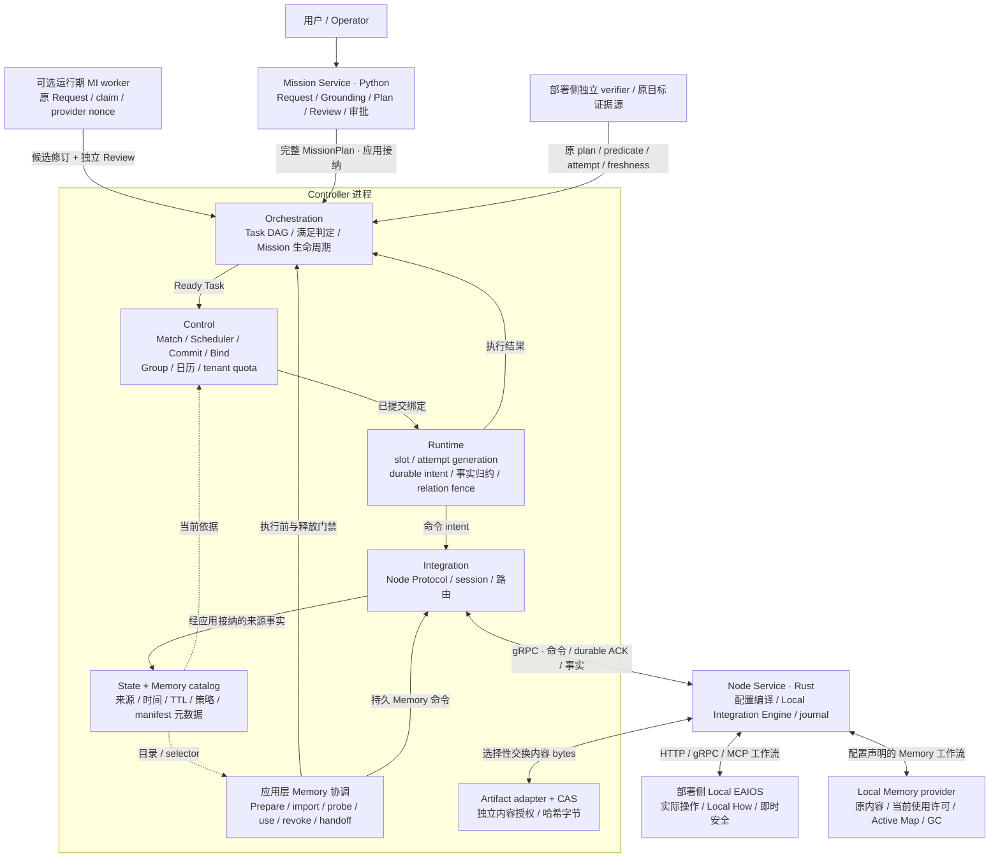

# RoboGuide

[原 Controller 内容入口](docs/development/acceptance/2026-10-23-owned-controller-content-ingress.md)
正在接显式 parent8：实际 Unix peer PID、原 spawn 日志、mTLS 和完整首次命令先于
Prepared 字节复制与同成员 metadata+bytes ACK。真实文件源使用正常 State 提交端口，
保留 SQL 回执丢失后的原 Unknown 和独立完整候选对账。它尚未替代 runnable Controller
composition；内容路由/readiness、完整 HA/恢复/升级与原全部整改继续实施。

[Prepared 内容作用域](docs/development/acceptance/2026-10-23-prepared-artifact-sources.md)
由 `core/artifact-store/src/prepared_source.rs` 维护：原 upload 实际 hash/fsync 后可在
最终 CAS 发布前供内部复制读取；原 guard/reader 独立撤销、退出并保留 writer/freeze。
真实 HTTP/SQL 回滚及进程 SIGKILL/reopen 验证原预算和 Unknown 不重做，公开 CAS 与
Memory use 权限保持。完整 owned child ingress、路由/readiness 和原 HA 矩阵继续实施。

[共识绑定的内容传输](docs/development/acceptance/2026-10-23-network-content-transport.md)
已接 core 的显式 v0.4/parent7：实际原 Artifact writer、mTLS Ready/有界字节流、
完整原候选与同一 voters 的 metadata+bytes ACK。独立进程用真实原 Controller/CAS
验证 leader SIGKILL 后多数读取及原 inode 重开。实现归属 `network_content.rs`、
`content_transport.rs` 与 `store_network.rs`；原 child/Prepared source、完整 joint/
catchup/恢复/升级/路由继续接线，runnable supervisor 的新内容模式仍封住。

[原有界内容流](docs/development/acceptance/2026-10-23-original-content-streams.md)由
`core/controller-replication/src/content_store/streams.rs` / `stream_writer.rs` 维护。
显式 SQL v4 在原持久意图/pin 后才读取实际源，完整 hash/fsync 后发布原回执，故障保留
Unknown；旧 producer/reader 原记录和 inode 经显式排空升级保持。实际进程/SQL 门禁
通过；网络 mTLS/Ready、原 child/Prepared source、同 voters metadata+bytes ACK 与完整
恢复/回收继续实施，生产内容 v0.4 尚未启用。

[共识成员内容身份](docs/development/acceptance/2026-10-23-consensus-member-content-identities.md)
由 `core/controller-replication/src/member.rs` 维护；完整 target 的 store owner 必须匹配
确切 committed member。旧缺省编码和摘要保持，旧 profile 拒绝隐藏新绑定。实际混合
mTLS binaries 的原 SQL 前进/回退通过；生产内容 v0.4 与完整在线接线继续实施。

[原内容主库显式接管](docs/development/replica-content-parent-adoption-v0.1.md)由
`controller-replica --content-maintenance` 与 `core/controller-replication/src/store_adoption.rs`
负责：实际 writers/native drain、原 child wait 和不可续意图先于当前责任接管。
pending/v6 日志缺失拒绝；旧业务行、legacy pins 和 Unknown 保留，不补造旧完成证据。
该入口不启用生产在线内容 quorum，完整迁移/恢复及其余非发布整改继续实施。

[ADR-0162](docs/decisions/0162-explicit-artifact-gc-sql-recovery.md) 增加显式本机 GC SQL
恢复：完整实际 writer/known consumer、原 digest、不可续意图及 forensic copy 先于
SQLite 原生 rollback，之后完整核对原记录。实现为
`apps/recovery-tool/roboguide_recovery/artifact_sql_recovery.py`；实际完整故障检查为
`tools/quality/check_artifact_sql_recovery_processes.py`。同证据目录只观察，未知旧操作
不会重做。该管理证据不授予应用、内容、GC 或设备权限，Artifact v5/原 SQL 合同保持。

[ADR-0161](docs/decisions/0161-controller-inode-writer-and-storage-generation.md) 将实际 Controller
的路径和 SQL inode 双租约绑定到最后一个真实连接，原生 SQLite 排空独立覆盖旧连接。
显式 `ROBOGUIDE_CONTROLLER_STORAGE_SCHEMA=1` 提供持久旧 writer fence，兼容 legacy
profile 不获取该代际声明。实现归属 `core/state/src/controller_storage.rs` 与
`apps/recovery-tool/roboguide_recovery/controller_storage.py`；实际完整门禁为
`tools/quality/check_controller_storage_processes.py`，恢复选择显式 v0.17。原数据、预算、
wrapper v52 和 Node 合同保留；不由本项推断在线 HA、设备连续性或全部整改完成。

[原内容生产者与中断对账](docs/development/acceptance/2026-10-23-original-content-producer-journal.md)
以显式 content SQL v3/parent storage v5 接通 Log/View/Snapshot 原日志、实际作用域、
独立原进程观察与 mandatory heads；39 个实际进程步骤通过。旧缺失历史仍 unavailable。
下一步继续真实 mTLS 同成员 bytes+metadata 多数、完整迁移/恢复与其余非发布整改。

原内容 Snapshot 已接实际存储生产者：原 candidate/完整 State 投影、log/view/Snapshot/
reader 独立保留，缺真实 bytes 或 stale Snapshot 拒绝发布/安装。实际 Controller
上传文件、独立接收 CAS、持有 Snapshot 的进程 SIGKILL/原 reader 退休及实际旧内容
二进制升级通过。该 gate 直接调用真实 Raft storage，未启动网络共识；生产 v0.3
仍不支持在线内容多数派。mTLS、同 voting 多数 ACK 与其余整改继续实施，见
[ADR-0159](docs/decisions/0159-original-content-quorum-and-raft-reference-lifecycle.md)。

正在按 [ADR-0159](docs/decisions/0159-original-content-quorum-and-raft-reference-lifecycle.md)
实现原 owner 内容多数派：新 member-local `core/controller-replication/src/content_store/`
先持久原 copy/reader intent 和独立引用，再读取实际 bytes；真实文件/SQL/inode/进程
证据保留 Unknown，读取句柄退出与 Snapshot 释放分别核对。当前部署 v0.3 仍只复制
元数据；新后端和同成员多数校验尚不代表在线 HA、设备停止或整体整改完成。

State 的原始恢复投影已接入原提交 writer 与 inactive 原子安装 API，保留原 Archive ID、
原零操作/Unknown 日志、完整 Catalog prefix 和 manifest/floor。旧 v2 安装入口遇到现代
checkpoint 会明确拒绝缺失投影。当前零 Node 三副本原版本流程实际复现了漏传 Archive
marker 的失败；完整投影的网络、Replica/Snapshot 与内容多数派接线正在继续实施。

恢复后未发布的原 provider Snapshot 可提交完整原/当前 profile，由实际全部 writer
排空后精确退休当前原记录；原 instance/request/generation pins 不变，沿用原 v0.1
receipt 和 SQL v4，历史源与 partial 保留，不复制或续期。实际 provider/CLI/SIGKILL/
双端 writer/SQL 故障/冷恢复通过，见 [ADR-0158](docs/decisions/0158-relocated-original-provider-snapshot-abort.md)
及[验收](docs/development/acceptance/2026-10-23-relocated-provider-snapshot.md)。

源 Artifact 已接通独立上传退休与离线引用回收：wrapper v52/codec v31 保留完整原
Completed receipt，显式 storage v5/recovery v0.16 在全部实际 writer 下核对已知
Catalog/lineage、上传、Memory/MI、Snapshot/Archive 和验证引用。原 intent/tombstone
先于 unlink，Unknown 原命令只观察；退休历史可不含已删 bytes。有效 MI policy 仍保留
声明，显式撤销和原目标/原 kernel 完成证明齐备后才解除。实现与实际文件/SQL/mTLS/
冷恢复见 [ADR-0157](docs/decisions/0157-source-artifact-retention-release-and-reclamation.md)
及[本轮验收](docs/development/acceptance/2026-10-23-source-artifact-reclamation.md)。
此离线入口拒绝 Replica/online 权威；Raft/在线生产者及其余完整整改继续实施。

旧未归属 Catalog 可经当前 tenant Artifact admin 显式接管保留责任：读取原 publication
digest 后提交精确原命令，实际 source envelope/metadata、CAS owner/bytes 与 typed parent
先核对，引用及完整 receipt 同一事务提交。历史 publisher/tenant 仍为 unknown，不增加
read/use/import 权限。wrapper v51 / codec v30 / [recovery v0.15](contracts/recovery/bundle-v0.15/README.md)
拒绝丢失 receipt 或改写原 source，见 [ADR-0156](docs/decisions/0156-explicit-original-legacy-catalog-adoption.md)。
真实旧 v50 producer、mTLS/SQL 回滚/重启/冷恢复已通过；其余源 GC、Raft/online 和完整整改继续实施。

私有接收 Archive 新增离线显式退休与 GC：全部原 writer、空的已知 consumer 清单、
唯一原 producer 和精确 compact receipt 先于保留决策 tombstone；终态 storage v4
拒绝旧 writer，独立原 GC intent/budget 先于 unlink。原 Unknown 重试只观察，新命令
可处理剩余 bytes，不改写先前结果。显式 [recovery v0.14](contracts/recovery/bundle-v0.14/README.md)
保留完整终态 history；这不是普通可写 v4 CAS。实际零 Node/CLI/文件门禁通过，见
[ADR-0155](docs/decisions/0155-private-archive-recipient-retirement-and-reclamation.md)。
源 Artifact 全引用 GC、其他生产者/旧 Catalog、Raft/online 和全部其余整改仍继续实施。

未发布 Archive 的显式 abort 已通过实际升级/文件/冷恢复验证：wrapper v50 / operations v0.2 保留原 copy
预算与历史，独立 cleanup intent 在真实 source/Archive writer fence 后先持久
tombstone，再以精确 SQL receipt 退休该 source pin。partial 与接收引用保留；已发布
归档拒绝 abort。见 [ADR-0154](docs/decisions/0154-original-unpublished-archive-abort.md)
和 [recovery v0.13](contracts/recovery/bundle-v0.13/README.md)。这只是软件 copier
隔离，不产生设备停止事实；归档退休/GC、在线及其余完整整改继续实施。

显式 Archive command v0.2 在原 SQL writer 内先记录原命令、
内容和预算，真实复制并验证后才压缩事件。wrapper v49 / Artifact storage v3 保存
原 Controller reference authority；recovery v0.12 / bundle v0.4 保留完整 Catalog、
source/target CAS、原引用和 mandatory 空目录。旧格式工具须拒绝，原命令只读对账
不重新复制或续期。见 [ADR-0152](docs/decisions/0152-original-archive-content-and-catalog-recovery.md)
及 [ADR-0153](docs/decisions/0153-artifact-reference-authority-inventory.md)。当前在执行
实际零 Node/文件/Catalog/冷恢复验收已通过；GC/Raft Snapshot/在线多数派及其余完整整改继续实施。

Artifact Snapshot 维护可显式选择 storage v2 / recovery v0.11：保留原 owner，复制前持久
原引用和预算；中断后原命令只允许查询对账，完整原发布验证后才退休。恢复保留原 active
intent，明确 abort 须持有所有原 writer 并保留 partial。见
[ADR-0151](docs/decisions/0151-original-artifact-maintenance-reference-journal.md)和
[恢复合同](contracts/recovery/bundle-v0.11/README.md)。Archive/在线多数派/GC 仍继续实施。

Node 输入以每 session 最多 8 条待完成事实接入已有应用批处理，保留原接收时间和等待期限，
按原顺序在持久提交后发送 ACK。拒绝、超时或失联保留原 route/Unknown 边界。见
[ADR-0150](docs/decisions/0150-bounded-node-application-pipeline.md)。

显式 retained Artifact 部署现在将真实 Catalog 发布、Group handoff 和 MI 修订 child
发布与原内容引用放在同一权威事务内。shared wrapper v48 / codec v29 保留实际 owner、
原 tenant/principal、完整 manifest/Spatial provenance 和各 child 独立的 parent lineage。
管理员精确退休须有原上下文/provider 撤权证明；重试和历史重放不能续期或重新激活。
[Recovery v0.10](contracts/recovery/bundle-v0.10/README.md)核对同一 bundle 的原引用与 CAS，
缺失内容拒绝发布。见 [ADR-0149](docs/decisions/0149-catalog-and-lineage-content-references.md)。
Archive/Raft Snapshot、在线内容复制和其余完整整改仍继续实施。

Controller Artifact CAS 可显式选择 storage v1：持久 backend identity、原目录 inode 迁移
intent、`objects-v1` 内容和旧路径文件 fence。旧 binary/backup 拒绝新格式；显式
recovery v0.9 保存原 owner/fence 和完整 bytes。`GET /v1/artifact-store` 是受限运维观察，
不授予内容权限或设备身份。实现与边界见
[ADR-0148](docs/decisions/0148-artifact-owner-identity-and-retained-layout.md)和
[恢复合同](contracts/recovery/bundle-v0.9/README.md)。Catalog/lineage/Archive 的引用接线
与在线 HA 仍继续实施，默认 legacy 部署保持原合同。

Snapshot 引用已有实际恢复工具生产者：显式启用 Memory SQL v4 / recovery profile v0.8，
在所有原 writer/inode 租约内先持久化原命令、内容集合、预算和引用，再复制真实 bytes。
发布结果须完整验证后才退休；中断保留引用，只读对账不重新复制。冷恢复不改写原 active
intent；显式 abort 只封住原同步复制并保留 partial 证据。操作与部署步骤见
[恢复工具](apps/recovery-tool/README.md)和
[ADR-0147](docs/decisions/0147-original-provider-snapshot-reference-lifecycle.md)。
默认仍为 v3，Node/Controller 合同不变；在线 HA 和全局引用覆盖继续按原计划实施。

原 Memory import 现在由实际 journal 在读取文件前的同一 SQL 事务生成本地 Replica 引用；
重启保留 Unknown，不重新激活已退休引用。原 provider 的不可逆 revoke 是退休前提，
其它 worker/map 引用继续独立阻止回收。实现为
[`replica_references.py`](integrations/memory-provider/roboguide_memory_provider/replica_references.py)，
权威边界见 [ADR-0146](docs/decisions/0146-original-import-replica-reference-producer.md)。
这只是完整 Memory 引用整改的一项生产者，不代表跨 owner、在线 HA 或整体整改完成。

[原 Controller 子进程排空](docs/decisions/0138-original-controller-child-drain-before-transfer.md)
将原 spawn、实际 PID/内核身份和原 supervisor 的 wait 写入独立日志。Transfer 先封住源
应用，确认原退出后才发送 V3 选举请求；排队消耗原接收预算，重启不替换未对账进程。
Replica storage v3 / recovery v0.7 保护这些证明；它们不代表机器人已停止。

[关系异常目标覆盖](docs/decisions/0137-terminal-relation-target-stop-coverage.md)保留原
Task/Role：本地 Completed 而缺少 relation proof 的目标，仍需独立 stop/hold 门禁。
全组 peers 复用既有停止 authority；不会从本地终态推导设备安全。

[成员本地 leader transfer](docs/decisions/0136-member-local-leader-transfer-evidence.md)
按原 ID 保留历史；丢失回包保持 Unknown，不重复选举。完成要求目标独立 quorum 与源的
认证只读观察，Raft snapshot 不携带本地 hold。Replica storage v2 / recovery v0.6 保护
新语义；原 v0.5 仍只接收 v1。完整 source-child 排空和在线 HA 继续验证。

[Replica 原数据升级与恢复校验](docs/development/acceptance/2026-10-21-replica-upgrade-quiescence.md)
在旧 SQLite 连接仍活跃时拒绝迁移，排空后保留原 identity；实际 inode lease 与只读旧表
屏障阻止双 writer。显式 recovery v0.5 在备份、验证、恢复时检查格式，摘要正确也不能
恢复损坏的 writer 合同。完整 leader transfer 排空、在线内容与跨故障域恢复继续实施。

[可执行部署 profile](tools/deployment/README.md)将进程共址、主机/控制域、原 binary/配置、
持久化 owner、TLS/协议声明与故障/退出矩阵作为显式输入；实际零 Node 服务门禁检查摘要、
inode 和四次只读探测。声明、观察、待验硬件及 RTO/RPO 目标分别保留，不自动宣告部署或整改完成。

[运行期 MI 与 scoped Memory 整链](docs/development/acceptance/2026-10-21-runtime-mi-scoped-memory.md)
补齐显式 v0.9 provider DTO，并将真实原 Request、自动故障、原退出/撤权、非空 child
许可、持久 MI 调用、独立 Review 和正常新组 import/use/原目标验证连通。默认仍为 v0.8，
跨合同输出拒绝；协议 fixture 不构成模型质量或设备证明。

[Memory writer 与完整恢复](docs/development/acceptance/2026-10-21-memory-provider-writer-recovery.md)
补齐参考 provider 的四类实际 SQL inode 租约：关闭主 Store 后，最后一个子连接关闭才释放
writer；旧数据先排空原 SQLite 连接再升级，原 instance 与预算不变。显式 recovery v0.4
冻结相同租约，恢复完整 SQL 和内容；这些存储事实不证明设备停止或整体整改完成。

[原属组 Memory 计划修订](docs/development/runtime-plan-revision-v0.1.md)
在候选和 Review 前冻结完整 child；原停止、撤权和 CAS 核验通过后，由 Control 创建新组，
每个 Task 重新导入并取得当前使用许可。共享 wrapper v45 保留原历史，软件证明不升级为设备事实。

[文件进程与接收身份验收](docs/development/acceptance/2026-10-20-file-process-memory-ownership.md)
接通实际 Local Memory 子进程的独立退出证明、崩溃后的 Unknown/GC fence，以及后续 Task
自己的 import 身份。原使用授权与停止门禁保持必需，软件退出不证明设备停止。

[运行期 MI 自动发现](docs/development/acceptance/2026-10-20-runtime-mi-discovery.md)按实际
证书主体和 tenant 读取当前原任务，再查回原 Request；部署不必预填未来 Mission 的 ID。
发现后仍经过原 claim/nonce、Review 和停止/撤销门禁。

[运行期 MI 完整恢复](docs/development/acceptance/2026-10-20-runtime-mi-recovery.md)将新 worker
纳入实际 writer 冻结，完整恢复原调用/nonce/预算与独立观察；活动 worker、硬链接别名和
旧工具均拒绝。该恢复不启动服务，不把数据可读当作执行连续性。

[运行期计划修订与原目标验证](docs/development/runtime-plan-revision-v0.1.md)保留原计划、
已满足事实和历史，完整停止/撤销门禁后重新交由 Control 绑定；当前 Task 全完成仍须独立
确认原 Mission 目标。普通 resume 不能绕过待完成修订，取消与重启保留原证据和预算。
[显式运行期 MI 工作](docs/development/runtime-mission-intelligence-v0.2.md)增加故障生成票据、
原 SQL worker claim、逐 phase 调用许可、原始回包、重启与只读对账；较早数据库不能
重新调用 provider。独立 Review、完整 stop/revoke、Control 和原目标 gate 保持必需。
scoped Memory 修订交接和其余全部非发布整改继续实施。

Operator HTTP 现有 TLS 前连接预算、完整请求 worker handoff 与 response I/O 期限，
真实权限仍在原 writer 下复核；慢 SQL 期间已提交健康读取可用。部署与失败语义见
[Operator 网络边界](docs/development/operator-network-bounds-v0.1.md)。

主动观测 Local EAIOS 的执行与诊断边界见
[`bounded-observation-and-evidence-closure`](docs/extensions/bounded-observation-and-evidence-closure.md)：
显式、有界的视角扫描复用真实底盘接口；检测缓存、语义像素及官方结果独立留证，不以本地
技能完成替代 Mission satisfaction 或 benchmark success。
Local How v0.14 还将自身真实旋转与扫描计时结束分开反馈，未转动和不可观测保持不同结果，
不修改原始碰撞、足迹或 NavMesh 约束。
Local How v0.15 在真实静止扫描后，允许下一次模型自主选择的同目标导航进行有界观测点搜索；
沿用原始路线、足迹和采集预算，候选不可用时明确失败，不把几何预测当成检测或官方成功。
Local How v0.16 还核对部署声明与实际固定相机光学参数，在有界局部网格中同时检查
取景必要条件、原路线与足迹；未声明能力保持未知，联合终态仍由官方 verifier 独立判断。

RoboGuide 是一套面向异构具身智能体协作的通用分布式具身智能操作系统架构。

[副本传输容量](docs/development/replica-transport-bounds-v0.1.md)在 TLS 前限制实际入站
handler，异步收发使用原成员共享的小帧/大帧容量；拒绝不排队，取消不否认已提交副作用。
本地部署容量和只读指标不改变集群/应用权限，也不替代完整在线 HA 或 OS/RSS 强制限额。

[网络 worker 与重复 leader transfer 修复](docs/development/acceptance/2026-10-20-worker-and-transfer-liveness.md)
让完整 timer/Node/Artifact 同步事务归还异步 worker；transfer 临时停用的 heartbeat/election
在成功、错误和取消后恢复。旧源码的三项反例与新单 worker 的真实文件/监控/三副本恢复
证据均保留。完整 F5/F10 及其余整改仍继续，不从短期软件路径推断设备或长期 SLO。

[完整副本静止恢复](docs/development/acceptance/2026-10-20-replica-cold-recovery.md)覆盖
实际 supervisor/Raft/child/Artifact writer、原日志投票和完整 SQL。显式 v0.2 同集群 CAS
集合恢复已核验内容，三个真实 endpoint 接续原 receipt；旧工具拒绝新 profile。
在线跨主机复制、受控升级和已观察到的间歇 HTTP 中断仍继续处理。

[副本证书生命周期](docs/development/replica-certificate-rotation-v0.1.md)以显式 v0.3 profile
持久化同一成员的 Stage/Retire/Abort，实际 TLS 证明后撤销旧 leaf，并支持部署 CA 根迁移。
换证不重置应用预算或 epoch；排队请求取得 writer 后复核实际证书，丢失新 key 不锁死
后续轮换。旧数据升级与完整 HA/CAS 恢复仍按非发布整改计划继续实施。

[运行指标与告警](docs/development/observability-v0.1.md)已接入有界 histogram/queue/drop、
stop/recovery 信号与真实 Prometheus/Alertmanager。专用 metrics-reader 只能抓取运行指标；
该监控切片引入 wrapper v42；当前共享 wrapper 为 v47，Mission 授权 v0.2，Node journal v13。新权限具备旧 writer/
降级门禁；采集缺失不算健康，短期软件通知验证不声明长期 SLO 或设备安全。

[Controller 故障恢复入口](docs/development/controller-write-recovery-v0.1.md)在实际持久化
失败后封住写入与 Node durable ACK，保留最后提交查询；全局 recovery-admin 的原
process/generation/checkpoint/revision 探针 Commit 成功后才能继续。复制不确定性仍经
受控重放；恢复回执不解除设备安全或原执行预算门禁。

原 provider 的[内容回收合同](contracts/memory/content-reclamation-v0.1/README.md)现核对实际
原 import/revoke、worker 与 Active Map 引用，先持久 tombstone，再删除并对账；调用方布尔
声明不授予 GC 权限。[恢复工具](apps/recovery-tool/README.md)在全部原 writer 退出后备份
完整 SQL 与实际内容，校验后恢复到新目录。Node journal 当前为 v13，原唯一 writer 在
任何 recovery 前取得锁；Node Contract 保持 v0.12，共享 wrapper 后续升级见上文。全局 Memory/HA
数据面及后续完整整改仍按原计划验收。

[恢复包活动引用门禁](docs/development/acceptance/2026-10-21-recovery-active-content-reference.md)
进一步核对已存活动 Memory/Active Map/pending-handoff 引用与同包 CAS；缺字节、tombstone
冲突或必要引用表丢失时拒绝发布或恢复。released 历史保留且不要求已删除字节，原预算不续期。

2026-10-20 的[分支同步与剩余整改核对](docs/development/roboguide-integration-status-2026-10-20.md)
记录所有远程分支与尚未关闭的非发布工作。整改、MI 校验和执行故障闭环按
[ADR-0111](docs/decisions/0111-branch-integration-and-authority-version-fences.md)组合：
Node Contract v0.12/config v0.13/catalog v0.15、wrapper v41/journal v12；Memory 准备与原执行
代次保持一致。SoftwareProcess 证据仍不证明设备停止，完整 F4 与 F5–F10 继续实施。

当前架构 source of truth 是 [`docs/architecture/v2/README.md`](docs/architecture/v2/README.md) 及其引用的已接受 ADR。它们记录当前实现对应的职责、协议语义、关键闭环和架构约束；原始 [`RoboGuide_Architecture_Baseline_V2.docx`](docs/architecture/v2/RoboGuide_Architecture_Baseline_V2.docx) 仅保留为最初 V2 基线快照，可能落后于后续演进。V1.1 作为历史基线保留。

全部非发布软件整改正在按[实施计划](docs/development/roboguide-software-completion-plan-2026-10-15.md)执行。
Group Memory 交接由 [ADR-0108](docs/decisions/0108-durable-group-memory-handoff.md) 定义：
原两端成员/attempt/策略/期限持久化；完整停止与原内容撤销齐全后提交带 lineage 的新 scope，
原接收方真实 import/probe 与显式 commit 后才 Execute。wrapper v40/codec v27 保护该权威。
软件线程退出只证明声明的 SoftwareProcess；完整 F4 和 F5–F10 仍有独立验收要求。

当前停止链路冻结 operation-owned State export、当前 attempt/session、receipt、TTL、confidence 和
deadline；Mission hold 与释放/继续门禁保留未确认所有权，旧停止记录不会自动升级为确认。
Mission HTTP 命令与 Request 进展原子关联，提供观察与中断恢复入口，不重复原命令。
Node 生命周期、稳定证书主体、租户匹配/承诺/恢复门禁和原生签名测量校验已接入当前软件，
参见[身份合同](docs/development/identity-lifecycle-v0.1.md)及[F2 验收](docs/development/acceptance/2026-10-15-f2.md)。
当前实现拓扑与证据边界见[实现拓扑](docs/architecture/v2/implementation-topology.md)。
软件测试不构成设备停止、硬实时或机器人执行连续性的证据。

Memory 撤销部分失败的独立只读恢复由
[ADR-0107](docs/decisions/0107-original-revoke-observation-and-provider-progress.md) 定义：
逐 provider 原证明、单一有界观察会话、追加证据及原作用域 release gate。原 Unknown
和预算保持不变，观察不重发副作用。wrapper v39 / Node journal v11 保护此合同。

## 当前总体架构

以下 Mermaid 依据 2026-10-22 主线代码重画。[完整架构图与代码依据](docs/architecture/v2/current-architecture.md)
分别说明执行闭环、进程/存储部署，以及 Habitat / Eval Harness 接入。

<!-- architecture-overview:start -->

<!-- architecture-overview:end -->

[V2 语义基线](docs/architecture/v2/README.md)与已接受 ADR 保持权威。
[原 V2 PNG](docs/images/roboguide-v2-overall-architecture.png)和 DOCX 作为历史概念快照保留。

State/MI 的当前整改见 [ADR-0104](docs/decisions/0104-state-consumers-belief-and-semantic-verifier.md) 与
[F3 验收](docs/development/acceptance/2026-10-15-f3.md)：显式来源策略进入 Control、Belief 保留原始
证据与 TTL、通用 verifier 独立于本地完成、MI provenance 与 Request 同事务持久化。POSIX 文件
计算已通过正式 Node/CAS/独立复算与重启验收；整体 Memory/HA/资源/协调/Federation 仍在实施。

Memory 的原实例查询、导入中断对账和日志回退保护已有当前软件切片，见
[验收记录](docs/development/acceptance/2026-10-15-f4-memory-continuity.md)。进程验收使用实际文件
复制、SQL 故障、正式协议与独立复算。当前还接入了 Control 内容策略、成员 generation、
Artifact 稳定证书主体和实际 bytes 上传归属门禁，见
[内容授权合同](contracts/memory/authorization-v0.1/README.md)及
[内容门禁验收](docs/development/acceptance/2026-10-15-f4-content-authority.md)。
[执行前准备合同](contracts/memory/preparation-v0.1/README.md) 已接入当前 Control/Runtime/Node：
先持久 Prepare、原导入/只读对账和当前 bytes observation，再发送带精确上下文的 Execute；
撤销 ACK、原始 boot/monotonic 预算、整组 pending barrier 与重启 fence 均保留独立证据。
[两软件节点验收](docs/development/acceptance/2026-10-15-f4-memory-preparation.md)使用真实文件、
SQL 失败、TLS、CPU 计算和独立验证。完整 Group lifetime/handoff、地图语义消费与 active-map/GC
及后续阶段仍须完成。
[typed-map 字节副本验收](docs/development/acceptance/2026-10-15-f4-typed-memory-replicas.md)
另验证真实地图生成→另一 Node 准备/导入/计算→独立验证与消费后重启。原 Spatial manifest
保持唯一权威，字节 placement 与地图激活/定位证据分开，wrapper v36 / codec v25 拒绝旧 writer。
Operator 修改请求现在在实际事务写锁内复核证书和当前委托，见
[排队撤权验收](docs/development/acceptance/2026-10-15-f4-operator-transactions.md)。

[多 Node Memory 生命周期切片](docs/development/acceptance/2026-10-19-f4-memory-group-lifecycle.md)
将本地 completion、Task 释放与整组取消/失败分开：正常 Task 等待自己的 context/provider
撤销确认，活跃兄弟 Task 保留许可；整组终结等待全部原参与方。执行前每次发送重新检查
整组 Memory permit 的原到期时间。Controller/supervisor wrapper v38 拒绝旧 writer；软件
进程与文件证据不证明设备停止或完整 F4 已完成。

独立 [Spatial file provider](integrations/spatial-provider/README.md) 已实现真实 PLY/PCD 的
FPFH/RANSAC、ICP、pose-graph、观测点分块融合和不可变增量 revision。
[文件验收](docs/development/acceptance/2026-10-15-f4-spatial-files.md)包含独立坐标真值、单位转换、
回环及失败检查；没有创建设备。当前还实现了单独的 Occupancy SE(2) profile，以及绑定原
host monotonic deadline 的预算门禁，见[后续文件验收](docs/development/acceptance/2026-10-15-f4-planar-and-clock-budget.md)。
私有 Unix Local How、正式 Node workflow/CAS publication、独立文件验证与无重复计算重启链路
已通过实际软件进程验收，见[Node/Spatial 验收](docs/development/acceptance/2026-10-15-f4-spatial-node.md)。
原记录为显式 loopback 兼容配置。后续 [producer 权威验收](docs/development/acceptance/2026-10-15-f4-map-provider-authority.md)
通过实际 mTLS、原始 dispatch/provider 快照及旧二进制拒绝检查；没有设备参与。
完整 Group lifetime、地图语义消费与 active-map/GC 和其余阶段继续实施。
[内容策略 v0.2](contracts/memory/authorization-v0.2/README.md) 另绑定完整 typed-map metadata，
通用 projection 不能绕过来源；wrapper v34 保留显式升级 history 并拒绝旧 Controller 写入。

## 系统目标

RoboGuide 统一感知系统状态、物理世界状态和具身能力状态，并联合调度 Capability、Compute、Space、Time，使机器人、感知设备、交互终端、边缘算力和基础设施节点能够持续完成复杂现实任务。

它不是单纯的多机器人 Scheduler，也不以中央控制替代节点本地自治。RoboGuide 持续管理资源抽象、状态、任务与执行生命周期、跨节点协调以及故障恢复。

State & Memory Plane 中，Memory Scope（语义消费边界）、Visibility（发现/交换策略）与
Placement（Node/provider 本地副本证据）彼此独立；例如 `Local + Discoverable` 允许共享目录发现，
但不允许跨 Node 消费内容。Artifact 引用只标识不可变 bytes，不代表本地 provider 已导入。

### 前期 MVP

MVP 方向是以普通多机异构任务验证领域无关的最小闭环：

- 节点发现、身份、Capability 声明、状态与健康更新；
- Mission、Task Graph 和 Execution Requirements；
- Capability Matching 与 Capability × Compute × Space × Time 联合调度；
- Assignment Proposal、共享资源协调与 Commit；
- Execution Group 创建、绑定、执行和释放；
- Observation、Shared Belief、Reconciliation 与分级恢复。

导盲是后续应用场景，不是核心架构或 MVP 的前置假设。该方向已经明确，
但具体 Mission、节点拓扑、故障矩阵、指标和退出条件尚未冻结。完整阶段边界
见 [`docs/project-goals-and-mvp.md`](docs/project-goals-and-mvp.md)，当前决策状态
见 [`docs/mvp-definition.md`](docs/mvp-definition.md)。

历史首个实现切片采用测试配置：Node A 执行运输与算力角色，Node B 作为运输替代节点，
Edge 提供共享算力；A 故障后保留 Execution Group 上下文，只重绑定失败角色并
继续执行。完整 MVP 仍未冻结。

## 开发基线与首个 Bootstrap

开发基线仍以 MVP Definition Draft 为约束，但首个可运行的 Rust core bootstrap
已经开始。它用于验证领域模型、端口、控制、运行时和确定性故障恢复的边界，
尚不代表完整 MVP 已经冻结或最终运行时已经完成：

- ADR-0001 提议由 Rust 负责 Domain、Control、Runtime 和 State 等长期核心；
- Python 承载 Mission Intelligence、模型、仿真和研究型 Adapter；
- 当前 `mission/` 已提供文本 Mission Request 澄清闭环、source-aware Mission Grounding View、resolved GroundedIntent handoff、
  确定性 Fixture Planner 和可配置的 Responses Interpreter/Planner/Reviewer/Repairer；Mission
  Request v0.4 持久化结构化 Dialogue、immutable Grounding snapshot 和独立 Review history，并将 repair、重新 clarification 与
  不可修复 reject 分流；Interpreter 不读取 live Node inventory，当前无 provider 不再使合法
  Mission 被 Mission Intelligence 拒绝；
- `contracts/capability/v0.3/` 提供 deployment-independent Canonical Capability Catalog；Planner
  与 Reviewer 获得同一 capability/operation 词汇表，确定性 admission 拒绝 unknown identity、
  未知/缺失参数、约束属性和类型不匹配，但 Catalog membership 不代表当前存在 provider；
- Mission 输出默认使用 `contracts/mission/v0.8/`，显式 v0.9 支持 Memory 前提；v0.2-v0.7 保持兼容输入；Mission
  Actor、ContextRole 与 TaskRole 已正规化，每个 TaskRole 可声明多个 exact Capability requirements、
  Resource requirements 与独立 semantic `ExecutionIntent`；每个 Task 显式声明 expected effect 及
  `execution-report` 或 `verifier-evidence` satisfaction policy；
- Planner/Reviewer/Repairer 共用 `config/mission.toml` 中显式的 satisfaction policy；其 ref/digest
  随模型输入保留，生成的 verifier receive-age bound 必须匹配配置。当前五秒窗口是系统接受
  策略，不是模型猜测、Task duration 或物理真值保证。可选的 deployment-owned terminal verifier
  ingress 只接纳启动时冻结的 source、精确 Task predicate 和当前物理 attempt；无证据时拒绝
  verifier-backed 计划，见 [ADR-0039](docs/decisions/0039-mission-satisfaction-freshness-policy.md)
  与 [ADR-0048](docs/decisions/0048-deployment-task-verifier-ingress.md)；
- B1 shared-world runner 默认使用 `scenarios/e1-shared-world-episode-51/mission-config-b1.toml`
  的显式权威终态确认策略：MI 的每个 DAG 末端 Task 必须绑定完整冻结目标的 verifier
  contract/predicate。普通 `config/mission.toml` 保留原有可选 basis；此策略不改变
  MissionPlan、节点选择或 Habitat 官方判定，见
  [ADR-0049](docs/decisions/0049-authoritative-goal-satisfaction-policy.md)；
- B1 自动归档另外生成可选的终态几何诊断，分别记录 Habitat 官方 `pddl_success`、按同一
  阈值重建的三维 `any_at` 和忽略高度后的 X/Z 反事实结果；诊断缺失或与官方终态矛盾时
  标记 unavailable，绝不改变 benchmark success 或 Formal admission。见
  [Eval Harness](evaluation/README.md)；
- 当前实现从模块化单体和确定性 Fake Nodes 起步；
- `core/state` 已实现 Shared Node State、Allocation State v0.1、source-aware State record、
  通用/Spatial Memory catalog 和 SQLite WAL evidence envelope；Control 通过
  transport-neutral Port 读取节点注册、能力、资源和最新健康事实；
- 核心 Rust 包按职责位于 `core/`，Mission 编排位于 `core/orchestration/`，可运行组合入口位于
  `apps/controller/` 和 `apps/integration-server/`；
- 可选 `core/controller-replication/` 与 `apps/controller-replica/` 提供静态三成员 quorum
  持久化和独立 supervisor；loopback 保留开发兼容，非 loopback member 必须使用双向 mTLS。
  切换重建 metadata，保留 Unknown/ownership 且不重放 Execute。默认 standalone；Artifact/Memory
  内容不复制。软件部署边界见 [ADR-0083](docs/decisions/0083-quorum-controller-replication.md)
  和 [ADR-0091](docs/decisions/0091-cross-host-replica-mtls-and-recovery-view.md)。复查修订
  [ADR-0092](docs/decisions/0092-reliability-review-authority-and-archive-fences.md) 增加 exact-member
  证书绑定、mutation 鉴权、breaker checkpoint/window 闸门与安全归档限制。
- `core/artifact-store` 提供独立 filesystem artifact CAS infrastructure；`apps/real-node-smoke`
  默认 probe formal Node Protocol v0.4，显式 `--simulate-execute` 经 Controller synthetic
  Mission 触发正式 dispatch 后只发送合成生命周期事实；
- Python 工具链由 `uv` 和项目级 `pyproject.toml` 管理；
- 目标目录、依赖方向和首个异构任务闭环见
  [`docs/development/README.md`](docs/development/README.md)；
- 每个 Rust `fn` 和 Python `def/async def` 都必须有有效文档注释，完整规则见
  [`docs/development/coding-standards.md`](docs/development/coding-standards.md)；
- Rust/Python 职责边界提案由
  [`ADR-0001`](docs/decisions/0001-rust-core-python-edges.md) 记录，当前状态为
  `Proposed`。
- DEAIOS 与本地 EAIOS/厂商运行时的语义边界由
  [`ADR-0002`](docs/decisions/0002-deaios-node-contract.md) 记录，当前状态为
  `Proposed for MVP Slice v0.1`。
- 通用异构 EAIOS 接入、canonical capability contract 与 Local Skill 映射由
  [`ADR-0006`](docs/decisions/0006-heterogeneous-eaios-integration-contract.md) 记录。
- 当前 transport / Local Integration Engine ownership 与设备扩展 conformance 由
  [`ADR-0021`](docs/decisions/0021-device-extension-boundary-conformance.md) 记录；旧 HTTP
  adapter 退役和 Artifact Store 隔离由
  [`ADR-0022`](docs/decisions/0022-retire-legacy-adapters-and-isolate-artifact-store.md) 记录。
- Node Protocol `Registered`/`Ack` 只在 Controller authority 与 durable checkpoint 接受事实后
  返回，见 [`ADR-0023`](docs/decisions/0023-application-accepted-node-protocol-facts.md)。
- Capability profile、semantic ExecutionIntent 与显式版本兼容边界见
  [`ADR-0035`](docs/decisions/0035-node-semantic-profile-and-intent-boundary.md)。
- Control-visible Operation Support 与 integrated operation provider baseline 见
  [`ADR-0036`](docs/decisions/0036-operation-support-and-integrated-capability-baseline.md)。
- source-aware State federation 与 selective Memory ownership/exchange 见
  [`ADR-0024`](docs/decisions/0024-federated-state-and-selective-memory.md)；node-config/v0.6
  provider backend、discover/export/import workflow 与 scope 边界见
  [`ADR-0025`](docs/decisions/0025-memory-provider-backend-and-workflow.md)。
- durable command outbox、两阶段 Mission cancellation、physical attempt history、Control-owned
  recovery composition 与 application timer 见
  [`ADR-0028`](docs/decisions/0028-durable-command-recovery-and-attempts.md)；离线故障证据见
  [`runtime-reliability-fault-matrix.md`](docs/development/runtime-reliability-fault-matrix.md)。

完整 MVP 切片仍需单独冻结。后续目录按首次真实实现按需创建，不提交空目录，
不允许绕过已接受的模块边界。

## V2 逻辑结构

### Mission / Application

外部用户、Agent 或 Application 提供 Mission / Goal，但不直接操作具体设备。

### Mission Intelligence

配置 execution-planning evidence 的部署在每个生成/恢复草案上调用 Controller 只读
`POST /v1/missions/validate-plan`，绑定实际计划与冻结来源；已知合同冲突进入现有有界
草案恢复，接口不可用或来源不匹配保留系统失败。前检不做资源承诺，也不证明物理可达。
普通顺序复用与终态 verifier 持有资源使用各自的声明规则，见
[ADR-0109](docs/decisions/0109-published-plan-validation-and-bounded-draft-recovery.md)。
执行声明及只读回复 v0.2 将支持的协作模式、DAG 与 Actor 生命周期显式绑定到冻结来源，
以具体 code/path 区分模式、能力和资源冲突；旧 v0.1 缺失字段不被推断为新能力。
字段与共享合成回归见[发布的执行拓扑合同](contracts/mission/execution-planning-v0.2/README.md)。

负责 Mission Understanding、Clarification、Task Planning、Task Graph 和 Execution
Requirements，回答 `What needs to be achieved?`。外部用户只提交文本 instruction；仅当存在
阻止 Mission semantic commitment 的 open questions 时停在 `NeedsClarification`，不会创建
Execution Group。合理且不改变核心目标或 Task Graph 的解释进入 `assumptions`；provider、Node、
Resource、placement/readiness 属于 Control，路径、姿态、速度和硬件动作属于 Local EAIOS，均不
成为用户 clarification。无 blocking 歧义并通过
计划审查与部署风险策略后，Mission Intelligence 把完整 MissionPlan 交给 Orchestration。
Interpreter 不消费 live Node/Resource inventory；Plan Accepted 只表示语义和合同可进入系统
生命周期，不表示当前部署一定可调度。当前 provider、health、readiness 与资源证据只由
Control Matching/Scheduling/Commit 使用。实现可以使用 LLM、VLM、符号规划器或混合方法，
但不能直接进行跨节点资源绑定。该边界见
[`ADR-0018`](docs/decisions/0018-mission-intent-loop.md)、
[`ADR-0030`](docs/decisions/0030-mission-semantic-admission-and-deployability.md) 与
[`ADR-0038`](docs/decisions/0038-blocking-clarification-and-grounding-acquisition.md)。

Canonical Capability Catalog 回答“这个 contract 是否属于 RoboGuide 当前语义语言”；live
Inventory 与 Capability Matching 回答“当前谁能执行”。Mission Intelligence 在 Reviewer 前
确定性校验 Catalog identity、scalar parameters 和 typed capability constraints，但不读取当前
provider。当前 v0.3 Catalog 已区分 Capability、Operation 及其 direct provider-level baseline
requirements；integrated operation 不会把内部 Local How 展开为全局 requirements。它仍不
定义 embodiment taxonomy、结构化 entity schema 或动态 Catalog negotiation，见
[`ADR-0031`](docs/decisions/0031-canonical-capability-catalog.md) 与
[`ADR-0034`](docs/decisions/0034-mission-semantic-contract-normalization.md)。

部署可额外提供启动时冻结的抽象能力类别摘要和带 episode/dataset 身份的环境静态事实。
MI 在同一不可变 Grounding Context 中保留已知事实和未知缺口；尚未 reset 才能确定的机器人
起点不可推测。能力类别不代表当前可用 Node，只有任务与世界证据支持时才声明 Role 的
typed constraint，最终匹配和资源承诺仍由 Control 决定。见
[`ADR-0044`](docs/decisions/0044-deployment-planning-evidence.md)。
Planning Profile v0.2 还可发布 canonical operation 对中性状态域的读取/可能更改声明；
MI 将同一逻辑 Actor 的重叠状态访问作为 advisory 交给 Reviewer/Repairer，不据此拒绝计划、
推断官方谓词必然失效或选择物理实体。v0.1 仍按原义兼容读取。

Mission Review 不再隐藏在 Planner 调用内部。Reviewer 对 exact draft 返回结构化 issue，Mission
Request Engine 保存 revision/digest-bound review evidence；`RepairPlan` 最多自动修复两次，
`RequestClarification` 返回用户对话，`RejectDraft` 或 repair budget exhausted 才失败。Repairer
不能补写 GroundedIntent 中不存在的用户事实，见
[`ADR-0032`](docs/decisions/0032-mission-review-and-repair-loop.md)。Mission Request v0.3 使用带
speaker、kind、turn identity、reply identity 和 receive time 的 `DialogueTurn`；Planner draft、
Reviewer issue 与 Repair attempt 保留在独立、revision-bound 的内部 deliberation trace。成功的
Interpreter assessment 会在调用 Planner 前持久化，因此后续 provider failure 不会抹掉已完成的
objective、assumptions 或 open-questions evidence。Responses Planner/Repairer 使用内部
provider-only key/value entry DTO 满足 strict structured output；返回值先确定性还原为 canonical
parameter map，再通过原始 MissionPlan v0.7、implementation 和 Catalog 校验。该 DTO 不是新的
Mission wire contract。

Mission Grounding v0.1 从既有只读 State/Memory facade capture 一份 digest-bound snapshot，供
Interpreter、Planner、Reviewer 与 Repairer 在同一 deliberation cycle 共同使用。它只包含部署
明确批准为全 Mission 可消费 payload schema 的、带完整 source/freshness/provenance 的 World
State evidence，以及 Global Semantic/Experience/Spatial
Memory manifest metadata；Memory bytes 尚未读取。Node health/liveness、capability/resource
inventory、leases、reservations、calendar 和 Runtime attempts 不进入 LLM context。State/Memory
的可恢复 transport failure 会先经过配置有界 acquisition retry，最终失败才成为可审计 gap；gap
本身不是用户语义歧义，空 context 仍然合法。`World` object class 不等价于 visibility，schema
admission 默认 fail-closed，嵌套 evidence 不能绕过 digest 原地修改。evidence、diagnostic 与最终
snapshot bytes 均有独立上限；HTTP body 中断不会阻止另一 source 的 capture。每份 context 按 digest
不可变保存并可通过 Mission Request API 回查，且进入模型前必须匹配当前 Dialogue input。
clarification answer 才触发下一份 snapshot；多问题 answer 不携带 `question_id` 时保持未定向，
不会被错误绑定到最后一个问题。不同 Mission Request 的慢 Grounding/model 调用不再持有全局
生命周期锁。边界见 [`ADR-0037`](docs/decisions/0037-mission-grounding-context.md) 与
[`ADR-0038`](docs/decisions/0038-blocking-clarification-and-grounding-acquisition.md)。

### Control Plane

Control Plane 负责全局决策与协调：

1. `Capability Matching` 根据任务需求和 Shared System View 输出 Candidate Set；
2. `Embodied Scheduler` 联合考虑 Capability × Compute × Space × Time，输出 Assignment Proposal；
3. `Shared Resource Coordination` 处理竞争、Reservation、Negotiation 和 Commit，输出 Committed Plan；
4. `Execution Group Manager` 管理 Create、Bind、Activate、Adapt、Complete、Release 生命周期；
5. `Reconciliation & Recovery` 检测现实与计划偏差，并选择最小必要恢复层级。

当前下发前恢复流程使用 typed reason/action 与 digest-bound evidence，POST 前持久化
submission fence。提交结果不明时只核对原 Mission，不重复提交或改写计划；Controller
明确拒绝后可显式重交原稿。独立 observations v0.3 保持 Request v0.4 和 MissionPlan
不变；新增完整 HTTP body 绑定的权威接纳对账见 [ADR-0055](docs/decisions/0055-controller-admission-reconciliation.md)。
旧 status 查询或缺少原请求指纹时继续保留不确定性。操作进度通过已注册的只读 State export
区分工作、正常等待、阻塞及未知，只有明确提供的量度与策略才报告停滞，见
[ADR-0056](docs/decisions/0056-execution-progress-observation.md)。显式执行恢复先确认当前
实例真实停止，再由 Control 部分释放、重新匹配和 Commit/Rebind，生成新的执行实例。
次数与时间预算不因重启或重复命令重置；Actor 保持原权威绑定。见
[ADR-0057](docs/decisions/0057-confirmed-stop-role-recovery.md)。自动停滞恢复和执行期 MI
重规划仍未实现；没有 progress observer 的部署明确返回 Unknown。
Habitat 的可选导航 observer 已接入同一 State export（
[ADR-0058](docs/decisions/0058-local-navigation-progress-observer.md)），区分真实 wait 和
既定目标的几何进展。观测不授权停止或重试；shared-world 取消仍影响整个联合执行。
单 Role 恢复还要求部署明确声明独立停止和原上下文重执行能力，dispatch 冻结且当前
注册不变，见 [ADR-0059](docs/decisions/0059-deployment-stop-continuation-contract.md)。缺失或
耦合声明会在 Cancel 前拒绝；Control 和 outbox 继续检查后续动作。当前 Habitat 如实声明
默认联合停止、不支持中断后重试；正常双 endpoint 和单 Actor 顺序 Task 不受此限制。

部署侧 retained-world continuation 已依
[ADR-0060](docs/decisions/0060-retained-shared-world-continuation.md) 实现默认关闭的本地路径：
联合取消后的新 attempts 复用原世界、观察与剩余步数，已完成端不再次调用模型。
有界的精确 session/intent/new-attempt 检查与重启 fencing 属于 Local EAIOS。
[ADR-0061](docs/decisions/0061-confirmed-stop-group-continuation.md) 增加独立的整组恢复命令：
冻结全部 current attempts 与逐操作重复授权，取得完整实际停止证明后，由 Control 重新
验证原绑定、物理身份和资源承诺；暂停不释放资源，完整新 attempts 持久化后才下发。
初版只支持同一 Execution Session 的 independent 原绑定续跑，默认部署仍关闭。
原世界续跑已有单 Actor 的真实物理验证；多 Actor 联合物理停机与续跑仍未验证。
现有单 Role 恢复仍拒绝联合停止，不存在自动停滞重试。
生产 B1 启动脚本通过 `ROBOGUIDE_B1_RETAIN_STOPPED_SESSION=1` 显式启用，默认关闭。
仅派生运行目录中的恢复声明，冻结 Node 配置摘要，并在注册前核对 Adapter 实际只读
能力。实际 Controller/Node 进程的零 Provider/Simulator 检查入口为
`tools/quality/check_group_continuation_processes.py`；该入口的合成结果不构成物理实验成绩。

Scheduler 的 Proposal 不是已生效分配。只有协调成功并 Commit 后，资源占用才成为系统认可的有效承诺。

当前实现 **Control Plane — Embodied Scheduler v0.2: Bounded Joint Scheduling & Future
Reservations**。Capability Matching 先产生 exact Candidate Set 回答 `Who can`；无状态
`BoundedJointScheduler` 在固定搜索预算内联合选择所有 Role 的 Node、独占 Resource 与最早
可行时间区间，能够回溯稳定排序下的多 Role dead end。MissionPlan v0.5 以
`resources[].kind/units` 声明所选资源的最低 capacity，并以相对 durable Mission acceptance
的 `timing` 声明 start window、deadline 与 planning duration。

只有 DAG-Ready Task 进入 Scheduling。立即决策仍依次通过 Proposal、Commit、Bind；未来决策
由 Control calendar 持久化，应用 timer 到期后重新执行 Matching 和完整 authority validation。
`Scheduled/Activated/Invalidated` calendar record 不是第二份物理 reservation：实际 ownership
仍只由现有 Control reservations 在 Commit 后建立。运行超过 estimated end 时资源被视为
开放占用，冲突任务保持 Ready，不会抢占运行中的 Local EAIOS。Context-scoped binding 必须
精确复用原 Node/resource。所有 normal/recovery Commit 都会拒绝覆盖其他 Task 的 future
interval；scheduled Task 只允许在所属 Group 中以 exact decision Commit。decision 的最迟激活
同时受 latest-start 和 completion deadline 约束，未完整绑定或过期的 Task 不得 Activate。
过期 interval 可在窗口内重排，window-missed 则按 Task 持久化去重并保持 Ready。Normal 与
上层 policy 确认前不再进入自动 timer dispatch。Normal 与 Recovery 共用 calendar-aware 的
确定性 Role/resource primitive，但当前 future reservation 只用于 normal Ready Task。

Orchestration 通过 typed scheduling disposition 区分 deployment 不足、reconciliation、
invalid contract 与内部故障；应用不再按错误文本决定重试。跨 Task distinct Actor 的当前
实体基数不足会保留 Ready 与持久化 deferral，其他 Mission 继续，补充部署证据后可重试。
详见 [`ADR-0041`](docs/decisions/0041-core-scheduling-disposition.md)。
资源承诺入口还必须提供当前 State，逐项重验 selected ResourceId 的 Node/kind/capacity；
无 State 的 compatibility Commit 仅限零资源 proposal，见
[`ADR-0042`](docs/decisions/0042-resource-identity-revalidation.md)。
registry 防回滚 watermark 独立持久化，恢复仍需部署供给当前 topology；旧 physical-binding
checkpoint 缺 watermark 时拒绝自动迁移，见
[`ADR-0043`](docs/decisions/0043-registry-anti-rollback-provenance.md)。

本切片不声称 optimal，也未实现 divisible quota、priority/fairness、travel/traffic cost、
preemption、batching、auction、RL/LLM scheduling 或 multi-role joint recovery。完整决策见
[`ADR-0029`](docs/decisions/0029-bounded-joint-scheduling-and-future-reservations.md)。

当前实现 **Control Plane — Reconciliation & Recovery Slice v0.1: Assigned Node
Unavailability**：Control 将 Active Group 的当前 assignment 作为 desired execution
configuration，并通过 Shared Node State 检查 assigned node 是否仍满足与 Capability
Matching 相同的 eligibility policy。Assessment 只产生 `NoAction` 或
`RoleRecoveryNeed`，不会立即修改 Group。

```text
Observed node unavailable
  -> Recovery Need
  -> Blocked + partial role release
  -> role-scoped Recovery Candidate Set
  -> external bounded scheduler choice
  -> Recovery Assignment Proposal
  -> Resource Coordinate / Commit
  -> committed replacement rebind
  -> Adapted -> Active
```

Reconciler 不选择 replacement node，也不实现 Scheduler。Controller 通过
`BoundedJointScheduler` 在 role-scoped Candidate Set 上产生 selection，再通过
Control API 创建 proposal。Proposal 不写 reservation；Commit 阶段重新验证 node
eligibility、Role capability、resource ownership/conflict、TaskRef/Group/Role identity 和
failed binding，并原子建立 existing Group 的 replacement reservation；Rebind 只接受
`CommittedRecoveryAssignment`。没有 candidate、没有 proposal 或 commit conflict 都只
表示 `RecoveryPending`，不等于 recovery exhausted，不会自动进入 `Failed`。

该实现形成 **Recovery Reassignment Pipeline v0.2**：`Who can` 属于 role-scoped
Capability Matching，`Who should` 仍属于外部 Scheduler boundary，资源能否生效属于
Shared Resource Coordination/Commit，已经 committed 的协作变化才由 Execution Group
Manager Rebind。Proposal 不等于 Commit，Commit 也不等于 Group Binding。

**Recovery Commitment Lifecycle v0.3** 显式管理 committed-but-not-rebound ownership：

```text
Recovery Commit
  -> Control-owned Pending Recovery Commitment
     -> Consume through Rebind
     -> Abort and release replacement resources
```

Control 以 `(ExecutionGroupId, RoleId)` 保证同一 Role 至多一个 pending commitment；
`CommittedRecoveryAssignment` 只是 handle，真正 authority 是 Control pending collection
与唯一的 `reservations`。Rebind Consume 后删除 pending entry，但保留已经成为 active
binding 的 reservation；Abort 只释放本次 replacement resources，Group 保持 Blocked、
Role 保持 unbound。Terminal `release_group` 会交叉验证并清理 active bindings、pending
commitments 及所有指向该 Group 的 reservations，确保 Released Group 不再拥有资源。

Pending commitment 不是 Execution Group lifecycle state，也不写入 Shared Node State。
Abort 不表示 recovery exhausted；它允许后续重新 Match/Propose/Commit。

恢复进入 Blocked 前先验证精确 Task/Role、previous owner 和既有 release 合同；拒绝不留下
部分生命周期或事件变化。阶段性[所有权模型与可回放测试](docs/development/control-ownership-model.md)
覆盖同名 Role 的跨 Task 交错、合法 pending/Context/零资源状态及 malformed checkpoint。

本切片未实现 background reconciliation loop、跨 Node 的整组重匹配、
spatial/task-timeout recovery、Mission replanning、自动 Runtime re-execution 或 recovery
exhaustion policy。

### Heterogeneous EAIOS Integration Contract v0.3

`ExecutionIntent` 以独立 semantic objective、可扩展 `OperationRef(namespace, name, version)`
和稳定 scalar parameter map 表达 `What to execute`。它不使用 enum 固化 operation，也不携带
厂商 Skill、ROS action、SDK method 或 shell command。MissionPlan v0.7 将 intent 与每个
TaskRole 显式关联；Matching 与 Scheduler 不解析 intent，Runtime 只路由，节点侧声明式
Local Integration Engine 负责将 canonical What 映射为本地 HTTP、dynamic gRPC 或 MCP workflow。

正式 gRPC Node Protocol v0.4 支持一个 Node 聚合多个 Local System。Node Contract v0.6 起
通过 exact capability profiles 上报 readiness 与 typed feasibility attributes，通过独立
`OperationSupport` 声明 Node 可接收的 canonical operation，并通过 canonical invocation 原样传递
Operation、objective 和 scalar parameters。Capability profile 回答节点能够证明什么，operation
support 回答是否能接收 semantic invocation，operation binding 决定哪个本地 workflow 接收
intent；三者保持分层，后者存在于 Node config v0.7 及后续显式版本。所有 Capability、
Sensor、Resource、State export 和 Memory provider 都保留唯一 owner；Execute 携带 Control
已 Commit 的 resource IDs。它还承载带当前 session/management sequence 的 peer-channel
readiness evidence；实际 peer transport 和高频控制仍完全属于 Local EAIOS。
Node config v0.7 可用固定、只读、owner-qualified 的 observer 周期读取 Local EAIOS 已建立端点；
Local EAIOS 响应不能自行选择 `local_system_id` 或 TTL，采样失败由旧证据自然过期并 fence。
`execution_id` 绑定 invocation、workflow digest 和 resources，冲突或模糊 dispatch 不重放。
Execute/Cancel 还携带不可变 `command_id`；Node journal durable receipt 只证明命令已持久接受，
不替代有序 execution lifecycle fact。Controller 先 checkpoint intent 再发送，restart 后把非终态
physical attempt 保守恢复为 `Unknown` 并进入 reconciliation，而不是自动重放动作。

旧同步 HTTP NodeGateway、HTTP wire DTO 和早期 configured command backend 已全部退役；它们
不再是正式 Node Protocol 或生产节点执行路径。正式异步 lifecycle、配置驱动执行、SQLite
journal、heartbeat/lease 与 session fencing 由 `roboguide-node` 和 `core/integration`/
Integration Server 实现，Controller 组合 bridge 位于 `core/orchestration`。Artifact bytes 则
由独立的 `core/artifact-store` filesystem CAS 提供，不参与设备执行生命周期。
当前合同与版本关系见 [`contracts/node/v0.13/`](contracts/node/v0.13/README.md) 和
[`contracts/node/README.md`](contracts/node/README.md)。Node config v0.7 为每个 exact
canonical capability profile 提供固定 readiness observation 与 attributes，将 operation/workflow
mapping 独立声明，并保留选择性的 State export、Memory provider、固定 discover/export/import
workflow，以及可选的 peer-channel
readiness observer；通过完整 RegistrationUpdate
snapshot 更新后续 Matching 和 discovery。v0.5 provider 仍可作为 metadata-only 配置启动；
v0.2-v0.6 配置仍作为原 combined capability/workflow 兼容输入；
Node Protocol v0.2 endpoint 只返回明确迁移错误。

设备扩展的离线合同、真实配置样例和开发者路径见
[`docs/extensions/device-extension-conformance-v0.2.md`](docs/extensions/device-extension-conformance-v0.2.md)。
可在不启动 Controller 或 Local EAIOS 的情况下运行：

```bash
cargo run -p roboguide-node -- --validate \
  scenarios/extension-conformance-v0.1/node.toml
```

```bash
cargo run -p real-node-smoke -- --endpoint http://127.0.0.1:50051
cargo run -p real-node-smoke -- --endpoint http://127.0.0.1:50051 \
  --simulate-execute --control-endpoint http://127.0.0.1:8080
```

该 smoke 工具注册合成 Node、验证 Welcome/Registered/Heartbeat/Ack，并可在显式模拟模式
下向 Controller 提交 synthetic Mission，经真实 Match/Commit/Dispatch 验证服务器下发的
Execute 生命周期。模拟使用会话唯一的 capability contract，不会匹配已有同类 Node；它不调用
Local EAIOS，也不能替代真实设备测试。模拟等待 ACK 时只去重完全相同的 Execute 重投，
不再次生成执行事实；不同 command/session/payload 继续拒绝。

### Embodied Execution Group

Execution Group 是进入实际执行阶段后由 Control/Runtime 承载的 Mission-level 长期分布式执行上下文。v0.x 默认一个 Mission 创建一个 Group，Group 本体跨多个节点并承载多个 Task；该默认策略不禁止未来拆分多个 Group。

- `Members`：参与执行的 Robot、Perception、Interaction、Compute 或 Infrastructure Node；
- `Roles`：成员在当前任务中的职责；
- `Resource Bindings`：已提交的 Space、Compute、Device、Time 占用；
- `Shared Context`：仅当前 Group 需要的上下文；
- `TaskExecution`：每个 Task 在 Group 内独立经历 Ready → Active →
  AwaitingSatisfaction → Completed，或进入 Blocked/Failed；
- `Lifecycle`：Group Create → Bind → Active → Adapt → Mission Complete/Failed → Release。

`Blocked` 是等待 Reconciliation & Recovery 的非终态，不等于 Group 已失败或应被销毁。
单个 Task 被明确满足时才释放该 Task 的临时 binding 和 reservation；单个 Role/Member/Resource
Binding 失效时，Control 只 partial release 受影响 binding，保留 Group、其他 Task 和
有效 binding。恢复成功后经 `Adapted → Active` 继续执行。只有 Mission `Completed`，或
恢复明确耗尽后的 `Failed`，才能执行 whole-group `Release`。

Role 是 Task 内与具体 Node 解耦的职责槽位：Capability 是 Node 能否承担该 Role 的
依据，Assignment 指明当前承担者，Resource Binding 则记录已经提交的执行资源。
如果 Task 直接绑定 Node，节点故障通常需要重新规划整个 Task；通过 Role 间接绑定，
系统可以只替换失败 Role 的承担节点，同时保留其他已完成工作、有效 Binding 和
Execution Group 上下文。

Member 与 Resource Binding 必须区分：GPU Node 可以是 Member，GPU quota 是 Binding；走廊是 Spatial Binding，不是 Group Member。

### State & Memory Plane

State & Memory 是横向基础设施，不是 Control → State → Runtime 的线性中间层。Nodes 和 Runtime 持续写入 Observation、Evidence 与运行状态，Control Plane 读取 Shared System View，并写入 committed desired state 和 allocation state。

```text
Observe → Update → Fuse → Believe
```

Shared Belief 是带有 Source、Timestamp、Freshness、Uncertainty 和冲突信息的决策视图，不等于绝对 Ground Truth。Memory 按 Local、Execution Group、Global 三种作用域管理，不要求全部全局同步。

当前代码从 Shared Node State 起步，并已扩展为多个彼此分权的 slice：

```text
Runtime / Local EAIOS facade observation -> Shared Node State -> Control decision
```

`core/state` 使用确定性内存实现保存 Node identity、Local EAIOS/runtime descriptor、
Capability/Resource declaration、Local EAIOS 最近上报的 health，以及 RoboGuide 观察到的
liveness。State 保存“观测到了什么以及何时观测”，Control 仍根据 reported health、
freshness、liveness、lease 和 requirement 决定是否可参与 matching。

当前同时实现 **State & Runtime Integration — Slice v0.1: Node Observation
Ingestion**。`NodeGateway` 仍代表 Runtime/testkit 中的 legacy Local EAIOS / Vendor Runtime 边界；
Runtime 从 `NodeGateway.status()` 形成 transport-neutral `NodeHealthObservation`，通过
`SharedNodeStateWriter` 写入 State。成功读取 gateway 是 `Reachable` 证据；lease expiry
只更新为 `Unreachable`，不会把 Local EAIOS 最后上报的 health 篡改成 `Offline`。

该路径只让新的事实可被后续 Control decision 读取，不会自动触发 Block、partial
release、rebind 或其他 Reconciliation 行为。

当前进一步实现 **State & Runtime Integration — Slice v0.2: Observation Time
Semantics**。`NodeStatus.observed_at` 明确表示 Local EAIOS 的 source-local observation
time；`NodeHealthObservation.received_at` 表示 RoboGuide Runtime/Control 收到该事实的
本地时间。State 同时保留二者，但以 `received_at` 作为当前 bootstrap 的 health
observation 接纳顺序，Control TTL/freshness 也只比较 RoboGuide-local receive time。
Liveness observation 与 Lease 时间继续属于 RoboGuide-local 时间域。

该策略没有解决跨节点 clock synchronization 或 global event ordering。Source time
仅作为未来 provenance、offset estimation 和冲突推理的证据保留；NTP/PTP、clock
offset 和 distributed ordering 均延后。

当前同时实现 **State & Memory Plane — Allocation State v0.1**。Control 的
`reservations` 仍是 resource commitment 唯一 authority；`allocation_snapshot()` 将
authority 投影为完整 `AllocationViewSnapshot`，由独立 `InMemoryAllocationState` whole-view
replace。View 只表达：

- `Committed`：正常资源已 Commit，尚未 Bind，`group_id=None`；
- `Bound`：资源属于当前 Execution Group assignment；
- `RecoveryPending`：replacement 已 Commit 到 existing Group，但 Role 尚未 Rebind。

Projection refresh 独立发生，可以暂时滞后；State write 失败不回滚 Control Commit，State
内容也不能授予、拒绝或释放 reservation。Projection builder 会拒绝 orphan、重复或同时
Bound/RecoveryPending 的 Group reservation。Scheduler v0.2 读取 Control 直接提供的 immutable
calendar snapshot，不读取可能滞后的 Allocation View；Commit 仍重新检查 authority。该边界记录在
[`ADR-0005`](docs/decisions/0005-allocation-state-projection-authority.md)。

当前新增 **Source-aware State v0.1**。共同模型显式区分 `Node`、`World`、`RoboGuide`
对象，以及 `Desired`、`Committed`、`Reported`、`Observed`、`Derived`、`Belief` 语义；记录
保留 source、channel、payload schema、source-local time、RoboGuide receive time、TTL 和
可选 confidence。不同来源不会互相覆盖，State 不自动制造 Global Truth 或 Belief。

Controller 的 `/v1/state/providers` 与 `/v1/state/records` 是只读 federation：Desired 从
accepted MissionPlan 读取，Committed 从 Control 读取，Reported/Observed 从 Shared Node
State 和声明 channel 读取，Derived 从 Runtime/Orchestration projection 读取。这个统一视图
不改变原 authority，也不提供通用写接口。Node Config v0.6 通过固定、只读 workflow 周期采样
选择性 State；失败只让旧值自然变 stale，不改变 health/readiness 或自动触发 recovery。

当前同时实现 **Selective Memory Catalog v0.1**。Execution、Spatial、Semantic、Experience、
Artifact 五类 immutable Memory revision 都可以发布和发现；owner 保持在本地系统或明确的
RoboGuide component。Discoverable 可只暴露 metadata，Exchangeable 必须引用现有 Artifact
CAS 中通过 digest/size 校验的 bytes。Consumer 显式选择 revision 并记录
Staged/Imported/Rejected evidence；replica durable identity 保留 exact
`(MemorySelector, NodeId, ConsumerProviderId)`，同一 Node 的多个 Local EAIOS 不会互相覆盖。
系统不做全量复制或 P2P。合同见
[`contracts/state/v0.1`](contracts/state/v0.1/README.md)、
[`contracts/memory/v0.1`](contracts/memory/v0.1/README.md) 和
[`ADR-0024`](docs/decisions/0024-federated-state-and-selective-memory.md)。

这仍不是完整 State & Memory Plane。显式 State consumer policy、来源保守融合、独立 verifier、
持久 selective-import 与原 provider 查询已接入当前软件；Imported 历史不代表当前可用性。
完整 Group grant/revocation、执行前准备、active-map/GC、空间融合、完整历史重建与动态多
Controller 内容恢复仍按 F4–F10 实施。通用 Node Memory provider workflow、filesystem/JSONL
参考 backend 和显式 data-plane exchange 保持原职责；Node 不因 discovery 自动复制 Memory。

这里的 Local Memory Provider 是统一操作合同：配置的 HTTP/gRPC/MCP workflow 把调用交给真实
EAIOS，EAIOS 保留 Memory semantic 与 backend storage authority。Node 内部
`FilesystemMemoryLedger` 只保存用于幂等和发现的 immutable manifest，并由这些对象重建 JSONL
index；只有未配置相应 workflow 时，它才作为 reference backend fallback 保留 payload bytes。
`storage_directory` 因此不是 EAIOS 数据库或厂商存储路径。

当前新增 **State & Memory Plane — Distributed Spatial Memory v0.1**：地图以不可变
`MapId`/`MapRevisionId` + SHA-256 digest manifest 形式记录在 Catalog projection，bytes 由
独立 content-addressed Artifact data plane 保存。任意 Mission 可按显式 revision pull，节点
在受控 cache 中校验后交给本地系统；A→B 与 B→A 使用同一接口。它不是 Runtime checkpoint、
Task handoff 或 Node Protocol payload。实现边界与非目标见
[`ADR-0016`](docs/decisions/0016-distributed-spatial-memory.md) 和
[`contracts/spatial/v0.1`](contracts/spatial/v0.1/README.md)。
强 localization verification 使用独立 evidence 合同，State 明确区分带完整 evidence 的
strong verification 与旧 `has_map=true` smoke fact；合同见
[`localization-evidence-v0.1`](contracts/spatial/localization-evidence-v0.1/README.md)。
双狗 Node Config 已迁移到 v0.5，Robonix deployment adapter 通过固定、只读 ROS service
discovery command 分别观测 mapping/localization exact-contract readiness；这不等价于强
localization evidence，也不能替代全新真机故障注入。
用于 Artifact HTTP 寻址的 `MapId`/`MapRevisionId` 统一限制为 path-safe ASCII
`[A-Za-z0-9][A-Za-z0-9._:-]*`；Domain 构造、serde 解码与 manifest schema 使用同一规则。
Artifact HTTP v0 将未完成 upload 限制为最多 32 个、合计 8 GiB；单个 Artifact 上限
4 GiB，空闲 15 分钟或请求体传输超过 5 分钟会 abort。调用
`DELETE /v1/artifact-uploads/<upload-id>` 可主动释放 staging；服务启动时也会删除上次
进程遗留、无法恢复增量 digest 状态的 `.partial` 文件。

### Distributed Embodied Runtime

Runtime 是持续驱动已经 Commit 的分布式具身执行运行下去的执行环境。它承载
Mission-level Group 的 live execution context。当前 slice 已实现 TaskExecution 的 execution
identity、事件顺序归约、checkpoint fencing、recovery-required evidence 和 lifecycle
transition。Runtime 成功终态只形成 `TaskExecutionCompleted`，Task 先进入
`AwaitingSatisfaction`；Orchestration 按 MissionPlan v0.7 的 policy 接纳后才产生
`TaskSatisfied`、推进 DAG 和释放 Task-scoped ownership。`execution-report` 是兼容 bootstrap
policy；`verifier-evidence` 要求 exact verifier contract/predicate、source-aware State evidence 和
RoboGuide receive-time freshness。后者仍不是全局物理真值或多源 belief fusion。MissionPlan
v0.7 还允许 Context 声明 coupling mode、typed Execution Coordination
Relation、选择性的 Group shared view 和 transport-neutral peer channel；端点是稳定的
`(TaskId, RoleId)` 逻辑槽，Runtime 将其解析到当前 attempt，归约
`Dormant/Pending/Satisfied/Violated/Unknown`，并以 relation fence 阻止未经满足证明的 target
Task 成功。rebind 改变 Node/attempt 而不改变关系语义，restart 则保守恢复为 `Unknown`；高频
相对状态与安全控制仍由 Local EAIOS 负责。
当前 `SupportedMechanismProfile` 只允许已实现 reducer 的 `requires-active` 与
`shared-spatial-reference` 进入执行；后者由既有 strong localization evidence 证明当前双端
attempt 使用相同 immutable map revision/frame。其余合法 typed relation 会在 Group 创建前
fail-fast。Peer channel 只有在每个 committed ContextRole 的注册 Local EAIOS 对同一 channel
instance/profile/schema 提供未过期确认后才 Ready，expiry、route loss、冲突或 restart 都会
Fence；等待确认的已绑定 Task 保持 durable Ready，不回滚 Mission。
Runtime-owned timer、取消状态与显式 resume/remote pause protocol 仍待后续实现。Matching、
Scheduling、Reservation、Commit 和 replacement selection 仍属于
Control；Node Protocol、Transport、Session 和 Router 属于 Integration；Node Service 的
声明式 workflow 负责 canonical intent 到本地 EAIOS How 的映射，Artifact Store 只服务
独立数据平面。

### Local Embodied Systems & Physical World

Local System 保留 Navigation、Local Planning、Perception、Motion、Hardware Control 和即时 Safety。RoboGuide 下发目标、角色、约束和资源绑定，但不把本地系统降级为 dumb slave。

部署侧 Local EAIOS 适配器位于 [`integrations/`](integrations/)；例如
[`integrations/robonix-map-service/`](integrations/robonix-map-service/) 只把 canonical
`ExecutionIntent` 映射到本机 Robonix Mapping WebUI，并维护本地执行句柄与受控地图文件。
[`integrations/habitat-local-eaios/`](integrations/habitat-local-eaios/) 是 C1-S0 的真实
Habitat/EMOS bridge：它在独立 `habitat` 环境中保留一个 simulator process，并以独立 HTTP
facade 持续响应 Node workflow，将既有
`mobility.navigate@v1` 的 semantic destination 映射到 EMOS 所用的 Habitat Oracle navigation
action，并通过稳定 local handle 上报 `ACCEPTED → RUNNING → terminal`。Habitat/EMOS 依赖、
PDDL entity、agent selection、path 与 pose control 均不进入 RoboGuide Core。
Controlled deployment 只在 EMOS Stage1→Stage2 边界注入 Control 已 Commit 的 assignment，
运行原始 `MultiLLMPolicy`、`HierarchicalPolicy` 和 Oracle skill stack；已分配 endpoint
使用原始 `CrabAgent` 及模型决策。单 Actor 执行时，未分配 endpoint 临时使用无模型
idle policy 选择 EMOS 已有的 `WaitSkillPolicy`，执行段结束后恢复原始 agent；双 Actor
分配仍各自使用原始 Stage2。适配器不改写模型已选动作，也不维护 prompt、重试或 skill
dispatcher 副本。单 Actor 的 idle 策略与原生 EMOS 的模型决策路径不同，配对比较须归档。
Controlled Stage2 的本地结果反馈由部署侧
[`stage2_feedback.py`](integrations/habitat-local-eaios/habitat_local_eaios/stage2_feedback.py)
提供：它将厂商模型提前写入的 `Success` receipt 替换为精确调用绑定的真实技能观测，区分
完成、预算耗尽、策略中断和未知；不改写模型所选动作、不额外调用模型或仿真 step。
下一次模型请求读取该反馈，替代无条件的完成声明；与原生 EMOS 的输入差异须归档。
该 Local EAIOS 内部反馈不构成 Task satisfaction 或官方成功，见
[`ADR-0069`](docs/decisions/0069-observed-local-skill-feedback.md)。
Habitat `pddl_success`、Local skill completion、episode termination 与 RoboGuide Mission outcome
作为四类独立证据记录，彼此不得推导。
可选 `--enable-relocation` 将已有 `object.relocate@v1` 的精确 object/source/destination
接入原始 nav/pick/place 技能及 Guard，支持双 Actor 操作不同物体，或单 Actor 逐 Task
复用同一次 reset。搬运导航完成不等于操作完成；原始 place 完成后才报告本地终态，随后
转入原始 wait，停止该 endpoint 的进一步模型决策。本地 place 完成仍不证明官方目标
成立。取消续跑和 `any_at` 专用 goal-region profile 不支持该操作组合；Task3 注册和
episode-start source evidence 与通用 B1 runner 接线已实现并通过离线验证。搬运入口为
`scenarios/e1-shared-world-relocation/run-b1-roboguide.sh`，要求显式 frozen input；
`ROBOGUIDE_B1_PREPARE_ONLY=1` 只准备部署文件，不启动服务或仿真。真实物理预检仍待完成。见[当前搬运
Profile 与实现图](docs/extensions/habitat-relocation-profile.md)。通用 adapter 默认关闭的
completion binding 由搬运部署声明 v0.2 显式选择 `true`，进一步启用 adapter 所有的
`relocation_completion.py`：把原始 place 的距离绑定到 canonical 对象，并以实际释放
核验本地完成。该 Local How v0.8 / feedback v0.4 差异保留原始动作、0.02m 条件和预算，
不修改官方 PDDL；详见 [ADR-0073](docs/decisions/0073-bound-relocation-place-completion.md)。
另有显式 `independent-live/v0.1` profile 支持 1–4 个 endpoint 的稀疏调度与逐 Task 复用，
不要求所有机器人都收到任务才开始。各 endpoint 仅暴露实际声明且运行时就绪的操作；
Drone 不声明搬运。Perception 通过已有检测传感器缓存提供只读 condition observation，
阴性观测只表示采集完成。新 profile、Local How v0.9 和原生初始化输出隔离详见
[ADR-0074](docs/decisions/0074-independent-live-endpoint-profile.md) 与
[实现图和运行门禁](docs/extensions/habitat-independent-live-profile.md)。新人口的真实配对
预检尚待执行；三机器人 Rearrangement 的原生 Task4 映射仍需核实。

Runner 冻结该选择与 run/input/deployment 字节摘要，在 Controller/MI 前核对子进程实际
Local How 和 loaded-interface/reset-reader readiness。缺失、冲突或 unavailable 时保留
证据并报 harness 失败，不能仅凭父进程开关宣称启用。导航及 v0.1 部署兼容路径不变；
声明 v0.2 与环境 override 冲突时拒绝，原始路径对照必须独立声明 `false`。
启用时稀疏反馈还保存实际机械臂/物体状态，缺失值保持 unknown；peer 通信只在既有
canonical scope 内进行。完成后无模型 idle 的 endpoint 不再作为请求收件人，wait 不证明
任务已经转交或同伴完成帮助。Guard 保留并拒绝越界原始调用，不替模型选择恢复动作。
搬运部署采用版本化 operation admission，绑定实际 reset 的物体来源、目的地与配置 endpoint；
导航负面候选检查仍保留，不能用它替代搬运可达性判断。共享拓扑与资源保护继续生效，
当前节点能力、资源承诺和 Task 满足权威保持不变，见
[`ADR-0071`](docs/decisions/0071-operation-aware-reset-admission.md)。
受控搬运的 Stage2 robot type 使用经过实际加载核验的注册来源；缺失的原生 resume 保持
显式证据缺口，不补造能力描述，见 [`ADR-0072`](docs/decisions/0072-verified-stage2-agent-identity.md)。
独立原生 EMOS 对照可显式使用
`python -m habitat_local_eaios.native_reset_observer --evidence-dir <new-dir>
--run-id <id> --episode-id <id> -- <原生 evaluator 参数>`，从原厂 environment factory
进入 worker 后观察其第一个真实 `Env.reset` 返回状态。它复用只读的 physical diagnostics
初态 reader，不修改原生源码、seed、动作或 multiprocessing mode；后续自动 reset
不能覆盖首次快照。缺失字段与未暴露的 simulator RNG 状态仍为 unavailable，不能因此
声称完整世界状态或 RNG 相同。默认原生入口不加载此观察器。
显式原生观察入口与受控 Stage2 共用 adapter-owned usage 日志隔离：仅保护后来添加的
详细采集 callback，Provider 请求、原响应解码和总 token 累计保持原行为；失败尽力
记录 unavailable，不修改 EMOS 源码或决策。原生 workload 构造后的全部观察读取也
单独隔离，不将采集错误当作构造失败。完整性边界见
[配对进程入口](evaluation/docs/e1-pair.md#原生-workload-与观测)。
当前 shared-world deployment 根据 Controller 已接受计划的版本化 Execution Session 选择
双 Actor 双 endpoint 并发执行，或单 Actor 在同一 endpoint 上逐 Task 复用一次 Habitat reset。
Task readiness、资源释放与下一次 dispatch 仍由 Control 决定；适配器不按官方目标数量
虚构 Actor、assignment 或 benchmark success。边界见
[`ADR-0045`](docs/decisions/0045-shared-world-execution-session.md)。
该部署还在 run-local、digest-bound 的 Node 配置快照中保留跨楼层能力声明，并在 Habitat
reset 后、Stage2 动作前读取起点与 PDDL 目标的空间证据。对于不在官方目标中的精确
实体目的地，现有部署保留“不同楼层且注册能力明确不支持跨楼层”的拒绝规则；
官方 `any_at` 这样的三维距离目标即使跨楼层也保留 `unknown`。位置未能唯一归属语义
区域时也记录 `unknown`，
不宣称可达，也不代替 Control 重新分配。见
[`ADR-0046`](docs/decisions/0046-reset-state-spatial-admission.md) 与
[`ADR-0050`](docs/decisions/0050-distance-goal-spatial-feasibility.md)。
当前 shared-world B1 部署在 endpoint 就绪前完成唯一一次 reset，冻结实际起点与精确
operation/destination/Node 的负向候选证据，并为后续 Stage2 保留同一份 observations。
`integrations/habitat-local-eaios/habitat_local_eaios/preassignment_feasibility.py` 生成
版本化矩阵；`evaluation/src/roboguide_eval/b1_deployment_feasibility.py` 将它与冻结输入
及来源 digest 交叉绑定；`apps/integration-server/src/application/deployment_feasibility.rs`
在部署可选启用时核对证据并收窄 Control 候选。Control 仍独占实时匹配、调度和 Commit，
未知空间证据不冒充可达性，官方成败仍由 Habitat 判定。见
[`ADR-0047`](docs/decisions/0047-reset-state-deployment-candidates.md) 与
[`ADR-0050`](docs/decisions/0050-distance-goal-spatial-feasibility.md)。
它不拥有 Mission、Execution Group、State Catalog、Artifact publication 或 Node Protocol
生命周期。节点机器仍只运行一个 [`roboguide-node`](apps/roboguide-node/)，适配器是其本地
配置声明的 Local EAIOS endpoint。

可选的 `--goal-region-navigation` deployment mode 只替换 Habitat Oracle 的
目标导航点解析：对于官方合取目标中明示的距离型 `any_at` 实体，优先保留原始导航点；
若它不在目标区域内或当前机器人专用导航网格无法到达，则在有界候选集中选取区域内
有路径的点。模型仍选择原实体工具调用，原始控制与官方 PDDL 判定不变。
模式、原始/选中点与路径查询另行归档；启用时的 Local How 与原生 EMOS 不同，
对照时须明确记录。见 [`ADR-0051`](docs/decisions/0051-goal-region-local-navigation.md)。

另有默认关闭的 `--reset-route-support` 观测（B1 环境变量
`ROBOGUIDE_B1_RESET_ROUTE_SUPPORT=1`，需同时启用 goal-region navigation）。它在同一次
实际 reset 后，用隔离导航网格查询两个轻量候选，输出带源码/Local How/起点绑定的
`evidence/reset-route-support.json`。找到静态路径、有限搜索未找到、证据不可用分别记录，
不会更改 MI 输入、Control 候选、物理执行或 benchmark 判定。启动前由
`evaluation/src/roboguide_eval/b1_reset_route_support.py` 校验证据一致性。
实现与限制见 [`ADR-0052`](docs/decisions/0052-reset-route-support-observations.md)。

可另行启用 `ROBOGUIDE_B1_INITIAL_CANDIDATE_PREFERENCES=1`（要求上述 route observer 已启用），
将正向静态路径证据转为 `evidence/initial-operation-preferences.json`。
Controller 对当前可行的初次并发候选组合优先比较正向证据覆盖，再比较成本；
Scheduler 仅调整搜索顺序，未知候选、资源约束和 Actor 绑定规则保持不变。
偏好只用于新 Controller 的首个 Mission，启动后十分钟或首次 Bind 即失效，
不进入 checkpoint、不用于后续顺序任务或恢复。它是显式的部署调度策略，
不是可达性或 benchmark 成功证明；对照实验应记录开关与源摘要。
见 [`ADR-0053`](docs/decisions/0053-initial-candidate-preferences.md)。

另行启用 `ROBOGUIDE_B1_RESET_ROUTE_GEOMETRY=1` 可在上述 reset observer 中增加有界的
完整起点连通区域检查（[ADR-0062](docs/decisions/0062-scoped-static-navigation-region-evidence.md)）。
它检查三角面内部及参考点偏移，输出 reset-route-support v0.2；读取失败、预算耗尽、
阈值接触保持 unknown。初次偏好 consumer 可优先减少静态不相交组合，再比较正向路径
覆盖与成本，仍保留所有原有候选。静态不相交不等于物理任务不可解，不能用于永久
Actor 排除、MI 输入、任务成功或 Formal admission。此开关默认关闭，不修改导航参数。

`ROBOGUIDE_B1_STEP_AWARE_NAVMESH=1` 是另一个默认关闭的 Local How 选项，要求启用
goal-region navigation。它细化独立导航网格的垂直分辨率，避免已声明的正台阶高度被
粗体素向下取整为零；机器人尺寸、爬阶/爬坡能力、目标、动作控制和官方成功规则保持
原有值。执行与 reset observer 共用复制配置，Local How v0.4 和实际网格证据记录该差异。
它会改变本地路线和移动可能性，对照原生 EMOS 时必须明示；静态路径仍不等于任务成功。
见 [ADR-0063](docs/decisions/0063-step-aware-local-navmesh-resolution.md)。

`ROBOGUIDE_B1_SPATIAL_NAVIGATION_ARRIVAL=1` 单独启用默认关闭的空间到达 Local How，
要求前两个执行 profile 已明确启用。它在三维接近选定导航点前继续沿 waypoint 移动，
接近后才朝向原实体并报告本地完成；不因 X/Z 重合就在不同楼层提前停止。保留原实体、
能力、速度、阈值与技能/仿真预算，每次调用只下发一次原 base action，路径失败不伪造
直线或成功。不编辑外部 EMOS；Local How v0.6 与 action evidence v0.4 明示控制差异，
官方 PDDL 与 Mission satisfaction 仍独立判定。见
[ADR-0064](docs/decisions/0064-spatial-route-arrival-local-navigation.md)。

该 profile 在联合 Gym step 前，按实际动作顺序准备全部导航目标、路径和控制指令。
有界路径失败时不进入该 step，保留具体 endpoint、Task/Role/attempt、搜索原因和已有
完成记录；第一次物理 step 前失败的官方执行结果为 unavailable，reset 指标另作诊断。
成功准备后仍只有一次原 Gym step 和每个动作一次原 base dispatch。准备会初始化原有
目标/网格缓存，并非只读观察；不保证任意仿真异常可以回滚，也不证明路径全局不可达。
版本与限制见 [ADR-0065](docs/decisions/0065-joint-navigation-preparation.md)。

可独立启用 `ROBOGUIDE_B1_INITIAL_SUPPORT_ASSESSMENT=1`，要求上述 geometry、initial
preferences 和 spatial-arrival profile 已启用。生产 MI 生成并审查计划后，Request Engine
通过 Controller 的只读 `POST /v1/missions/assess-initial-support` 查询初始支持度。
Controller 用现有 Control Matching 的私有副本检查受支持的初始组合，不提交 Mission，
不创建资源承诺，返回精确计划/来源/有效期绑定的中性 Task/Role 反馈。所有组合都含
完整的静态不相交证据时，或所要求的预检不可用时，Request 显式 Blocked；有限搜索
未找到与 unknown 本身不阻塞。该 hold 是声明的部署就绪策略，不是物理不可解证明。

默认零次模型恢复时，显式 retry 只重查同一份已审查计划和冻结 context；通过后才走原来的
唯一提交路径。中途重启恢复为可观察的 hold，不能偷偷重规划。真实预检失败仍计入
Formal population 的系统失败，官方物理结果 unavailable。默认关闭，不改 Prompt、
机器人能力、官方任务或控制动作；初次证据不用于后续顺序 Task、恢复或新的 world。
Schema、开关、时限及未验证边界见
[ADR-0066](docs/decisions/0066-initial-operation-support-feedback.md) 和
[反馈契约 v0.2](contracts/mission/initial-operation-assessment-v0.2/README.md)。新反馈记录当次
查询的首个 Control 排除原因计数，不暴露 Node/Resource inventory；之后健康不改写之前原因。

`ROBOGUIDE_B1_DEPLOYMENT_RECOVERY_ATTEMPTS=1..3` 可另外启用有界 MI 部署重检 agent，
默认 `0`，要求上述 initial-support preflight 已开启。复用生产 Responses Repairer，在
同一冻结任务/context/catalog/policy/profile 下，提议 `recheck`、`revise_plan` 或
`wait_for_evidence`。调用前持久化原始次数和不续期的时限；相同反馈、来源变化、
过期和重启不导致重复调用。修订必须重新通过完整校验、Reviewer、必要风险审批与
Control 预检。不能删目标、伪造能力、降低真实合作需求或直接选择物理执行器。
发生提交不明后只能接纳对账，不能返回模型重规划。Session 归档进入 observations v0.4，
公共 Request/Plan 与 Formal/benchmark 规则不变。理论调用预算单独归档，不自动增加
实验的 observation deadline。实现、版本及模型验证限制见
[ADR-0067](docs/decisions/0067-bounded-mi-deployment-reconsideration.md) 和
[恢复证据契约](contracts/mission/deployment-recovery-session-v0.1/README.md)。

## 三条核心语义链

```text
Plan → Match → Propose → Coordinate → Commit → Bind → Execute
Observe → Update → Fuse → Believe
Detect → Reconcile → Adapt
```

系统使用四类流表达这些关系：Decision / Control、Observation / State、Binding / Lifecycle、Adaptation / Recovery。

## Recovery Escalation Ladder

| 层级 | 所有者 | 典型处理 |
| --- | --- | --- |
| L0 | Local Autonomy | 局部避障、短程重规划、motion retry、安全停机 |
| L1 | Integration / Node Service；Runtime 保留执行 fence | transport 重连、durable handle 续查；歧义保持 Unknown |
| L2 | Control | Role-scoped recovery、Commit 后 Rebind；保留停止证据和 Actor 限制 |
| L3 | Control；Scheduler 提供 bounded decision | 当前 CandidateSet 下重新 Propose、Coordinate、Commit |
| L4 | Mission Intelligence | 执行期 Task Graph 重规划尚未实现；现有 reconsideration 属于准入前 |

恢复目标不是盲目重放旧命令，而是在当前物理世界中恢复任务进展，并且只升级到必要层级。

## 启动 Node Protocol v0.4

Server 使用正式 gRPC bidirectional streaming：

```bash
cargo run -p integration-server -- 0.0.0.0:50051
```

默认 Node heartbeat 为 5 秒、Node lease 为 15 秒。部署需要调整时，在启动
Integration Server 前设置 `ROBOGUIDE_NODE_HEARTBEAT_INTERVAL_MS` 和
`ROBOGUIDE_NODE_LEASE_DURATION_MS`；lease 至少覆盖两个 heartbeat 周期，非法配置会在
启动时 fail-closed。该策略同时进入 gRPC transport 和 Control 的 Node lease renewal。
`ROBOGUIDE_NODE_APPLICATION_ACCEPTANCE_TIMEOUT_MS` 单独配置 application durable acceptance
等待上限（默认 30 秒）。默认关闭的 `ROBOGUIDE_DIAGNOSTICS_PATH` 输出有界本地 JSONL
阶段指标；sink 失败不影响事实接受。见[配置与只读诊断](docs/development/node-protocol-diagnostics.md)。

Control 在持久事务中检查当前精确 session/lease 的连续 reader 心跳证据，先续约再做
timer expiry。该证据不刷新排队 health，也不提前 Ack 原始事实；实际 ingress time 保留
证据年龄，fresh decision time 驱动资格与恢复。已提交 expiry、route loss 或 restart 仍
要求新 registration。见 [ADR-0076](docs/decisions/0076-continuous-node-liveness-and-decision-time.md)。

Integration Server 还接受 controller evidence SQLite 路径、Control HTTP 地址、Artifact
HTTP 地址和文件 CAS 根目录；后两者默认是 `127.0.0.1:8090` 与
`roboguide-artifacts`：

```bash
cargo run -p integration-server -- \
  0.0.0.0:50051 ./var/controller-events.sqlite3 127.0.0.1:8080 \
  127.0.0.1:8090 ./var/artifacts
curl http://127.0.0.1:8080/healthz
curl 'http://127.0.0.1:8080/v1/events?limit=100&after=0'
curl http://127.0.0.1:8080/v1/state/providers
curl 'http://127.0.0.1:8080/v1/state/records?object_class=world&include_stale=false'
curl http://127.0.0.1:8080/v1/memory/providers
curl http://127.0.0.1:8090/healthz
curl http://127.0.0.1:8090/v1/maps
curl http://127.0.0.1:8090/v1/memories
# 查询已接收的 execution 状态；取消只会发出 Node Cancel 请求
curl http://127.0.0.1:8080/v1/executions/<execution-id>
curl -X POST http://127.0.0.1:8080/v1/executions/<execution-id>/cancel
```

实验需要把 Mission Intelligence 中的逻辑 Actor 固定到两台真实节点时，可传入第六个、
显式的 placement JSON 路径：

```bash
cargo run -p integration-server -- \
  0.0.0.0:50051 ./var/controller-events.sqlite3 127.0.0.1:8080 \
  127.0.0.1:8090 ./var/artifacts \
  scenarios/distributed-spatial-memory-v0.1/actor-placement.json
```

文件格式是 `roboguide.actor-placement/v0.1`，每条记录包含 `mission_id`、`actor_id` 和
`node_id`。它是 Control 的部署约束，不会写入 MissionPlan，也不会提前制造
`ActorBinding`；匹配时仍会检查注册、lease、健康度、liveness、能力和 contract。省略该参数
则保留通用的确定性候选选择行为。只要该配置非空，Mission 提交就启用 strict coverage：
配置必须恰好覆盖该 MissionPlan 的全部 Actor，MissionId/ActorId 拼写错误或漏配会
fail-closed，不能悄悄退回通用 Matching。

MissionPlan v0.8 可选择性声明 Actor 的 admitted `physical_entity`，并在 Context 内声明
`distinct-physical-entities` 约束。当前 Node Protocol 只允许每个 Node 对应一个可独立寻址的
物理执行体；对于需要此语义的部署，可在上述 placement 路径之后再传入第七个可选参数，
即 `roboguide.physical-entity-registry/v0.1` JSON 文件路径。文件声明 `registry_id`、
单调 `revision`、`routing_profile: "one-routable-entity-per-node"` 和
`entities: [{"entity_id": "...", "node_id": "..."}]`。它不是 MissionPlan、Node inventory
或第二套 reservation；重启时需要重新提供当前 registry，已绑定实体的路由若变化或
registry 缺失，服务拒绝以旧绑定继续启动。没有此约束的 v0.7 Mission 仍可照常使用。

Control HTTP 不绕过 Control 修改 reservation；独立 Artifact HTTP 只写不可变 CAS bytes 和
Memory catalog/replica evidence，不驱动 Task/Group lifecycle。Operator HTTP 可在非 loopback
部署中配置 mTLS certificate-to-role map。viewer 不能修改 Mission；operator 可提交/取消、
修改 future scheduling 和普通 resume；recovery-admin 才能进行 review、显式物理恢复授权和
归档维护。角色 header 不赋权。Loopback 默认 operator，隔离开发管理员必须显式配置
`ROBOGUIDE_OPERATOR_LOCAL_RECOVERY_ADMIN=1`，仅适用于无 mTLS 的 loopback listener。
统一恢复 view v0.2 使用实际 attempt ID，完成的恢复历史不作为待恢复事项。
若 SQLite 中存在与事件末尾一致的版本化 controller checkpoint，Integration Server
会恢复 Control/State/Runtime projection；Spatial evidence 会在同一事务中 carry-forward 该
checkpoint。非终态 execution 恢复为 `Unknown` 并等待 Reconciliation，不会直接判定 Mission
失败；live relation 同样保守重算并保留 coordination fence。缺少 checkpoint、schema 不支持、
relation registry 与 MissionPlan 不一致或序号不一致时 fail-closed。

默认 standalone composition root 是单 writer：进程启动时会持有 controller SQLite 同目录下的
`<database>.writer.lock`，第二个指向同一数据库的 Integration Server 会立即启动失败，避免
形成两个不同步的 Catalog projection。可选的静态三成员 quorum 软件入口仍让每个数据库
只有一个 writer；多数接受先于 ACK，切换走原保守恢复。配置与能力范围见
[Controller 复制部署](docs/development/controller-replication.md)，默认不启用。

未来排期可通过 `POST /v1/missions/{beneficiary}/scheduling-preemption` 显式让位给更高
priority 的 Ready Mission；请求必须使用 `GET /v1/scheduling-reservations` 的当前
`calendar_version`，且目标未到期、未 Bind/Commit。原计划、等待年龄和物理资源保留；
运行中工作不能经此 API 抢占。请求格式与回归范围见 [ADR-0084](docs/decisions/0084-explicit-future-scheduling-preemption.md)。

节点侧复制并修改 `config/node.toml` 后启动常驻 Node Service：

```bash
cargo run -p roboguide-node -- config/node.toml
```

`server_endpoint` 是节点主动连接的可达地址，例如
`http://192.168.1.10:50051`。每台节点机器只运行一个 `roboguide-node`；配置可聚合多个
Local EAIOS/runtime，并用固定的 HTTP、dynamic gRPC 或 MCP workflow 描述能力、资源、
状态与取消。新增 Local EAIOS 只修改本地配置，不修改或重新编译 RoboGuide。

配置启动时整体校验并冻结。执行前写入 SQLite WAL journal；进程重启后无法确认是否已
触发的物理动作进入 ReconciliationRequired，绝不自动重放。Node 本地资源锁不取代
Control reservation authority。

## 当前开放问题

V2 仍保留七类架构问题：State Authority、Spatial Authority、Control Topology、Execution Group Authority、Scheduling vs Runtime Coordination、Temporal Assurance、Resource Commitment Semantics。它们记录在 [`docs/implementation-backlog.md`](docs/implementation-backlog.md)；MVP 具体场景、拓扑和验收指标的草案记录在 [`docs/mvp-definition.md`](docs/mvp-definition.md)。

## 仓库内容

```text
.
├── AGENTS.md
├── README.md
├── Cargo.toml
├── rust-toolchain.toml
├── pyproject.toml
├── config/
│   ├── mission.toml
│   ├── mission-service.toml
│   └── node.toml
├── contracts/
│   ├── capability/v0.1/ ... v0.3/
│   ├── mission/v0.2/ ... v0.9/
│   ├── mission/request-v0.1/ ... request-v0.4/
│   ├── mission/grounding-context-v0.1/
│   ├── mission/inventory-v0.1/
│   ├── node/v0.2/ ... v0.9/
│   ├── state/v0.1/
│   ├── memory/v0.1/
│   ├── spatial/v0.1/
│   └── spatial/localization-evidence-v0.1/
├── evaluation/
│   ├── specs/e1/           # 实验定义（E1 Mobility Smoke 等）
│   ├── src/roboguide_eval/ # Eval Harness：进程编排 + 可复现结果基础设施
│   └── tests/
├── mission/
│   ├── src/mission/
│   ├── prompts/v0/
│   └── tests/
├── scenarios/
│   ├── phase1-mission-v0.2/ + v0.3/
│   ├── extension-conformance-v0.1/
│   ├── execution-relations-v0.1/
│   └── distributed-spatial-memory-v0.1/
├── tools/
│   └── quality/
├── core/
│   ├── domain/              # core values + allocation/state/memory domain modules
│   ├── ports/               # transport-neutral core ports
│   ├── state/               # node/allocation/source-aware state/memory projections
│   ├── control/             # node/match/proposal/coordination/group/scheduler/recovery/allocation
│   ├── runtime/
│   ├── artifact-store/      # filesystem ArtifactBlobStore implementation
│   ├── integration/         # formal gRPC Node Protocol v0.4 wire/session/router
│   ├── controller-replication/ # opt-in quorum accepted metadata; no execution authority
│   ├── orchestration/       # Controller Mission orchestration + IntegrationRuntimeBridge composition
│   ├── node-service/        # single service + declarative Local Integration Engine
│   └── testkit/
├── integrations/
│   ├── robonix-map-service/ # Robonix-specific Local EAIOS adapter, outside the core authority
│   └── habitat-local-eaios/ # C1-S0 real Habitat/EMOS local execution bridge
├── apps/
│   ├── controller/
│   ├── integration-server/
│   ├── controller-replica/  # static loopback consensus + one owned leader child
│   ├── mission-service/
│   ├── roboguide-node/
│   └── real-node-smoke/
├── console/               # Mission Console：只读任务旅程可视化（零依赖静态）
└── docs/
    ├── README.md
    ├── architecture/
    │   ├── README.md
    │   ├── v2/
    │   │   ├── README.md
    │   │   └── RoboGuide_Architecture_Baseline_V2.docx
    │   └── v1.1/
    │       ├── README.md
    │       └── Distributed_Embodied_AI_OS_总体架构详细设计说明书_V1.1.docx
    ├── project-goals-and-mvp.md
    ├── mvp-definition.md
    ├── implementation-backlog.md
    ├── development/
    │   ├── README.md
    │   └── coding-standards.md
    ├── decisions/
    │   ├── 0001-rust-core-python-edges.md
    │   ├── 0002-deaios-node-contract.md
    │   ├── 0003-mission-plan-contract.md
    │   ├── 0004-recovery-commitment-lifecycle.md
    │   ├── 0005-allocation-state-projection-authority.md
    │   ├── 0006-heterogeneous-eaios-integration-contract.md
    │   ├── 0007-mission-actor-continuity.md
    │   ├── 0008-integration-server-node-connector.md
    │   ├── 0009-node-service-grpc-protocol.md
    │   ├── 0010-single-node-service-local-integration-engine.md
    │   ├── 0011-event-evidence-codec.md
    │   ├── 0012-controller-checkpoint-recovery.md
    │   ├── 0013-mission-level-execution-group.md
    │   ├── 0014-phase1-mission-orchestration.md
    │   ├── 0015-runtime-execution-boundary.md
    │   ├── 0016-distributed-spatial-memory.md
    │   ├── 0017-canonical-capability-contract-identity.md
    │   ├── 0018-mission-intent-loop.md
    │   ├── 0019-capability-readiness-and-localization-evidence.md
    │   ├── 0020-execution-coordination-relations.md
    │   ├── 0021-device-extension-boundary-conformance.md
    │   ├── 0022-retire-legacy-adapters-and-isolate-artifact-store.md
    │   ├── 0023-application-accepted-node-protocol-facts.md
    │   └── 0024-federated-state-and-selective-memory.md
    ├── extensions/
    │   ├── device-extension-conformance-v0.1.md
    │   └── device-extension-conformance-v0.2.md
    ├── images/
    │   ├── README.md
    │   ├── roboguide-v2-overall-architecture.png
    │   └── distributed-embodied-ai-os-architecture-v1.1.png
└── website/               # MkDocs Material 技术文档站（Cloudflare Workers 静态资产）
```

技术文档站点由 [`website/`](website/) 提供：MkDocs Material 构建，部署于 Cloudflare
Workers 静态资产（免费，静态请求量不限）。`website/sync_docs.py` 在构建时把仓库文档镜像到站点
（ADR 自动索引、内链重写、未镜像仓库路径回退到 GitHub），通过 Cloudflare Workers Builds
Git 集成部署，每次推送 `main` 自动更新；本地预览命令见 AGENTS.md。

当前 V2 架构是有效基线；开发基线正在通过多个最小工程切片验证。Shared Node State、
Allocation State v0.1、source-aware State federation、selective Memory catalog、Node terminal
execution 到 Group lifecycle 推进、SQLite evidence envelope 和 controller projection
checkpoint restore 已实现，但完整 State & Memory Plane（Belief/fusion、Task/Group 历史
projection、跨 Controller 复制）和 MVP Definition 均未完成；
完整 MVP 的测试、适配器和仿真环境尚未完成。

双机器狗 Spatial Memory 的 Phase 1 真机验收定义现处于 `In Review`，见
[`scenarios/distributed-spatial-memory-v0.1/acceptance.md`](scenarios/distributed-spatial-memory-v0.1/acceptance.md)。
它要求 per-capability readiness 与强 localization evidence，不把旧的 process health 或
`has_map=true` 当作稳定成功证据。

Habitat shared-world 的可选物理诊断 v0.5 记录原始 Oracle 实际选中的导航点、
一次原始寻路调用的成败，以及通过 Habitat 语义区域包含关系可唯一确定的机器人和目标楼层；缺失或歧义明确标为
unavailable。它不重新寻路、不改变运动或官方 PDDL 成绩。旧 v0.4 终态证据仍可用于
独立的 B1 三维与 X/Z 反事实诊断。

## Mission Intelligence 开发

Mission 配置位于 [`config/mission.toml`](config/mission.toml)，版本化 Prompt 位于
[`mission/prompts/`](mission/prompts/)。模型名、Provider、Prompt 版本、Responses
路径、推理强度、review 模型和存储策略均由配置提供；API Key 只从
`OPENAI_API_KEY` 读取。默认配置使用 `gpt-5.6-luna`，但远程明文 HTTP 会被安全
边界拒绝，生产与持续联调应使用 HTTPS 或 localhost 隧道。

外部文本入口由 [`apps/mission-service/`](apps/mission-service/) 提供，部署配置位于
[`config/mission-service.toml`](config/mission-service.toml)。默认 `127.0.0.1:8070`；
Controller 继续在 `127.0.0.1:8080` 接受内部完整 MissionPlan，并提供只读 inventory 与 State
federation；Artifact HTTP 默认在 `127.0.0.1:8090` 提供 Memory catalog。Mission Service 仅从
后两者构建受限 Mission Grounding snapshot，不把 live inventory 用于语义 admission。

```bash
uv sync --dev
uv run mission-service

curl --fail-with-body -X POST http://127.0.0.1:8070/v1/mission-requests \
  -H 'Content-Type: application/json' \
  -d '{"instruction":"让一只可建图的机器狗建立指定区域地图"}'

uv run mission validate \
  --input scenarios/mvp-slice-v0.1/mission-plan.json
uv run pytest -q
```

## Eval Harness（实验驱动开发）

仓库进入实验驱动阶段后，[`evaluation/`](evaluation/) 提供独立的 Eval Harness：

[`e1-batch`](evaluation/docs/e1-batch.md) 在冻结配置下监督独立的对照进程，支持后台启动、
状态读取、暂停派发与恢复观察。它保留正式判定及 unavailable，普通任务失败不会停止队列；
重启不会重跑已认领的任务。B1 的 HTTP/gRPC 端口可按运行隔离，默认端口保持兼容。
[`e1-pair`](evaluation/docs/e1-pair.md) 消费冻结 Population Manifest 的一个 workload，
顺序运行隔离的原生 EMOS 与生产 B1，保存脱敏的真实模型调用、实际 reset 与配对证据。
允许继续的 Provider HTTP 错误仍逐次留证；受控停止先归档，再清理服务并等待采集器落盘。
它不属于 Core、Runtime、Control Plane、State & Memory Plane 或 Local EAIOS，
不修改 Proposal / Commit / Binding / Runtime 语义，也不 import 外部决策或仿真模块。
EMOS/Habitat-MAS 通过进程边界在摘要验证的私有代码副本中运行。第一版提供 ExperimentSpec 合同、
进程编排（超时/终止/日志持久化）、canonical metric schema、RunManifest 可复现
身份和 `roboguide-eval` CLI（doctor / run / summarize），并以
[`evaluation/specs/e1/mobility-smoke.yaml`](evaluation/specs/e1/mobility-smoke.yaml)
（E1 Habitat-MAS Mobility，EMOS vs RoboGuide）作为第一条 workload。机器相关的
Conda 环境、工作目录与凭据只来自 Git 忽略的 `evaluation/local.yaml` 或
`ROBOGUIDE_EVAL_*` 环境变量；真实 results 不提交 Git。详见
[`evaluation/README.md`](evaluation/README.md)。

## Mission Console（任务旅程可视化）

> **状态：开发中（experimental）** —— 布局、功能与事件映射仍在快速演进，
> 尚未冻结；欢迎试用并反馈，但不要将其语义当作稳定契约。

[`console/`](console/) 提供只读的 Mission Journey 控制台：动态展示一个任务被
接受后，事件证据流经 Mission Intelligence → Control Plane → Execution Group →
Runtime → Nodes 各层的真实效果（Match → Schedule → Propose → Commit → Bind →
Execute 决策链、Observe → Update 观测链、Detect → Reconcile → Adapt 恢复链）。
支持多 Mission 并发与整机集群视图。它是零依赖静态前端，只消费既有 HTTP API，
不是新的架构权威：

```bash
python3 console/serve.py   # http://127.0.0.1:8095（默认演示回放模式）
```

「实时系统」模式连接真实 Integration Server/Controller：按 `after` 游标增量
轮询 `/v1/events`，刷新 `/v1/inventory` 节点卡，并可用 `console/scenarios/`
中的版本化 MissionPlan 通过既有 `POST /v1/missions` 提交真实任务。细节见
[`console/README.md`](console/README.md)。

Mission 的可证明契约局部失败使用持久 execution isolation（ADR-0077）：私有 candidate
和 event savepoint 同时回滚，其他 Mission 可继续。新 Execute 和派生推进暂停，原资源、
physical ambiguity、raw facts 与取消规则保留。GET Mission 显示 isolation；POST
`/v1/missions/{id}/resume` 携带当前 `isolation_generation`，通过实时 Control 重验并
提交 checkpoint 后才恢复。未知错误、Control invariant 和数据库失败仍 fail closed。
当前已验证持久 hold、回滚和显式恢复。ADR-0079 增加真实运行期分类：声明 completion
deadline 的 accepted Task 按首次 Controller terminal received_at 检查，违约只 hold
对应 Mission。生产 timer 回归使用合成 Node facts；这是观察契约，不证明物理逾期或停止。
其他未知错误继续 fail closed，非法输入仍在 admission/restore preflight 拒绝。
见 [Mission 隔离决策](docs/decisions/0077-mission-execution-isolation.md)。

Controller 分阶段合成测量入口为 `tools/quality/measure_controller_pipeline.py`；实际本地
证据及 batch/增量持久化门禁见[事务性能记录](docs/development/controller-persistence-performance.md)。
ADR-0080 的有界事实批处理默认最多 8 条、单一合批窗口 2ms；registration/route barriers
独立提交，每项保留独立回滚和原 receive time。单条兼容配置为
`ROBOGUIDE_FACT_BATCH_LIMIT=1`。实际本地合成比较已完成，测量不属于 E6 或硬件实验。

增量 checkpoint 存储已提供为显式选项 `ROBOGUIDE_CHECKPOINT_STORAGE=incremental`
（ADR-0081），有完整 digest/revision 链与原子 compaction。默认 full；较少写入 bytes
尚未证明整体吞吐提高。`integration-server --inspect-checkpoint <database>` 只读重建
最新快照，原 Unknown/ownership/no-replay 恢复规则保留。

多 Mission dispatch 采用持久 priority/aging 与按 Mission 分轮的 Ready-Task 顺序
（ADR-0082）。`POST /v1/missions/{id}/scheduling-policy` 接受 `{"priority":0..255}`；
默认 128。资源不足保留等待年龄，Control 继续独占资源/Actor/时间窗校验。准入默认最多
128 个 nonterminal Mission、4096 个 declared slots，可用 `ROBOGUIDE_MAX_ADMITTED_MISSIONS`
与 `ROBOGUIDE_MAX_ADMITTED_ROLE_SLOTS` 配置，容量拒绝返回 429，原 hold/取消规则保留。

部署来源解析与中性消费者已在 application 内拆分；来源身份与 Control/Orchestration
权威继续保留，见[部署证据边界](docs/development/deployment-evidence-boundaries.md)。

当前开源准备、锁定依赖清单、历史凭据风险与网络认证边界见
[发布技术准备审计](docs/development/release-preparation-audit.md)。项目 LICENSE 与历史
风险处置待负责人决定；此处的代码与合成检查不表示发布批准。

Deployment-owned bounded active observation, pre-dispatch model reselection and evidence closure are
documented in [the extension guide](docs/extensions/bounded-observation-and-evidence-closure.md),
with authority and physical release limits in [ADR-0094](docs/decisions/0094-bounded-observation-and-local-contract-recovery.md).
Acquisition Local How v0.11 supplies actual cached condition/budget feedback and disclosed bounded
pauses; it preserves raw model choices, the original attempt budget and official terminal authority.

软件进程停止与本地执行结果是独立证据（[ADR-0110](docs/decisions/0110-execution-generation-and-process-stop-evidence.md)）。
Habitat Local EAIOS 在原 worker 真实退出后发布 safe-state v0.3，完整绑定原 Group、attempt
和 generation；Failed/Completed 不会被改写为 Cancelled。缺失证明保留 ownership；
软件进程证明不表示设备安全。实际 Controller、两个生产 Node 与独立 POSIX child 的离线门禁：
`uv run python tools/quality/check_process_stop_evidence.py --output /absolute/fresh-directory`。
该检查不调用 Provider 或仿真器，fixture 结果不是 B1 benchmark。

B1 在启动前还使用实际 Habitat Python 执行 `habitat_local_eaios.runtime_check`，覆盖五种
canonical operation 的请求解析、代次校验、SQLite 和真实 loopback HTTP 接收。失败在调用 MI
或启动仿真前停止，保存 `habitat-runtime-check.json`；主 Python 3.13 测试通过不代表独立
Python 3.9 worker 已兼容。运行该解释器回归时设置 `ROBOGUIDE_HABITAT_PYTHON`。详见
[部署兼容性检查](integrations/habitat-local-eaios/README.md#deployment-python-compatibility)。
