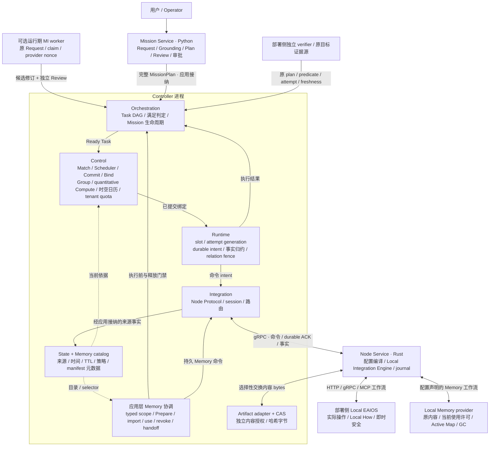
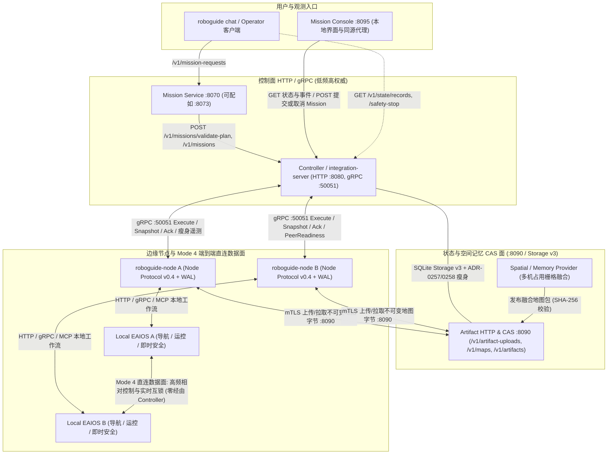

# RoboGuide

面向异构具身智能体协作的分布式具身智能操作系统框架（Distributed Embodied AI Operating System, DEAIOS）。
RoboGuide 联合调度 **Capability · Compute · Space · Time**，把自然语言任务目标转化为经过验证的分布式执行过程与恢复闭环，同时保留各节点 **Local EAIOS** 的本地自治与即时安全。

> **A distributed operating-system framework for heterogeneous embodied agents** — coordinating Capability, Compute, Space, and Time around long-lived Missions while preserving Local EAIOS autonomy and immediate safety.

[双语文档站 (中文 / English)](https://roboguide-docs.chaokedu.workers.dev) · [V2 架构基线](docs/architecture/v2/README.md) · [核心数据流图解](docs/architecture/v2/system-dataflows.md) · [文档总索引](docs/README.md) · [Mission Console](console/README.md) · [3 分钟快速开始](#quickstart) · [历史研发日志归档](docs/development/readme-development-log-archive-2026-11.md)

---

## 核心定位与设计不变量

RoboGuide 不是单纯的多机器人任务队列或中央运动控制器，也不以云端/中心控制替代节点本地安全环。系统职责围绕三条语义链展开：

```text
决策与执行链：Plan -> Match -> Propose -> Coordinate -> Commit -> Bind -> Execute
状态与信念链：Observe -> Update -> Fuse -> Believe
偏差与恢复链：Detect -> Reconcile -> Adapt
```

贯穿全系统的四个基本不变量：

1. **Proposal 不等于 Commit**：Scheduler 的候选选择不持有资源；只有在 Control 事务写锁内通过实时依据、配额、日历与冲突复核并 `Commit` 后，才产生有效资源义务。
2. **本地 Completed 不等于 TaskSatisfied 或资源释放**：本地执行完成先进入 `AwaitingSatisfaction`，再按声明的 `execution-report` 或独立 `verifier-evidence` 核对满足性，并经 Memory revoke / 停止门禁后才释放所有权。
3. **逻辑参与者与执行实体分离**：`Actor` / `ContextRole` / `TaskRole` 是计划与协作槽位，`Node` 是协议与能力接入边界，`PhysicalEntity` 是部署执行主体，三者不因同进程或同主机而混同。
4. **Memory 三维解耦**：`Scope`（谁可语义消费）、`Visibility`（谁可发现/交换）与 `Placement`（哪个节点/provider 持有本地副本证据）相互独立；CAS 引用不代表接收端已完成导入或获得当前使用许可。

---

## 系统分层架构与三平面通信总览

### 1. 当前代码分层架构

下表与架构图对齐当前主线实现（`origin/main`），完整代码依据见 [当前代码架构图册](docs/architecture/v2/current-architecture.md) 与 [V2 架构手册](docs/architecture/v2/architecture-handbook.md)。

<!-- architecture-overview:start -->

<!-- architecture-overview:end -->

| 分层 | 核心职责 | 实现入口 |
| --- | --- | --- |
| **Mission Intelligence** | 意图理解、澄清、受控 Grounding、Plan/Review/Repair、审批与运行期重规划 | [`mission/`](mission/README.md) · [`apps/mission-service/`](apps/mission-service/README.md) |
| **Orchestration** | 完整 `MissionPlan` 接纳、DAG 就绪推进、依赖时间窗前检、`TaskSatisfied` 判定与隔离 | [`core/orchestration/`](core/orchestration/) |
| **Control Plane** | Eligibility 匹配、有界联合调度、资源/配额承诺、Execution Group、角色恢复 | [`core/control/`](core/control/) |
| **Distributed Runtime** | `(Group, Task, Role)` 槽位、attempt 代次、durable outbox、事实归约与 `relation_fences` | [`core/runtime/`](core/runtime/) |
| **State & Memory Plane** | 来源感知 State 联邦、Memory/Spatial 目录、Storage v3 持久化、CAS 不可变字节 | [`core/state/`](core/state/) · [`core/artifact-store/`](core/artifact-store/) |
| **Integration & Node Service** | 正式 gRPC Node Protocol v0.4、会话围栏、本地执行日志与声明式 workflow 映射 | [`core/integration/`](core/integration/) · [`core/node-service/`](core/node-service/) |
| **Local EAIOS & Providers** | 厂商/仿真器本地运行、底盘实时安全、本地建图与多机地图融合（核心权威之外） | [`integrations/`](integrations/) · [`apps/roboguide-node/`](apps/roboguide-node/) |

### 2. 三平面全景通信与数据流总览

系统在运行期严格分离 **控制面（Control Plane）**、**状态与空间记忆 CAS 面（State & Spatial CAS Plane）** 以及 **Mode 4 端到端直连数据面（Direct Peer Data Plane）**；五类协议级细化数据流图见 [核心系统数据流图解](docs/architecture/v2/system-dataflows.md)。



---

## 四种协作耦合模式概览（ADR-0026 / ADR-0027）

`MissionPlan` 通过 `ExecutionCouplingMode` 显式声明同一 `CoordinationContext` 内的协作机制要求，Controller 仅承载语义与就绪门禁，不将高频运动控制算法搬入核心：

| 模式 | 语义与适用场景 | 控制面核心门禁与接口 | 数据面与本地安全边界 |
| --- | --- | --- | --- |
| **Mode 1: `Independent`** | 单机或无运行时耦合的独立任务 | 标准 Task DAG、`Match -> Commit -> Bind -> Execute` | 各 Node 独立执行，无跨 Role 共享视图或 Peer 通道 |
| **Mode 2: `SequentialHandoff`** | 顺序接力任务（如探索后盲导、拍照后巡检） | 前序 `TaskSatisfied` + Memory/Artifact 释放门禁解锁后继 Task | 数据经由不可变 Artifact CAS 与显式 `import / use` 交接 |
| **Mode 3: `ConcurrentCooperation`** | 并发协同（如双机协同护航、共享同一地图基准） | 声明 `RequiresActive` / `SharedSpatialReference`；提供 `GET /v1/missions/{id}/shared-view?context_id=...`；异常触发 `relation_fences`，人工/条件恢复走 `POST /v1/missions/{id}/relations/{relation_id}/reconcile` | 共享状态受 receive-time TTL 分类为 `Fresh / Stale / Unknown`，局部避障由 Local EAIOS 自持 |
| **Mode 4: `TightlyCoupledCooperation`** | 紧耦合协同（如并排编队） | 依赖双端 `PeerChannelReadiness` 观测维护通道生命周期 `Planned -> Ready -> Fenced -> Closed`；未就绪或断链即 Fence | 高频相对控制与即时安全由部署侧 Local EAIOS 实现。点对点数据面绕过 Controller，实机效果依赖本地部署 |

---

## 分级恢复阶梯（Recovery Escalation Ladder, L0–L4）

RoboGuide 遵循最小必要恢复权限原则，任何通信中断或未知结果默认保守隔离为 `Unknown`，严禁盲目重放有物理副作用的动作：

| 层级 | 责任主体 | 核心机制与近期主线能力 | 证据边界 |
| --- | --- | --- | --- |
| **L0** | Local Autonomy | 局部避障、本地重规划、硬件即时急停与 safe-state 冻结 | 即时安全与物理动作仅由 Local EAIOS 证明 |
| **L1** | Integration / Node Service / Runtime | Wi-Fi 漫游断链重连与 outbox 合并（PR #19/#27）、旧注册拒绝限定原会话（PR #39）、Node WAL `ExecutionJournal` 句柄续查 | 断链/重启进入 `Unknown` 或 `Stopping`，不推断物理未发生 |
| **L2** | Control Plane | `RoleRecoveryNeed` 评估、`Blocked` 部分释放、Role 级 `Match -> Commit -> Rebind`（保留原 Actor 连续性） | 需先取得目标停止或独立安全证据，不偷换物理实体 |
| **L3** | Control + Bounded Scheduler | 在合法 `CandidateSet` 与资源日历内重新调度并原子 `Commit` 新分配 | 仅消费已提交依据，遵守租户配额与时空冲突检查 |
| **L4** | Runtime / Mission Intelligence | 经独立安全停机证据确认自然设备故障后解锁 `plan_revision` 同 Mission 动态接管（PR #33）；或通过 `POST /v1/executions/{id}/safety-stop/reconcile` 对已取消/失败/完成尝试执行受控人工结案（ADR-0232 / PR #17/#40） | 软件修订与人工结案均保留原历史与独立停止证明边界 |

---

<a id="quickstart"></a>

## 3 分钟快速开始

以下命令均从仓库根目录运行。Rust 工具链由 [`rust-toolchain.toml`](rust-toolchain.toml) 固定，Python 3.13 环境由 [`pyproject.toml`](pyproject.toml) 与 `uv.lock` 管理。

### 路径 A：零网络控制面纵向切片（无需模型或设备）

```bash
cargo run --locked -p controller
```

在内置 `FakeNode`、`VirtualClock` 与内存 State 上演示注册、资源承诺、执行与恢复全链路（`DEAIOS control slice produced ... events`）。

### 路径 B：正式 Node Protocol v0.4 握手与离线配置校验

```bash
# 1. 离线验证 Node 声明式配置与 Local Integration Engine 映射（不连 Controller / 设备）
cargo run --locked -p roboguide-node -- --validate scenarios/extension-conformance-v0.1/node.toml

# 2. 启动独立的本地 Controller（gRPC :39151 / Control HTTP :39152 / Artifact HTTP :39153）
mkdir -p /tmp/roboguide-quickstart
cargo run --locked -p integration-server -- \
  127.0.0.1:39151 /tmp/roboguide-quickstart/controller.sqlite3 \
  127.0.0.1:39152 127.0.0.1:39153 /tmp/roboguide-quickstart/artifacts

# 3. 另开终端运行合成协议探针完成 Welcome / Registered / Heartbeat 握手
cargo run --locked -p real-node-smoke -- --endpoint http://127.0.0.1:39151 --node-id quickstart-smoke
```

### 路径 C：Mission Service 与 `roboguide chat` 对话工作台

```bash
uv sync --dev --frozen
cp .env.example .env   # 按需配置 OPENAI_API_KEY（纯查询或本地回放可跳过）

# 启动 Mission Intelligence 服务（默认 http://127.0.0.1:8070）
uv run mission-service

# 另开终端初始化并进入交互式对话工作台（支持自然语言规划、/state 查询、任务诊断与 /cancel）
uv run roboguide init
uv run roboguide chat
```

### 路径 D：零依赖 Mission Console 控制台与双语文档站预览

```bash
# 启动任务旅程控制台（默认 http://127.0.0.1:8095，演示回放不需要后端）
python3 console/serve.py
```

实时控制台可通过已连接的 Controller 提交或取消任务。只看演示时使用回放模式。

```bash
# 本地同步并构建 MkDocs 双语文档站（严格校验模式）
python website/sync_docs.py
uvx --from mkdocs --with-requirements website/requirements.txt mkdocs build --strict -f website/mkdocs.yml
python website/check_site.py
```

---

## 仓库目录地图

```text
RoboGuide/
├── core/                         # Rust 核心库（11 个 workspace crate）
│   ├── domain/                   # 领域值对象、ID、MissionPlan / ExecutionIntent / EventPayload 语义
│   ├── ports/                    # 传输中立核心端口（Clock / EventSink / State / Memory / Artifact）
│   ├── state/                    # Shared Node State、Allocation 投影、Memory Catalog、Storage v3 SQLite
│   ├── control/                  # Capability Matching、BoundedJointScheduler、Commit、Group、Recovery
│   ├── runtime/                  # 逻辑槽位、Attempt 代次、Durable Outbox、Fact 归约与 Relation Fences
│   ├── artifact-store/           # 文件系统内容寻址存储（CAS）与增量分块校验
│   ├── integration/              # 正式 gRPC Node Protocol v0.4 线缆协议、会话与路由
│   ├── controller-replication/   # 可选 OpenRaft 三成员元数据共识与恢复存储
│   ├── orchestration/            # Mission DAG 编排、IntegrationRuntimeBridge、遥测瘦身与时间窗前检
│   ├── node-service/             # 节点服务、声明式 Local Integration Engine、WAL 日志与漫游恢复
│   └── testkit/                  # 确定性测试替身、虚拟时钟与故障注入工具
├── apps/                         # 可运行服务与运维二进制（7 个应用）
│   ├── controller/               # 最小控制平面纵向切片演示入口
│   ├── integration-server/       # 生产主服务端（gRPC :50051 / Control HTTP :8080 / Artifact CAS :8090）
│   ├── controller-replica/       # 高可用共识监督进程
│   ├── roboguide-node/           # 边缘节点统一宿主服务及 --validate 离线校验 CLI
│   ├── real-node-smoke/          # Node Protocol v0.4 协议冒烟探针
│   ├── mission-service/          # Mission Service HTTP 组合根（Python）
│   └── recovery-tool/            # 离线静止备份、校验与冷恢复工具（roboguide_recovery）
├── mission/                      # Mission Intelligence 规划/审查引擎与 roboguide_workbench 终端（附 POSTURE_VERIFIER_ACCEPTANCE.md）
├── integrations/                 # 部署侧 Local EAIOS 与外部 Provider 适配器（独立于核心权威）
│   ├── robonix-task/             # 真机任务委派与世界证据接入（Robonix）
│   ├── robonix-map-service/      # Robonix 建图任务适配服务
│   ├── spatial-provider/         # CPU 点云配准、多机占用栅格融合（CORRELATIVE_ICP / AKAZE）与本地服务
│   ├── memory-provider/          # Local Memory Provider 与使用租约/GC 管理
│   ├── habitat-local-eaios/      # Habitat / EMOS 仿真器 Local EAIOS 桥接
│   └── coherent-local-eaios/     # COHERENT 图环境与故障注入适配
├── contracts/                    # 跨语言 JSON Schema 与 Protobuf 契约（14 类：capability, control, deployment,
│                                 # deployment-management, federation, memory, mission, node, observability,
│                                 # operator, recovery, replication, spatial, state）
├── config/                       # 无凭据模板配置（mission.toml, mission-service.toml, node.toml, workbench.example.toml）
├── scenarios/                    # 19 个版本化任务场景与验证配置（含 phase1, mvp-slice, execution-relations 等）
├── evaluation/                   # Eval Harness（roboguide_eval）、E1 评测定义、离线发布工具与历史冻结基线
├── experiments/                  # 历史 EP51 审计快照（2026-09-20，保持只读原位留档）
├── tools/                        # 部署检查、可观测性、现场到达验收（onsite_arrival）与 CI 进程级质检门禁（quality）
├── console/                      # Mission Console 任务旅程可视化控制台（零依赖静态前端 + serve.py）
├── website/                      # MkDocs Material 双语文档站源码、内容基线、图表校验与 Playwright 烟雾测试
└── docs/                         # 架构基线（v2/）、257 份 ADR（decisions/）、接入规范（extensions/）与历史验收档案
```

---

## 核心文档、双语站点与历史归档入口

| 目标 | 推荐入口 | 说明 |
| --- | --- | --- |
| **文档总导航** | [`docs/README.md`](docs/README.md) | 全仓文档分层目录与主题索引 |
| **系统架构与协议数据流** | [`docs/architecture/v2/README.md`](docs/architecture/v2/README.md) · [`system-dataflows.md`](docs/architecture/v2/system-dataflows.md) | V2 现行权威语义、5 类完整协议数据流与端口映射 |
| **系统手册与当前代码图册** | [`architecture-handbook.md`](docs/architecture/v2/architecture-handbook.md) · [`current-architecture.md`](docs/architecture/v2/current-architecture.md) | 读者向深入导读与 4 张主线矢量架构图 |
| **架构决策记录（ADR）** | [`docs/decisions/`](docs/decisions/) · [`website/pages/decisions.md`](website/pages/decisions.md) | 257 份历史与现行 ADR（`0001`–`0259`） |
| **设备与 EAIOS 接入** | [`device-extension-conformance-v0.2.md`](docs/extensions/device-extension-conformance-v0.2.md) · [`contracts/`](contracts/) | 不修改核心源码接入新机器人的配置规范 |
| **双语站点源码与同步门禁** | [`website/README.md`](website/README.md) · [`website/pages/status.md`](website/pages/status.md) | 中英文维护指南与最新 `e4c03a55` 实现边界对账 |
| **实验评测与可视化控制台** | [`evaluation/README.md`](evaluation/README.md) · [`console/README.md`](console/README.md) | Eval Harness 与任务旅程控制台用法 |
| **验收记录与历史研发流水账** | [`docs/development/acceptance/README.md`](docs/development/acceptance/README.md) · [`readme-development-log-archive-2026-11.md`](docs/development/readme-development-log-archive-2026-11.md) | 143 份软件/真机验收归档与原 README 研发日志无损归档 |

> **贡献与代码规范**：提交前请遵循 [`AGENTS.md`](AGENTS.md) 与 [`docs/development/coding-standards.md`](docs/development/coding-standards.md) 中的 Rust/Python 文档注释、格式化、类型检查与进程级门禁要求。
