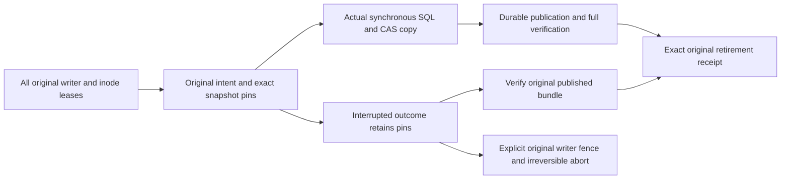

# Recovery profile v0.8

This explicit profile selects Memory SQL v4 / writer v0.2 and retains v0.7's Replica storage v3,
original Controller process journal, full writer/inode leases, complete SQL and content contracts.
Each declared Memory provider must have explicitly enabled `--enable-snapshot-references` while
quiescent. Its native v3 migration preserves original identity, history, budgets and other stores.
Default v3 is unchanged; old writers and profiles refuse v4, and old tools refuse v0.8.

The original provider stores one unique `command_id`, complete original profile/target identity,
persistent instance, exact CAS digest/size set, UID and original Linux boot/time-namespace/deadline.
The canonical purpose fixes `operation_id`; each content reference has kind `snapshot`, generation
1 and reserved owner `snapshot-operation:<operation hash>`. No retry can change the target, content,
profile, ownership or budget, or start another copy for an uncertain or aborted command.

Intent and every pin commit in one provider transaction before copying. Existing tombstoned files
remain historical bytes and never become new active references. A v0.2 bundle manifest includes
one `snapshot_operations` descriptor per actual Memory component, tied to its original SQL request
digest and exact same-bundle CAS objects. Immutable verification rejects missing content, altered
provider identity, incomplete mandatory tables and forged descriptors even with a new manifest pin.

Only complete actual bundle verification under the original source leases permits retirement.
A failed final source transaction leaves a published bundle and active pins; retry verifies that
original bundle and retires the exact original pins without copying, replacing timestamps or
renewing the original budget. Cold restore preserves pre-publication active intent and pins.
`reconcile-snapshots` verifies the original bundle again and binds it to the current same provider
instance, so restored history is not implicitly promoted into a completion proof.

`abort-snapshots` applies only to an unpublished destination. It takes all original writer/inode
leases and permanently aborts that unique command before releasing its pins in the same local SQL
transaction. The synchronous producer launches no background/child copy work outside those leases.
A live original copier refuses the leases. Partial output remains untouched; a late original
command cannot copy again. This is a local copy fence, not cross-domain transaction abort.

`roboguide.restore-receipt/v0.8` keeps all original SQL/CAS bytes and starts no services. These
same-UID administrative operations do not expose the Unix socket remotely or grant content/use
permission. Controller Artifact CAS, Raft Snapshot, event Archive, Catalog/lineage, online content
replication and physical continuity remain independent contracts. See
[ADR-0147](../../../docs/decisions/0147-original-provider-snapshot-reference-lifecycle.md).
