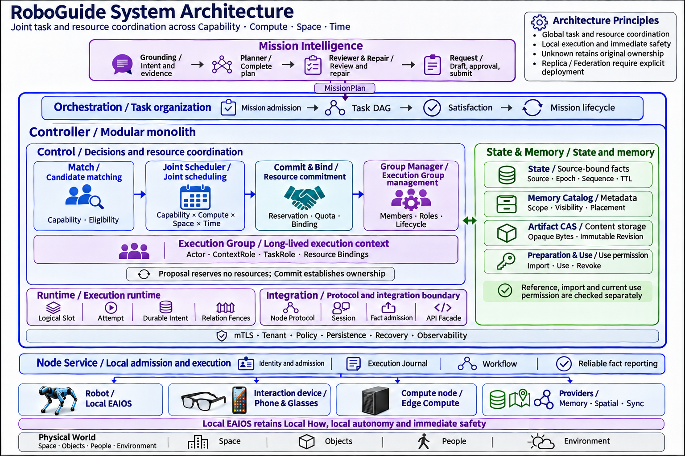

# RoboGuide V2 architecture baseline

Code reviewed: 2026-11-26 · `main@3c7136d6`. Figures describe implemented responsibilities and protocol boundaries; device outcomes require original acceptance evidence.

RoboGuide coordinates heterogeneous bodies, compute nodes and interaction devices around a shared Mission: planning, scheduling, execution, state and recovery. It jointly considers Capability, Compute, Space and Time while Local EAIOS retains local execution and immediate safety. The Controller is currently a modular monolith; a responsibility box does not imply a separate microservice.

<!-- diagram:overview:en -->

## Reading path

1. [Handbook](architecture-handbook.en.md)
2. [Current architecture atlas](current-architecture.en.md)
3. [Protocol flows](system-dataflows.en.md)
4. [Concepts](concepts.en.md)

## Objects and lifecycles

| Object | Meaning and authority |
| --- | --- |
| Mission Request | MI conversation, drafts, approval and submission, distinct from Controller Mission |
| MissionPlan | Original goal, Actors, Contexts, Task DAG, requirements and satisfaction basis |
| Actor / ContextRole / TaskRole | Logical participant, continuous context role and execution slot, not physical robots |
| Execution Group | Control-owned long-lived context; normally one per Mission, with successor Groups on revision |
| Attempt | One execution of a `(Group, Task, Role)` slot on a specific Node/session/generation |
| Node / PhysicalEntity | Protocol boundary and deployment executor; both distinct from Host |

## Core invariants

1. Proposal is not Commit; Scheduler holds no resources and Group Manager remains in Control.
2. Local Completed is not TaskSatisfied, Mission success or resource release.
3. Authority commits precede outbox sends; durable fact acceptance precedes ACK.
4. Unknown retains effect ambiguity and ownership; new IDs, timeout or restart cannot erase it.
5. Memory Scope, Visibility, Placement and current-use permission are independently checked.
6. Caching, replay and restore cannot refresh original State provenance or freshness.
7. Local EAIOS owns Local How and immediate safety; process evidence is not physical safety evidence.

## Implementation and evidence

V2 continues to define responsibility and authority semantics. Current figures bind this reviewed code SHA; source-derived references distinguish Node Protocol, Node Contract, wire Catalog and local config versions. Accepted ADRs retain their original dates. Implementation, unit tests, process acceptance, physical outcomes and long-term metrics remain separate evidence classes.

[Project goal](../../project-goals-and-mvp.md) · [MVP definition](../../mvp-definition.md) · [ADR guide](../../reference/decision-guide.en.md)
