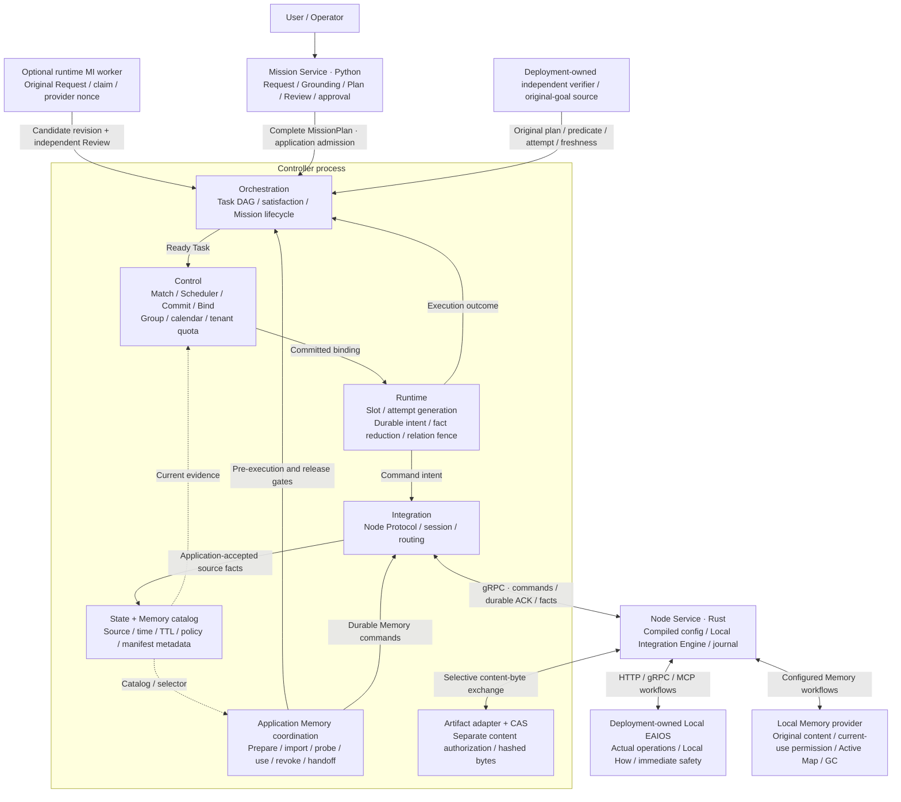

# RoboGuide V2 current architecture

[ADR-0171](../../decisions/0171-owned-controller-content-ingress.md) defines same-host owned-child
Unix peer PID/original spawn journal/mTLS ingress and parent8 command history. Zero-event operations
still retain first intent; Unknown retries only observe. Production authority requires actual wiring.

[ADR-0170](../../decisions/0170-scoped-prepared-artifact-sources.md) adds an original scoped
Prepared-upload source for complete-content replication. Actual writer/FD/hash/size, append freezing
and revocation remain distinct from final CAS publication. Guards/readers retain the real writer;
public CAS lookup still sees only finalized bytes. This in-memory capability grants no Task,
Memory-use, durable completion or protocol authority.

[ADR-0169](../../decisions/0169-consensus-bound-content-stream-transport.md) connects an explicit
network content profile, parent v7 and actual mTLS Ready/bounded streams. Exact Raft member data
binds owners; original epoch, credentials and budgets remain checked per chunk. A complete ACK
requires the same complete byte/metadata members in every current/joint voting set. The runnable
supervisor remains fenced until its original child and Prepared-source contracts are connected;
all remaining upgrade/recovery/routing and original remediation gates remain independent.

Reviewed: 2026-10-23. Committed remediation baseline: `b372d95`
plus ADR-0169 actual network content integration; runnable supervisor and full online gates remain in progress,
on the single development branch `codex/nonrelease-remediation-closure`. The atlas retains its
October 22 source baseline `495a6d2`. These later remediation changes have not merged back to main;
they are not claims about the current remote main branch.
This page and accepted ADRs define V2 authority. It reorganizes the implemented architecture without
introducing new decisions. The Chinese source and accepted ADRs govern interpretation. [中文](README.md).

The [architecture atlas](current-architecture.en.md) provides overview, execution, deployment and evaluation
views. The [handbook](architecture-handbook.en.md) supplies a reading path. The
[alignment review](../../development/architecture-code-alignment-2026-10-22.md) records code evidence and
corrections; the [historical text](architecture-history-2026-10-22.md) retains the preceding document.

### Current code overview · 2026-10-22

<!-- architecture-overview:start -->

<!-- architecture-overview:end -->

Controller responsibilities currently share `integration-server`. Solid arrows indicate collaboration/data
flow; dotted arrows indicate read-only inputs. The website displays a vector rendering of the same Mermaid
source directly, with enlargement and source access. Publication checks bind source and rendered assets.

## 1. Purpose

RoboGuide coordinates heterogeneous embodied systems around a long-lived Mission. Decisions span Capability,
Compute, Space and Time, retaining execution evidence, permissions, resource obligations and recovery history.
Nodes and capabilities come from deployment declarations and formal registration; zero Nodes is valid.

Global coordination handles `What / Who / When / Shared Where`. Local EAIOS owns `Immediate How`, local
planning, perception, navigation, motion, hardware control and immediate safety. Node, PhysicalEntity, Host
and LocalSystem remain distinct identities even when they share a process or machine.

## 2. Logical architecture

| Responsibility | Authority | Implementation |
| --- | --- | --- |
| Mission Intelligence | Original Request/Dialogue/Grounding, drafts, independent Review, bounded Repair, approval and submission reconciliation; model outputs are candidates | [mission](../../../mission/src/mission/) |
| Orchestration | Complete-plan admission, DAG readiness, logical dispatch priority, Task satisfaction, Mission lifecycle, holds and plan history | [orchestration](../../../core/orchestration/src/) |
| Control | Eligibility, resources/calendar, Group membership, Actor/Role binding, tenant quota, recovery and explicit takeover decisions | [control](../../../core/control/src/) |
| Scheduler | Bounded deterministic selection within supplied candidates, Control calendar and attributed costs; no reservations | [scheduler/policy.rs](../../../core/control/src/scheduler/policy.rs) |
| Runtime | Logical slots, original attempts/generations, durable command intents, ordered facts, relations and fences | [runtime/execution](../../../core/runtime/src/execution/) |
| Integration | Node Protocol/wire conversion, sessions/leases and routing; ACK after durable application acceptance | [integration](../../../core/integration/src/) |
| Node Service | Compiled configuration, Local Integration Engine, command/receipt journal and local-workflow fences | [node-service](../../../core/node-service/src/) |
| Controller Application | Actual writer, transactions, timer, outbox, verification, Memory and safety gates composing the existing authorities | [application](../../../apps/integration-server/src/application/) |
| State / Memory / Artifact | Source projections, catalog metadata, separately authorized content and provider-owned storage | [state](../../../core/state/src/), [artifact-store](../../../core/artifact-store/src/), [providers](../../../integrations/) |

Logical modules are not separate microservices. `IntegrationRuntimeBridge` is Orchestration-side composition
of formal Node facts with existing Control/Runtime/State. It creates no second execution/resource authority.
`domain` holds objects/invariants; `ports` exposes transport-neutral contracts. Integration has no dependency
on Control, Runtime or State.

### Mission Request and planning

User-answerable blocking semantic gaps lead to `NeedsClarification`; reasonable assumptions remain separate.
Live inventory, resource availability, Local How and deployment failures do not become user semantic questions.
A valid known plan may be accepted with zero current candidates and retain Ready Tasks.

The Canonical Capability Catalog defines provider-independent capabilities, Operations, parameters and baseline
requirements. Requirements declare necessary evidence; ExecutionIntent declares the selected operation's
semantic objective. Models do not select Nodes, endpoints, vendor skills or internal workflows. Review is
independent of Planner; repairs are bounded and revalidated. Approval considers intent, world context and
explicit risk policy.

One deliberation uses an immutable digest-bound GroundingContextSnapshot of explicitly admitted World State
and Memory revision metadata, preserving sources, receive times, TTLs and gaps. Metadata does not establish
content consumption. Health, placement, reservations and attempts stay in the execution/Control boundary.
Request SQL retains original code/config/Catalog/Prompt/dependencies/provider-call provenance and raw outputs.
Missing historical evidence remains unavailable.

The default provider DTO remains MissionPlan v0.8. Memory prerequisites require explicit v0.9 schema
selection and cannot disappear through compatibility normalization.

Original submission intent persists before POST. Interrupted responses trigger read-only original-admission
observation, never another blind POST. The HTTP command journal binds actual principal, tenant, method/path/key
and original Request; observe/reconcile endpoints repeat no model or create effects.

## 3. Core abstractions

### Embodied Node

A Node is an execution/capability/liveness boundary, not necessarily a robot or physical host. A generic
`roboguide-node` connects to Controller and configured LocalSystems. Deployment fixes operation owners,
capability profiles, endpoints and workflow mappings. Existing generic drivers are HTTP, dynamic gRPC and MCP;
vendor SDK and hardware code stay in deployment-owned facades.

Configuration conformance, process health, exact capability readiness, registration, current State/lease and
physical capability are different evidence. Wire Protocol, negotiated Node Contract, config, IDL catalog,
journal and Controller checkpoint evolve independently. Legacy compatibility does not grant newer authority.

### Capability and Resource

Control checks capability attributes, exact Operation Support, current readiness, consumer policy, lease,
tenant and binding constraints. Static support does not establish current executability.

Current commitments use exclusive ResourceIds. Original Role units and immutable Mission tenant drive durable
tenant/category quota claims through normal/Group/recovery Commit and exact release. Over-limit rejection
precedes reservation/event changes. Existing claims without configured limits still report usage, with
`null` limit/remaining values. This logical accounting is separate from divisible allocation, GPU/OS isolation
and realtime guarantees. Original file-worker CPU/address-space kernel receipts are a separate process contract.
Time is a planning-calendar dimension; complete spatial/traffic commitments require their own contracts.

### Embodied Execution Group

Actor identifies a Mission participant; ContextRole places it in a continuing collaboration context; TaskRole
references that context and declares an execution slot. PhysicalEntity is deployment identity and Node is
registration/routing identity. The current physical-binding profile addresses one entity per Node; multiple
Nodes may share a Host.

Complete-plan admission creates the Control-owned Group and TaskExecutions. Task release does not destroy the
Group. An explicit runtime revision can retire a Group and create a successor while retaining completed facts
and history; one Group forever per Mission is not a domain invariant.

Runtime uses `(GroupId, TaskRef, RoleId)` slots and original physical attempt generation/session/identity.
Ordinary recovery does not silently migrate a bound Actor. Explicit takeover additionally requires exact
entities/registry, stop evidence and ordinary candidate/Commit/Rebind gates.

### Execution Coordination Relation

DAG readiness and live relations are separate. Current strong executable relations include `requires-active`
and `shared-spatial-reference`, with exact attempt/owner/map/frame evidence. Expressible coupling modes do not
establish every hazard, tactile, formation or physical handoff mechanism. Uncertain relations fence execution;
relation stop covers the exact target and required live peers, including locally Completed targets still
missing relation proof.

## 4. Decision and commitment semantics

Proposal reserves nothing. Under the actual writer, Commit rechecks current evidence, tenant, quota, calendar
and conflicts. Bind preserves the Commit policy identity. Allocation State projects Control decisions rather
than becoming another resource ledger.

Future `Scheduled` intervals are planning commitments; due work repeats Match/Propose/Commit/Bind. Estimated
completion never releases actual resources. No candidates, infeasible combinations, search limits and missed
windows remain distinct. Preempting unactivated future planning grants no authority to stop running work.

Application persists authority, attempts and command intents before Execute/Cancel delivery. Node receipts,
local outcomes and Task satisfaction remain separate. Original Task/context/provider revocation proofs gate
satisfaction and ordinary release when Memory applies. A configured independent original-goal gate remains
mandatory for Mission completion even after all Tasks finish.

## 5. State, evidence, belief and Memory

The State API is a read-only federation of existing authorities. Records distinguish `Node / World / RoboGuide`
objects and `Desired / Committed / Reported / Observed / Derived / Belief` semantics, preserving source/channel,
schema, source/receive times, TTL, confidence and lineage. Independent sources are not silently overwritten;
remote clocks are not compared as one clock.

Explicit consumer policy binds tenant/source/schema/freshness/conflict/conditions to Match, Commit, Bind,
Rebind, continuation, readiness and satisfaction. Named Belief producers preserve raw lineage through scalar
rules or conservative Gaussian covariance intersection. Confidence never invents variance. Duplicate input,
old epochs and restore do not renew TTL.

An independent verifier freezes source per accepted Task and checks original plan/predicate, complete current
attempts, freshness/finality and optional actual CAS proof. Local Completed may await satisfaction. Continuous
invalidation enters stop/hold; absent evidence creates neither a positive nor negative fact.

### Memory catalog and current use

Execution, Spatial, Semantic, Experience and Artifact Memory use immutable manifests. Scope limits semantic
consumers, Visibility controls discovery/exchange, and Placement records provider-qualified replica evidence.
`Local + Discoverable` is valid. An Artifact reference or another Task's completed import does not grant use.

Configured Local Memory Providers retain semantic/backend ownership. FilesystemMemoryLedger holds manifests,
indexes and a reference fallback; configured workflow payloads are not copied into it. Discovery publishes only
eligible immutable revisions. State/checkpoints/Node Protocol hold no Memory blobs. Artifact CAS stores opaque,
digest-checked bytes under separate application authorization.

Current code includes selective import, durable outbox/receipt, Prepare, Task/attempt-owned imports, original
provider read-only reconciliation, availability probes, current-use grant/renew/revoke and a Group pending
prerequisite barrier. Original context, membership/policy, session/provider and budgets persist before effects.
Prepare ACK precedes import; actual current content/use proof precedes Execute. Unknown does not restart an
import with a new identity.

Normal completion revokes only the Task's original contexts/providers, preserving active peers. Whole-Group
termination/recovery and dual-Group handoff require complete original stop/revoke coverage. Handoff freezes
both memberships/attempts/policy/principal/deadline, publishes immutable child lineage and requires ordinary
Control binding plus receiver-owned import/probe/use. Staging and model output grant no availability.

### Spatial Memory, Active Map and reclamation

Typed maps preserve original producer, anchor, lineage, map revision and publication attempt. Byte placement,
map-workflow import, active selection and localization proof remain distinct. CPU file geometry, 3D tile/
registration and planar fusion/incremental paths exist; [provider documentation](../../../integrations/spatial-provider/README.md)
records exact inputs and validation. Algorithms do not establish physical localization success.

Active Map effects bind original typed input, Node, Group, attempt, provider and handoff target. Original-provider
GC checks imports, irreversible revoke, workers, maps and stored references, persists a tombstone before unlink,
and retains history. FileJobs execution/use-lease reference production and recovery scans are connected; an
expressible snapshot/archive/lineage reference type does not prove every external producer lifecycle is covered.
Quiescent recovery verifies stored active references against bundled bytes; released history needs no deleted bytes.

The reviewed remediation baseline also connects actual import Replica, Catalog/child lineage,
provider/Artifact Snapshot, Archive command and independent receiving-copy references and retirement.
Standalone source upload retirement and offline GC use wrapper v52/codec v31, explicit storage v5 and
recovery v0.16. All original writers, every known Controller reference, actual hash/inode and the
original intent/tombstone precede unlink. MI declarations require explicit policy revocation, terminal
Mission/switches and independent original-goal/kernel completion evidence. Parent retirement leaves
the child's pin intact. Unknown retries only observe, and released history needs no deleted bytes.
See the [actual acceptance](../../development/acceptance/2026-10-23-source-artifact-reclamation.md).
The offline entry refuses Replica/online authority; Raft/online producers and majority content remain required.

ADR-0158 closes recovery of an original unpublished provider Snapshot. Complete original/current
profiles and all actual writers precede exact abort in the current original SQL. Provider instance,
request and pins cannot be replaced. The original v0.1 receipt/SQL v4 and historical source/budget remain
unchanged. Actual provider/copy/wait, both writer fences, SQL rollback and cold recovery pass; see the
[acceptance](../../development/acceptance/2026-10-23-relocated-provider-snapshot.md).

## 6. Runtime and local autonomy

Runtime retains original attempt history, ordered facts, durable generations, intents and relation fences.
Application drives timers/cancellation/delivery; Orchestration advances Missions/Tasks and Control chooses
replacement commitments. Uncertain restored attempts remain Unknown. Message delivery, receipts, heartbeats
and local terminal results do not establish device stopping.

The Node journal admits identified commands before workflows. Duplicate identities/restarts do not silently
start another action. `Registered`/sequence ACK waits for application durability. Worker isolation, bounded fact
batching, Operator pre-TLS connection limits and response deadlines retain original ordering/budgets; these are
not realtime guarantees.

Mission isolation is an Orchestration hold. Attributable Task-local contract errors roll back candidate/savepoint
before a durable hold; unclassified/global Control/State/storage failures fail closed. Holds fence new dispatch
and continuation while raw facts remain admissible. Resume rechecks original generation and stop gates.

Habitat is optional Local EAIOS, not a Core dependency. One original process owns a reset shared world and
configured agent endpoints. Profile-specific navigation, Contract Guard, observed skill feedback, idle/wait and
retained-world continuation disclose differences from native execution. Local completion, TaskSatisfied and
official PDDL/benchmark results retain separate provenance. The Eval Harness never bypasses the system to call
skills; absent official results remain unavailable.

## 7. Reconciliation and recovery

Recovery proceeds under current ownership and the lowest necessary authority: local autonomy, communication
reconciliation, Control Group/resource recovery, scheduling or separately authorized MI revision.

### Stop and execution recovery

Application freezes exact operation-owned State export, original attempt/generation/session, policy and deadline.
Cancellation paths retain separate durable Cancel receipt, terminal Cancelled and independent fresh safe-state
gates. Natural Failed/Completed preserves its original result without inventing a Cancel receipt. SoftwareProcess OS wait proves only the original
instance/PID exited. Missing proof retains ownership; restart/retry renews no budget.

Role recovery checks dispatch-frozen/current operation-owner isolated-stop/repeat support; coupled deployments
require complete Group gates. Original stop/revoke precedes ordinary Match/Schedule/Propose/Commit/Rebind.
Missing candidates remain Pending/Blocked. Group continuation rechecks complete original ownership, members,
resources and budget; completed peers do not rerun. Running preemption and complex migration require further
contracts and conformance.

### Runtime plan revision

Versioned revision, original-goal authority, principal/tenant-filtered MI discovery, original Request lookup,
SQL worker claims, unique phase nonces, raw/interrupted-call reconciliation, independent Review and scoped
Memory declarations are implemented. These form an implemented runtime MI software path.

Original fault/hold, stop/revoke, goal, current owner, Review and nonrenewable budgets gate publication/switch.
Original Memory child declarations freeze before candidates; CAS verification precedes publication. Successor
Groups use normal Control/import/use. Prior plans/completed facts remain history and retired Execute outboxes
stay fenced. Model candidates cannot write binding or redefine the original goal as achieved.

### Persistence, Replica and recovery bundles

Controller owns a single writer and atomic journal/events/complete checkpoint. Optional incremental byte storage
reconstructs the same snapshot and is not an event-complete reducer. Write-disabled mode fences mutations/ACK/
outbox while retaining committed queries. Recovery-admin probes bind the original generation/checkpoint/head.

Standalone remains default. Explicit Replica profiles provide OpenRaft/SQLite, epoch/quorum and supervisor
Controller children. Learner/joint-consensus membership, transfer and certificate Stage/Retire/Abort are present.
Member-local transfer/spawn/PID/wait history is separate from Raft snapshots. V3 transfer fences source authority,
waits for the original child, then checks original quorum/receive-relative budget before target election.
Lost responses remain Unknown; duplicate IDs do not repeat elections. Replica identities are not device Nodes.

Quiescent recovery freezes all declared writer/inode leases, validates complete SQL/receipts/content and stored
active Memory/map/handoff references, and restores to new roots without starting services or renewing budgets.
Metadata quorum, content recovery, cross-host continuity and device stopping need separate evidence. The
original reference/offline GC work above has actual acceptance on the reviewed development baseline,
without being merged to main. The original alignment review retains its October 22 observation scope;
independent process gates do not close Raft/online producers.

[ADR-0159](../../decisions/0159-original-content-quorum-and-raft-reference-lifecycle.md) is implementing
original-content quorum. Source owner/digest/size stay separate from each receiving member/store owner.
Log/Snapshot/reader/current-view references precede byte effects. Success requires the same actual
members to persist metadata and every required byte, satisfying each current/joint voter majority.
Complete Catalog/Archive/Snapshot recovery and upgrade/rollback remain mandatory. Current v0.3 does not
provide this new contract; online HA is not complete before implementation and actual gates pass.

Complete original State/Catalog/Archive capture now runs under the original writer and imports in one
inactive SQL transaction, preserving original IDs, empty journals, pending copy/abort and floors.
Modern metadata-only imports refuse before writing. Independent actual capture/import and Controller/
CAS reads pass. The original v0.3 missing-marker process failure remains evidence; private transport,
Snapshot and content-quorum integration continue.

Private application v3/direct storage v4 retain the complete candidate, original event owners,
recomputable batch digest and State recovery. Actual log/view/Snapshot/managed SnapshotData readers
hold independent pins; missing real bytes and stale installs refuse. Actual Controller uploads,
independent receiver CAS and killed Snapshot-reader retirement pass, as does a retained old binary's
explicit content SQL v2 upgrade without rewriting raw history. Production ReplicaConfig v0.3 has not
enabled this contract. Network quorum, interrupted producers, online Archive/GC/recovery/upgrades and
configured routing remain in progress.

[ADR-0160](../../decisions/0160-original-content-producer-journal-and-interruption-reconciliation.md)
freezes each producer's original SQL source, complete inputs, actual incarnation and nonrenewing
budget in a separate member-local journal. Snapshots never import this operational authority. Its
explicit new profile is separate from existing v1/v2 upgrade entry points; missing original history
remains unavailable. Explicit content SQL v3/parent storage v5 now connect actual producers,
mandatory local heads, independent interruption reconciliation and bounded heavy workers; 39 owned
process steps passed. Full original-deployment migration, network quorum and remaining N1/N3/N7
requirements still need their own implementation and acceptance.

[ADR-0166](../../decisions/0166-explicit-original-content-parent-adoption.md) defines explicit
local parent adoption. Actual root/SQL writers, native draining, complete original data and a new
nonrenewing intent precede adoption of current Log/View/Snapshot retention. Storage v6 requires
complete adoption history; original business rows, legacy pins and unavailable history remain.
Retries only observe. Adoption establishes neither historical completion, global reference coverage
nor network quorum, and does not enable production v0.4.

[ADR-0167](../../decisions/0167-consensus-bound-content-member-identities.md) requires the complete
target's member/store map to equal member data in the exact committed membership. Typed member data
preserves legacy absent-field encoding; old profiles refuse hidden bindings. Matching data grants no
real content ACK. Actual mTLS/SQL/CAS adapters and same-member majorities in both joint groups remain
required; production v0.4 stays disabled.

[ADR-0168](../../decisions/0168-original-bounded-replica-content-streams.md) freezes original
receive intent/pins, actual source permission/budget, unique worker/FD and bounded chunk/hash/fsync/
publication/receipt ordering. Ready acknowledges only intent; cancellation/disconnection never
creates completion. A separate stream journal preserves original copy/reader/producer history.
Production content remains disabled until actual network, application Commit and recovery wiring pass.

[ADR-0161](../../decisions/0161-controller-inode-writer-and-storage-generation.md) requires both
the canonical sibling and actual SQL inode leases, retained until the last actual connection closes.
Native SQLite draining separately fences older live connections. Explicit storage v1 and exact
read-only legacy views fence older writers; the compatibility legacy profile gains no persistent
generation claim. Recovery v0.17 declares the format and preserves the complete original data.
The actual two-process counterexample is retained. Historical binary checks, 15 Controller starts,
three original upload events/Archive across migration, an independent read-only observer and full
cold recovery passed; see the [acceptance](../../development/acceptance/2026-10-23-controller-inode-and-generation.md).
Complete deployment adoption, supervisor replacement and online content quorums remain mandatory.

[ADR-0162](../../decisions/0162-explicit-artifact-gc-sql-recovery.md) adds explicit local OS
administration for an actual hot rollback journal. Complete actual writer/known-consumer coverage,
pinned source digests, nonrenewable intent and forensic copies precede writable SQLite; every
original GC record is validated afterward. The same evidence directory only observes; a new repair
has an independent ID. Forensic evidence grants no application/content/GC authority. The actual
read-only counterexample is retained; implementation and complete fault validation remain in progress.

## 8. Frozen invariants

- Proposal, Commit, Bind, dispatch, receipt, local outcome, satisfaction and release retain separate gates.
- Control owns Group membership/resources/Actor bindings; Runtime never selects replacements.
- Actor, ContextRole, TaskRole, Node, PhysicalEntity, LocalSystem and Host are not interchangeable.
- DAG readiness and live relations differ; relation endpoints are logical Task/Role slots.
- Sources, receive times, TTLs, uncertainty and original budgets survive replay/restore without renewal.
- Read-only State/catalogs do not become Global Truth, resource ledgers or blob stores.
- Memory Scope, Visibility, Placement and current use are independent; imports do not lend another Task permission.
- Unknown and missing stop/revoke proof retain ownership. Software exit does not establish device safety.
- Local EAIOS retains Local How/immediate safety. Models, quorum, certificates and recovery tools create no devices.
- Compatibility, colocation and document restructuring do not change accepted authority or lifecycle semantics.

## 9. Remaining architecture work

[ADR-0165](../../decisions/0165-bounded-snapshot-reader-closure.md) moves actual Tokio Snapshot
reader SQL closure into one bounded drainer per original root. Jobs retain original leases and
intents; Drop, queuing or an empty queue cannot replace a durable close receipt or erase Unknown pins.

[ADR-0164](../../decisions/0164-owned-controller-projection-installation.md) installs inactive
Controller projections transactionally on the original SQL inode, after actual inode/sidecar
ownership and native drain. Original command prefixes and recovery/Unknown history remain.
Empty or incomplete views cannot erase local responsibility. Installation grants no epoch,
child, content or execution authority; online content and upgrade acceptance remain separate.

[ADR-0163](../../decisions/0163-bounded-replica-transport-admission.md) bounds local replica
connections before TLS and separates small/large encoded-frame capacity. Actual handlers and
frames retain their permits; rejection never queues. Deployment limits and observations change
no cluster, checkpoint or execution authority. Network cancellation cannot disprove committed
effects or end independently owned storage work. This is not an OS/RSS or complete HA guarantee.

| Area | Reviewed implementation | Still required |
| --- | --- | --- |
| Memory / Spatial | Selective import/use/revoke, Group handoff, Active Map/GC, stored-reference recovery checks, file algorithms | All external reference producer lifecycles, typed-map/multi-kind fault combinations, online content consistency |
| HA / recovery | Dynamic membership, original-child drain, transfer, certificate rotation, SQL/CAS cold recovery | Complete online content/archive/catalog recovery, rolling upgrades/rollback, independent-domain RTO/RPO |
| Resources | Bounded selection, attributed costs, future calendar, logical quota, file-worker POSIX proof | Divisible allocation, GPU/load/traffic costs/enforcement, complete spatial commitments |
| Coordination / revision | Relation stop/hold, continuation, runtime MI, original goal/Review and scoped Memory file paths | Running preemption, complex migration/handoff, more Memory/map/cross-stage combinations |
| Federation | Durable prepare/commit/abort session and recovery validation | Actual dual-domain transport, authorization, routing and recovery service |
| Operations | Write-disabled, metrics-reader, monitoring config, short software alert gates, partial I/O isolation | Remaining listeners/blocking paths, long-term SLO/runbooks, complete version/fault matrix and hardware evidence |

The [non-release completion plan](../../development/roboguide-software-completion-plan-2026-10-15.md) retains full
acceptance requirements. The [inventory review](../../development/roboguide-branch-audit-2026-10-22.md) is a frozen
snapshot. Neither announces SoftwareComplete. Branch implementations become mainline claims only after merge
and a fresh review.

## 10. Version relationship

V2 supersedes [V1.1](../v1.1/README.md). This alignment is not a new V3 or a rewrite of historical experiments.
The original [DOCX](RoboGuide_Architecture_Baseline_V2.docx), [PNG](../../images/roboguide-v2-overall-architecture.png)
and [preceding text](architecture-history-2026-10-22.md) remain historical snapshots.

Authority, dependency, lifecycle or public-contract changes require an ADR and synchronized architecture/code/
status views. Incremental implementation updates belong in the corresponding current chapter and reviewed
baseline; historical evolution belongs in ADRs and acceptance records.

