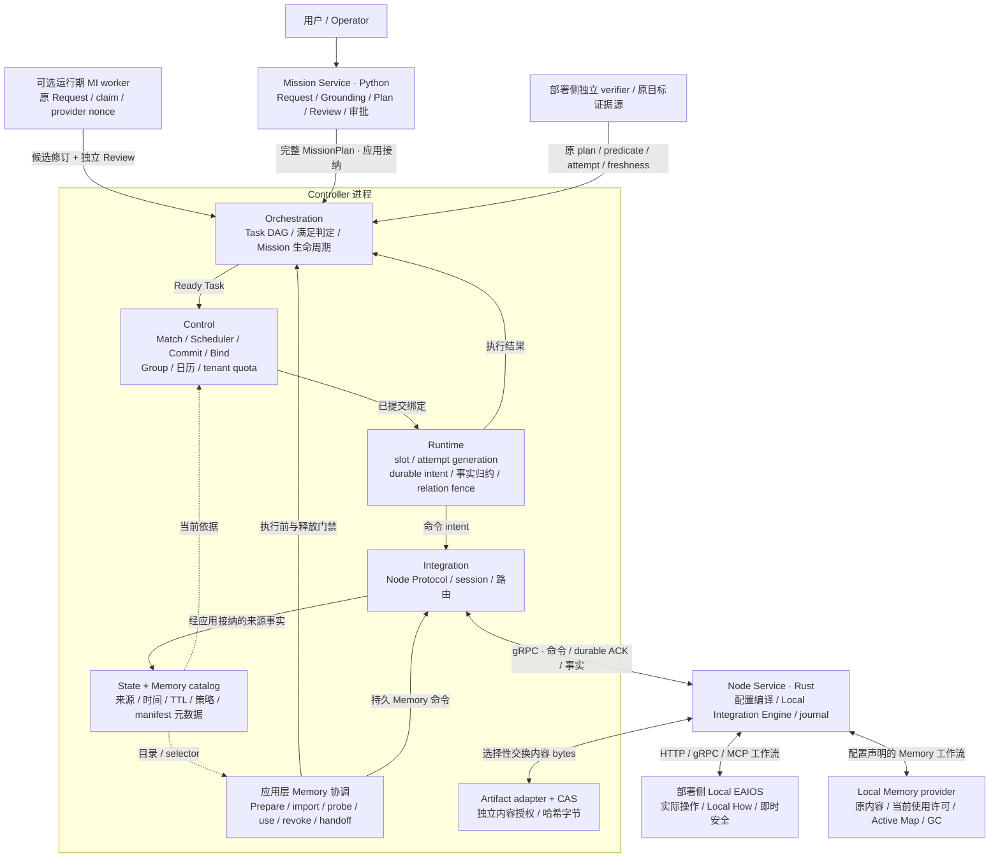

# RoboGuide V2 现行架构

核对日期：2026-10-23；当前整改代码基线：`6e7f7d21cf57e7b84329ab468440aa1813fa65cc`
加本包 ADR-0159 的 direct storage/Snapshot 接线，在线接线仍实施中，
位于唯一开发分支 `codex/nonrelease-remediation-closure`。本页同步 main 的 10 月 22 日图册，
保留其原基线 `495a6d2`；下述新增整改尚未合回 main，不提前记为远端 main 能力。
本文与已接受 ADR 共同构成 V2 架构权威，按当前职责和生命周期组织，不新增架构决策。
[English](README.en.md)。

[图册与代码入口](current-architecture.md)提供总体、执行、部署、评估四张 Mermaid 图；
[架构手册](architecture-handbook.md)提供读者路径；
[对齐记录](../../development/architecture-code-alignment-2026-10-22.md)列出本次修正和代码依据。
[旧正文快照](architecture-history-2026-10-22.md)保留原始说明、版本演进及早期验收边界。

### 当前代码架构图 · 2026-10-22

<!-- architecture-overview:start -->

<!-- architecture-overview:end -->

Controller 内部职责当前共址于 `integration-server`；图中实线表示协作或数据流，虚线表示只读依据。
网页正文直接显示由同一 Mermaid 源码生成的矢量图，可放大查看；源码与图像在构建时校验一致性。

## 1. 系统定位

RoboGuide 是面向异构具身系统的分布式协调与执行框架。Mission 组织长期目标，系统在 Capability、
Compute、Space、Time 上进行联合决策，并保留执行过程、证据、权限、资源义务和恢复历史。
它可以接入机器人、计算节点、感知系统和基础设施；可执行能力来自部署声明与正式注册。
零 Node 有效，代码或模型不能自行补造设备、能力与当前可用性。

全局侧协调 `What / Who / When / Shared Where`。Local EAIOS 保留 `Immediate How`、局部规划、
感知、导航、运动、硬件控制与最终即时安全。Node、PhysicalEntity、Host、LocalSystem 是不同身份，
不因同进程、同机器或证书注册而自动等同。

## 2. 逻辑架构

| 职责 | 当前权威 | 代码位置 |
| --- | --- | --- |
| Mission Intelligence | 原 Request、Dialogue、Grounding、完整计划草案、Review、Repair、审批及提交对账；模型输出为候选 | [mission](../../../mission/src/mission/) |
| Orchestration | 接纳完整 MissionPlan、DAG readiness、逻辑调度优先级、Task satisfaction、Mission 生命周期、hold 与计划版本历史 | [orchestration](../../../core/orchestration/src/) |
| Control | eligibility、资源/日历承诺、Group membership、Actor/Role binding、tenant quota、恢复与显式 takeover 决策 | [control](../../../core/control/src/) |
| Scheduler | 在给定 Candidate Set、Control 日历与来源化成本输入内做有界确定性选择；不拥有 reservation | [scheduler/policy.rs](../../../core/control/src/scheduler/policy.rs) |
| Runtime | 逻辑 slot、原 attempt/generation、durable command intent、事实归约、relation、fence 与执行恢复上下文 | [runtime/execution](../../../core/runtime/src/execution/) |
| Integration | 正式 Node Protocol、wire conversion、session/lease fence、Node 路由；等待应用持久接纳再 ACK | [integration](../../../core/integration/src/) |
| Node Service | 配置编译、Local Integration Engine、command/receipt journal、本地工作流与恢复围栏 | [node-service](../../../core/node-service/src/) |
| Controller Application | 组合上述权威，持有实际 writer、事务、timer、outbox、验证、Memory 和安全门禁 | [application](../../../apps/integration-server/src/application/) |
| State / Memory / Artifact | 来源投影、目录元数据、独立内容与存储；按各自 owner 消费和授权 | [state](../../../core/state/src/)、[artifact-store](../../../core/artifact-store/src/)、[providers](../../../integrations/) |

逻辑边界不等于微服务边界。`IntegrationRuntimeBridge` 位于 Orchestration 的组合边界，连接正式
Node facts 与既有 Control/Runtime/State；它不建立第二份执行或资源权威。`domain` 保存对象与不变量，
`ports` 提供 transport-neutral 合同；Integration 本身不依赖 Control、Runtime 或 State。

### Mission Request 与规划

用户入口是 Mission Request。阻塞且可由用户回答的语义缺口进入 `NeedsClarification`；合理假设单独保留。
实时 Node inventory、资源可用性、Local How 和部署故障不转成用户语义问题。零候选不使已知合法计划
自动无效，Ready Task 可以等待当前部署证据变化。

Canonical Capability Catalog 规定 provider-independent 的能力、Operation、参数与 baseline requirements。
Capability Requirement 回答“槽位需要什么证明”，ExecutionIntent 回答“被选中后做什么”。模型不能填
Node、endpoint、厂商 Skill 或内部工作流来绕过 Control。Review 独立于 Planner；Repair 有界且必须重新
校验，用户事实不能由模型补造。审批是基于 intent、操作、世界上下文与显式风险策略的决定。

MI 在一次 deliberation 中使用同一 digest-bound GroundingContextSnapshot：明确允许的 World State 和
Memory revision metadata 保留来源、receive time、TTL 和 gap。Memory metadata 不代表内容已读取。
实时健康、placement、reservation 和 attempts 仍在 Control/执行边界。Request SQL 原子保留原代码、配置、
Catalog、Prompt、依赖、provider-call metadata 与原始输出；缺失的历史依据保持 unavailable。

默认 provider DTO 保持 MissionPlan v0.8；Memory prerequisites 必须显式选择 v0.9 schema，
兼容归一化不能丢失已声明的 Memory 要求。

发送 Controller POST 前先保存原 submission fence；中断或丢失回包只读查询原 admission。
HTTP 命令 journal 绑定实际主体、tenant、method/path/key 与原 Request，观察/对账不重做模型调用或提交。
详见 [ADR-0037](../../decisions/0037-mission-grounding-context.md)、
[ADR-0103](../../decisions/0103-http-command-reconciliation-and-node-identity-lifecycle.md)与
[ADR-0128](../../decisions/0128-explicit-memory-plan-provider-dto.md)。

## 3. 核心抽象

### Embodied Node（具身节点）

Node 是 execution/capability/liveness 接入边界，不等于机器人或物理机。通用 `roboguide-node` 通过
Node Protocol 连接 Controller，并依据启动时校验的配置连接一个或多个 LocalSystem。实际执行的
capability owner、Operation workflow、固定 endpoint 和状态映射由部署配置决定。

HTTP、dynamic gRPC、MCP 是现有通用 driver。新增 EAIOS 的厂商代码位于部署 facade，不把 SDK、ROS
topic、硬件命令提升为 Core 语义。配置检查、process health、exact capability readiness、正式注册、
当前 State/lease 与真实设备能力是不同证据。

wire Protocol、协商 Node Contract、Node config、IDL catalog、journal 和 Controller checkpoint 分别演进。
兼容输入不自动获得新 Memory/use/stop authority；当前版本由[参考页](../../../website/pages/status.md)关联
源码与构建来源，不能从旧切片版本号推导当前支持。

### Capability 与 Resource

Control 同时检查 capability profiles、typed attributes、exact Operation Support、当前 readiness、State
consumer policy、lease、tenant 与绑定约束。Capability 存在不代表当前可执行。

Capability、Compute、Space、Time 是联合决策维度。当前资源承诺以独占 ResourceId 为基础；Role 的
units 与 immutable Mission tenant 进入持久 tenant/category quota ledger。quota 接入正常 Commit、
Group Commit、recovery Commit 和 exact release，超额拒绝先于 reservation/event 变化。
未设 limit 的现有 claim 仍显示 usage，limit/remaining 为 `null`。

该 quota 是逻辑核算，不表示 divisible allocation、GPU/OS 隔离或硬实时保证。部署侧 Memory 文件 worker
的原 CPU/address-space `rlimit` 与实际 PID/kernel receipt 是单独的进程约束。Time 的 future interval
属于 Control 日历，不能等同普通整数容量；完整空间/交通承诺仍需独立合同和验收。

### Embodied Execution Group（具身执行组）

Actor 是 Mission 内连续的逻辑参与者；ContextRole 将 Actor 放入长期协作上下文；TaskRole 引用
ContextRole 并声明本 Task 的执行槽。PhysicalEntity 是部署执行身份，Node 是寻址与注册边界。
当前可执行物理绑定 profile 为一个 Node 一个可寻址实体；Host 可承载多个 Node。

Orchestration 接纳完整计划时，通过 Control 建立 Group 与 TaskExecution。Control 独占 Group membership、
Actor binding 和资源义务。Task 释放不销毁 Group；同一 Mission 可在显式运行期修订中退役原 Group、
创建新 Group，保留已满足事实及历史。不能把“一 Mission 永远一个 Group”写成领域硬约束。

Runtime 用 `(GroupId, TaskRef, RoleId)` 作为逻辑 slot；物理 attempt 使用原 generation/session/identity。
Node 或可复用执行字符串不能代替逻辑 slot。普通 recovery 不隐式迁移已绑定 Actor；显式 takeover
还须精确实体、registry、停止证明和正常 Control 候选/Commit/Rebind 门禁。

### Execution Coordination Relation

DAG 约束何时 Ready；relation 约束已经绑定的并发逻辑端点。当前可执行强关系包括 `requires-active`
和 `shared-spatial-reference`；强地图依据绑定当前 attempt/owner/map revision/frame。
Contract 能表达的 coupling mode 不等于每种 hazard、触觉、formation 或物理交接已经实现。
未知、失效或冲突关系进入 fence/reconciliation；relation stop 覆盖 exact target 与所有所需 live peers，
包括本地 Completed 但尚缺 relation proof 的目标。

## 4. 决策与承诺语义

Proposal 不预留资源。Commit 在实际 writer 内重新检查当前证据、tenant、quota、日历与冲突，形成资源
义务；Bind 使用同一 policy/commit 身份。Allocation State 只投影 Control 结果，不是第二资源账本。

Scheduler 可以选当前或未来区间。未来 `Scheduled` 先占 planning calendar，到期后重新 Match/Propose/
Commit/Bind；估算结束并不释放真实资源，超时运行保持占用。预算内没有候选、没有可行组合、搜索截断
和 window missed 分别保留。未来未激活区间的逻辑抢占不授予运行中动作的停止权。

应用先持久化 accepted authority、attempt 与 command intent，再发 Execute/Cancel。Node receipt 证明
journal 接纳；执行事实证明本地结果；Orchestration 按原 basis 判定 Task satisfaction，三个阶段分开。
有 Memory 时，原 Task/context/provider 的 revoke proofs 先通过，才落定满足与正常资源释放。
独立原目标门禁启用后，全部 Task 完成也不能单独完成 Mission。

## 5. 状态、证据、信念与记忆

State API 是既有 authority 的只读 federation，不是 Global Truth 或新的写入 owner。记录正交区分
`Node / World / RoboGuide` 对象和 `Desired / Committed / Reported / Observed / Derived / Belief` 语义，
保留 source/channel、payload schema、source time、receive time、TTL、confidence 和 lineage。
独立来源不被隐式 last-writer-wins 覆盖；source clock 不与远端 decision clock 比较。

显式 consumer policy 将 tenant/source/schema/freshness/conflict/condition 接到 Match、Commit、Bind、
Rebind、continuation、outbox readiness 和 satisfaction。Belief 是命名 producer；scalar 冲突规则及
保守 Gaussian covariance intersection 保留原始 lineage，confidence 不转换成未经提供的 variance。
重复输入、旧 epoch 或 restore 不刷新原 TTL。

独立 verifier 按原 accepted Task 固定来源，核对 plan/predicate、完整当前 attempts、freshness/finality
和可选实际 CAS proof。Local Completed 可以停在 AwaitingSatisfaction。持续证据失效进入 stop/hold；
缺证据不制造肯定或否定事实，终态后的争议保留为 incident。

### Memory 目录与当前使用

Memory 与实时 State 分离。Execution、Spatial、Semantic、Experience、Artifact 使用 immutable manifest；
Scope 限制语义消费者，Visibility 决定发现/交换，Placement 是 provider-qualified replica evidence。
`Local + Discoverable` 合法；Artifact ref 或另一个 Task 的 Completed import 不授予当前 Task 使用权。

Local Memory Provider 是统一操作边界，保留本地语义和 backend-storage authority。Node 的
FilesystemMemoryLedger 只保存 manifest、索引和 reference fallback；配置 workflow 的 payload 不复制到
该 ledger。目录 discovery 返回 publish-eligible 集合，不等于本地全部 Memory。State/checkpoint/Node
Protocol 不保存 Memory blob；独立 Artifact 数据面保存并按摘要校验 opaque bytes。

当前已有 Controller-to-Node selective import、持久 outbox/receipt、Prepare、原 Task/attempt import、
原实例只读对账、availability probe、current-use grant、renew/revoke 和 Group pending barrier。
原 context、membership/policy、provider/session 与预算先持久化；Prepare ACK 后才能 import，完整当前
内容与 use 证明通过后才能 Execute。Unknown 不更换 ID 重做；逐 provider 的只读 query 不制造副作用。

正常完成仅撤销该 Task 的原 context/provider，活跃 peers 保留许可。整组终结、恢复和双 Group handoff
核对完整原 stop/revoke；交接冻结双边 membership、attempt、policy/principal 和 deadline，发布 immutable
child lineage 后目标仍须正常 Control 绑定及自己的 import/probe/use。模型或 staging 不授予可用性。

### Spatial Memory、Active Map 与回收

Typed map 保留完整原 producer、anchor、lineage、map revision 与 publication attempt；通用 manifest
不能替代 Spatial provenance。字节 placement、地图 workflow import、active-map selection 与定位证明分别
保留。当前已有来源文件的 CPU 几何、3D tile/配准及平面融合/增量软件路径，具体输入、算法和验收见
[Spatial provider](../../../integrations/spatial-provider/README.md)，不把算法存在写成物理定位成功。

Active Map 的 effect 绑定原 typed input、Node、Group、attempt、provider 与 handoff target。
原 provider GC 检查实际 imports、不可逆 revoke、workers、Active Map 和已存内容引用，先持久化 tombstone
再 unlink。实际 FileJobs execution/use-lease 引用及恢复 scan 已接线；可表达 snapshot/archive/lineage 等
引用类型不表示所有外部 producer 生命周期均已覆盖。完整跨服务生产、释放和在线内容恢复仍须验收。
静止恢复包重查同包内实际 bytes 与已存活动引用；released history 不要求已删除内容。

当前整改基线另接通实际 import Replica、Catalog/child lineage、provider/Artifact Snapshot、
Archive 原命令和接收副本的独立引用与退休。standalone 源 Artifact 的 Completed 上传退休
与离线 GC 使用 wrapper v52/codec v31、显式 storage v5/recovery v0.16；全部原 writer 和
已知 Controller 引用闭包、实际 hash/inode、原 intent/tombstone 先于 unlink。MI 原声明要
显式撤销 policy、Mission/switch 终结及独立原目标/kernel 完成证明才解除，parent 退休不
释放 child。原 Unknown 只读重试，已释放 history 可不含已删 bytes。实际范围见
[源回收验收](../../development/acceptance/2026-10-23-source-artifact-reclamation.md)。
该离线入口拒绝 Replica/online authority；Raft/在线 producer 与多数派数据面仍须完成。

ADR-0158 补齐 provider 原未发布 Snapshot 的恢复后退出：完整原/current profile
与实际全部 writer 先于当前原 SQL 中的精确 abort，原 provider instance/request/pins
不能替换。继续沿用原 v0.1 receipt/SQL v4，不改独立历史源或 copy 预算；实际
provider/copy/wait/双端 writer/SQL rollback/冷恢复已通过，见
[本轮验收](../../development/acceptance/2026-10-23-relocated-provider-snapshot.md)。

## 6. Runtime 与本地自治

Runtime 保留原 attempt history、ordered facts、durable generation、命令意图与 relation fence。
应用驱动 timer、取消与投递；Orchestration 推进 Mission/Task，Control 选择替代并重验资源。进程恢复后
仍不确定的执行保持 Unknown。发出消息、receipt、心跳或本地 Completed 均不能单独证明设备停止。

Node journal 在本地工作流前持久接纳完整 identified command；重启不因相同 identity 再启动动作。
正式 `Registered` / sequence `Ack` 等待应用权威事务接纳事实。接入与异步 worker 隔离、有界事实批处理、
Operator TLS 前连接预算和 response I/O 期限均保留原 writer/ACK/预算顺序，不成为硬实时保证。

Mission isolation 是 Orchestration-owned hold。可归因的 exact-Task 本地契约错误在私有 candidate/savepoint
回滚后持久化 hold；无法分类或全局 Control/State/持久化错误 fail closed。hold 阻止新 dispatch/continuation，
原事实仍可接纳；resume 重验原 generation、当前证据和停止门禁，不刷新预算。

Habitat 是可选 Local EAIOS，通用 Core 不依赖其 simulator。一个原进程拥有一次 reset 的共享 world，
agent endpoints 经配置 Node Service 接入；Control 分配、DAG 与资源释放保持全局权威。
Local How 中的导航、Contract Guard、实际 skill feedback、idle/wait 与 retained-world continuation
分别按显式 profile 启用并披露与原生臂的差异。Local completion、TaskSatisfied 与官方 PDDL/benchmark
结果分别保留；Eval Harness 不绕过系统调用 skills，缺失官方结果保持 unavailable。

## 7. 对账与恢复

恢复由当前 owner 和最低必要权限推进：Local Autonomy、Runtime 通信对账、Control Group/资源恢复、
重新调度，以及独立授权的 MI 计划修订。观察进度、模型建议、取消回执和恢复预算不是物理停止证明。

### 停止与执行恢复

应用冻结 exact operation-owned State export、原 attempt/generation/session、policy 与 deadline。
需要的 durable Cancel receipt、terminal Cancelled 与独立 fresh safe-state 是不同门禁；自然 Failed/Completed
保留原结果，不补造 Cancelled。SoftwareProcess 原 PID/instance 的实际 OS wait 只证明软件进程退出。
缺证明或超时保留 ownership，不能因为用户重试或 Controller restart 获得新时限。

Role recovery 核对 dispatch-frozen/current operation-owner 的 isolated-stop 和 repeat support；耦合部署须
使用相应完整 Group gate。原停止/Memory revoke 通过后，正常 Match/Schedule/Propose/Commit/Rebind
形成新 attempt；候选不足保持 Pending/Blocked。原 Group continuation 还须完整原 owner、当前集合与
原资源承诺，完成 peers 不重执行。运行中抢占和复杂耦合迁移仍需各自安全合同及组合验收。

### 运行期计划修订

当前已有版本化 runtime plan revision、独立原 Mission goal gate、受当前 principal/tenant 约束的 MI
work discovery、原 Request lookup、SQL worker claim、每 provider phase 唯一 nonce、原回包/不明结果
对账、独立 Review，以及 scoped Memory 声明。这些已组成当前运行期 MI 软件路径。

故障/hold、原停止/撤权、原目标、当前 owner、Review 与不可续期预算均是发布/切换门禁。
候选前冻结原属组 Memory child 声明；原 CAS 核验后才可发布，新 Group 继续正常 Control/import/use。
原计划版本和已完成事实保留，原 Group 的 Execute outbox 永久 fence。运行期模型不能直接写 binding，
新 DAG 不能把原目标解释为已经达成。详见
[运行期计划合同](../../development/runtime-plan-revision-v0.1.md)和
[MI/scoped Memory 验收](../../development/acceptance/2026-10-21-runtime-mi-scoped-memory.md)。

### 权威持久化、Replica 与恢复包

Controller 使用实际单 writer、authority journal、事件与完整 checkpoint 的原子事务。
增量 checkpoint 是可选 opaque byte 存储格式，按 schema/sequence/revision/digest 重建同一完整快照；
不自动提供 event-complete reducer。持久化失败可进入 write-disabled，禁止 mutations/ACK/outbox，
保留最后提交查询；recovery-admin 的原 generation/checkpoint/journal probe 只解除适用的原 fence。

默认 standalone；显式 Replica profile 使用 OpenRaft/SQLite、epoch/quorum 和 supervisor Controller child。
当前已有 learner/joint-consensus 成员变更、leader transfer、证书 Stage/Retire/Abort 与实际 TLS pin/CA
重检。成员本地 transfer/spawn/PID/wait journal 不由 Raft snapshot 覆盖；V3 transfer 先 fence 源应用，
等待原 child durable wait，再按原 quorum/receive-relative budget 发原 target command。丢回包保留 Unknown，
不能因重启或同 ID 再发选举。副本身份不是 Node/device identity。

静止 recovery-tool 依据显式 profile 冻结全部实际 writer/inode lease，校验完整 SQL、原 receipts、declared
CAS bytes、活动 Memory/Active Map/handoff references，再恢复到新目录。它不启动服务、不续预算、不把
历史缺失补成当前事实。quorum 元数据、内容恢复、跨独立主机连续性和设备停止需要独立证据。
上述原引用与离线回收已在当前整改基线通过实际门禁，尚未合回 main；原对齐记录保留其
10 月 22 日观察范围。Raft/在线 producer 不由这些独立进程证明关闭。

正在按 [ADR-0159](../../decisions/0159-original-content-quorum-and-raft-reference-lifecycle.md)
接原内容多数派：原 owner/digest/size 与每个接收 member/实际 store owner 独立，
log/Snapshot/reader/current-view 引用先于 bytes effects。成功 ACK 要求同一批实际
成员同时持久 metadata 和完整 bytes，并分别满足 current/joint voters 多数；
Catalog/Archive/Snapshot 和升级/回退须完整闭环。当前 v0.3 尚不提供该新合同，
实现和实际 gate 通过前不记为在线 HA 完成。

完整原 State/Catalog/Archive 投影已接入原 writer 与 inactive 单事务安装，保留原
ID、zero-operation/pending copy/abort 和原 floor；旧 metadata-only 入口缺投影时
在写入前拒绝。真实独立捕获/安装及 Controller/CAS 读取已验证。v0.3 的原三副本
缺 marker 负例保留，完整私有协议、Snapshot 和内容多数派接线继续实施。

私有 application v3/direct storage v4 保留完整 candidate、原 event→owner、可重算
batch digest 与完整 State projection。实际 log/view/Snapshot/managed SnapshotData
分别持有引用，缺真实 bytes 或 stale 安装拒绝。实际 Controller 上传、两独立接收
CAS 与 Snapshot 进程 kill/reader 退休已验证；content SQL v2 的实际旧 binary
显式升级保留原 raw history。生产 ReplicaConfig v0.3 仍未启用该合同，真实网络
多数、中断 producer 对账、online Archive/GC/恢复/升级与路由继续实施。

[ADR-0160](../../decisions/0160-original-content-producer-journal-and-interruption-reconciliation.md)
进一步固定每个原生产者的 source SQL、完整输入、实际进程与不可续预算，采用独立
member-local journal；Snapshot 不导入此操作权威。新 producer profile 与既有 v1/v2
升级入口分开，旧缺失历史保持 unavailable。显式 content SQL v3/parent storage v5
已接实际日志、mandatory heads、独立中断对账与有界重型 worker，39 个 owned process
步骤通过。原部署完整迁移、真实网络多数与其余 N1/N3/N7 仍须分别完成。

[ADR-0161](../../decisions/0161-controller-inode-writer-and-storage-generation.md)要求实际
Controller 的 canonical sibling 与 SQL inode 同时排他，并由最后一个真实连接持有到关闭。
原生 SQLite 排空独立覆盖旧 live writer；显式 storage v1/read-only legacy views 提供
持久旧 writer fence，兼容 legacy profile 不获取该代际声明。Recovery v0.17 须显式声明
存储格式并保留完整原数据。实际旧 binary、15 次启动、原三条上传事件/Archive 的代际
升级、独立只读 observer 和完整冷恢复通过，见[验收](../../development/acceptance/2026-10-23-controller-inode-and-generation.md)。
完整部署 adoption、supervisor replacement 与在线内容多数仍分别必需。

[ADR-0162](../../decisions/0162-explicit-artifact-gc-sql-recovery.md)为真实 hot rollback
journal 增加显式本机 OS 管理恢复边界：完整实际 writers/known consumers、原 digest、
不可续 intent 与 forensic copy 先于 writable SQLite，之后重验全部原 GC 记录。
同 evidence directory 只观察，新 repair 独立 ID；forensic 文件不是应用/内容/GC 权威。
实际只读拒绝反例已保留，维护命令与完整故障验收实施中。

## 8. 已冻结不变量

- Proposal、Commit、Bind、dispatch、Node receipt、本地结果、Task satisfaction 与 release 分别有权威。
- Control 持有 Group membership、资源承诺和 Actor binding；Runtime 不选择 replacement。
- Actor、ContextRole、TaskRole、Node、PhysicalEntity、LocalSystem 与 Host 不互相替代。
- DAG readiness 与 live relation 分开；稳定 relation endpoint 是逻辑 Task/Role。
- 独立来源、receive time、TTL、uncertainty 与原预算保留；restore/replay 不刷新证据。
- State query 和 rebuildable catalog 不成为 Global Truth、新资源账本或 Memory blob store。
- Memory Scope、Visibility、Placement 和 current use 独立；已有 import 不代表另一 Task 的许可。
- Unknown 与缺失停止/撤权证明保持 ownership；消息发送、终态、取消标志和软件 OS wait 不等于设备安全。
- Local EAIOS 保留 Local How 与即时安全；模型、共识、证书、检查器与恢复包不创建设备事实。
- 替换实现、兼容版本、部署共址与资料重排不能改写已接受的权威和生命周期。

## 9. 开放架构问题

[ADR-0163](../../decisions/0163-bounded-replica-transport-admission.md)规定副本进程的本地
连接与编码帧准入：TLS 前非阻塞连接 permit，独立小帧/大帧容量，实际 handler 与帧生命周期
持有原 permit，拒绝不排队。部署容量和只读指标不改变集群、Checkpoint 或执行权威；网络
取消不否认已提交副作用，也不替代原后台工作生命周期。不宣称 OS/RSS 或整体 HA 保证。

实现、组合验收与部署证明必须分别列出，不能用“阶段未关闭”否认已有代码，也不能反向宣告整体完成。

| 主题 | 当前审查代码已有 | 尚需的完整能力或验收 |
| --- | --- | --- |
| Memory / Spatial | selective import、use/revoke、双 Group handoff、Active Map/GC、已存活动引用恢复校验、空间文件算法 | 全外部引用 producer 生命周期、typed-map/多类型与复杂故障组合、在线跨服务内容一致性 |
| HA / 恢复 | 动态成员、原 child 排空、transfer、证书轮换、SQL/CAS 静止恢复 | 在线内容/完整 archive/catalog 恢复、滚动升级/回退、独立故障域与 RTO/RPO |
| 资源 / 调度 | 有界搜索、来源化成本、future calendar、逻辑 quota、文件 worker POSIX proof | divisible allocation、GPU/load/traffic 成本与执行、完整空间交通承诺 |
| 协调 / 计划修订 | relation stop/hold、continuation、运行期 MI、原目标、Review、scoped Memory 文件链路 | 运行中抢占、复杂耦合迁移/handoff、更多 Memory/typed-map 与跨阶段组合 |
| Federation | 持久 prepare/commit/abort session 及恢复校验 | 实际双域 transport、身份/tenant/domain 授权、路由与双域恢复服务 |
| 运维 | write-disabled、metrics-reader、监控配置、短窗口软件 firing/resolved、部分 I/O 隔离 | 其余 listener/阻塞路径、长期 SLO、完整 runbook/告警/版本组合及硬件证据 |

[全部非发布计划](../../development/roboguide-software-completion-plan-2026-10-15.md)保留目标与完整验收门禁；
[存量复核](../../development/roboguide-branch-audit-2026-10-22.md)是其冻结代码时点的证据。
两者均不宣告当前 SoftwareComplete。后续分支只在合并并重新核对后升级为本页的主线事实。

## 10. 版本关系

V2 取代 [V1.1](../v1.1/README.md)。本次按当前代码整理叙述，不另立 V3，也不回写历史实验或验收。
原始 [V2 DOCX](RoboGuide_Architecture_Baseline_V2.docx)、
[V2 PNG](../../images/roboguide-v2-overall-architecture.png)与
[旧正文快照](architecture-history-2026-10-22.md)仅表示各自历史时点。

改变 authority、依赖方向、生命周期或 public contract 仍须 ADR，并同步本页、图册、实现状态与代码。
普通增量实现应更新对应现行章节及来源基线；演进历史进入 ADR/验收，不继续前插到正文形成互相矛盾的清单。

