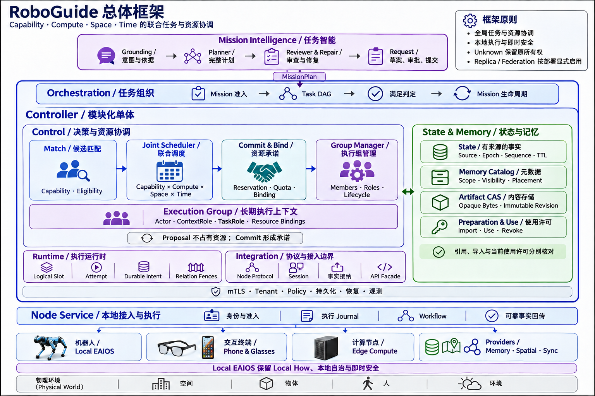

# RoboGuide V2 架构基线

代码核对：2026-11-26 · `main@3c7136d6`。图文描述代码职责与协议边界；实际设备结果须另查原验收证据。

RoboGuide 将异构执行体、计算节点和交互设备组织为共享 Mission 的任务、调度、执行、状态与恢复闭环。它联合考虑 Capability、Compute、Space、Time，同时保留 Local EAIOS 的本地执行方式与即时安全权威。Controller 当前是模块化单体：各职责在同一应用事务中协作，不代表每个框都是独立微服务。

<!-- diagram:overview:zh -->

## 如何阅读

1. [Handbook](architecture-handbook.md)
2. [Current architecture atlas](current-architecture.md)
3. [Protocol flows](system-dataflows.md)
4. [Concepts](concepts.md)

## 对象与生命周期

| 对象 | 所有权与含义 |
| --- | --- |
| Mission Request | MI 的对话、草案、审批和提交过程；独立于 Controller Mission |
| MissionPlan | 原目标、Actor、Context、Task DAG、要求和满足依据 |
| Actor / ContextRole / TaskRole | 逻辑参与者、持续上下文角色与执行槽；不是物理机器人 |
| Execution Group | Control 拥有的长期任务上下文；当前默认一个 Mission 一个 Group，修订可创建后继 Group |
| Attempt | `(Group, Task, Role)` 槽在具体 Node/session/generation 上的一次执行 |
| Node / PhysicalEntity | 协议接入边界与部署执行实体；与 Host 分别判断 |

## 核心不变量

1. Proposal 不等于 Commit；Scheduler 不持有资源，Group Manager 保持在 Control。
2. 本地 Completed 不等于 TaskSatisfied、Mission 成功或资源释放。
3. 权威变更先持久提交，随后才发送 outbox；事实持久接纳后才 ACK。
4. Unknown 保留副作用歧义与所有权，不通过换 ID、超时或重启自动消除。
5. Memory 的 Scope、Visibility、Placement 与当前使用许可分别核对。
6. State 的来源和时效不能因缓存、重放或恢复而刷新。
7. Local EAIOS 保留 Local How 与即时安全；软件进程证明不升级为物理安全证明。

## 实现与证据

V2 继续定义职责与权威语义。当前实现图以本次代码 SHA 为准；协议和存储版本从代码生成的版本参考核对，不能把 Node Protocol、Node Contract、wire Catalog 和本地 config 混成一个版本。已接受 ADR 的历史结论保持原时点；代码存在、单元测试、进程验收、真机结果和长期运行指标分别记录。

[Project goal](../../project-goals-and-mvp.md) · [MVP definition](../../mvp-definition.md) · [ADR guide](../../reference/decision-guide.md)
