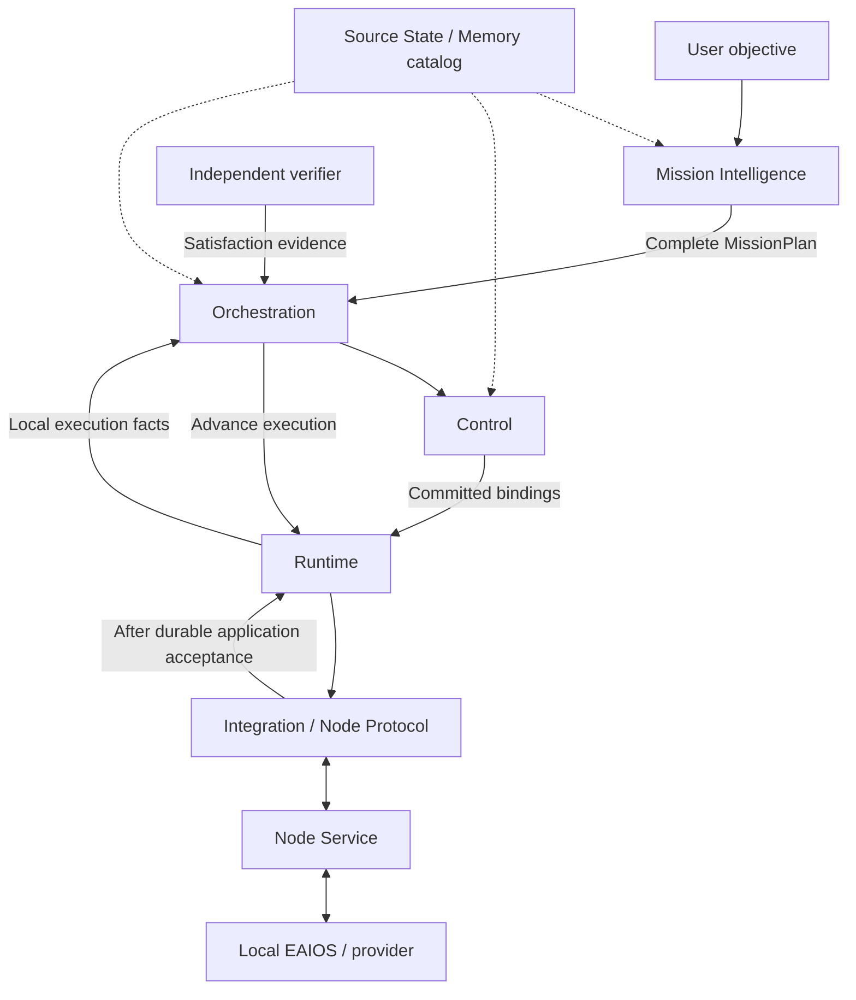
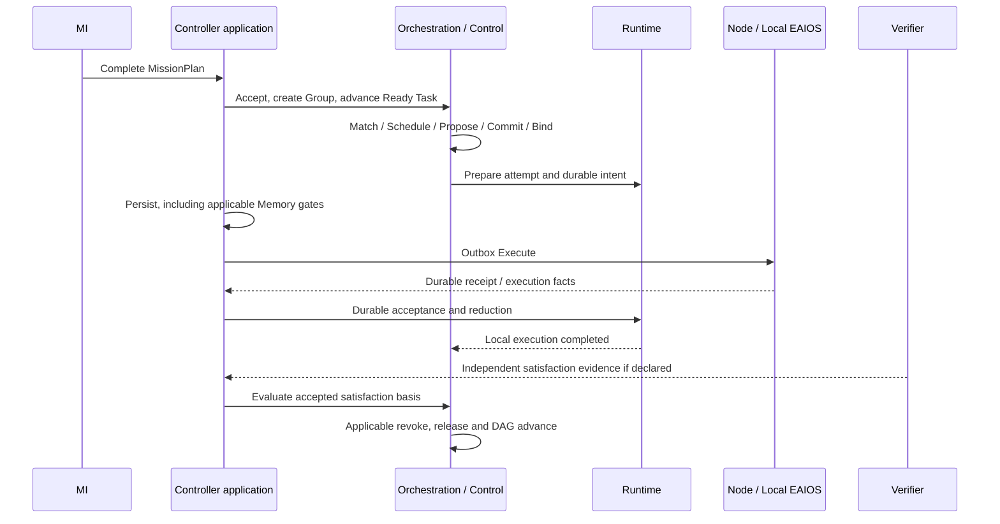
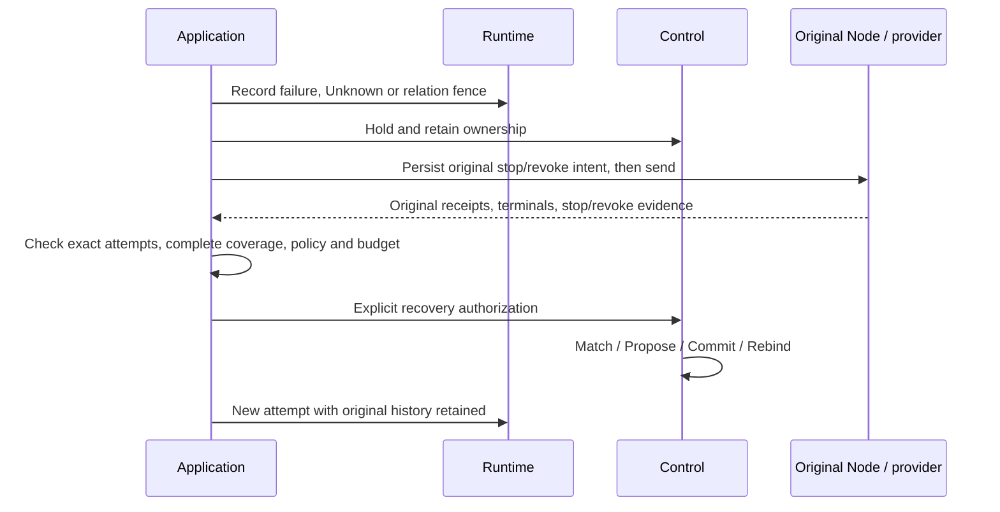
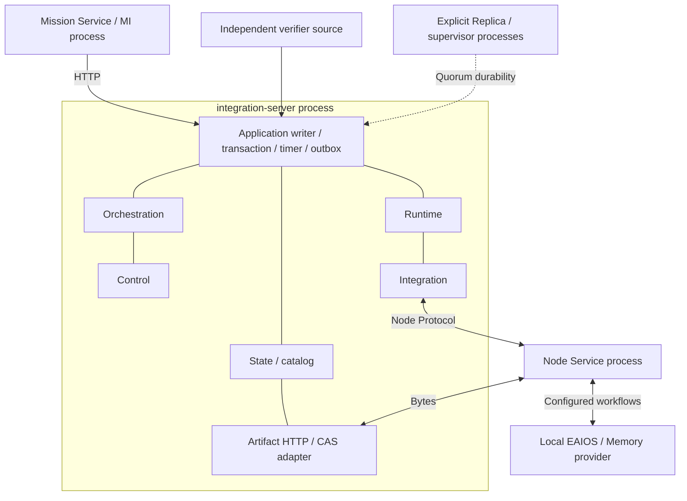

# RoboGuide architecture handbook

Reviewed: 2026-10-22. Code baseline: `495a6d274f6f930016d97ec5514124876e539cfe`.
This explains the [V2 baseline](README.md), accepted ADRs and current code; it introduces no new architecture decision.
[中文](architecture-handbook.md).

See the [Mermaid architecture atlas](current-architecture.en.md) for current code, execution, deployment and evaluation views.

## Purpose and system boundary

RoboGuide coordinates heterogeneous embodied systems over a Mission: interpret objectives, build plans,
select participants, commit resources, track execution and decide satisfaction, release or recovery from evidence.
Participants may be robots, perception terminals, compute or infrastructure. Capability, Compute, Space and Time
are joint decision dimensions; the [implementation audit](../../development/roboguide-branch-audit-2026-10-22.md)
defines the actual supported slices.

Global coordination owns objectives, participants, commitments and collaboration constraints.
Local EAIOS retains perception, navigation, motion, immediate correction and final safety.
Logical modules are not independent microservices: the current Controller combines several responsibilities.

## Logical responsibilities

State, Memory, identity, persistence and observation span the execution chain. Connections indicate collaboration,
not exact transaction or transport ordering.

| Responsibility | Decision authority | Code entry |
| --- | --- | --- |
| Mission Intelligence | Interpretation, clarification, draft, Review, approval and original Request history | `mission/src/mission/request_engine.py` |
| Orchestration | Complete-plan acceptance, DAG readiness, Task satisfaction and Mission lifecycle | `core/orchestration/src/mission/` |
| Control | Eligibility, resource commitment, Actor/Role bindings, Groups and recovery decisions | `core/control/src/` |
| Runtime | Logical slots, attempts/generations, durable intents, facts and relation fences | `core/runtime/src/execution/` |
| Integration | Wire conversion, sessions and Node routes; ACK after application acceptance | `core/integration/src/` |
| Node Service | Journal admission, configuration compilation and generic workflows | `core/node-service/src/` |
| Local EAIOS | Actual operations, local storage and immediate safety | `integrations/` and deployment configuration |
| Controller application | Writer, transactions, timer, outbox and composed gates | `apps/integration-server/src/application/` |

The Scheduler consumes filtered Candidate Sets and a calendar and returns a selection. Control Commit alone creates
commitments. Application composition does not introduce a second resource or execution authority.

## Objects, identity and ownership

| Object | Meaning |
| --- | --- |
| Mission Request | Dialogue, grounding, drafts, approval and submission; distinct from an accepted Mission |
| MissionPlan | Declared objective, Actors, Contexts, Task DAG, constraints and satisfaction policies |
| Actor | A logical participant continuous across Tasks within a Mission |
| ContextRole | Places an Actor in a persistent collaboration context |
| TaskRole | An execution slot referencing a ContextRole and declaring requirements and ExecutionIntent |
| Execution Group | Persistent membership, bindings, resources and recovery context; currently one per Mission by default |
| Execution attempt | One execution of a logical slot on an exact Node/session/generation |
| Node | An execution/capability/liveness admission boundary; not necessarily one physical host |
| PhysicalEntity | A deployment-owned execution identity; distinct from a logical Actor |

A Capability Requirement states what a participant must demonstrate. ExecutionIntent states the requested effect.
Operation Support declares an exact canonical operation; private Operation Bindings map that operation to Local How.
The current one-addressable-entity-per-Node restriction is a deployment protocol limit, not the Actor definition.

Ordinary recovery cannot silently replace an Actor's physical entity. Explicit takeover requires exact authorization,
original stop evidence, a fresh Commit and Rebind. Consult the ADR index for the physical-executor identity contract.

## Normal execution lifecycle

“Produce a file, then verify it” is a conceptual example. The website quickstart separately identifies tested runnable examples.

1. MI freezes grounding, generates Task A and dependent Task B using the stable Catalog, then performs Review,
   bounded repair and approval. MI never selects a current Node.
2. Configured published-contract preflight checks the exact plan and frozen sources. Passing reserves nothing
   and does not prove current deployability.
3. Orchestration accepts the complete plan and asks Control to create the Group and all TaskExecutions,
   before any individual Task Commit.
4. Ready Tasks follow `Match → Schedule → Propose → Commit → Bind`. Commit rechecks State, tenant,
   resources and logical quota. Due future intervals must pass current admission again.
5. Explicit Memory prerequisites require original-context persistence, Prepare, original-provider import/reconciliation,
   current availability and use gates. Group pending barriers and original deadlines apply before each send.
6. Application persistence commits the dispatch intent, attempt and related authority changes before outbox Execute.
   The Node journals admission before invoking Local How.
7. Receipts, execution and observation facts receive ACK only after durable application acceptance;
   Runtime reduces the current attempt.
8. Local Completed enters the satisfaction path. Orchestration consumes execution-report or exact verifier evidence
   according to the accepted basis. Local completion cannot replace a required independent verifier.
9. Applicable Memory revoke gates precede normal release. Control releases Task ownership and the DAG advances;
   live sibling Tasks retain permission. Mission completion and final Group release require all closing conditions.

## State, Memory and Artifact

State retains source, channel, schema, source time, Controller receive time, TTL and semantics.
Reported, Observed, Derived and Belief do not merge implicitly. The unified API is a read-only federation,
not a new write or global truth authority. Control uses explicit consumer policies.

Memory content remains with its original provider. The catalog contains manifests, discovery and placement evidence;
content moves selectively. Artifact CAS stores opaque bytes, outside Runtime checkpoints and Node Protocol.

| Evidence | What it does not establish |
| --- | --- |
| Discoverable catalog metadata | Permission to read content |
| Artifact hash/reference | Import by a particular Node/provider |
| Imported placement history | A fresh use grant for another Task |
| Current availability/use receipt | Active-map selection or localization |
| Actual software-process exit / content revoke | Device stopping or physical handoff |

Scope, Visibility and Placement are independent. Handoff requires original membership, attempts, stop/revoke,
scoped child lineage, target preparation and explicit commit. GC follows original-provider reference and revoke gates.
Recovery bundles compare declared active references with the same bundle's CAS; this does not cover unknown providers.

## Failure, stopping and recovery

Unknown means unresolved execution ambiguity. Ownership and fences remain; it neither implies Failed nor authorizes
repeating possibly completed effects under a new ID. Cancel receipt, Cancelled terminal and independent safe-state
are separate gates. Natural Failed/Completed reconciliation preserves the result; actual OS wait proves only the original process exit.

Runtime plan revision is a separate authorization path: original objective, complete stop/revoke, MI claim/nonce,
independent Review, then a fresh Group and normal Control admission. Resume/recovery cannot bypass a pending revision.
Restart, replay and read-only observation never renew original budgets, TTLs or permissions.

## Current deployment

The default is one Controller, including valid zero-Node deployment. Explicit HA adds Replica and supervisor processes.
Consensus does not replicate all CAS content; cold recovery does not prove online cross-host continuity.
Control's Federation session types are not a cross-domain service entrypoint. Eval Harness organizes experiments externally;
Habitat's official outcomes remain environment-authoritative.

## Review coverage and open boundaries

Static review covers MI RequestEngine, plan acceptance/satisfaction, Control Commit/Bind,
RuntimeExecutionManager, IntegrationRuntimeBridge, Node journal, and application write/persistence/Memory/recovery gates.
Referenced software acceptance records are not new physical measurements.

Tenant/category quota is logical accounting, not resource subdivision or OS/GPU enforcement. Owned CPU-worker rlimit
proof cannot be generalized to every resource. Running preemption, coupled migration, cross-domain transport,
online content recovery and the full composed fault matrix remain bounded by the
[current inventory audit](../../development/roboguide-branch-audit-2026-10-22.md).
Q1–Q7 have partial answers; neither their age nor Accepted ADR status establishes overall completion.
