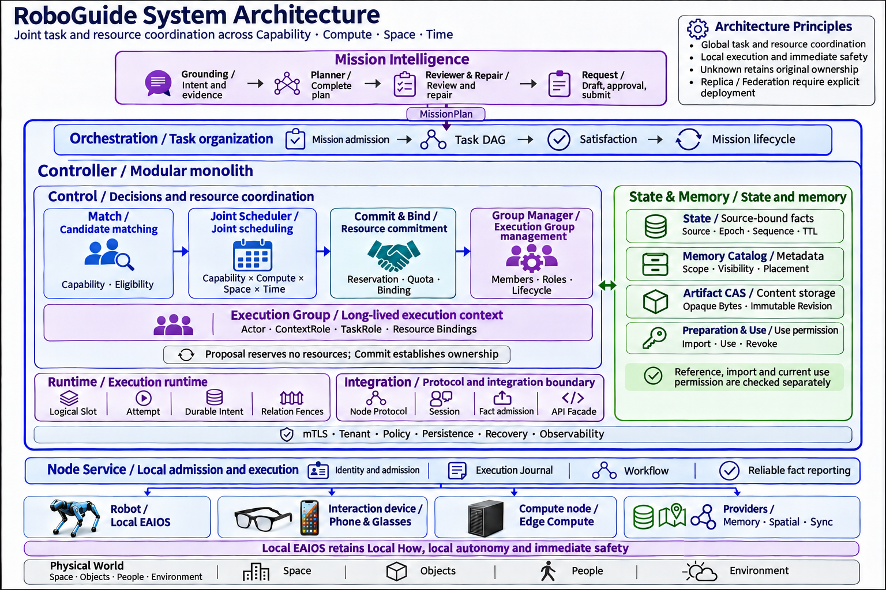

# Architecture reading handbook

Code reviewed: 2026-11-26 · `main@3c7136d6`. Figures describe implemented responsibilities and protocol boundaries; device outcomes require original acceptance evidence.

RoboGuide coordinates heterogeneous bodies, compute nodes and interaction devices around a shared Mission: planning, scheduling, execution, state and recovery. It jointly considers Capability, Compute, Space and Time while Local EAIOS retains local execution and immediate safety. The Controller is currently a modular monolith; a responsibility box does not imply a separate microservice.

<!-- diagram:overview:en -->

## Follow one unit of work

1. The application commits authority, checkpoint and outbox before sending Execute.
2. The Node journal binds invocation, workflow digest, resources and generation; duplicate commands return the original record.
3. Local locks and capacity gates precede workflow effects; Local EAIOS performs the operation.
4. CommandPersisted proves journal admission; execution facts arrive separately.
5. Controller ACK follows durable fact acceptance; old sessions and expired evidence cannot authorize new effects.

## Read by question

| Question | Topic |
| --- | --- |
| RoboGuide system framework | [Atlas](current-architecture.en.md) · [Flows](system-dataflows.en.md) |
| From conversation to a reviewed plan | [Atlas](current-architecture.en.md) · [Flows](system-dataflows.en.md) |
| From candidates to durable execution | [Atlas](current-architecture.en.md) · [Flows](system-dataflows.en.md) |
| Satisfaction and resource release | [Atlas](current-architecture.en.md) · [Flows](system-dataflows.en.md) |
| State, Memory and spatial content | [Atlas](current-architecture.en.md) · [Flows](system-dataflows.en.md) |
| Unknown, stopping and recovery | [Atlas](current-architecture.en.md) · [Flows](system-dataflows.en.md) |
| Four cooperation modes | [Atlas](current-architecture.en.md) · [Flows](system-dataflows.en.md) |
| Processes, storage and failure domains | [Atlas](current-architecture.en.md) · [Flows](system-dataflows.en.md) |

## Evidence that must remain distinct

Runtime reduces current Role execution facts but does not own TaskSatisfied. Local Completed enters AwaitingSatisfaction. Orchestration consumes only the accepted plan’s basis: execution-report is an explicit option, not independent goal verification. Verifier evidence must match the original plan, predicate, current attempt, source and freshness.

Unknown means the original execution’s effects remain ambiguous. Original ownership, stop fences and budgets remain; changing IDs cannot authorize replay. Cancel receipt, local terminal state, independent safe state and Memory revocation are distinct proofs. Process exit proves only that the original process exited, not device stopping.

[V2 semantics](README.en.md) · [Concepts](concepts.en.md)
