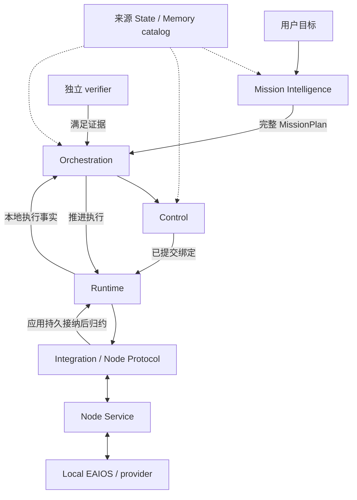
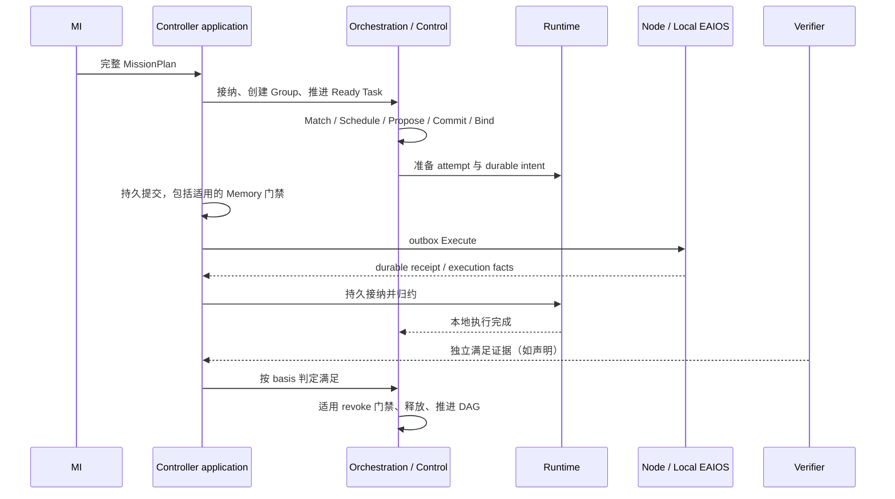
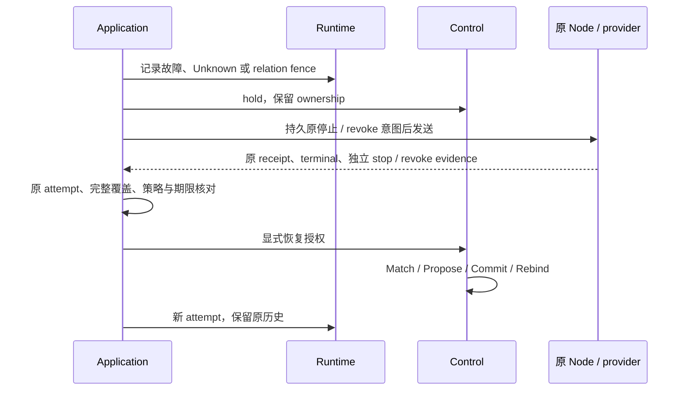
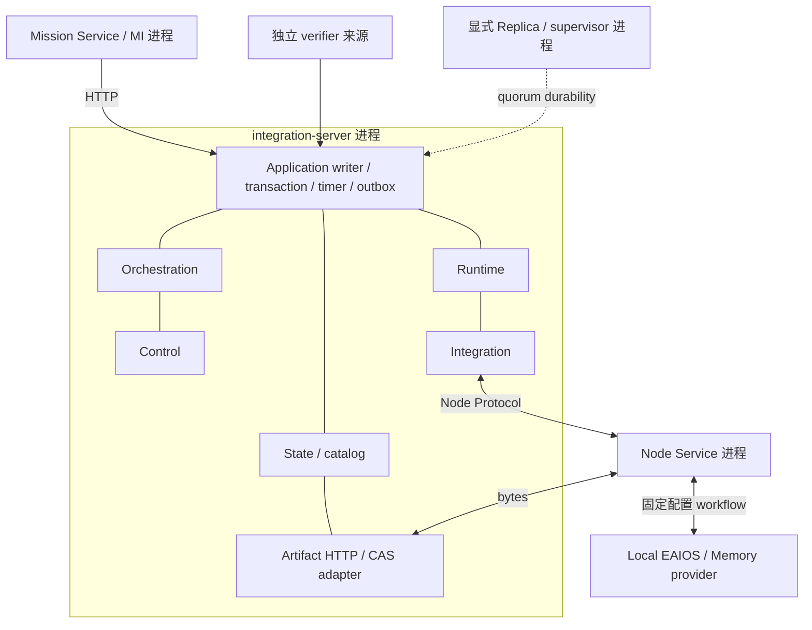

# RoboGuide 架构手册

核对日期：2026-10-22。代码基线：`45a82410867e01241394d1b9116aa53634ce2a06`。
本文是对 [V2 基线](README.md)、已接受 ADR 与当前代码的解释，不新增架构决策。
[English](architecture-handbook.en.md)。

## 系统定位

RoboGuide 组织异构具身系统持续完成 Mission：理解目标、形成计划、选择参与者、承诺资源、
推进执行，并依据证据决定满足、释放或恢复。参与者可以是机器人、感知终端、计算节点和基础设施。
联合调度的四个维度是 Capability、Compute、Space、Time；当前具体支持范围见
[实现状态核对](../../development/roboguide-branch-audit-2026-10-22.md)。

全局侧决定目标、参与者、承诺和协作约束。Local EAIOS 保留感知、导航、运动、即时纠偏和最终安全。
逻辑模块不等于独立微服务：当前 Controller 内组合多个职责，Node 和 Local EAIOS 位于部署侧。

## 逻辑职责

State、Memory、身份授权、持久化和观测横跨执行链。图中的连接表示职责协作，
不替代实际应用事务、注册或传输顺序。

| 职责 | 决定什么 | 代码入口 |
| --- | --- | --- |
| Mission Intelligence | 解释、澄清、草案、Review、审批和原请求历史 | `mission/src/mission/request_engine.py` |
| Orchestration | 接纳完整计划、DAG readiness、Task satisfaction、Mission 生命周期 | `core/orchestration/src/mission/` |
| Control | eligibility、资源承诺、Actor/Role 绑定、Group、恢复决定 | `core/control/src/` |
| Runtime | logical slot、attempt/generation、durable intent、执行事实和关系 fence | `core/runtime/src/execution/` |
| Integration | wire 转换、session、Node 路由，等待应用接纳再 ACK | `core/integration/src/` |
| Node Service | journal 接纳、配置编译、通用本地工作流 | `core/node-service/src/` |
| Local EAIOS | 实际操作、本地存储与即时安全 | `integrations/` 与部署配置 |
| Controller application | writer、事务、timer、outbox 和跨职责门禁 | `apps/integration-server/src/application/` |

Scheduler 消费已过滤 Candidate Set 与日历，给出选择；只有 Control Commit 形成承诺。
Application 负责事务组合，不建立第二份资源或执行权威。

## 对象、身份与所有权

| 对象 | 含义 |
| --- | --- |
| Mission Request | 对话、grounding、草案、审批和提交过程；还不是 Controller 已接受的 Mission |
| MissionPlan | 已声明的目标、Actors、Contexts、Task DAG、约束和满足标准 |
| Actor | Mission 内跨 Task 连续的逻辑参与者 |
| ContextRole | 将 Actor 放入持续协作上下文 |
| TaskRole | 引用 ContextRole 的执行槽，声明 capability requirements 与 ExecutionIntent |
| Execution Group | 长期成员、绑定、资源和恢复上下文；当前默认一个 Mission 一个 Group |
| Execution attempt | 逻辑槽在具体 Node/session/generation 上的一次执行 |
| Node | execution/capability/liveness 接入边界；不等于一台物理机 |
| PhysicalEntity | 部署拥有的可绑定执行实体；不等于逻辑 Actor |

Capability Requirement 回答“承担槽位需要证明什么”；ExecutionIntent 回答“选中后完成什么”；
Operation Support 说明 Node 支持哪个 canonical operation；Operation Binding 在 Node 配置中映射 Local How。
当前一 Node 一可寻址实体是协议部署限制，不是 Actor 的定义。

普通恢复不能静默更换已绑定 Actor 的实体。跨实体 takeover 需要额外的精确授权、停止证据、
新 Commit 和 Rebind。[ADR-0040](../../decisions/0040-mission-actor-binding-semantics.md)
记录物理执行身份合同；具体 ADR 路径以索引为准。

## 正常执行闭环

以下“生成文件 → 验证文件”是解释语义的通用例子；可运行路径由网站快速开始另行验证。

1. MI 保存不可变 grounding，用稳定 Catalog 生成 Task A（生成文件）和依赖 A 的 Task B（验证文件），
   经 Review、必要修复与审批提交。MI 不选择当前 Node。
2. 已配置的只读发布合同前检检查 exact plan 与冻结来源；通过不预留资源、不证明当前可执行。
3. Orchestration 接纳完整计划，通过 Control 创建 Group 和全部 TaskExecution；这发生在各 Task Commit 之前。
4. Ready Task 经过 `Match → Schedule → Propose → Commit → Bind`。
   Commit 重查当前 State、tenant、资源和逻辑 quota；未来区间到期也重新准入。
5. 声明了 Memory prerequisites 时，先持久原 context，再 Prepare、原 provider 导入/对账、
   当前 availability 和 use gate。Group pending barrier 与每次发送前的原期限检查保留。
6. 应用持久化 dispatch intent、attempt 和其他权威变更；提交后 outbox 才发送 Execute。
   Node journal 先接纳，再调用 Local How。
7. receipt、执行和观测事实经应用持久接纳后 ACK；Runtime 归约当前 attempt。
8. 本地 Completed 进入等待 satisfaction 的路径。Orchestration 按 accepted basis 消费
   execution-report 或 exact verifier evidence；独立 verifier 要求不能由 local Completed 替代。
9. 正常释放通过适用的 Memory revoke 等门禁，由 Control 释放 Task ownership，DAG 才前进。
   活跃兄弟 Task 保留自己的许可。全部满足和收尾后 Mission 完成，Group 最终释放。

## State、Memory 与 Artifact

State 保留 source、channel、schema、source time、Controller receive time、TTL 和语义。
Reported、Observed、Derived、Belief 不隐式合并。统一 State API 是只读 federation，
不是新的写入或全局真值权威。Control 的显式 consumer policy 决定哪些当前证据可用。

Memory 内容由原 provider 保有，catalog 保存 manifest、发现与 placement 证据，按需选择性交换。
Artifact CAS 存 opaque bytes；bytes 不进入 Runtime checkpoint 或 Node Protocol。

| 证据 | 不能由它推断的下一步 |
| --- | --- |
| 可发现 catalog metadata | 获准读取内容 |
| Artifact hash/reference | 某 Node/provider 已导入 |
| Imported placement history | 新 Task 的当前使用许可 |
| 当前 availability/use receipt | active-map 或定位成立 |
| 软件进程退出 / 内容 revoke | 设备停止或物理交接完成 |

Scope、Visibility、Placement 独立。handoff 需原成员、attempt、停止与撤销、新 scope child lineage、
目标准备和显式 commit。GC 需原 provider 的引用与撤销门禁；恢复包按声明范围核对 active refs 与
同包 CAS，不能据此声称覆盖未注册的其他 provider。

## 失败、停止与恢复

`Unknown` 表示恢复待定的执行歧义，保留 ownership 与 fence，不自动变成 Failed，也不授权
换 ID 重做可能已经发生的副作用。Cancel receipt、Cancelled terminal 和独立 safe-state 是不同 gate。
自然 Failed/Completed 对账保留原结果；软件进程实际 wait 只证明原进程退出。

运行期计划修订是另外的授权路径：冻结原目标、原 stop/revoke、MI claim/nonce、独立 Review，
然后创建新 Group 并正常准入。普通 resume/recovery 不能绕过待完成修订。
重启、重放或只读观察不刷新原预算、TTL 或权限。

## 当前部署

默认单 Controller，可零 Node 启动；显式 HA profile 另有副本与 supervisor。
副本共识不复制所有 CAS 内容；静止恢复不是在线跨主机连续性；Control 内 Federation session
不等于已经有跨域服务入口。Eval Harness 在系统外编排实验、归档证据；Habitat 官方结果仍由环境权威判定。

## 核对与开放边界

本次静态核对覆盖 MI RequestEngine、Orchestration acceptance/satisfaction、Control Commit/Bind、
RuntimeExecutionManager、IntegrationRuntimeBridge、Node journal，以及 application 的
write gate、persistence、Memory 与 recovery 接线。测试结果和软件验收引用原记录，不能改写为本次物理实测。

当前 quota 是 tenant/category 逻辑记账，不是资源切分或 OS/GPU 强制；独立 CPU worker 的
rlimit proof 也不能推广到所有资源。运行中抢占、复杂耦合迁移、跨域 transport、在线内容恢复和
完整跨阶段故障矩阵仍须按[最新存量核对](../../development/roboguide-branch-audit-2026-10-22.md)逐项评估。
旧 Q1–Q7 已有局部答案，不能统称完全未实现；ADR Accepted 也不表示总体验收完成。
