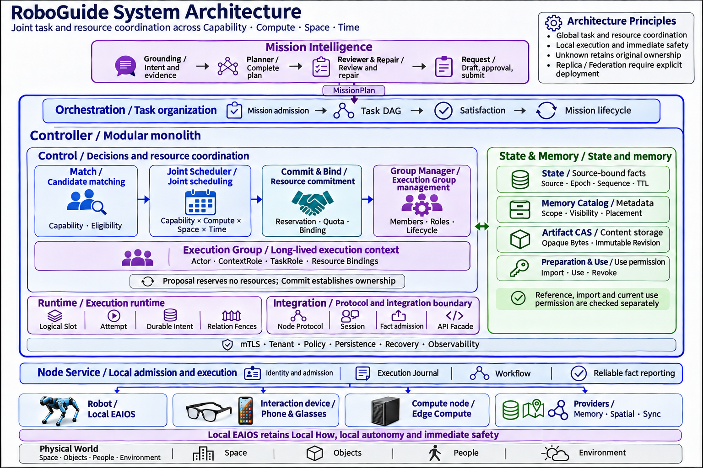

# Architecture tour

Code reviewed: 2026-11-26 · `main@3c7136d6`. Figures describe implemented responsibilities and protocol boundaries; device outcomes require original acceptance evidence.

<!-- diagram:overview:en -->

RoboGuide coordinates heterogeneous bodies, compute nodes and interaction devices around a shared Mission: planning, scheduling, execution, state and recovery. It jointly considers Capability, Compute, Space and Time while Local EAIOS retains local execution and immediate safety. The Controller is currently a modular monolith; a responsibility box does not imply a separate microservice.

[Handbook](architecture-handbook.en.md) · [Eight figures](current-architecture.en.md) · [Flows](system-dataflows.en.md)
