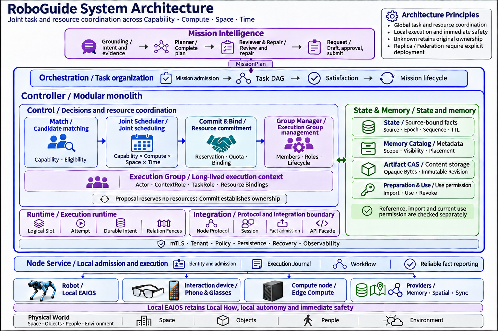
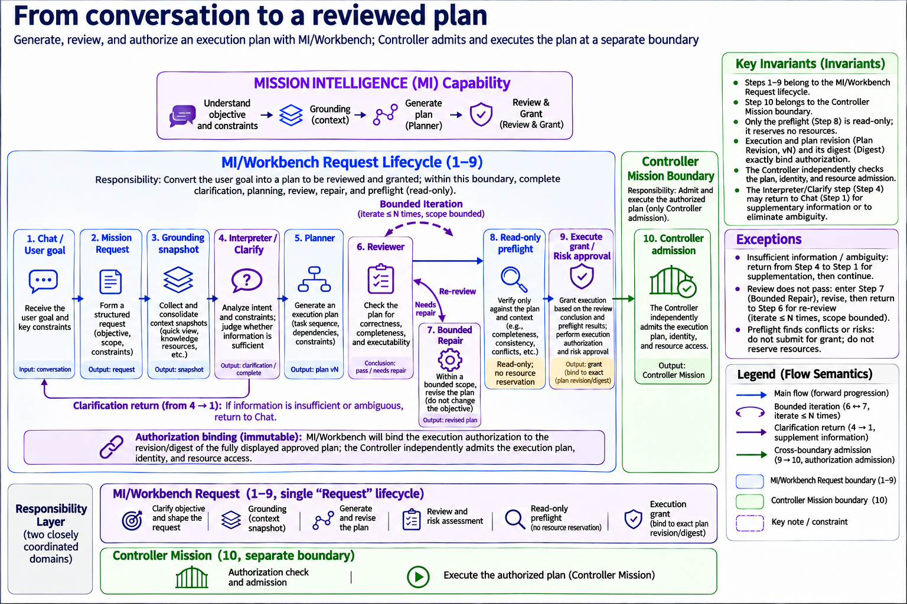
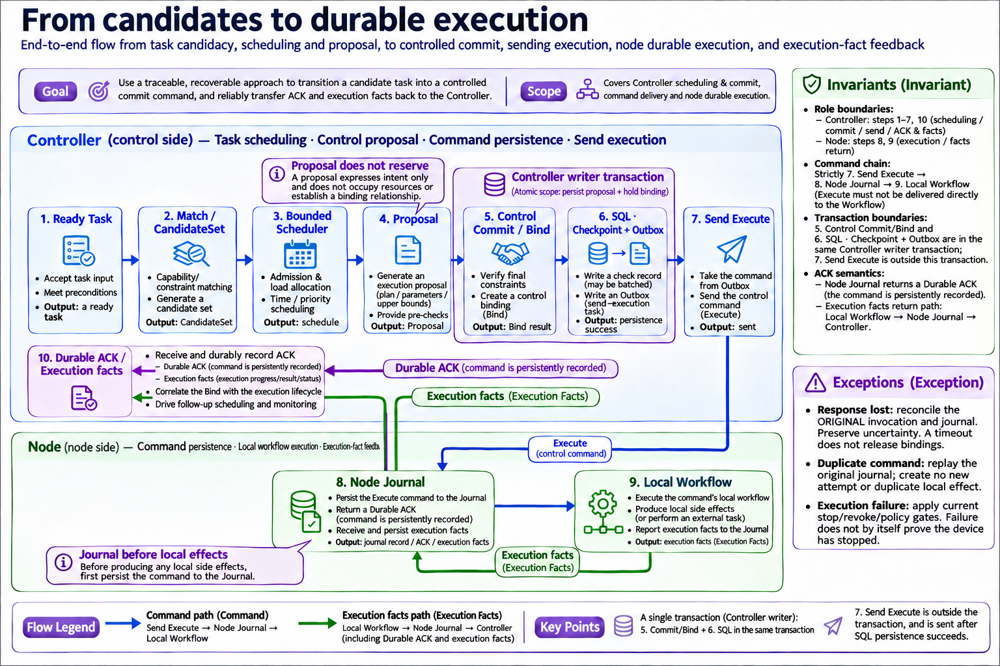
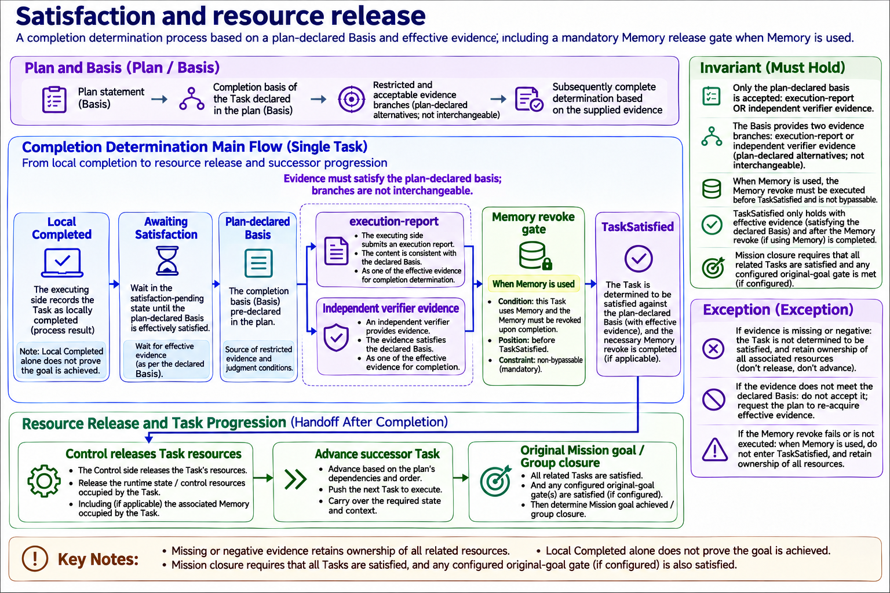
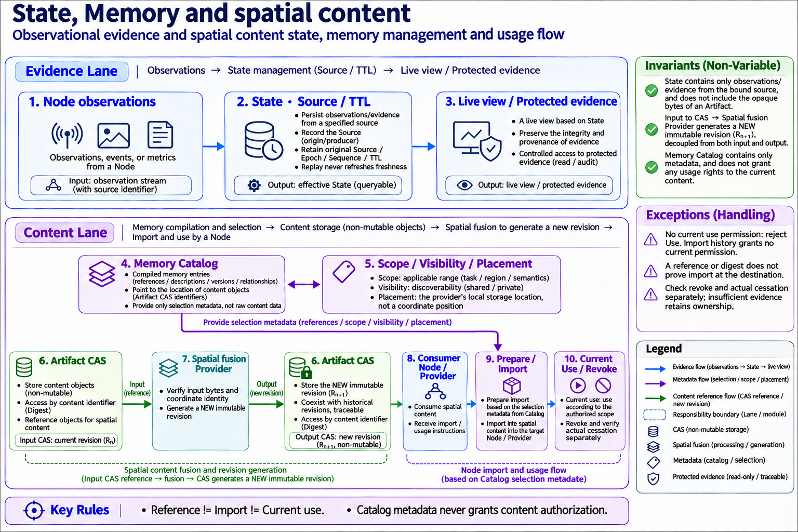
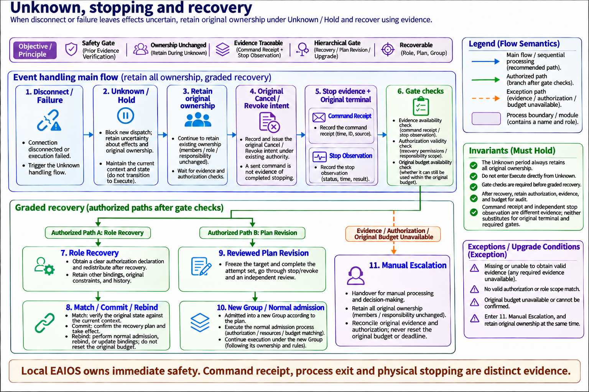
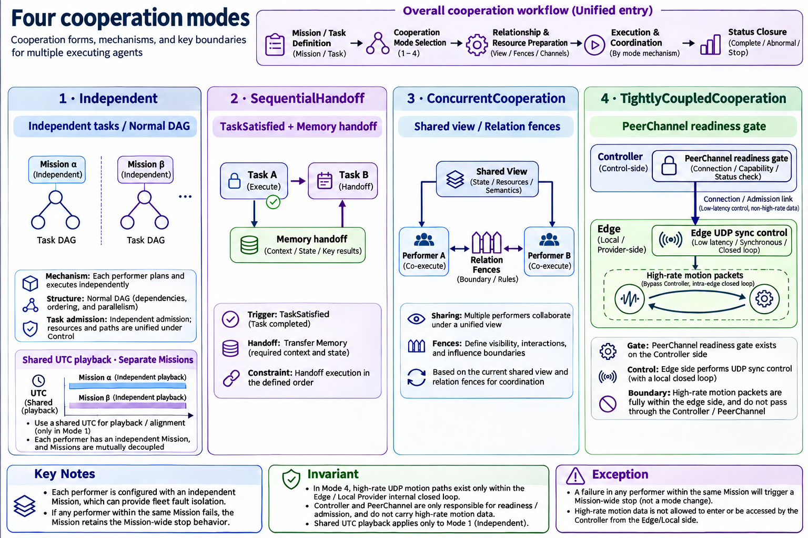
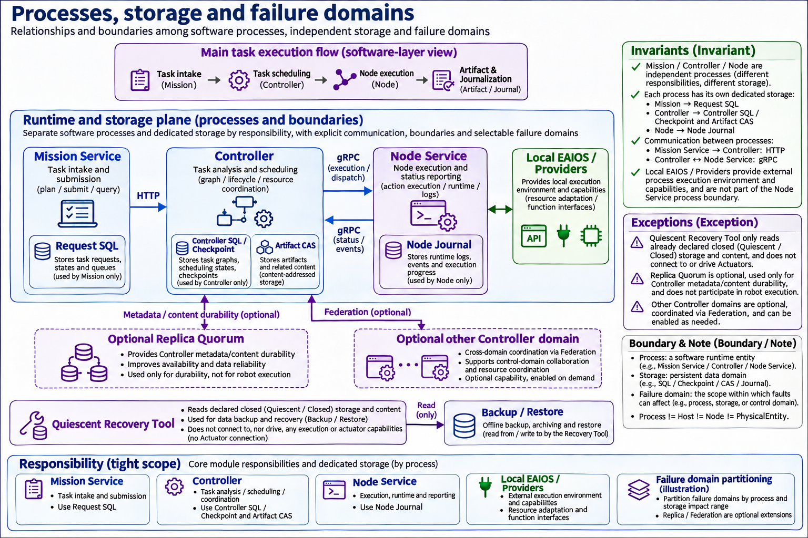

# Current mainline architecture atlas

Code reviewed: 2026-11-26 · `main@3c7136d6`. Figures describe implemented responsibilities and protocol boundaries; device outcomes require original acceptance evidence.

The first plate describes the system framework and ownership; the other seven cover specific flows. The accompanying text and source files define exact steps, exceptions and protocol boundaries. Open each figure for the original resolution.

## RoboGuide system framework

<!-- diagram:overview:en -->

RoboGuide coordinates heterogeneous bodies, compute nodes and interaction devices around a shared Mission: planning, scheduling, execution, state and recovery. It jointly considers Capability, Compute, Space and Time while Local EAIOS retains local execution and immediate safety. The Controller is currently a modular monolith; a responsibility box does not imply a separate microservice.

1. Mission Intelligence produces a complete semantic plan; it does not allocate current Nodes.
2. Orchestration owns the DAG, satisfaction and Mission lifecycle.
3. Control owns eligibility, commitments, bindings, Groups and recovery decisions.
4. Runtime owns logical slots, physical attempts, durable intents and relation fences.
5. Integration and Node Service connect actual sessions to local workflows; State/Memory supplies attributed evidence horizontally.

Code evidence:[main.rs](../../../apps/integration-server/src/main.rs) · [lib.rs](../../../core/orchestration/src/lib.rs) · [lib.rs](../../../core/control/src/lib.rs) · [mod.rs](../../../core/node-service/src/service/mod.rs)

## From conversation to a reviewed plan

<!-- diagram:mission-planning:en -->

Conversation first becomes a durable Mission Request. Grounding records controlled facts, provenance, freshness and acquisition gaps. The interpreter can request clarification. Planner drafts pass contract and Catalog validation before independent Review; structural regeneration and semantic Repair have distinct bounded budgets. Infrastructure failures do not silently become draft retries.

1. Draft-only intent survives parameter clarification and cannot silently authorize execution.
2. Execute and approval bind the displayed draft revision and digest; risk approval independently checks server authority.
3. Read-only preflight checks contracts, dependency windows and optional deployment declarations, without reservations.
4. Submission identity is persisted before sending; response loss retains ambiguity and reconciles the original request.
5. Request Accepted means Controller admission, not device completion.

Code evidence:[request_engine.py](../../../mission/src/mission/request_engine.py) · [task_tools.py](../../../mission/src/roboguide_workbench/task_tools.py) · [plan_validation.rs](../../../apps/integration-server/src/application/plan_validation.rs)

## From candidates to durable execution

<!-- diagram:dispatch:en -->

A Ready Task is jointly scheduled within its currently eligible candidates. The bounded Scheduler suggests Nodes, resources and time; a Proposal owns no resources. Under the current writer transaction, Control rechecks State, tenant, quota, conflicts and physical bindings before Commit and Bind. Future reservations still require admission at activation.

1. The application commits authority, checkpoint and outbox before sending Execute.
2. The Node journal binds invocation, workflow digest, resources and generation; duplicate commands return the original record.
3. Local locks and capacity gates precede workflow effects; Local EAIOS performs the operation.
4. CommandPersisted proves journal admission; execution facts arrive separately.
5. Controller ACK follows durable fact acceptance; old sessions and expired evidence cannot authorize new effects.

Code evidence:[scheduling.rs](../../../core/orchestration/src/mission/scheduling.rs) · [coordination.rs](../../../core/control/src/coordination.rs) · [write_gate.rs](../../../apps/integration-server/src/application/write_gate.rs) · [admission.rs](../../../core/node-service/src/engine/admission.rs)

## Satisfaction and resource release

<!-- diagram:completion:en -->

Runtime reduces current Role execution facts but does not own TaskSatisfied. Local Completed enters AwaitingSatisfaction. Orchestration consumes only the accepted plan’s basis: execution-report is an explicit option, not independent goal verification. Verifier evidence must match the original plan, predicate, current attempt, source and freshness.

1. Local completion neither releases bindings nor immediately advances successors.
2. When Memory is used, applicable preparation/use revocation proof must pass first.
3. After satisfaction, Control releases Task resources; Context resources retain their original scope.
4. DAG successors then become Ready; active siblings keep their own ownership.
5. Mission completion additionally requires all Tasks, any configured original-goal gate and complete Group closure.

Code evidence:[lifecycle.rs](../../../core/orchestration/src/mission/lifecycle.rs) · [outcomes.rs](../../../apps/integration-server/src/application/outcomes.rs) · [memory_use.rs](../../../apps/integration-server/src/application/memory_use.rs)

## State, Memory and spatial content

<!-- diagram:state-memory:en -->

State keeps independent facts keyed by object, semantic, source and channel, retaining source time, receive time, epoch, sequence and TTL. Reported, Observed, Derived and Belief do not automatically become global truth. Ordinary telemetry may coalesce or persist on changes/intervals; protected decision and safety evidence keeps its durable acceptance boundary.

1. Memory Catalog owns metadata and reconstructable provenance; CAS stores immutable opaque bytes.
2. Scope limits semantic consumption, Visibility controls discovery/exchange, and Placement records provider-local copies.
3. A reference/hash does not prove import; historical import grants no current-use permission.
4. Prepare/Import, current availability/use and revoke retain exact attempt, provider and original budgets.
5. Spatial fusion validates input bytes and frame identities and produces a new revision; map existence proves neither localization nor arrival.

Code evidence:[state_record.rs](../../../core/state/src/state_record.rs) · [memory.rs](../../../core/domain/src/memory.rs) · [memory_preparation.rs](../../../apps/integration-server/src/application/memory_preparation.rs) · [shared_map_job.py](../../../integrations/spatial-provider/roboguide_spatial_provider/shared_map_job.py)

## Unknown, stopping and recovery

<!-- diagram:recovery:en -->

Unknown means the original execution’s effects remain ambiguous. Original ownership, stop fences and budgets remain; changing IDs cannot authorize replay. Cancel receipt, local terminal state, independent safe state and Memory revocation are distinct proofs. Process exit proves only that the original process exited, not device stopping.

1. Local EAIOS owns immediate safety; Controller retains the original stop purpose and attempt.
2. Safety evidence checks current source/session, generation, original declarations, receive times and deadlines.
3. Role recovery re-enters Match/Commit/Rebind only after explicit release authority, preserving other bindings.
4. Plan revision freezes the original goal and complete old attempt cohort; stop/revoke and independent Review precede a new Group and normal admission.
5. Missing evidence, authority or original budget retains ManualEscalation; observations do not reset deadlines.

Code evidence:[safety_stop.rs](../../../apps/integration-server/src/application/safety_stop.rs) · [recovery.rs](../../../apps/integration-server/src/application/recovery.rs) · [switching.rs](../../../apps/integration-server/src/application/plan_revision/switching.rs)

## Four cooperation modes

<!-- diagram:cooperation:en -->

Coupling modes are explicit accepted-plan semantics. Independent uses the ordinary DAG. SequentialHandoff advances after satisfaction and data handoff gates. ConcurrentCooperation retains shared views and relation fences. TightlyCoupledCooperation gates dispatch on both endpoints’ PeerChannel evidence. Controller does not carry high-rate relative motion control.

1. If a RequiresActive source ends before its target, the relation is violated; local success cannot erase the fence.
2. sync-provider’s mobility.sync-follow@v1 exchanges progress, barriers and ESTOP over edge UDP; Controller consumes lifecycle/readiness facts.
3. choreography.play@v1 verifies clock offset and plays local tracks from a shared UTC start.
4. Separate Missions isolate performer faults; a shared Mission retains Mission-wide failure-stop semantics.
5. Sim, HTTP chassis and Robonix Lite3 are adapter paths; code/simulation does not prove physical stopping or actual emergency latency.

Code evidence:[manager.rs](../../../core/runtime/src/relation/manager.rs) · [server.rs](../../../apps/integration-server/src/controller_http/server.rs) · [sync_engine.py](../../../integrations/sync-provider/roboguide_sync/sync_engine.py) · [choreography_engine.py](../../../integrations/sync-provider/roboguide_sync/choreography_engine.py)

## Processes, storage and failure domains

<!-- diagram:deployment:en -->

Mission Service, Controller, Node Service and deployment-side Providers have distinct process responsibilities. A Node is not a physical host. Controller composes existing modules with its SQL/CAS; Node owns its execution journal. Optional Replica and cross-domain Federation require explicit deployment contracts; a diagram does not enable them.

1. Request SQL, Controller SQL/CAS and Node journal belong to different authorities and are not interchangeable recovery inputs.
2. Replica provides durability for the current Controller’s metadata and declared content; it does not independently match or execute robot tasks.
3. Federation retains original domains, all Commit receipts, writer epochs, clocks and budgets; execution still passes local gates.
4. Standalone Storage v3 and replication profiles are negotiated separately, not assumed to compose by default.
5. Recovery Tool backs up, verifies and restores explicitly quiescent storage/content; software recovery does not establish cross-host or physical continuity.

Code evidence:[main.rs](../../../apps/integration-server/src/main.rs) · [lib.rs](../../../core/controller-replication/src/lib.rs) · [main.rs](../../../apps/controller-replica/src/main.rs) · [__main__.py](../../../apps/recovery-tool/roboguide_recovery/__main__.py)

## Image provenance and history

[Generation briefs, prompts and records](../../images/architecture/2026-11-26/README.en.md). The original V2 PNG, Mermaid/SVG and previous architecture documents remain historical material, not current implementation figures.
