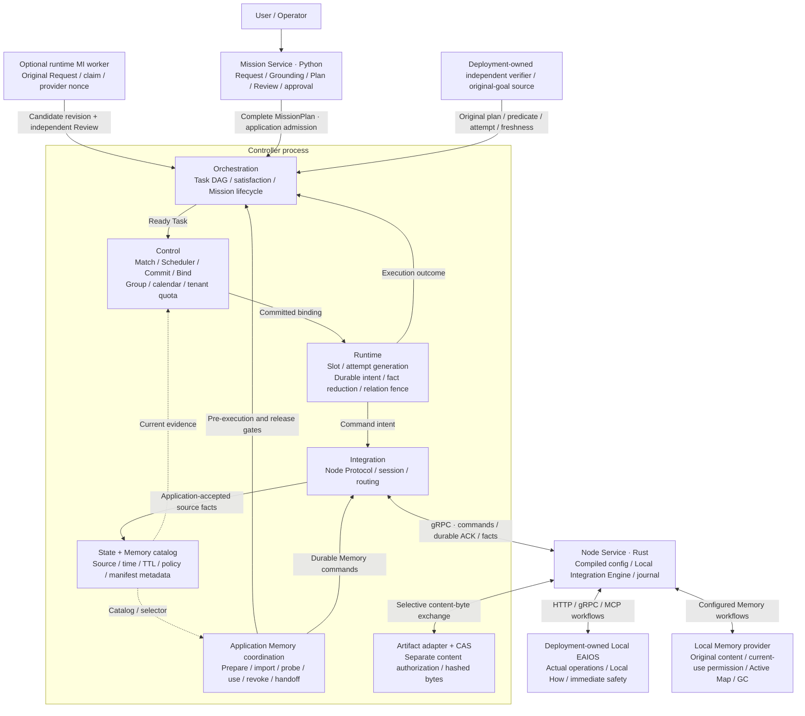
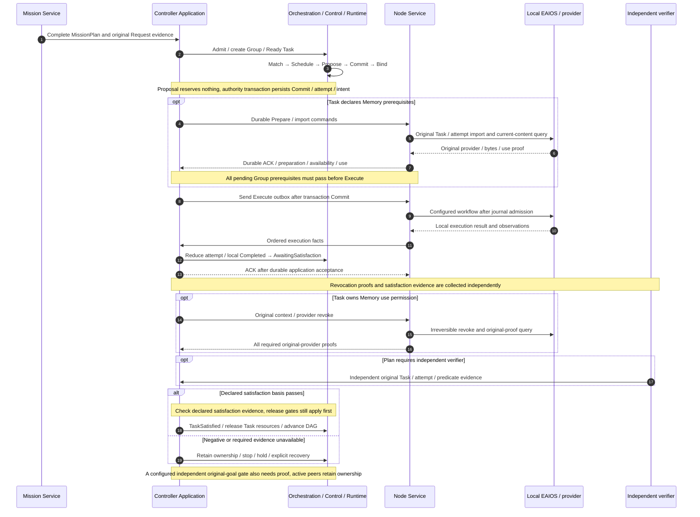
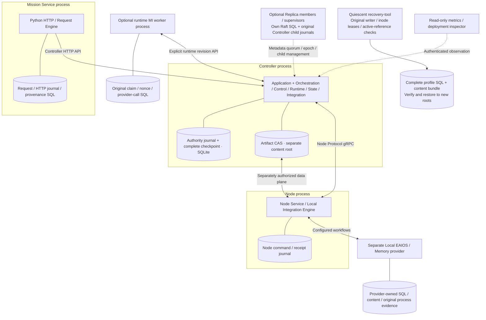
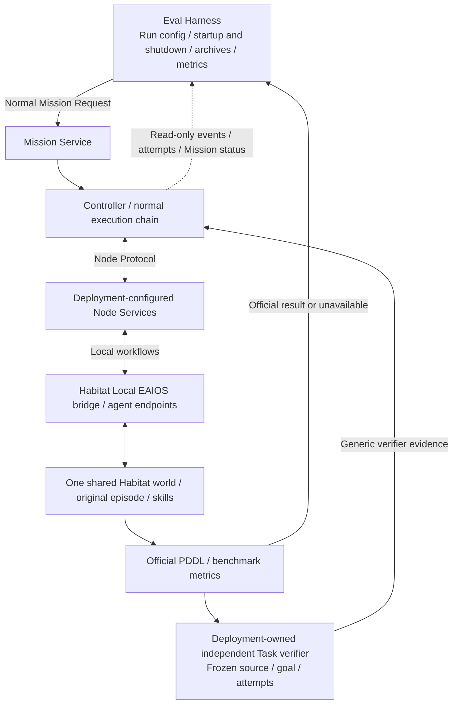

# Current code architecture (Mermaid)

Reviewed: 2026-10-22. Code baseline: `495a6d274f6f930016d97ec5514124876e539cfe`.
[中文](current-architecture.md). These views redraw the implemented V2 architecture from modules,
call chains and composition roots. They introduce no new authority or change to [V2 semantics](README.md).
Accepted ADRs govern subsequent evolution.

ADR-0184 implements parent8/Root4 cold data recovery with actual second-restore and three-leader software acceptance. Original logical identities and operation history remain unchanged; an explicit Root5
binding separately records the actual restored inodes. Old entry points refuse the new binding.
The bundle must cover the paired parent, Root, active references and exact qualified bytes.
Copying data never completes an original Unknown operation or renews its budget.

ADR-0185 keeps a producer's original Unknown unchanged while its actual incarnation remains live
and no scope-close proof exists. It neither retires/releases pins nor invents process-end evidence
or renews effect budgets. Independent parent observation and actual scope closure still gate later
cleanup. This storage concurrency rule provides no device-stop proof.

## System overview

Solid arrows show commands, facts or responsibility collaboration; dotted arrows show read-only inputs.
This is not a Rust import graph. Boxes inside Controller share a process and application transactions.

<!-- architecture-overview:start -->

<!-- architecture-overview:end -->

[Download Mermaid source](../../images/roboguide-current-architecture-english.mmd). The code map below locates every responsibility.

- **Commitment authority.** Scheduler selects within supplied candidates and the Control calendar. Only Control Commit creates a resource obligation after rechecking current State, tenant, quota and conflicts. Group Manager stays in Control.
- **Execution authority.** Runtime owns logical `(Group, Task, Role)` slots, physical attempts and relations. Integration transports facts; the Node journal admits local commands. Application transactions connect these boundaries.
- **Horizontal data.** State preserves source and TTL; the Memory catalog holds rebuildable metadata. Providers and CAS own content. Scope, Visibility and Placement remain independent, and references do not establish current availability.
- **Satisfaction and safety.** Orchestration consumes the plan-declared satisfaction basis. Independent verifiers bind original plan, predicate, attempt and freshness. Local EAIOS retains Local How and immediate safety. A software-process exit receipt establishes only the original process's exit.

## Execution loop and durability order

This is one normal path. Revocation proofs and independent satisfaction evidence may arrive in either
order, and evidence consumption rechecks current authority.

ExecutionReport is an explicit optional satisfaction basis. Local Completed does not automatically count
as independent verification. With Memory, the original Task/context/provider revocation gate precedes
TaskSatisfied and resource release. Unknown, lost responses and recovering attempts retain original ownership
and budgets. Stop, recovery/rebind and plan revision have separate gates. Revision requires original
stop/revoke, goal, Review and Memory declarations, then a fresh Group through ordinary Control Commit.
Model candidates never authorize Execute. See the [lifecycle guide](../../../website/pages/lifecycle.en.md).

## Actual processes and storage boundaries

`integration-server` composes Controller, and `roboguide-node` runs each configured Node.
This configurable process composition does not assume a host count or fault domain. An explicit
[deployment profile](../../../tools/deployment/README.md) declares those facts. Zero Nodes is valid;
multiple Nodes may share a Host.

Replica copies accepted application metadata; member-local transfer, spawn, PID and wait history remains
separate. Recovery handles only complete stores/content declared by an explicit profile, starts no service
and renews no budget. SQL/CAS boxes do not establish online content replication, cross-domain HA or physical
continuity. Control tenant quota accounts for logical commitments. Local Memory process CPU/address-space
`rlimit` receipts are separate evidence, not general GPU, OS or hard-realtime isolation.

## Habitat and Eval Harness integration

This is an existing optional deployment, not a Habitat dependency for every RoboGuide Node. One separate
Habitat process owns a shared world, with agent endpoints exposed through configured Node Services.

The harness never bypasses RoboGuide to call simulator skills. Local navigation/operation Completed,
TaskSatisfied, official `pddl_success` and archived evaluation results preserve separate provenance.
Absent official results remain unavailable rather than false. Software gates do not establish hardware
outcomes. This review starts no Habitat, model or device.

## Code evidence

| Responsibility | Actual implementation and review point |
| --- | --- |
| Mission Service / Review | [request_engine.py](../../../mission/src/mission/request_engine.py): original Request, drafts, Review, submission; [api.py](../../../mission/src/mission/api.py): separate HTTP entry |
| Runtime MI | [runtime_replanning.py](../../../mission/src/mission/runtime_replanning.py), [runtime_work_store.py](../../../mission/src/mission/runtime_work_store.py): claims/nonces, provider I/O, candidates; [plan_revision](../../../apps/integration-server/src/application/plan_revision/): original stop, Review, Memory and new-Group gates |
| Orchestration | [mission/checkpoint.rs](../../../core/orchestration/src/mission/checkpoint.rs): complete-plan admission; [scheduling.rs](../../../core/orchestration/src/mission/scheduling.rs): readiness and scheduling; [lifecycle.rs](../../../core/orchestration/src/mission/lifecycle.rs): separate local completion and satisfaction |
| Control / Scheduler / Group | [matching.rs](../../../core/control/src/matching.rs), [scheduler/policy.rs](../../../core/control/src/scheduler/policy.rs), [group](../../../core/control/src/group/), [quota.rs](../../../core/control/src/quota.rs): candidates, stateless selection, commitment/binding/release and quota |
| Runtime / Integration bridge | [execution/mod.rs](../../../core/runtime/src/execution/mod.rs): slots, attempts, intents; [integration_bridge/mod.rs](../../../core/orchestration/src/integration_bridge/mod.rs): compose Control/Runtime/State and reduce formal Node facts |
| Application writer / ACK / outbox | [write_gate.rs](../../../apps/integration-server/src/application/write_gate.rs), [persistence.rs](../../../apps/integration-server/src/application/persistence.rs), [fact_batch.rs](../../../apps/integration-server/src/application/fact_batch.rs), [dispatch.rs](../../../apps/integration-server/src/application/dispatch.rs): writer, transactions, checkpoints and effect ordering |
| Integration / Node Service | [integration/src/lib.rs](../../../core/integration/src/lib.rs): protocol boundary over domain/ports; [local_engine/mod.rs](../../../core/node-service/src/local_engine/mod.rs): config compilation and HTTP/gRPC/MCP drivers |
| State / Memory catalog / ports | [state_record.rs](../../../core/state/src/state_record.rs), [memory.rs](../../../core/state/src/memory.rs), [spatial_memory.rs](../../../core/state/src/spatial_memory.rs), [ports](../../../core/ports/src/lib.rs): source projections, manifests and transport-neutral interfaces |
| Memory preparation / use / handoff | [memory_preparation.rs](../../../apps/integration-server/src/application/memory_preparation.rs), [memory_use.rs](../../../apps/integration-server/src/application/memory_use.rs), [memory_handoff.rs](../../../apps/integration-server/src/application/memory_handoff.rs): durable original contexts, Group barrier and scoped revocation |
| Content / local provider | [artifact-store](../../../core/artifact-store/src/lib.rs), [Memory provider](../../../integrations/memory-provider/roboguide_memory_provider/), [content_references.py](../../../integrations/memory-provider/roboguide_memory_provider/content_references.py): hashed bytes, current use and original references; application authorization is separate |
| Verification / stop | [task_verifier.rs](../../../apps/integration-server/src/application/task_verifier.rs), [semantic_verifier.rs](../../../apps/integration-server/src/application/semantic_verifier.rs), [safety_stop.rs](../../../apps/integration-server/src/application/safety_stop.rs): original sources, attempts, budgets and independent stop evidence |
| Replica / quiescent recovery | [controller-replication](../../../core/controller-replication/src/), [controller-replica](../../../apps/controller-replica/src/main.rs), [recovery bundle.py](../../../apps/recovery-tool/roboguide_recovery/bundle.py): quorum, original child lifecycle, writer freezing and complete recovery |
| Habitat / Eval Harness | [shared_world.py](../../../integrations/habitat-local-eaios/habitat_local_eaios/shared_world.py), [task_verifier.py](../../../integrations/habitat-local-eaios/habitat_local_eaios/task_verifier.py), [b1_run.py](../../../evaluation/src/roboguide_eval/b1_run.py): shared world, official results and independent evaluation |

## Maintenance

ADR-0198 is accepted and implemented: inspect actual committed-but-unapplied Log inputs before
Raft startup and refuse promptly with a repair requirement when original receipts/bytes are absent.
Local inspection/repair opens existing parent9/Root8 only and binds original Log/input/digest,
actual Artifact owner and the first budget to the existing copy journal. Stable IDs exclude retries
and epochs; original Unknown, clocks and semantic permissions remain. No replacement authority.

ADR-0199 preserves the complete original `MapArtifactManifest` through typed-map Group handoff.
Schema v0.2 requests retain frame, anchor, provider and lineage beside the generic child projection;
Control rechecks scope, tenant, principal and typed policy on retry and restore. Generic v0.1
handoffs retain their original semantics. This does not select an active map or prove localization,
device stopping or physical continuity.

ADR-0200 attaches new generic and typed-map replica evidence to the original Memory import's exact
consumer `TaskRef` and physical `execution_id`. The Node derives it from the canonical invocation;
Artifact/Controller admission checks the retained import intent, and event codec v33 plus
State/Catalog snapshots retain it. Legacy rows decode with unavailable provenance and never infer
ownership from a Node or provider.

ADR-0201 exposes `FederationSession` through the deployed Controller HTTP service. Prepare/commit/
abort/get require operator mTLS, the recovery-admin role, an explicit tenant, a configured
`ROBOGUIDE_CONTROL_DOMAIN`, and a certificate domain grant naming both endpoints. Each Control
domain stores the same tenant/epoch/digest/deadline/state in its own checkpoint; GET reconciles a
lost response and restart never renews the deadline. The service does not dispatch Execute,
select a Node, or claim device continuity, and the two domains retain independent resource
authority.

ADR-0197 passes actual producer/GC/restart and three-leader cold acceptance: compose an actual retired upload with every member's original
Log/View/Snapshot and stream/reader retention. Real mTLS Snapshot/applied-cut purge and original
scope/process end release only their own responsibilities. Local OS-admin reader retirement delegates
to the Root's actual incarnation check; timeouts and labels cannot invent exit. Final CAS tombstone/
unlink retains independent Artifact/Archive/backup responsibility and all existing generations.
The actual parent writer/mutex may reconcile its complete producer set under one Root guard with
full validation before/after; each original FULL Commit and pre-queue observer budget remain.
Failures retain actual partial progress and Unknown.
Raft ACK follows actual prefix/pointer Commit before a bounded owned task retires original Log
references under the real irreversible cut. Root writes release the parent mutex; failures retain
pins. Maintenance waits for actual cleanup without blocking the consensus core.

ADR-0196 passes actual runnable and three-leader cold recovery acceptance: Root validation can extend only its original connection's
complete witness after exact reader write counts, actual reader/pin/heads and two unchanged SQL
header observations. Failures, extra writes, external commits, DDL, old generations and reopen
cannot borrow it. Bytes, identity/restore binding, current permission, original budgets and GC
checks remain fresh; history and persistent/Node/recovery contracts do not change.

ADR-0195 is implemented with actual process checks: an explicit application-initialization/v0.1 envelope/context-bound
application-snapshot/v0.1 admits the exact compacted source checkpoint, hot tail, commands and
Archive/Catalog only into an empty application. Incremental v2 keeps its continuity checks.
Parent9, explicit startup and recovery v0.23 fence older entry points, preserving source identity,
Unknown, budgets and member-local history. Original Unknown, Log/Snapshot, runnable entry and three
restored leaders are covered in the [acceptance record](../../development/acceptance/2026-10-24-original-archived-source-initialization.md).
Global Archive/reference coverage, upgrades and complete non-release conditions remain required.
Original standalone checkpoint bytes remain exact. Only the actual current child, through its
PID/Unix/mTLS channel and fresh full quorum, may recognize that exact current initial checkpoint
before a normal durable startup command binds the new profile. Generic cross-profile restore
remains refused; a declared child binary must advertise initialization support before application spawn.
Optional typed Node-TLS deployment inputs pin certificate/key/CA/identity-profile bytes and retain
original identity recovery requirements. Paths grant no identity; these files enroll or start no Node.
Local inputs from the immediately prior accepted target in the same epoch/membership can avoid
another source copy; all candidate bytes still undergo complete verification. Remote old inputs
skip retransmission only after fresh authenticated prior-state/full-byte observation, with final
complete quorum verification retained. Typed TLS inputs also retain the existing Operator/Artifact
authorization profiles and pin their actual file bytes in the common policy.
Completed original Archive operations still require their declared source CAS and actual Archive
directory. Metadata initialization cannot replace these stores. Only v0.23 may reuse validation of
exact repeated operations independently bound to the same actual Replica profile, full original
records and writer dependencies. Conflicts, other clusters and standalone duplicates refuse.
Complete archived-candidate validation, original read admission and supervisor parent observations
run on owned workers retaining original capacity/leases. Async network workers do not wait on the
parent mutex. Lost epochs still stop/reap the child; observations restore no authority.
Network-profile Raft log/range/vote/committed reads use fresh readonly WAL transactions on the
original leased inode with generation/profile checks. They read no pending application value and
do not wait on its writer mutex; consensus write/durability-callback ordering stays unchanged.
Unchanged vote/committed saves return only after fresh observation of that exact durable WAL value;
changed values retain the original FULL writer path.

ADR-0194 has actual process/full-recovery acceptance: explicit Root8 admits staging reclamation only from original
copy/stream IDs and actual retirement. Intent/per-item Unknown and mandatory inventories precede
open/unlink. Only private staging names are removed; CAS, other refs and Root7 tombstones remain
independent. Process v0.6/recovery v0.22 select this boundary, preserving old outcomes/budgets and
omitting private staging payloads from restore, without Node/device or global-erasure facts.
The actual legacy tree copier retained private staging. New v0.22 copies only its empty directory
and rejects declared files/nested directories there before verification reads their payloads.
Earlier formats and historical bundles retain their original interpretations.

ADR-0193 sends normal Raft Append heartbeats carrying the original vote/committed Snapshot cut
while explicit content prerequisites wait. OpenRaft alone handles terms and election timers;
prefix conflict proves no catch-up, and actual higher votes return upstream. The first heartbeat
and preparation share one budget, preserving Unknown without creating Node/device evidence.
Heartbeats cover metadata delivery too. Explicit network-content chunks may wait up to 10 seconds,
clamped by one original 15-second source transfer budget. This covers the actual Root7 install/ACK
gap beyond the upstream 200ms default; retries never renew storage workers or original outcomes.

ADR-0192 adds readonly complete-content admission before network-content voter changes enter joint
consensus. After original learner enrollment/catch-up it checks the current target, actual new-voter
mTLS/Root/metadata/bytes and complete old/new majorities. Failure does not request joint consensus;
empty application bootstrap retains the original metadata rules. Later failure/timeout/uncertainty
remains governed by the original Raft, complete-content and child fences.
Actual complete-content commits and voter changes share an owned process-local transition gate.
Caller cancellation/expiry does not release a queued Raft operation's gate before its actual result.
Queueing, observation and pre-effect checks retain the original budget; pending outcomes fence
overlap without renewing that budget or creating distributed authority.
Administration retains its caller epoch; direct calls freeze an epoch before queueing. Actual
admission rechecks that same value and rejects stale epochs before learner/joint effects.
The actual member writer and captured TLS witness follow owned work after network cancellation;
pre-effect checks retain original member/chain/leaf validity under current committed trust.

ADR-0191 moves historical catch-up into one bounded independently owned task per original Root.
The durable Raft Append ACK no longer waits for that task. Original sender, Log prefix, budget and
actual blocking-job admission guards remain; overlapping heartbeats create no duplicate task.
Complete byte/apply/application Commit/readiness gates remain mandatory.

ADR-0190 implements explicit Root7 GC intents, irreversible qualified-key tombstones and
unlink receipts. Complete original references must retire before admission under the Root writer;
active/Unknown references keep blocking deletion. Process v0.5/recovery v0.21 explicitly select the
generation. Actual CLI/fault/drained-upgrade/three-leader cold-recovery acceptance passed.
Complete producer/joint/partial-staging and cross-host matrices remain mandatory.
The same Root7 retains complete stream-retirement rows and a mandatory head. Only actual original
worker closure or independent original process-end observation permits atomic pin retirement.
Live workers refuse; original receipts/Unknown/budgets stay unchanged and independent
Log/View/Snapshot/reader pins continue blocking deletion.

ADR-0188 implements explicit Root6 durable network-Snapshot preparation/independent pins,
actual-byte readiness before metadata installation and complete recovery v0.20. Transport obtains
its actual server source through a Weak reference without a writer-lifetime cycle. Receiver readiness
does not establish Snapshot application. Real single-host multi-process, learner, purged-Log,
restart and independent-recovery gates pass; cross-host, joint/GC and long-term SLO evidence remain
separate gates.

ADR-0187 adds separate pre-apply historical Log catch-up: the source must actually retain and commit
the exact Log, the receiver first needs its own durable Log/producer, and original stream intent
and pins precede payload reads. Every chunk retains original Log/current membership/epoch/Root/TLS
and budget checks. Ordinary committed routing still requires the same currently accepted application
on both sides. The network Snapshot slice also covers content prerequisites for an empty learner;
joint consensus, complete GC and cross-domain continuity remain required. It creates no device or
physical-continuity evidence.

ADR-0189 adds a readonly Replica readiness projection separating actual role, metadata quorum/
positions, joint membership and same-voter content majority. Process liveness never becomes
content-ready, and producer retirement retains its original Unknown/reconciliation boundary.

The [Replica readiness acceptance](../../development/acceptance/2026-10-24-replica-readiness.md)
checks leader content-ready and learner non-content-ready through real multi-process Snapshot/Log
gates; producer GC and the complete joint matrix remain in the A2 queue.

The overview's canonical sources are [Chinese .mmd](../../images/roboguide-current-architecture.mmd) and
[English .mmd](../../images/roboguide-current-architecture-english.mmd). Marked regions in README, the V2 entry
and the site tour contain the same content; publication checks reject drift. Authority, dependency,
lifecycle or public-contract changes still require an ADR and an updated code baseline/evidence map.
The old [V2 PNG](../../images/roboguide-v2-overall-architecture.png) and DOCX remain historical conceptual
snapshots, not current implementation diagrams.

ADR-0186 waits for exact actual input receipts/bytes within parent8's original apply-worker budget, before acquiring the parent writer. Receiving Snapshots reuse the original worker clock after complete identity/successor checks and before producer admission or a write transaction; expiry creates no producer or completion fact. Waiting neither copies content nor grants permission or renews budgets. Corrupt bytes behind a known receipt still fail immediately; absent historical-content routing remains a separate required implementation.
