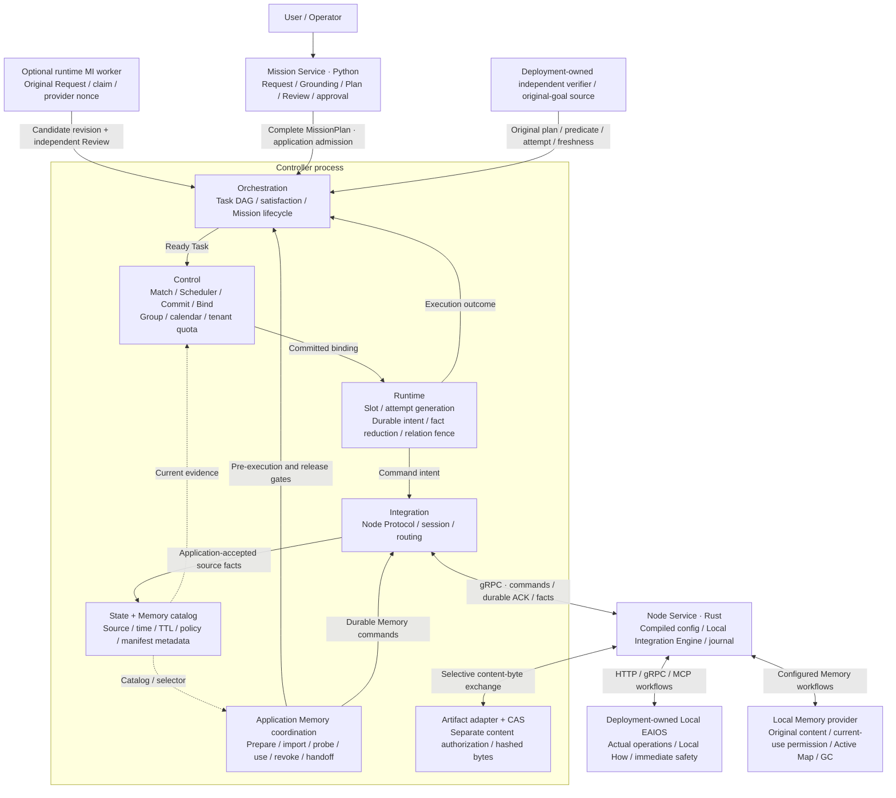
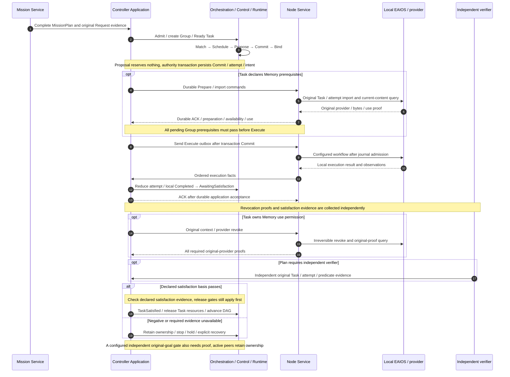
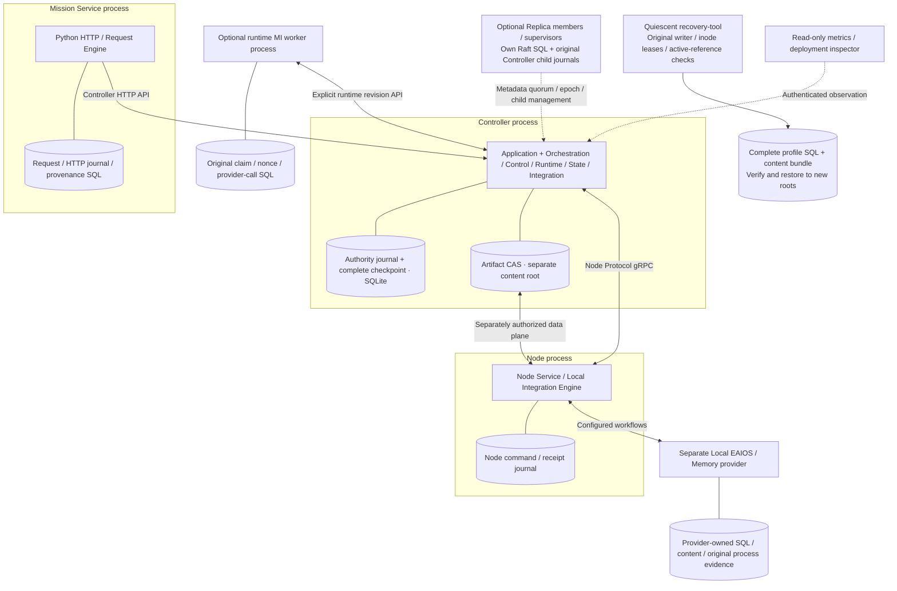
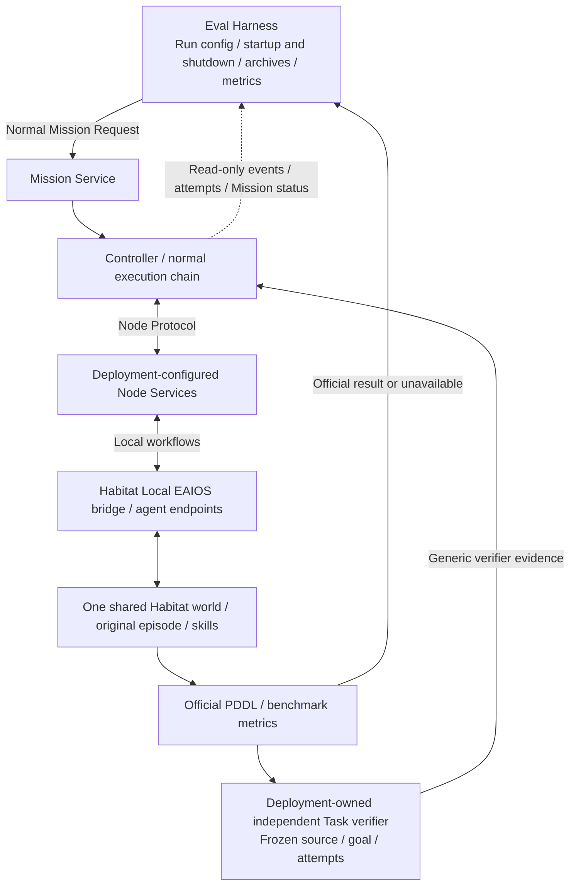

# Current code architecture (Mermaid)

Reviewed: 2026-10-22. Code baseline: `495a6d274f6f930016d97ec5514124876e539cfe`.
[中文](current-architecture.md). These views redraw the implemented V2 architecture from modules,
call chains and composition roots. They introduce no new authority or change to [V2 semantics](README.md).
Accepted ADRs govern subsequent evolution.

ADR-0184 implements parent8/Root4 cold data recovery with actual second-restore and three-leader software acceptance. Original logical identities and operation history remain unchanged; an explicit Root5
binding separately records the actual restored inodes. Old entry points refuse the new binding.
The bundle must cover the paired parent, Root, active references and exact qualified bytes.
Copying data never completes an original Unknown operation or renews its budget.

ADR-0185 keeps a producer's original Unknown unchanged while its actual incarnation remains live
and no scope-close proof exists. It neither retires/releases pins nor invents process-end evidence
or renews effect budgets. Independent parent observation and actual scope closure still gate later
cleanup. This storage concurrency rule provides no device-stop proof.

## System overview

Solid arrows show commands, facts or responsibility collaboration; dotted arrows show read-only inputs.
This is not a Rust import graph. Boxes inside Controller share a process and application transactions.

<!-- architecture-overview:start -->

<!-- architecture-overview:end -->

[Download Mermaid source](../../images/roboguide-current-architecture-english.mmd). The code map below locates every responsibility.

- **Commitment authority.** Scheduler selects within supplied candidates and the Control calendar. Only Control Commit creates a resource obligation after rechecking current State, tenant, quota and conflicts. Group Manager stays in Control.
- **Execution authority.** Runtime owns logical `(Group, Task, Role)` slots, physical attempts and relations. Integration transports facts; the Node journal admits local commands. Application transactions connect these boundaries.
- **Horizontal data.** State preserves source and TTL; the Memory catalog holds rebuildable metadata. Providers and CAS own content. Scope, Visibility and Placement remain independent, and references do not establish current availability.
- **Satisfaction and safety.** Orchestration consumes the plan-declared satisfaction basis. Independent verifiers bind original plan, predicate, attempt and freshness. Local EAIOS retains Local How and immediate safety. A software-process exit receipt establishes only the original process's exit.

## Execution loop and durability order

This is one normal path. Revocation proofs and independent satisfaction evidence may arrive in either
order, and evidence consumption rechecks current authority.

ExecutionReport is an explicit optional satisfaction basis. Local Completed does not automatically count
as independent verification. With Memory, the original Task/context/provider revocation gate precedes
TaskSatisfied and resource release. Unknown, lost responses and recovering attempts retain original ownership
and budgets. Stop, recovery/rebind and plan revision have separate gates. Revision requires original
stop/revoke, goal, Review and Memory declarations, then a fresh Group through ordinary Control Commit.
Model candidates never authorize Execute. See the [lifecycle guide](../../../website/pages/lifecycle.en.md).

## Actual processes and storage boundaries

`integration-server` composes Controller, and `roboguide-node` runs each configured Node.
This configurable process composition does not assume a host count or fault domain. An explicit
[deployment profile](../../../tools/deployment/README.md) declares those facts. Zero Nodes is valid;
multiple Nodes may share a Host.

Replica copies accepted application metadata; member-local transfer, spawn, PID and wait history remains
separate. Recovery handles only complete stores/content declared by an explicit profile, starts no service
and renews no budget. SQL/CAS boxes do not establish online content replication, cross-domain HA or physical
continuity. Control tenant quota accounts for logical commitments. Local Memory process CPU/address-space
`rlimit` receipts are separate evidence, not general GPU, OS or hard-realtime isolation.

## Habitat and Eval Harness integration

This is an existing optional deployment, not a Habitat dependency for every RoboGuide Node. One separate
Habitat process owns a shared world, with agent endpoints exposed through configured Node Services.

The harness never bypasses RoboGuide to call simulator skills. Local navigation/operation Completed,
TaskSatisfied, official `pddl_success` and archived evaluation results preserve separate provenance.
Absent official results remain unavailable rather than false. Software gates do not establish hardware
outcomes. This review starts no Habitat, model or device.

## Code evidence

| Responsibility | Actual implementation and review point |
| --- | --- |
| Mission Service / Review | [request_engine.py](../../../mission/src/mission/request_engine.py): original Request, drafts, Review, submission; [api.py](../../../mission/src/mission/api.py): separate HTTP entry |
| Runtime MI | [runtime_replanning.py](../../../mission/src/mission/runtime_replanning.py), [runtime_work_store.py](../../../mission/src/mission/runtime_work_store.py): claims/nonces, provider I/O, candidates; [plan_revision](../../../apps/integration-server/src/application/plan_revision/): original stop, Review, Memory and new-Group gates |
| Orchestration | [mission/checkpoint.rs](../../../core/orchestration/src/mission/checkpoint.rs): complete-plan admission; [scheduling.rs](../../../core/orchestration/src/mission/scheduling.rs): readiness and scheduling; [lifecycle.rs](../../../core/orchestration/src/mission/lifecycle.rs): separate local completion and satisfaction |
| Control / Scheduler / Group | [matching.rs](../../../core/control/src/matching.rs), [scheduler/policy.rs](../../../core/control/src/scheduler/policy.rs), [group](../../../core/control/src/group/), [quota.rs](../../../core/control/src/quota.rs): candidates, stateless selection, commitment/binding/release and quota |
| Runtime / Integration bridge | [execution/mod.rs](../../../core/runtime/src/execution/mod.rs): slots, attempts, intents; [integration_bridge/mod.rs](../../../core/orchestration/src/integration_bridge/mod.rs): compose Control/Runtime/State and reduce formal Node facts |
| Application writer / ACK / outbox | [write_gate.rs](../../../apps/integration-server/src/application/write_gate.rs), [persistence.rs](../../../apps/integration-server/src/application/persistence.rs), [fact_batch.rs](../../../apps/integration-server/src/application/fact_batch.rs), [dispatch.rs](../../../apps/integration-server/src/application/dispatch.rs): writer, transactions, checkpoints and effect ordering |
| Integration / Node Service | [integration/src/lib.rs](../../../core/integration/src/lib.rs): protocol boundary over domain/ports; [local_engine/mod.rs](../../../core/node-service/src/local_engine/mod.rs): config compilation and HTTP/gRPC/MCP drivers |
| State / Memory catalog / ports | [state_record.rs](../../../core/state/src/state_record.rs), [memory.rs](../../../core/state/src/memory.rs), [spatial_memory.rs](../../../core/state/src/spatial_memory.rs), [ports](../../../core/ports/src/lib.rs): source projections, manifests and transport-neutral interfaces |
| Memory preparation / use / handoff | [memory_preparation.rs](../../../apps/integration-server/src/application/memory_preparation.rs), [memory_use.rs](../../../apps/integration-server/src/application/memory_use.rs), [memory_handoff.rs](../../../apps/integration-server/src/application/memory_handoff.rs): durable original contexts, Group barrier and scoped revocation |
| Content / local provider | [artifact-store](../../../core/artifact-store/src/lib.rs), [Memory provider](../../../integrations/memory-provider/roboguide_memory_provider/), [content_references.py](../../../integrations/memory-provider/roboguide_memory_provider/content_references.py): hashed bytes, current use and original references; application authorization is separate |
| Verification / stop | [task_verifier.rs](../../../apps/integration-server/src/application/task_verifier.rs), [semantic_verifier.rs](../../../apps/integration-server/src/application/semantic_verifier.rs), [safety_stop.rs](../../../apps/integration-server/src/application/safety_stop.rs): original sources, attempts, budgets and independent stop evidence |
| Replica / quiescent recovery | [controller-replication](../../../core/controller-replication/src/), [controller-replica](../../../apps/controller-replica/src/main.rs), [recovery bundle.py](../../../apps/recovery-tool/roboguide_recovery/bundle.py): quorum, original child lifecycle, writer freezing and complete recovery |
| Habitat / Eval Harness | [shared_world.py](../../../integrations/habitat-local-eaios/habitat_local_eaios/shared_world.py), [task_verifier.py](../../../integrations/habitat-local-eaios/habitat_local_eaios/task_verifier.py), [b1_run.py](../../../evaluation/src/roboguide_eval/b1_run.py): shared world, official results and independent evaluation |

## Maintenance

The overview's canonical sources are [Chinese .mmd](../../images/roboguide-current-architecture.mmd) and
[English .mmd](../../images/roboguide-current-architecture-english.mmd). Marked regions in README, the V2 entry
and the site tour contain the same content; publication checks reject drift. Authority, dependency,
lifecycle or public-contract changes still require an ADR and an updated code baseline/evidence map.
The old [V2 PNG](../../images/roboguide-v2-overall-architecture.png) and DOCX remain historical conceptual
snapshots, not current implementation diagrams.

ADR-0186 waits for exact actual input receipts/bytes within parent8's original apply-worker budget, before acquiring the parent writer. Receiving Snapshots reuse the original worker clock after complete identity/successor checks and before producer admission or a write transaction; expiry creates no producer or completion fact. Waiting neither copies content nor grants permission or renews budgets. Corrupt bytes behind a known receipt still fail immediately; absent historical-content routing remains a separate required implementation.
