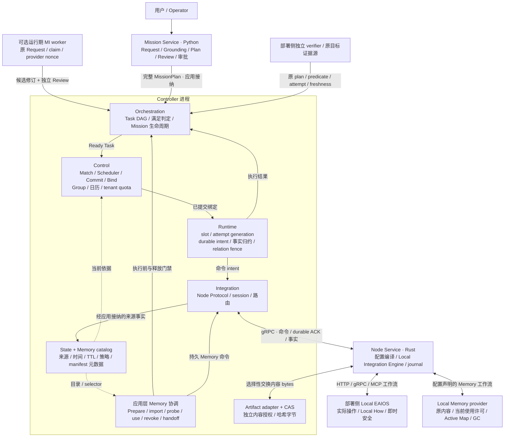
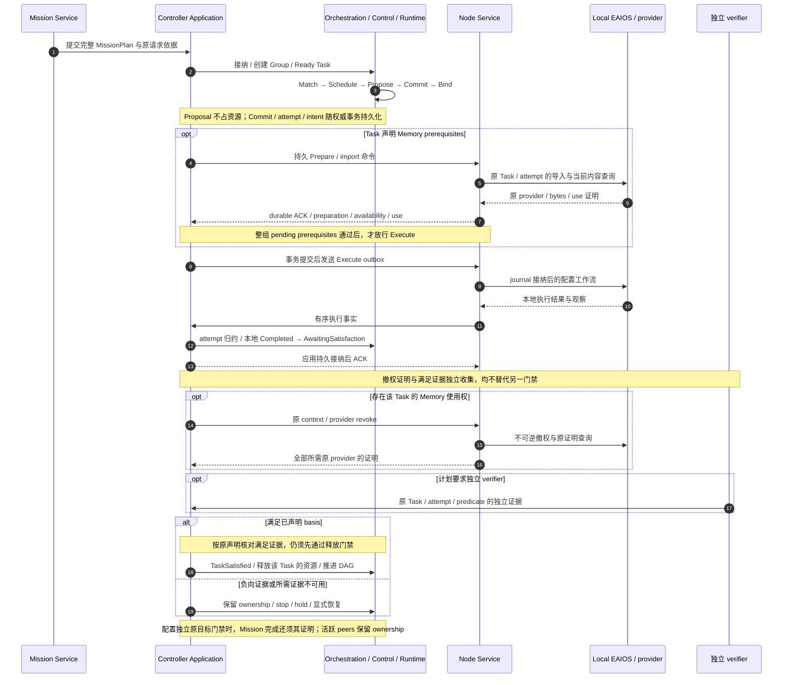
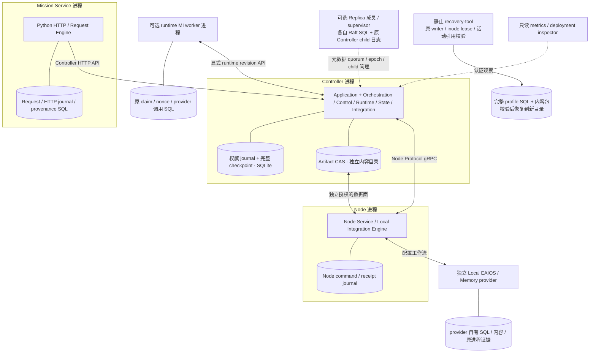
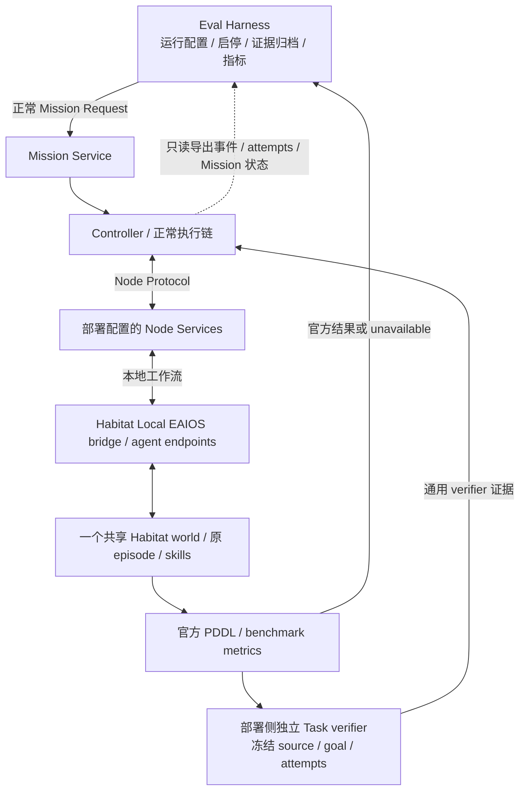

# 当前代码架构（Mermaid）

核对日期：2026-10-22；代码基线：`495a6d274f6f930016d97ec5514124876e539cfe`。
[English](current-architecture.en.md)。本文依据实际模块、调用链和组合入口重画 V2 的当前实现视图，
不新增权威或修改 [V2 语义](README.md)。后续设计以已接受 ADR 为准。

## 总体架构

图中实线表示命令、事实或职责协作，虚线表示只读依据；不是 Rust import 图，也不表示每个框独立部署。
Controller 框中的模块当前共址，由 Application writer、事务、timer 和 outbox 组合。

<!-- architecture-overview:start -->

<!-- architecture-overview:end -->

[下载 Mermaid 源码](../../images/roboguide-current-architecture.mmd)。图中的每一项职责都能在下文代码表定位。

- **承诺权威。** Scheduler 在候选集和 Control 日历内给出选择；Control Commit 重验当前 State、tenant、quota 和冲突后才产生资源承诺。Group Manager 留在 Control。
- **执行权威。** Runtime 管理 `(Group, Task, Role)` 的逻辑槽、物理 attempt 和关系；Integration 传递事实，Node journal 接纳本地命令。应用事务连接这些边界。
- **横向数据。** State 保留来源与 TTL，Memory catalog 保存可重建元数据；内容属于 provider / CAS。Scope、Visibility、Placement 分别判断，引用不等于当前可用性。
- **满足与安全。** Orchestration 消费计划声明的满足依据；独立 verifier 按原 plan、predicate、attempt 和 freshness 验证。Local EAIOS 保留 Local How 与即时安全。软件进程退出证明只说明原进程退出。

## 执行闭环与持久化顺序

图示为一条正常路径；撤权证明与独立满足证据可先后到达，实际消费仍重验当前依据。
ExecutionReport 是显式可选 satisfaction basis；不能把所有本地 Completed 都当作独立验证。
有 Memory 时，应用先通过原 Task/context/provider 撤权门禁，才落定 TaskSatisfied 并释放资源。
Unknown、丢失回包或恢复中的 attempt 保留原 ownership 与预算。停止、recovery/rebind 和计划修订
各有独立门禁：修订须原 stop/revoke、原目标、Review 与 Memory 声明通过后，正常创建新 Group 并重新 Commit，
不会从模型候选直接 Execute。详细失败路径见[执行生命周期](../../../website/pages/lifecycle.md)。

## 实际进程与存储边界

Controller 由 `integration-server` 组装，Node 由 `roboguide-node` 运行。
这张图表达可配置的进程组合，不预设主机数量或故障域；实际部署由
[deployment profile](../../../tools/deployment/README.md)声明。零 Node 有效，多 Node 可共用一台 Host。

Replica 复制接受的应用元数据；成员本地 transfer / spawn / PID / wait 历史另行保留。
ADR-0184 已实现并通过 parent8/Root4 静止恢复及实际三 leader 软件验收：原逻辑身份和操作
历史不改写，显式 Root5 binding 单独记录恢复后的实际 inode，旧入口拒绝新绑定。恢复包必须
同时覆盖原 parent、Root、活动引用及精确字节；Unknown 不因复制而完成。

ADR-0185 的 producer 对账保留实际仍存活且没有 scope-close 证据的原 Unknown：不退休、
不释放引用、不伪造 process-end，也不续原 effect 预算。独立 parent 观察和实际 scope 关闭
仍是后续清理的条件；该存储并发规则不提供设备停止证明。

恢复只处理显式 profile 声明的完整存储和内容，不启动服务、不续原预算。图中 SQL/CAS 的存在
不证明在线内容复制、跨域 HA 或设备连续性。Control tenant quota 是逻辑承诺核算；Local Memory
进程的 CPU/address-space `rlimit` 回执是另一种证据，不表示 GPU、OS 或硬实时隔离已普遍实现。

## Habitat 与 Eval Harness 的接入位置

这是已有的可选部署实例，不是所有 RoboGuide Node 都依赖 Habitat。共享 world 由一个独立
Habitat 进程拥有，各 agent endpoint 通过正式 Node Service 接入。

Harness 不绕过 RoboGuide 直接调用 simulator skill。本地导航/操作 Completed、TaskSatisfied、
官方 `pddl_success` 和评估归档结果分别保留来源。缺少官方结果记录为 unavailable；不把缺失补成 false，
也不从软件 gate 推断真实硬件效果。本次仅核对代码，不启动 Habitat、模型或设备。

## 图与代码的对应关系

| 图中职责 | 实际代码入口与核对点 |
| --- | --- |
| Mission Service / Review | [request_engine.py](../../../mission/src/mission/request_engine.py)：原 Request、草案、Review、提交；[api.py](../../../mission/src/mission/api.py)：独立 HTTP 入口 |
| 运行期 MI | [runtime_replanning.py](../../../mission/src/mission/runtime_replanning.py)、[runtime_work_store.py](../../../mission/src/mission/runtime_work_store.py)：原 claim/nonce、provider I/O 与候选；[plan_revision](../../../apps/integration-server/src/application/plan_revision/)：应用侧原 stop、Review、Memory 和新组门禁 |
| Orchestration | [mission/checkpoint.rs](../../../core/orchestration/src/mission/checkpoint.rs)：完整计划接纳；[scheduling.rs](../../../core/orchestration/src/mission/scheduling.rs)：Ready Task 与调度；[lifecycle.rs](../../../core/orchestration/src/mission/lifecycle.rs)：本地完成与满足分离 |
| Control / Scheduler / Group | [matching.rs](../../../core/control/src/matching.rs)、[scheduler/policy.rs](../../../core/control/src/scheduler/policy.rs)、[group](../../../core/control/src/group/)、[quota.rs](../../../core/control/src/quota.rs)：候选、无状态选择、承诺/绑定/释放与 quota |
| Runtime / Integration bridge | [execution/mod.rs](../../../core/runtime/src/execution/mod.rs)：slot、attempt、intent；[integration_bridge/mod.rs](../../../core/orchestration/src/integration_bridge/mod.rs)：组合 Control/Runtime/State，归约正式 Node 事实 |
| Application writer / ACK / outbox | [application](../../../apps/integration-server/src/application/) 中的 [write_gate.rs](../../../apps/integration-server/src/application/write_gate.rs)、[persistence.rs](../../../apps/integration-server/src/application/persistence.rs)、[fact_batch.rs](../../../apps/integration-server/src/application/fact_batch.rs)、[dispatch.rs](../../../apps/integration-server/src/application/dispatch.rs)：原 writer、事务、checkpoint 与副作用顺序 |
| Integration / Node Service | [integration/src/lib.rs](../../../core/integration/src/lib.rs)：只依赖 domain/ports 的协议边界；[local_engine/mod.rs](../../../core/node-service/src/local_engine/mod.rs)：配置编译与 HTTP/gRPC/MCP driver |
| State / Memory catalog / ports | [state_record.rs](../../../core/state/src/state_record.rs)、[memory.rs](../../../core/state/src/memory.rs)、[spatial_memory.rs](../../../core/state/src/spatial_memory.rs)、[ports](../../../core/ports/src/lib.rs)：来源投影、manifest 与 transport-neutral 接口 |
| Memory 准备 / 使用 / 交接 | [memory_preparation.rs](../../../apps/integration-server/src/application/memory_preparation.rs)、[memory_use.rs](../../../apps/integration-server/src/application/memory_use.rs)、[memory_handoff.rs](../../../apps/integration-server/src/application/memory_handoff.rs)：持久原 context、整组 barrier 与按范围撤权 |
| 内容与本地 provider | [artifact-store](../../../core/artifact-store/src/lib.rs)、[Memory provider](../../../integrations/memory-provider/roboguide_memory_provider/)、[content_references.py](../../../integrations/memory-provider/roboguide_memory_provider/content_references.py)：哈希字节、当前使用与原引用；授权在应用层另外检查 |
| 独立验证与停止 | [task_verifier.rs](../../../apps/integration-server/src/application/task_verifier.rs)、[semantic_verifier.rs](../../../apps/integration-server/src/application/semantic_verifier.rs)、[safety_stop.rs](../../../apps/integration-server/src/application/safety_stop.rs)：原来源、attempt、预算和独立停止证据 |
| Replica / 静止恢复 | [controller-replication](../../../core/controller-replication/src/)、[controller-replica](../../../apps/controller-replica/src/main.rs)、[recovery bundle.py](../../../apps/recovery-tool/roboguide_recovery/bundle.py)：quorum、原 child 生命周期、冻结 writer 和完整恢复 |
| Habitat / Eval Harness | [shared_world.py](../../../integrations/habitat-local-eaios/habitat_local_eaios/shared_world.py)、[task_verifier.py](../../../integrations/habitat-local-eaios/habitat_local_eaios/task_verifier.py)、[b1_run.py](../../../evaluation/src/roboguide_eval/b1_run.py)：共享 world、官方结果与独立评估 |

## 如何维护

ADR-0198 已接受并实施：Raft 启动前核对真实 committed-but-unapplied Log 的原输入，
缺回执/字节时及时拒绝并给出修复入口。已有 parent9/Root8 的本地检查/修复绑定原
Log/input/digest、真实 Artifact owner 和首次预算，委托既有 copy journal；稳定 ID 不随
重试或 epoch 改变。原 Unknown、时钟与语义使用权限不改写，不创建替代存储权威。

ADR-0199 已接通 typed-map handoff：v0.2 请求保留完整原始 MapArtifactManifest，并在
Control 的 source/target scope、tenant、principal、provider、frame/anchor/lineage policy
上重查；generic v0.1 仍保持原语义。该门禁不选择 active map、不证明 localization 或设备停止。

ADR-0200 让新的 generic/typed-map replica evidence 保留原始 Memory import 的 `TaskRef` 与
`execution_id`。Node 从 canonical invocation 生成，Artifact/Controller 在写入前核对原始
import intent，event codec v33 与 State/Catalog snapshot 持久化；旧事件的 provenance 保持
unavailable，不从 Node/provider 推断 owner。

ADR-0201 将 `FederationSession` 接到实际 Controller HTTP 服务：prepare/commit/abort/get
 需要 operator mTLS、recovery-admin、明确 tenant、`ROBOGUIDE_CONTROL_DOMAIN` 和证书域对
 两端的显式授权。每个 Control 域在自己的 checkpoint 中保存相同的 tenant、epoch、digest、
 deadline 和 state；响应丢失通过 GET 对账，重启不续期。两个服务的资源权威仍彼此独立，
 该入口不发送 Execute、不选择 Node，也不证明设备连续性。

ADR-0197 已通过真实引用/回收/重启与三 leader 冷恢复：以实际已退休上传、各成员原 Log/View/Snapshot 和 stream/reader
为完整回收链，真实 mTLS Snapshot/原 cut purge 与原进程/作用域结束分别释放自己的引用。
本地 OS-admin reader 退休只委托原 Root 的实际 incarnation 检查；无权以超时或标签补造
退出。最终 CAS tombstone/unlink 不删除独立 Artifact/Archive/备份责任，代际和 Node 合同不变。
实际原 parent writer/mutex 可在一个 Root guard 内对账完整 producer 集合，前后完整校验，
每条仍独立 FULL Commit 和原排队前观察预算；失败保留实际部分进度与 Unknown。
Raft purge 的已提交前缀/指针先返回 ACK，独立有界任务按真实不可回退 cut 对账原 Log
引用；释放 parent mutex 后才写 Root，失败保留 pin。维护等待实际清理，但不阻塞共识核心。

ADR-0196 已实现并通过实际入口/三 leader 冷恢复：Root 只在同一原连接的完整校验 witness、准确 reader 事务
写入行数、全部实际 reader/pin/head 和两次 SQL header 观察一致时延续校验。失败、额外
写入、外部提交、DDL、旧代际和 reopen 不能借用。字节、身份/restore binding、当前权限、
原预算及 GC 门禁仍逐次检查，不删除历史，也不改变任何持久/Node/恢复合同。

ADR-0195 已接通并通过实际进程门禁：已压缩原源经显式初始化 application-initialization/v0.1 / application-snapshot/v0.1
接纳完整原 checkpoint、热尾、命令与 Archive/Catalog；接收方必须尚无应用状态，普通
增量 v2 保持连续性检查。parent9/显式启动与 recovery v0.23 封住旧入口，保留原来源、
Unknown、预算和 member-local 历史。原 Unknown、Log/Snapshot、实际入口和三 leader 恢复
见[验收记录](../../development/acceptance/2026-10-24-original-archived-source-initialization.md)；
全局 Archive/引用覆盖、升级和全部非发布完成条件仍继续。
原 standalone 检查点保留原字节；仅实际当前 child 经 PID/Unix/mTLS 与完整 quorum 核对
那一份当前初始检查点后，才可用普通持久化启动命令绑定新 profile。通用恢复仍拒绝跨
profile；旧 child binary 必须在启动应用前因缺少显式初始化支持而拒绝。
可选 typed Node-TLS 部署输入按原证书/密钥/CA/身份 profile 文件字节固定策略，保留原
身份恢复要求；配置文件不注册、合成或启动 Node，文件路径也不替代内容身份。
同 epoch/成员的紧邻原状态可复用已接纳的本机输入，仍逐字节校验全部候选内容；远端
只在新鲜 mTLS 原状态/完整字节观察一致时跳过旧输入重传，最终完整 quorum 校验保留。
typed TLS 输入同时支持 Operator/Artifact 原授权 profile，实际文件字节固定共同策略。
原已完成 Archive 还须声明原 source CAS 和实际 Archive 目录，不能由初始化元数据替代。
v0.23 仅对独立核对到同一实际 Replica profile、全部原记录和依赖一致的重复投影复用校验；
冲突、其他集群和 standalone 重复仍拒绝，原历史不合并改写。
完整归档候选的校验、原读取接纳以及 supervisor 父库观察在持有原容量/租约的工作任务
执行，异步网络线程不等待父库互斥锁。原 epoch 丢失仍停止并 wait child，观察不恢复权限。
网络 profile 的 Raft log/range/vote/committed 读取使用同一原租约 inode 的新只读 WAL
事务，保持 generation/profile 检查；不等应用 writer，也不读未提交数据。写入/ACK 顺序保持。
重复保存 vote/committed 仅在新鲜原 WAL 观察已有完全相同持久值时返回，变化值仍经原 FULL writer。

ADR-0194 已实现并通过真实进程/完整恢复验收：显式 Root8 按原 copy/stream ID 和实际退休证据接纳 staging
回收，intent/逐项 Unknown 与 mandatory inventories 先于 open/unlink。只删除原私有临时
名字，CAS/原引用/Root7 tombstone 独立；旧结果与预算不改写。process v0.6/recovery v0.22
显式选择新边界，私有 staging payload 不随恢复传播，不产生 Node/设备或全局删除事实。
实际旧目录复制会保留私有 staging；v0.22 因此只复制其空目录，并在 verify 读取 payload
前拒绝该目录下声明的文件或子目录。原旧格式和历史包不被改标为新边界。

ADR-0193 在显式 Snapshot 内容前置条件等待期间发送原 vote/原 committed cut 的普通 Raft
Append 心跳。OpenRaft 自己处理任期与选举计时；prefix conflict 不算追平，实际 higher vote
返回上游处理。首个心跳与后续准备沿用同一预算，原 Unknown 不改写，不创建 Node/设备事实。
该心跳覆盖元数据投递；显式 network-content 的单 chunk 等待为 10 秒，仍受首次发出前
固定的全程 15 秒预算约束。真实 Root7 安装超过上游默认 200ms 的接收/应答缺口独立保留，
重试不续期，超时/取消后的实际 storage worker 仍保留原生命周期。

ADR-0192 为显式 network-content profile 的 voter 切换增加只读完整内容准入：原 learner
加入/追平后、进入 joint consensus 前，核对原 current target、新 voter 实际 mTLS/Root/
metadata/字节，以及新旧完整内容多数派。失败不请求 joint 变更；空应用 bootstrap 保留原
元数据规则。后续故障、超时及不确定结果仍由原 Raft/完整内容/child 门禁处理。
原内容 Commit 与 voter 切换共用实际进程内串行门禁；独立持有的任务在调用方取消/超时后
仍等待已入队 Raft 的实际结果，防止校验与 joint 提交之间被并发内容 Commit 穿透。
排队、观察和新效果前检查沿用原预算；未决结果保留门禁，不续期、不产生分布式权限。
管理请求保留调用者原 epoch，本地调用也在排队前固定 epoch；实际准入复核同一值，
旧 epoch 请求在 learner/joint 效果前拒绝，不从排队后的新观察借用任期。
实际 member writer 与原 TLS witness 随独立任务持有；网络等待取消不释放未决 writer，
效果前仍检查原连接的当前成员、链/leaf 有效性，不借新证书授权旧请求。

ADR-0191 将历史内容追赶放入每个原 Root 唯一、有界且独立持有的任务；已持久化的 Raft
Append ACK 不再等待该任务。原 sender、Log prefix、预算与实际 blocking job 的 admission
guard 不变，重叠 heartbeat 不创建重复任务；完整 byte/apply/应用 Commit/readiness 门禁保留。

ADR-0190 已接入显式 Root7 的 GC intent、不可逆 qualified-key tombstone 和删除回执。
原 Root writer 内完整引用均退休后才可持久接纳；活跃/Unknown 引用继续阻止删除。
process v0.5/recovery v0.21 显式选择新边界；实际 CLI/故障/排空升级/三 leader 冷恢复已验收。
完整 producer/joint/partial staging 和跨主机矩阵继续必需。
同一 Root7 还保留完整 stream retirement 表及 mandatory head。只有原 worker 实际关闭或
独立原进程结束观察才可原子退休其 pin；活跃 worker 拒绝，原 receipt/Unknown 与预算不变，
其它 Log/View/Snapshot/reader 引用继续独立阻止删除。

ADR-0188 已为网络 Snapshot 接入显式 Root6 的持久准备/独立 pin、实际字节就绪与
元数据安装门禁，以及 recovery v0.20 的完整恢复。原副本流量由实际 server 的弱引用
取得源上下文，避免 writer 生命周期形成强引用环；接收就绪不等于 Snapshot 已应用。
普通 delta 和原已归档历史的来源/连续性拒绝保持；真实单机多进程、learner、Log 清理、
重启和独立恢复门禁已通过，跨主机、joint/GC/长期 SLO 仍单独验收。

ADR-0187 为 apply 前的历史 Log 增加独立内容追赶：来源须实际保留并提交同一 Log，接收方
须先有自己的原 Log/producer，现存 stream 意图和 pin 先于实际源读取；每块仍检查原
Log、current membership/epoch、Root/TLS 和原预算。普通已提交路由仍要求双方当前接受
同一应用。网络 Snapshot 切片也覆盖空 learner 的内容前置条件；joint、完整 GC 和跨域
连续性继续必需；不增加设备或物理连续性事实。

ADR-0189 增加只读 Replica readiness 投影，把实际 role、metadata quorum/位置、joint 成员和
同 voter 内容多数派分开；进程存活不能变成 content-ready，producer retirement 仍保持原
Unknown/对账边界。

[Replica readiness 验收](../../development/acceptance/2026-10-24-replica-readiness.md) 已由真实
多进程 Snapshot/Log 门禁核对 leader content-ready 与 learner 非 content-ready；producer GC
和完整 joint 组合仍在 A2 队列。

总体图的单一源码为 [中文 .mmd](../../images/roboguide-current-architecture.mmd)和
[英文 .mmd](../../images/roboguide-current-architecture-english.mmd)；README、V2 入口和网站导览中的
标记区同步同一内容，网站检查会拒绝漂移。改动权威、依赖方向、生命周期或公开合同仍须 ADR，
并同步本页代码依据与核对基线。旧 [V2 PNG](../../images/roboguide-v2-overall-architecture.png)
和 DOCX 作为历史概念快照保留，不再充当当前实现图。

ADR-0186 在显式 parent8 的原 apply worker 内、取得 parent 写锁前，按原预算等待确切输入的实际 receipt/字节就绪。接收 Snapshot 同样在完整身份/后继校验之后、producer 准入和写事务之前复用原 worker 时钟等待；到期不创建 producer 或完成事实。等待不复制内容、不授予权限、不续预算；已知 receipt 的字节损坏仍立即失败，缺失历史内容的路由仍须独立接通。
