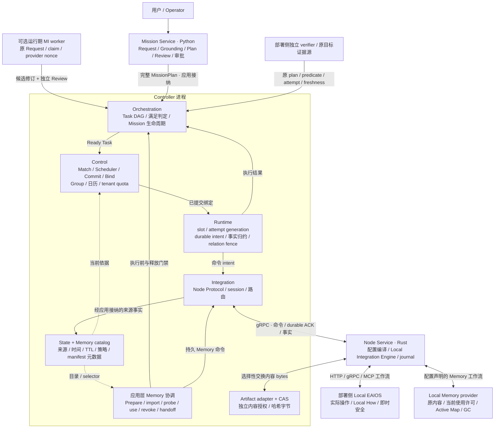
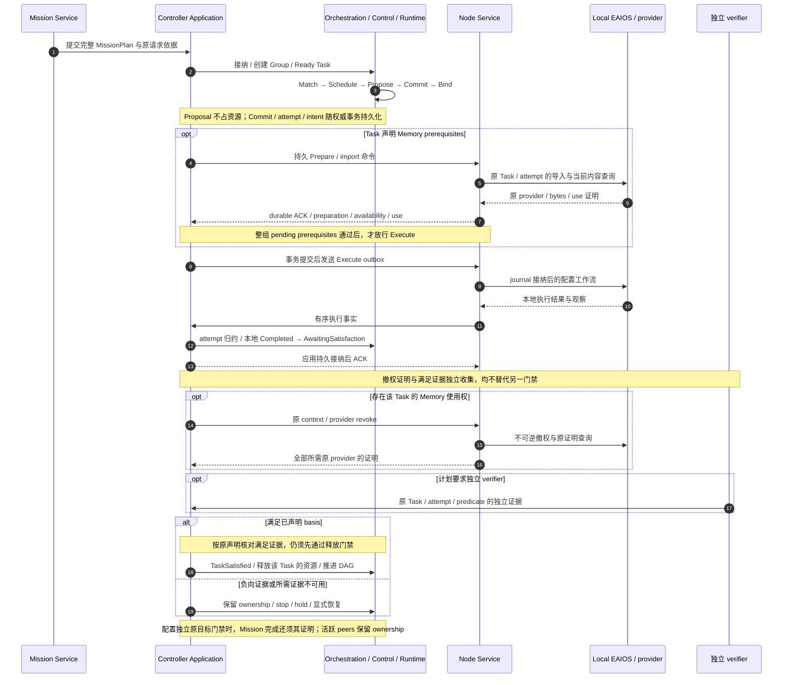
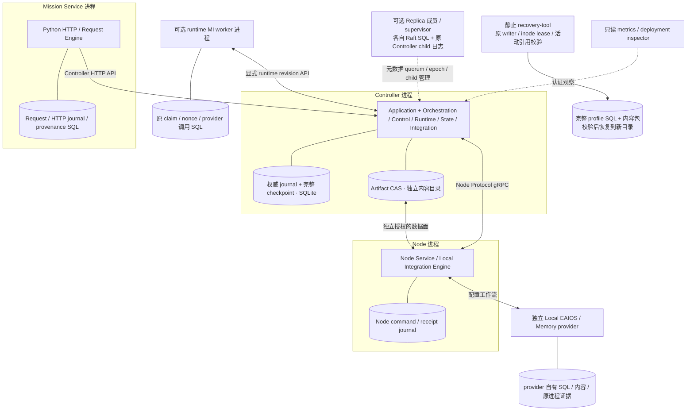
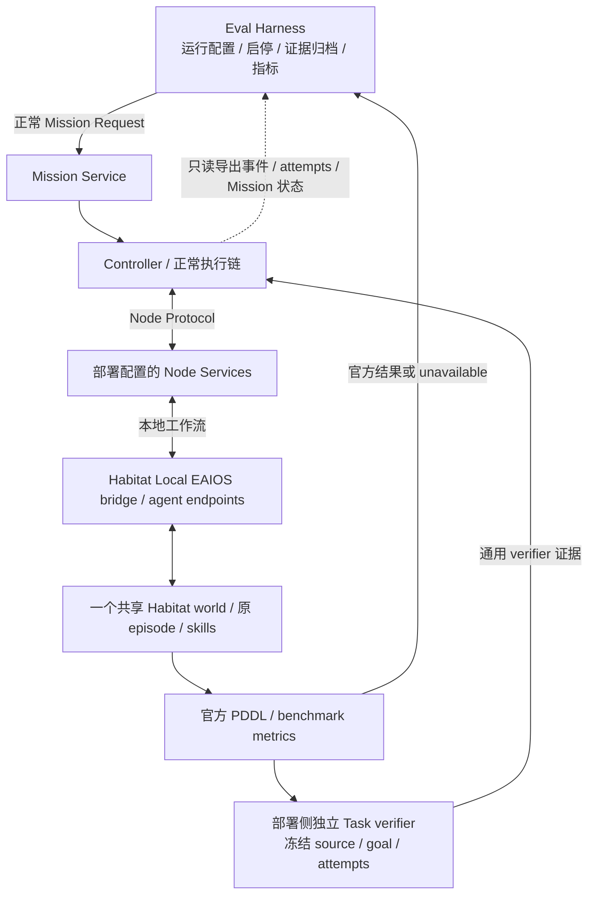

# 当前代码架构（Mermaid）

核对日期：2026-10-22；代码基线：`495a6d274f6f930016d97ec5514124876e539cfe`。
[English](current-architecture.en.md)。本文依据实际模块、调用链和组合入口重画 V2 的当前实现视图，
不新增权威或修改 [V2 语义](README.md)。后续设计以已接受 ADR 为准。

## 总体架构

图中实线表示命令、事实或职责协作，虚线表示只读依据；不是 Rust import 图，也不表示每个框独立部署。
Controller 框中的模块当前共址，由 Application writer、事务、timer 和 outbox 组合。

<!-- architecture-overview:start -->

<!-- architecture-overview:end -->

[下载 Mermaid 源码](../../images/roboguide-current-architecture.mmd)。图中的每一项职责都能在下文代码表定位。

- **承诺权威。** Scheduler 在候选集和 Control 日历内给出选择；Control Commit 重验当前 State、tenant、quota 和冲突后才产生资源承诺。Group Manager 留在 Control。
- **执行权威。** Runtime 管理 `(Group, Task, Role)` 的逻辑槽、物理 attempt 和关系；Integration 传递事实，Node journal 接纳本地命令。应用事务连接这些边界。
- **横向数据。** State 保留来源与 TTL，Memory catalog 保存可重建元数据；内容属于 provider / CAS。Scope、Visibility、Placement 分别判断，引用不等于当前可用性。
- **满足与安全。** Orchestration 消费计划声明的满足依据；独立 verifier 按原 plan、predicate、attempt 和 freshness 验证。Local EAIOS 保留 Local How 与即时安全。软件进程退出证明只说明原进程退出。

## 执行闭环与持久化顺序

图示为一条正常路径；撤权证明与独立满足证据可先后到达，实际消费仍重验当前依据。
ExecutionReport 是显式可选 satisfaction basis；不能把所有本地 Completed 都当作独立验证。
有 Memory 时，应用先通过原 Task/context/provider 撤权门禁，才落定 TaskSatisfied 并释放资源。
Unknown、丢失回包或恢复中的 attempt 保留原 ownership 与预算。停止、recovery/rebind 和计划修订
各有独立门禁：修订须原 stop/revoke、原目标、Review 与 Memory 声明通过后，正常创建新 Group 并重新 Commit，
不会从模型候选直接 Execute。详细失败路径见[执行生命周期](../../../website/pages/lifecycle.md)。

## 实际进程与存储边界

Controller 由 `integration-server` 组装，Node 由 `roboguide-node` 运行。
这张图表达可配置的进程组合，不预设主机数量或故障域；实际部署由
[deployment profile](../../../tools/deployment/README.md)声明。零 Node 有效，多 Node 可共用一台 Host。

Replica 复制接受的应用元数据；成员本地 transfer / spawn / PID / wait 历史另行保留。
ADR-0184 已实现并通过 parent8/Root4 静止恢复及实际三 leader 软件验收：原逻辑身份和操作
历史不改写，显式 Root5 binding 单独记录恢复后的实际 inode，旧入口拒绝新绑定。恢复包必须
同时覆盖原 parent、Root、活动引用及精确字节；Unknown 不因复制而完成。

ADR-0185 的 producer 对账保留实际仍存活且没有 scope-close 证据的原 Unknown：不退休、
不释放引用、不伪造 process-end，也不续原 effect 预算。独立 parent 观察和实际 scope 关闭
仍是后续清理的条件；该存储并发规则不提供设备停止证明。

恢复只处理显式 profile 声明的完整存储和内容，不启动服务、不续原预算。图中 SQL/CAS 的存在
不证明在线内容复制、跨域 HA 或设备连续性。Control tenant quota 是逻辑承诺核算；Local Memory
进程的 CPU/address-space `rlimit` 回执是另一种证据，不表示 GPU、OS 或硬实时隔离已普遍实现。

## Habitat 与 Eval Harness 的接入位置

这是已有的可选部署实例，不是所有 RoboGuide Node 都依赖 Habitat。共享 world 由一个独立
Habitat 进程拥有，各 agent endpoint 通过正式 Node Service 接入。

Harness 不绕过 RoboGuide 直接调用 simulator skill。本地导航/操作 Completed、TaskSatisfied、
官方 `pddl_success` 和评估归档结果分别保留来源。缺少官方结果记录为 unavailable；不把缺失补成 false，
也不从软件 gate 推断真实硬件效果。本次仅核对代码，不启动 Habitat、模型或设备。

## 图与代码的对应关系

| 图中职责 | 实际代码入口与核对点 |
| --- | --- |
| Mission Service / Review | [request_engine.py](../../../mission/src/mission/request_engine.py)：原 Request、草案、Review、提交；[api.py](../../../mission/src/mission/api.py)：独立 HTTP 入口 |
| 运行期 MI | [runtime_replanning.py](../../../mission/src/mission/runtime_replanning.py)、[runtime_work_store.py](../../../mission/src/mission/runtime_work_store.py)：原 claim/nonce、provider I/O 与候选；[plan_revision](../../../apps/integration-server/src/application/plan_revision/)：应用侧原 stop、Review、Memory 和新组门禁 |
| Orchestration | [mission/checkpoint.rs](../../../core/orchestration/src/mission/checkpoint.rs)：完整计划接纳；[scheduling.rs](../../../core/orchestration/src/mission/scheduling.rs)：Ready Task 与调度；[lifecycle.rs](../../../core/orchestration/src/mission/lifecycle.rs)：本地完成与满足分离 |
| Control / Scheduler / Group | [matching.rs](../../../core/control/src/matching.rs)、[scheduler/policy.rs](../../../core/control/src/scheduler/policy.rs)、[group](../../../core/control/src/group/)、[quota.rs](../../../core/control/src/quota.rs)：候选、无状态选择、承诺/绑定/释放与 quota |
| Runtime / Integration bridge | [execution/mod.rs](../../../core/runtime/src/execution/mod.rs)：slot、attempt、intent；[integration_bridge/mod.rs](../../../core/orchestration/src/integration_bridge/mod.rs)：组合 Control/Runtime/State，归约正式 Node 事实 |
| Application writer / ACK / outbox | [application](../../../apps/integration-server/src/application/) 中的 [write_gate.rs](../../../apps/integration-server/src/application/write_gate.rs)、[persistence.rs](../../../apps/integration-server/src/application/persistence.rs)、[fact_batch.rs](../../../apps/integration-server/src/application/fact_batch.rs)、[dispatch.rs](../../../apps/integration-server/src/application/dispatch.rs)：原 writer、事务、checkpoint 与副作用顺序 |
| Integration / Node Service | [integration/src/lib.rs](../../../core/integration/src/lib.rs)：只依赖 domain/ports 的协议边界；[local_engine/mod.rs](../../../core/node-service/src/local_engine/mod.rs)：配置编译与 HTTP/gRPC/MCP driver |
| State / Memory catalog / ports | [state_record.rs](../../../core/state/src/state_record.rs)、[memory.rs](../../../core/state/src/memory.rs)、[spatial_memory.rs](../../../core/state/src/spatial_memory.rs)、[ports](../../../core/ports/src/lib.rs)：来源投影、manifest 与 transport-neutral 接口 |
| Memory 准备 / 使用 / 交接 | [memory_preparation.rs](../../../apps/integration-server/src/application/memory_preparation.rs)、[memory_use.rs](../../../apps/integration-server/src/application/memory_use.rs)、[memory_handoff.rs](../../../apps/integration-server/src/application/memory_handoff.rs)：持久原 context、整组 barrier 与按范围撤权 |
| 内容与本地 provider | [artifact-store](../../../core/artifact-store/src/lib.rs)、[Memory provider](../../../integrations/memory-provider/roboguide_memory_provider/)、[content_references.py](../../../integrations/memory-provider/roboguide_memory_provider/content_references.py)：哈希字节、当前使用与原引用；授权在应用层另外检查 |
| 独立验证与停止 | [task_verifier.rs](../../../apps/integration-server/src/application/task_verifier.rs)、[semantic_verifier.rs](../../../apps/integration-server/src/application/semantic_verifier.rs)、[safety_stop.rs](../../../apps/integration-server/src/application/safety_stop.rs)：原来源、attempt、预算和独立停止证据 |
| Replica / 静止恢复 | [controller-replication](../../../core/controller-replication/src/)、[controller-replica](../../../apps/controller-replica/src/main.rs)、[recovery bundle.py](../../../apps/recovery-tool/roboguide_recovery/bundle.py)：quorum、原 child 生命周期、冻结 writer 和完整恢复 |
| Habitat / Eval Harness | [shared_world.py](../../../integrations/habitat-local-eaios/habitat_local_eaios/shared_world.py)、[task_verifier.py](../../../integrations/habitat-local-eaios/habitat_local_eaios/task_verifier.py)、[b1_run.py](../../../evaluation/src/roboguide_eval/b1_run.py)：共享 world、官方结果与独立评估 |

## 如何维护

总体图的单一源码为 [中文 .mmd](../../images/roboguide-current-architecture.mmd)和
[英文 .mmd](../../images/roboguide-current-architecture-english.mmd)；README、V2 入口和网站导览中的
标记区同步同一内容，网站检查会拒绝漂移。改动权威、依赖方向、生命周期或公开合同仍须 ADR，
并同步本页代码依据与核对基线。旧 [V2 PNG](../../images/roboguide-v2-overall-architecture.png)
和 DOCX 作为历史概念快照保留，不再充当当前实现图。

ADR-0186 在显式 parent8 的原 apply worker 内、取得 parent 写锁前，按原预算等待确切输入的实际 receipt/字节就绪。接收 Snapshot 同样在完整身份/后继校验之后、producer 准入和写事务之前复用原 worker 时钟等待；到期不创建 producer 或完成事实。等待不复制内容、不授予权限、不续预算；已知 receipt 的字节损坏仍立即失败，缺失历史内容的路由仍须独立接通。
