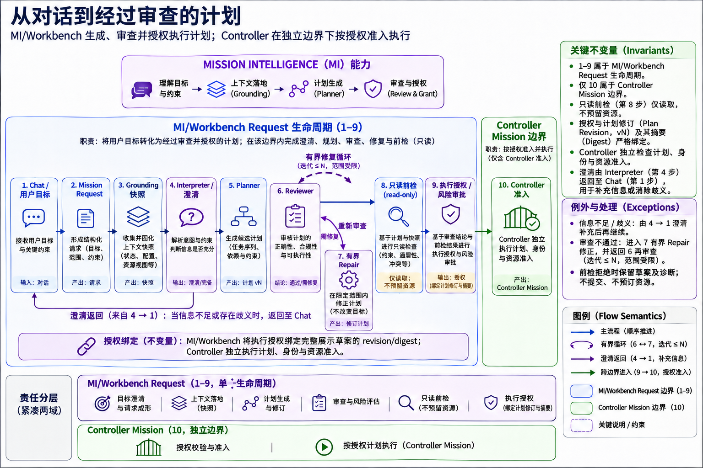
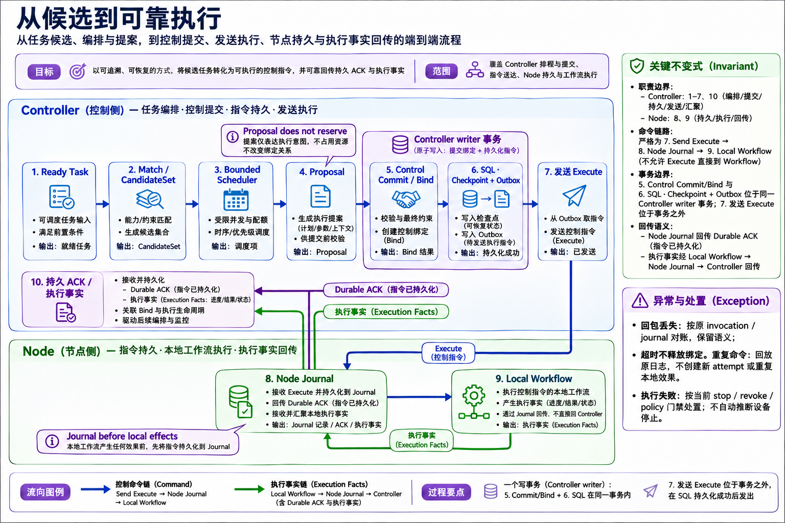
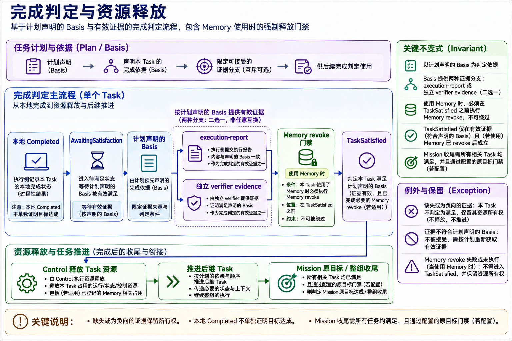
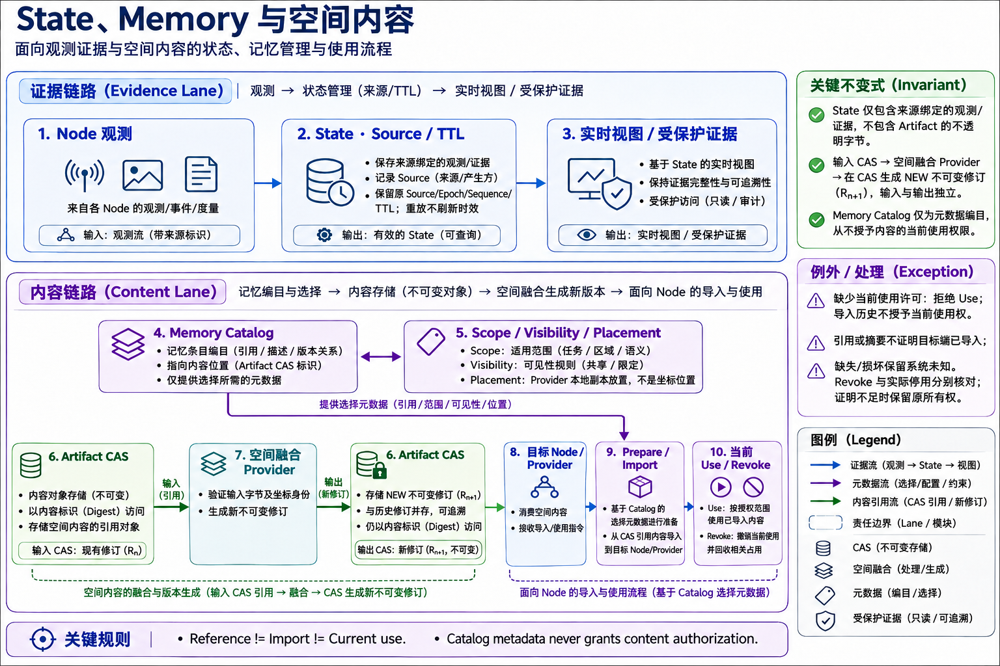
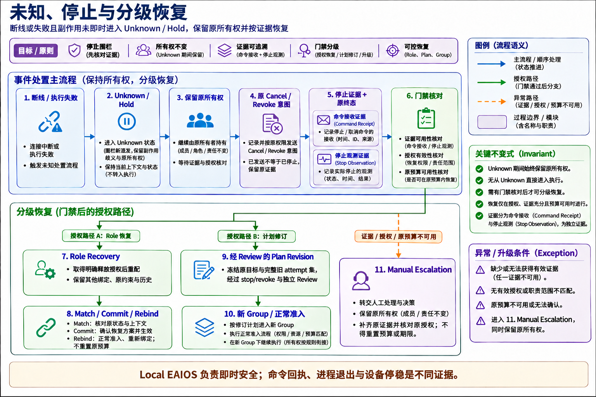
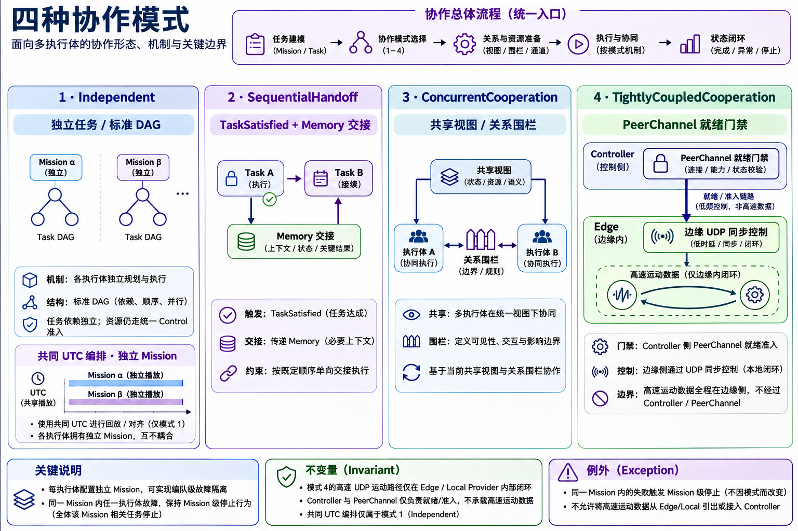
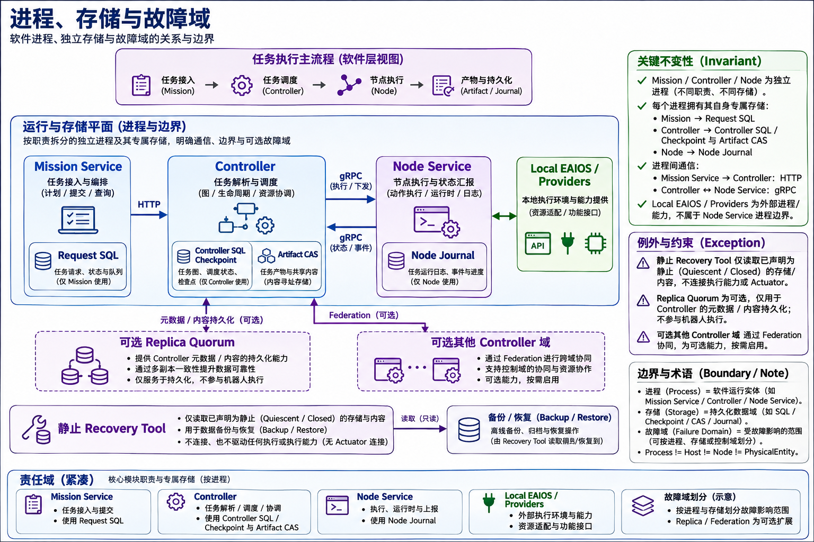

# 当前主线架构图册

代码核对：2026-11-26 · `main@3c7136d6`。图文描述代码职责与协议边界；实际设备结果须另查原验收证据。

首图展示系统框架与权威归属，其余七图按主题展示流程。操作步骤、例外和精确协议边界见图下说明及源码依据；点击图片可查看原始尺寸。

## RoboGuide 总体框架

<!-- diagram:overview:zh -->

RoboGuide 将异构执行体、计算节点和交互设备组织为共享 Mission 的任务、调度、执行、状态与恢复闭环。它联合考虑 Capability、Compute、Space、Time，同时保留 Local EAIOS 的本地执行方式与即时安全权威。Controller 当前是模块化单体：各职责在同一应用事务中协作，不代表每个框都是独立微服务。

1. Mission Intelligence 形成完整语义计划，不负责分配当前 Node。
2. Orchestration 拥有 DAG、满足判定与 Mission 生命周期。
3. Control 拥有候选过滤、承诺、绑定、Group 和恢复决定。
4. Runtime 拥有逻辑槽、物理 attempt、durable intent 与关系围栏。
5. Integration 和 Node Service 连接实际会话与本地工作流；State/Memory 横向提供有来源的依据。

代码依据：[main.rs](../../../apps/integration-server/src/main.rs) · [lib.rs](../../../core/orchestration/src/lib.rs) · [lib.rs](../../../core/control/src/lib.rs) · [mod.rs](../../../core/node-service/src/service/mod.rs)

## 从对话到经过审查的计划

<!-- diagram:mission-planning:zh -->

用户对话先成为持久 Mission Request。Grounding 记录本轮受控取得的事实、来源、时效及缺口；解释器可以要求澄清。Planner 输出经契约和 Catalog 校验的草案，再由独立 Reviewer 审查；结构错误与可修复语义问题分别消费有界再生或 Repair 预算。基础设施错误不自动当成草案错误重试。

1. 只规划意图保持为 draft-only；参数补充不能撤销用户的执行限制。
2. 执行与审批绑定当前完整展示草案的 revision 和 digest；风险审批还由服务端授权独立判断。
3. 只读前检核对契约、依赖时间窗和可选部署声明，不预订资源。
4. 发送前保存实际提交字节的身份；回包丢失保留歧义，通过原请求查询对账。
5. Request Accepted 说明 Controller 已接纳，不表示设备已完成任务。

代码依据：[request_engine.py](../../../mission/src/mission/request_engine.py) · [task_tools.py](../../../mission/src/roboguide_workbench/task_tools.py) · [plan_validation.rs](../../../apps/integration-server/src/application/plan_validation.rs)

## 从候选到可靠执行

<!-- diagram:dispatch:zh -->

Ready Task 从当前合法候选中进行有界联合调度。Scheduler 给出 Node、资源和时间建议；Proposal 本身不占有资源。Control 在当前 writer 事务里重新检查 State、租户、配额、资源冲突和物理绑定约束，通过 Commit 后才能 Bind。未来时间预订在激活时仍须重新准入。

1. 应用先持久化权威状态、checkpoint 和 outbox，事务成功后才发送 Execute。
2. Node journal 绑定 invocation、workflow digest、资源与代次，重复命令只回放原记录。
3. 本地锁与容量门禁先于工作流；Local EAIOS 负责实际操作。
4. Node 的 CommandPersisted 回执证明命令已入日志；执行事实仍独立回传。
5. Controller 持久接纳事实后才 ACK；旧会话及过期依据不得授权新动作。

代码依据：[scheduling.rs](../../../core/orchestration/src/mission/scheduling.rs) · [coordination.rs](../../../core/control/src/coordination.rs) · [write_gate.rs](../../../apps/integration-server/src/application/write_gate.rs) · [admission.rs](../../../core/node-service/src/engine/admission.rs)

## 完成判定与资源释放

<!-- diagram:completion:zh -->

Runtime 归约当前各 Role 的执行事实，但不拥有 TaskSatisfied 权威。本地 Completed 进入 AwaitingSatisfaction；Orchestration 只能消费接受计划声明的 basis。execution-report 是可选声明，不等同于独立目标验证。verifier-evidence 则需要匹配原计划、谓词、当前 attempt、来源与时效。

1. 本地完成不直接释放绑定，也不直接推进后继任务。
2. 使用 Memory 时，适用的 preparation/use 撤权证明必须先通过。
3. 满足成立后由 Control 释放该 Task 的资源；Context 级资源保留原作用域。
4. DAG 后继随后变为 Ready；活跃兄弟任务保留各自所有权。
5. Mission 完成还要满足所有任务、已配置的原目标门禁和整组收尾。

代码依据：[lifecycle.rs](../../../core/orchestration/src/mission/lifecycle.rs) · [outcomes.rs](../../../apps/integration-server/src/application/outcomes.rs) · [memory_use.rs](../../../apps/integration-server/src/application/memory_use.rs)

## State、Memory 与空间内容

<!-- diagram:state-memory:zh -->

State 以对象、语义、来源和通道为键保存独立事实，保留 source time、receive time、epoch、sequence 和 TTL。Reported、Observed、Derived、Belief 不会自动合成全局真值。普通遥测可合并或按变更/间隔落盘，但受保护的决策与安全依据保持原持久接纳边界。

1. Memory Catalog 管理元数据与可重建来源；CAS 保存不可变 opaque bytes。
2. Scope 限制语义消费，Visibility 限制发现/交换，Placement 记录 provider 本地副本，三者独立。
3. 引用或哈希不证明接收端已导入；导入历史不授予当前使用许可。
4. Prepare/Import、当前 availability/use、revoke 分别保留原 attempt、provider 和预算。
5. 空间融合 Provider 验证输入字节及坐标身份，产生新 revision；地图存在不证明定位或到达成功。

代码依据：[state_record.rs](../../../core/state/src/state_record.rs) · [memory.rs](../../../core/domain/src/memory.rs) · [memory_preparation.rs](../../../apps/integration-server/src/application/memory_preparation.rs) · [shared_map_job.py](../../../integrations/spatial-provider/roboguide_spatial_provider/shared_map_job.py)

## 未知、停止与分级恢复

<!-- diagram:recovery:zh -->

Unknown 表示原执行是否产生副作用仍不明确。原所有权、停止围栏与预算继续保留，不能换一个 ID 重新执行。Cancel 回执、本地终态、独立安全状态和 Memory 撤权是不同的证明；进程退出只能证明原进程退出，不能自动证明设备停止。

1. 即时安全由 Local EAIOS 承担；Controller 记录原停止目的和原 attempt。
2. 安全证据核对当前来源/会话、代次、原声明、接收时间和截止期限。
3. Role 恢复在取得明确释放授权后重新 Match/Commit/Rebind，保留其他绑定。
4. 计划修订冻结原目标和完整旧 attempt 集，经过 stop/revoke 与独立 Review 后创建新 Group，走正常准入。
5. 证据、权限或原预算不足则保留 ManualEscalation；新观察不重置原期限。

代码依据：[safety_stop.rs](../../../apps/integration-server/src/application/safety_stop.rs) · [recovery.rs](../../../apps/integration-server/src/application/recovery.rs) · [switching.rs](../../../apps/integration-server/src/application/plan_revision/switching.rs)

## 四种协作模式

<!-- diagram:cooperation:zh -->

协作模式是接受计划的显式语义。Independent 使用普通 DAG；SequentialHandoff 在前序满足和数据交接门禁后推进；ConcurrentCooperation 保留共享视图与关系围栏；TightlyCoupledCooperation 由双端 PeerChannel 就绪证据约束派发。Controller 不承载高频相对运动控制。

1. RequiresActive 的 source 若先于 target 结束，会导致关系违例；不能用本地成功掩盖围栏。
2. sync-provider 的 mobility.sync-follow@v1 在边缘通过 UDP 交换进度、屏障和 ESTOP，Controller 只接入生命周期与就绪事实。
3. choreography.play@v1 校验时钟偏差，以共同 UTC 起点播放本地轨迹。
4. 跨表演者故障隔离使用独立 Mission；同一 Mission 内仍保留整组失败停止语义。
5. 模拟器、HTTP 底盘及 Robonix Lite3 是适配器路径；代码和模拟测试不证明实际急停时延或底盘停稳。

代码依据：[manager.rs](../../../core/runtime/src/relation/manager.rs) · [server.rs](../../../apps/integration-server/src/controller_http/server.rs) · [sync_engine.py](../../../integrations/sync-provider/roboguide_sync/sync_engine.py) · [choreography_engine.py](../../../integrations/sync-provider/roboguide_sync/choreography_engine.py)

## 进程、存储与故障域

<!-- diagram:deployment:zh -->

Mission Service、Controller、Node Service 与部署侧 Provider 是不同进程职责，Node 也不等同于一台物理主机。Controller 默认组合现有模块与独立 SQL/CAS；Node 保留自己的执行 journal。可选 Replica 与跨域 Federation 是显式部署能力，不由架构图自动启用。

1. Mission Request SQL、Controller SQL/CAS 与 Node journal 分属不同权威，恢复时不能互相替代。
2. Replica 负责当前 Controller 权威的元数据与声明内容持久性，不另行匹配或执行机器人任务。
3. Federation 保留原域、全体 Commit 回执、writer epoch、时钟与预算，实际执行仍过本域门禁。
4. Storage v3 的 standalone 配置与复制 profile 分别协商，不能从图推断默认组合支持。
5. Recovery Tool 对静止的显式存储/内容进行备份、校验与恢复；软件恢复不等于跨主机或物理连续性。

代码依据：[main.rs](../../../apps/integration-server/src/main.rs) · [lib.rs](../../../core/controller-replication/src/lib.rs) · [main.rs](../../../apps/controller-replica/src/main.rs) · [__main__.py](../../../apps/recovery-tool/roboguide_recovery/__main__.py)

## 图片来源与历史

[生成规格、提示词与记录](../../images/architecture/2026-11-26/README.md)。原 V2 PNG、旧 Mermaid/SVG 与原架构文档保留为历史材料，不作为当前实现图。
