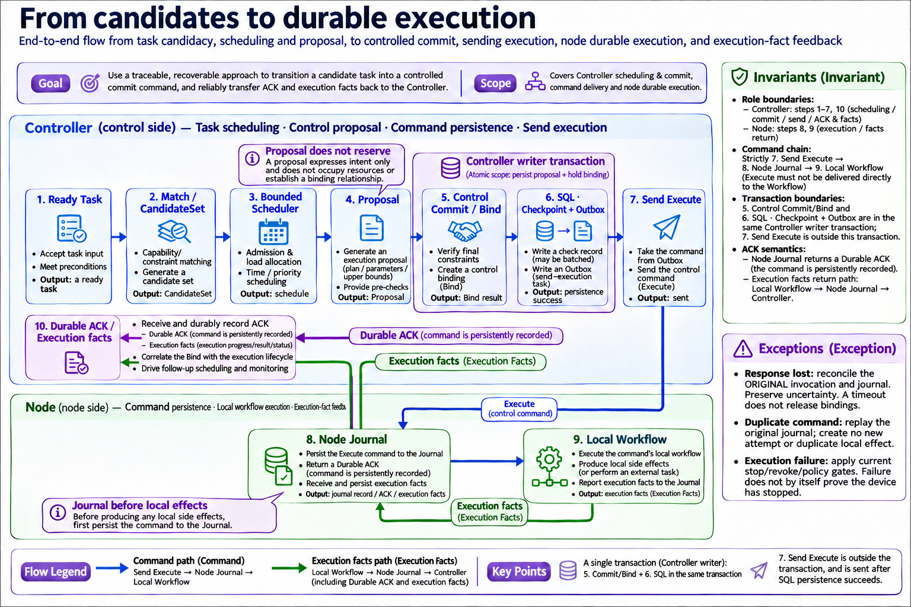
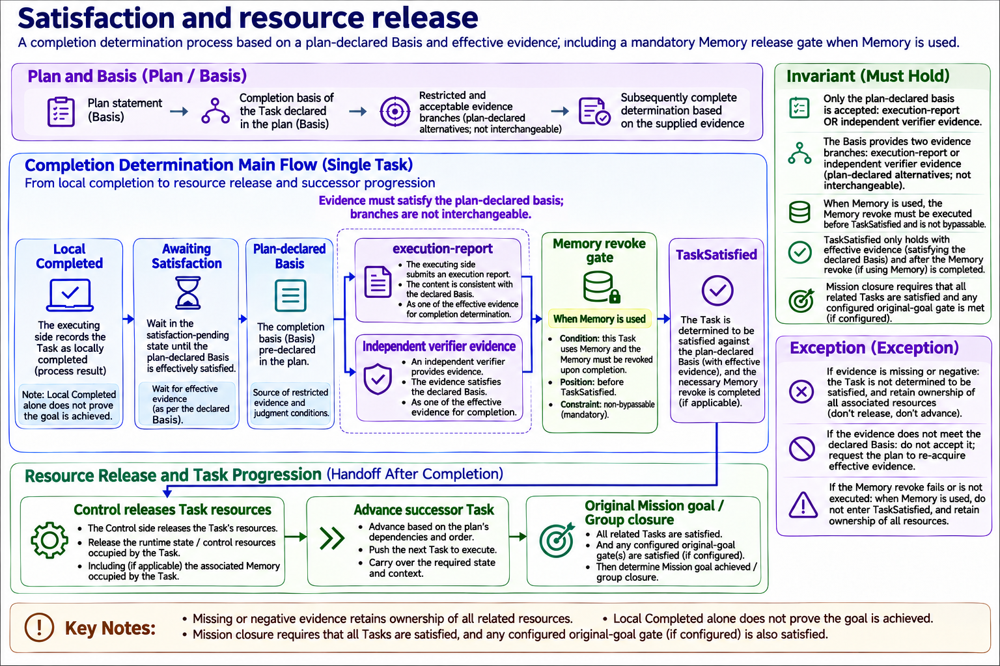

# Execution lifecycle

Code reviewed: 2026-11-26 · `main@3c7136d6`. Figures describe implemented responsibilities and protocol boundaries; device outcomes require original acceptance evidence.

<!-- diagram:dispatch:en -->

A Ready Task is jointly scheduled within its currently eligible candidates. The bounded Scheduler suggests Nodes, resources and time; a Proposal owns no resources. Under the current writer transaction, Control rechecks State, tenant, quota, conflicts and physical bindings before Commit and Bind. Future reservations still require admission at activation.

<!-- diagram:completion:en -->

Runtime reduces current Role execution facts but does not own TaskSatisfied. Local Completed enters AwaitingSatisfaction. Orchestration consumes only the accepted plan’s basis: execution-report is an explicit option, not independent goal verification. Verifier evidence must match the original plan, predicate, current attempt, source and freshness.

[Detailed flow](system-dataflows.en.md) · [Recovery](current-architecture.en.md)
