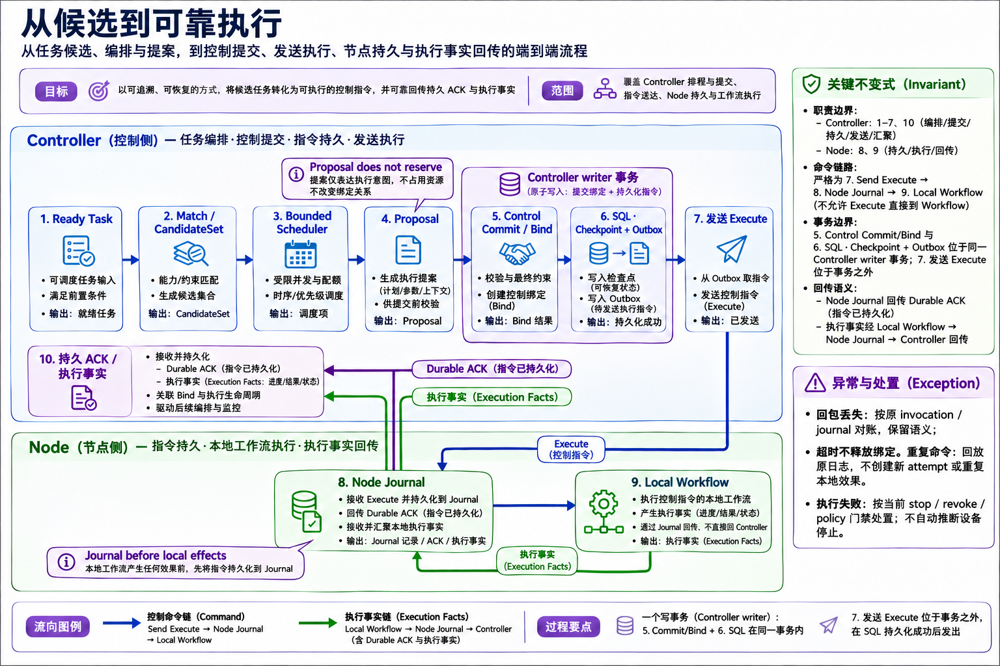
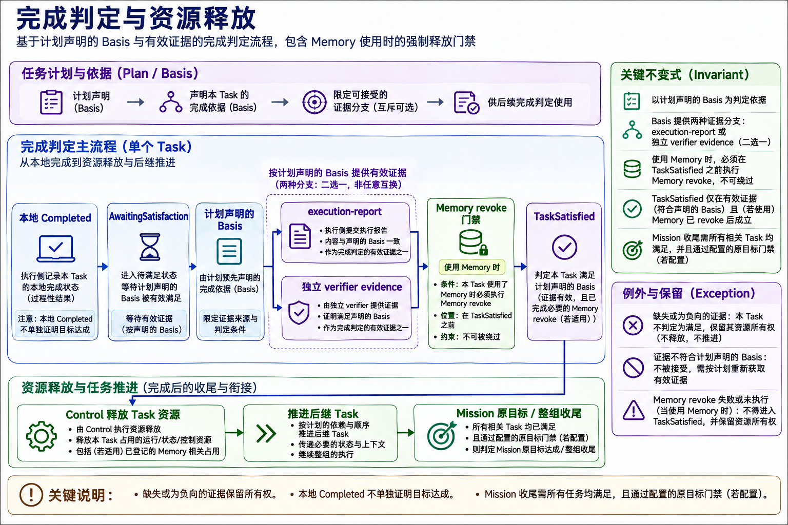

# 执行生命周期

代码核对：2026-11-26 · `main@3c7136d6`。图文描述代码职责与协议边界；实际设备结果须另查原验收证据。

<!-- diagram:dispatch:zh -->

Ready Task 从当前合法候选中进行有界联合调度。Scheduler 给出 Node、资源和时间建议；Proposal 本身不占有资源。Control 在当前 writer 事务里重新检查 State、租户、配额、资源冲突和物理绑定约束，通过 Commit 后才能 Bind。未来时间预订在激活时仍须重新准入。

<!-- diagram:completion:zh -->

Runtime 归约当前各 Role 的执行事实，但不拥有 TaskSatisfied 权威。本地 Completed 进入 AwaitingSatisfaction；Orchestration 只能消费接受计划声明的 basis。execution-report 是可选声明，不等同于独立目标验证。verifier-evidence 则需要匹配原计划、谓词、当前 attempt、来源与时效。

[Detailed flow](system-dataflows.md) · [Recovery](current-architecture.md)
