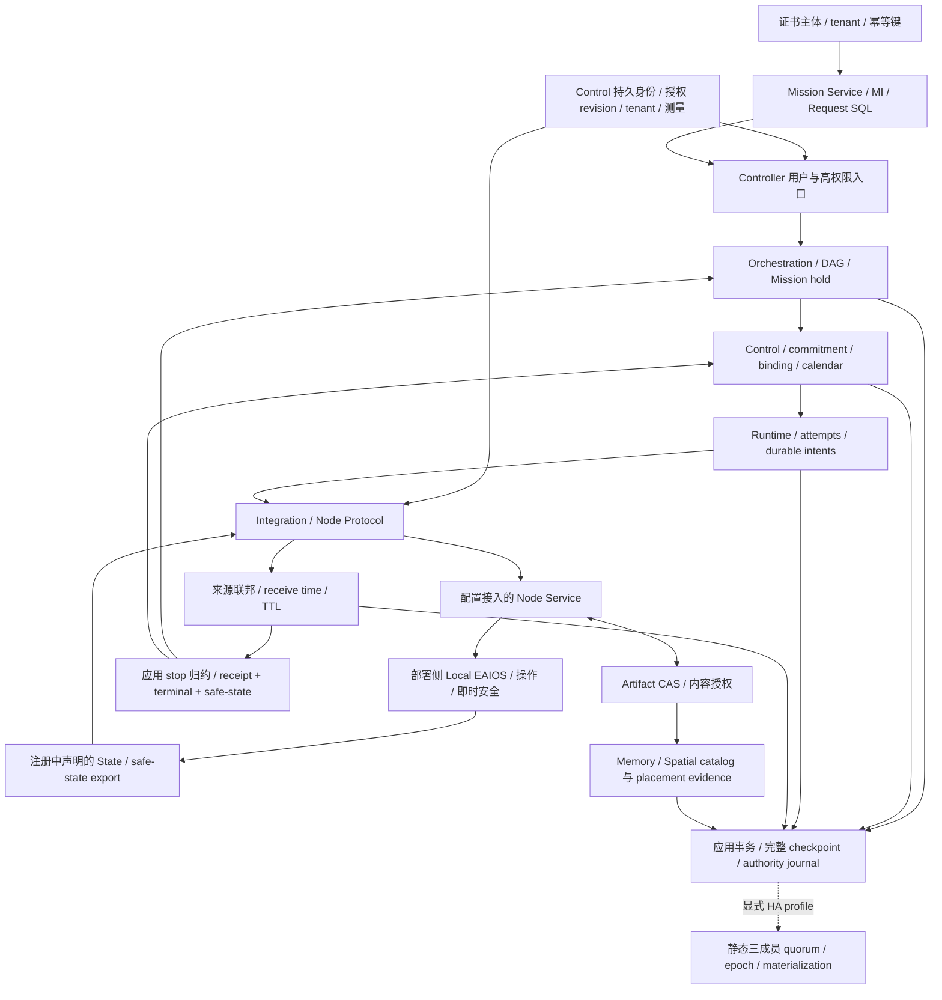

# 当前软件实现与部署拓扑

更新：2026-10-15。对应全部非发布软件整改计划；后续目标不视为当前能力。
节点、LocalSystem、能力、操作、State export 和 Memory provider 均由部署配置和正式注册提供。
未接设备的部署可以拥有零个 Node；系统不能自行生成设备或能力。

Controller 中 Orchestration、Control、Runtime、State 和 Integration 当前共址，责任边界由
Rust 模块及 transport-neutral ports 保持。Mission Service 是独立进程，Local EAIOS 位于
部署侧。默认监听 loopback；非 loopback 入口必须启用对应 mTLS 和证书权限 profile。
默认单 Controller，显式静态三成员 HA profile 使用独立副本 SQL 和 Controller 子进程。
动态成员、Federation、运行期重规划、完整时空/quota 和自动空间融合属于本轮必需目标，
目前仍需按阶段实现和验收。

副作用只在应用事务持久化并取得当前 quorum/epoch 后发出。副本只复制元数据和命令证据，
CAS 内容及 Local EAIOS 执行连续性需要独立恢复合同。Unknown 保留所有权；本地安全仍由
Local EAIOS 掌握。SoftwareProcess、测试合成观察和设备观察的证据等级不能混用。

当前停止软件门禁见 ADR-0102。完整数据记录可由
`GET /v1/executions/{execution_id}/safety-stop` 检查；这个查询不刷新 TTL 或 stop deadline。
身份与 tenant 权威的当前调用链见 [ADR-0103](../../decisions/0103-http-command-reconciliation-and-node-identity-lifecycle.md)
及[身份合同](../../development/identity-lifecycle-v0.1.md)；证书登记不会增加设备 inventory。
