# 当前软件实现与部署拓扑

更新：2026-10-21。对应全部非发布软件整改计划；后续目标不视为当前能力。
节点、LocalSystem、能力、操作、State export 和 Memory provider 均由部署配置和正式注册提供。
未接设备的部署可以拥有零个 Node；系统不能自行生成设备或能力。

Relation stop 保留 exact Task/Role target；缺少 relation proof 的 Completed target 与
当前 live peers 一起进入现有独立 stop/hold 门禁。单元合同的合成 Node 观察不进入部署。

2026-10-21 Replica storage v3 同时拥有实际 SQL inode 与 sibling writer lease。升级须先
核对原 identity、由 SQLite 排空旧连接，再原子提交只读旧表 fence；缺失 identity 不自动
修复。Recovery v0.7 冻结相同 writer，并在 bundle verify/restore 重查完整格式、原 transfer
与原 Controller spawn/PID/wait。成员本地 hold 不进入 Raft snapshot；Unknown 原 ID 不重发。
V3 election 前须原 source child 独立 durable wait、原 quorum 与预算；完成须目标 quorum
与源独立只读观察。跨域/在线内容恢复继续验收。

```mermaid
flowchart TB
  Client[证书主体 / tenant / 幂等键] --> MI[Mission Service / MI / Request + provenance SQL]
  ID[Control 持久身份 / 授权 revision / tenant / 测量] --> Entry
  Entry --> WIT[实际 leaf / 当前委托 / 事务写锁内复核]
  WIT --> SQL
  ID --> PROTO
  ID --> ART
  MI --> Entry[Controller 用户与高权限入口]
  Entry -->|recovery-admin / expected revision| QUOTA[Control tenant quota / 原 Role demand / wrapper v47]
  QUOTA --> CTRL
  Entry --> HTTPBOUND[有界 TLS 前连接 / 同步 poll handoff / response I/O 期限]
  HTTPBOUND --> WIT
  MI --> PREFLIGHT[只读发布合同前检 / exact plan + source digests]
  PREFLIGHT --> FEEDBACK[有界草案错误 / 原始输出保留]
  FEEDBACK --> MI
  Entry --> ORCH[Orchestration / DAG / Mission hold]
  MI --> MIWORK[独立 MI worker / 原 SQL + kernel budget / 原 Request]
  Entry --> DISCOVERY[只读当前 Generating 队列 / 实际 principal + tenant / 有界分页]
  DISCOVERY --> MIWORK
  MIWORK -->|Mission 唯一索引 + tenant / 精确 Request lookup| MI
  MIWORK -->|实际 Request + 原 admission / 只读 source| Entry
  Entry --> CLAIM[原 SQL claim / 每 provider phase 唯一 nonce / wrapper v45]
  CLAIM --> SQL
  CLAIM -->|原停止齐备后工作许可| MIWORK
  MIWORK -->|原 provider bytes / candidate / 独立实际 Review| Entry
  MIWORK --> MIREC[recovery profile v0.3 / 原 worker + inode lease / 完整原 SQL]
  MIREC --> SQL
  Entry --> REV[原 policy / candidate / exact Review / wrapper v45]
  DEPLOY[闭合部署 profile / 共址 故障域 目录 TLS 协议 退出证据] --> INSPECT[原 binary schema / 文件 inode / 实际只读 TLS GET / 零 Node 可用]
  INSPECT -. 无执行或停止权 .-> Entry
  MI --> MEMDTO[显式 MissionPlan v0.9 DTO / 非空 child 许可 / 原 v0.8 默认]
  MEMDTO --> REV
  Entry --> REVMEM[v0.3 原属组 child 声明 / 原 membership 与策略 / 无预绑定]
  REVMEM --> REV
  REV --> SQL
  REV --> STOP
  STOP --> RGROUP[原 stop 与 revoke 齐全 / source 历史保留 / 新 Group]
  REVMEM --> REVPUB[原 CAS 字节 / lineage / Review / 原预算 / Commit 后 catalog]
  STOP --> REVPUB
  REVPUB --> RGROUP
  RGROUP --> CTRL
  RGROUP --> ORCH
  GOAL[独立原目标 source / 实际 TLS / current version attempts / 原接收预算] --> Entry
  Entry --> GGATE[Control 原 goal contract 与 receipt / Orchestration 完成 gate]
  GGATE --> ORCH
  ORCH --> CTRL[Control / commitment / binding / calendar]
  CTRL --> RT[Runtime / attempts / durable intents]
  RT --> PROTO[Integration / Node Protocol / 独立 generation + Memory 字段]
  PROTO --> NODE[配置接入的 Node Service]
  NODE --> LOCAL[部署侧 Local EAIOS / 操作 / 即时安全]
  LOCAL --> OBS[注册中声明的 State / safe-state export]
  OBS --> PROTO
  PROTO --> STATE[来源联邦 / receive time / TTL]
  STATE --> BELIEF[显式 Belief producer / 原始 lineage / 非续期 TTL]
  BELIEF --> GATE[Control 来源策略 / Match Commit Bind Rebind Readiness]
  STATE --> GATE
  GATE --> CTRL
  VERIFY[独立 verifier / 当前 plan + attempts / CAS proof] --> ORCH
  VERIFY --> SQL
  STATE --> STOP[应用 stop 归约 / receipt + terminal + safe-state]
  STOP --> ORCH
  STOP --> CTRL
  ORCH --> SQL[应用事务 / 完整 checkpoint / authority journal]
  Entry --> IOBOUND[同步 writer SQL fence 归还异步网络 worker / 原事务顺序]
  HA --> TICKER[串行 transfer source / 所有退出路径恢复 heartbeat election]
  CTRL --> SQL
  RT --> SQL
  STATE --> SQL
  SQL -. 显式 HA profile .-> HA[quorum / 动态成员 / leader transfer / epoch / materialization]
  HA --> CERT[显式 replica v0.3 / Raft Stage Retire Abort / 实际 TLS 与 CA 迁移]
  SQL --> DEGRADED[原进程 write-disabled / 禁止 mutations ACK outbox / 最后提交查询]
  Entry --> PROBE[全局 recovery-admin / 原 generation + checkpoint + journal revision]
  PROBE --> SQL
  PROBE --> DEGRADED
  NODE <--> ART[Artifact CAS / 内容授权]
  NODE --> MEM[配置固定的 Local Memory provider]
  MEM --> MEMWRITER[参考 backend SQL v3 / root use 与四 SQL inode / 最后连接才释放]
  MEMWRITER --> MEMCOLD[显式 recovery v0.4 / 原 schema rows UUID 内容 / 无服务启动]
  MEM --> FILEPROC[显式 owned CPU child / 原预算与 PID / 有期限 read permit]
  FILEPROC --> EXITPROOF[真实 OS wait / 原 instance PID generation / 非设备证明]
  EXITPROOF --> OBS
  NODE --> NJ[Node journal v13 / 原唯一 writer / inode 与 canonical lease]
  MEM --> GC[实际原 import + revoke + worker + map 引用 / tombstone / unlink 对账]
  COLD[显式静止恢复工具 / 全部原 writer lease] --> SQL
  COLD --> ART
  COLD --> NJ
  COLD --> MEM
  COLD --> SNAP[完整 SQL / 实际内容 / pinned manifest / 新目录恢复]
  COLD --> REPLICACOLD[v0.2 全部 supervisor Raft child Artifact writer / 原日志投票 / 显式 CAS 恢复集合]
  Entry --> METRICS[专用 metrics-reader / 有界 histogram queue drop / 原角色 fence]
  MI --> METRICS
  HA --> METRICS
  METRICS --> PROM[声明部署 profile / 原生 Prometheus / Alertmanager]
  PROM --> INCIDENT[实际 firing resolved / 明确授权 receiver / 不授予恢复权]
  MEM --> QUERY[原实例 GET query / 实际 bytes 与原始日志]
  QUERY --> PROTO
  Entry --> MINT[持久 Memory intent / 对账 generation 与预算]
  MINT --> SQL
  MINT --> PROTO
  Entry --> HANDOFF[持久双 Group handoff / 原成员与期限]
  HANDOFF --> STOP
  HANDOFF --> MINT
  HANDOFF --> CHILD[停止与撤销齐全 / immutable child + lineage]
  CHILD --> ART
  HANDOFF --> READY[原接收方准备 / 显式 commit / Execute gate]
  READY --> RT
  HANDOFF --> SQL
  CTRL --> MAUTH[Memory tenant / selector / provider / 成员 generation]
  Entry --> MAUTH
  MAUTH --> MINT
  MAUTH --> ART
  RT --> PREP[原 Memory context / Prepare ACK / Group pending barrier]
  PREP --> IMPORTOWNER[原 Task attempt preparation / 自己的 import identity / 完整 request 比较]
  IMPORTOWNER --> MINT
  MAUTH --> PREP
  CAT --> PREP
  PREP --> SQL
  PREP --> PROTO
  MEM --> AVAIL[原 backend / 当前 bytes / 一次性 Probe]
  AVAIL --> PROTO
  PROTO --> PREP
  PREP --> PERMIT[Memory permit / 最早原期限 / 每次发送重查整组]
  PERMIT --> RT
  PREP --> REVOKE[durable Revoke ACK / 独立 stop hold]
  REVOKE --> PROTO
  ART --> UPLOAD[原 upload / bytes 校验与 fsync / CAS 归属 receipt]
  UPLOAD --> SQL
  ART --> CAT[Memory / Spatial catalog 与 placement evidence]
  CAT --> SQL
  FILES[来源固定的 PLY / PCD / planar occupancy 文件] --> SP[独立 CPU Spatial file provider]
  SP --> BUNDLE[不可变观测点 tile bundle / parent lineage / 计算证据]
  SP <-->|私有 Unix HTTP / 原 attempt 查询| NODE
  BUNDLE -->|Node 冻结并上传原 bytes| ART
  CAT --> TYPED[完整原 map / provider-qualified 字节副本]
  TYPED --> PREP
  TYPED --> SQL
  PREP --> USE[原 context 的当前使用租约 / generation / provider ACK]
  MAUTH --> USE
  USE --> SQL
  USE --> PROTO
  USE --> PERMIT
  MEM --> ULOCAL[同 kernel 与 time namespace / 私有 Unix / 每块读取复查]
  ULOCAL --> PROTO
  USE --> REVOKE
  REVOKE --> RELEASE[按 Task 或整组核对全部原 context 与 provider ACK]
  STOP -->|按需核对独立停止证据| RELEASE
  RELEASE --> ORCH
```

Controller 中 Orchestration、Control、Runtime、State 和 Integration 当前共址，责任边界由
Rust 模块及 transport-neutral ports 保持。Mission Service 是独立进程，Local EAIOS 位于
部署侧。默认监听 loopback；非 loopback 入口必须启用对应 mTLS 和证书权限 profile。
默认单 Controller，显式静态三成员 HA profile 使用独立副本 SQL 和 Controller 子进程。
动态成员、Federation、运行期重规划、完整时空与 divisible allocation、分布式 Spatial 消费属于本轮必需目标，
目前仍需按阶段实现和验收。

实际 Spatial 文件计算已接入 Node Service 的正式 Local How、prepared-artifact 和 CAS
发布链路。独立 verifier 检查来源文件与实际 tile bytes；Controller/Node 重启不再启动 worker。
首次进程记录使用显式 trusted-loopback profile；下述后续记录单独验证 mTLS producer 门禁。

当前 F4 producer 合同：typed-map v0.2 将原 producer provider/content schema 固定进不可变 manifest，
原 build provenance 与当前 publication attempt 分开。Node config v0.9 / Contract v0.8 必须显式
协商；catalog 在实际 writer gate 内核对当前证书、Node session、provider 和 Control/Runtime
绑定。旧 v0.1 不补 provider，远程 data-plane 不以历史兼容记录授权新发布。
Runtime 在实际 dispatch preparation 冻结原 Node contract、session 和 provider 声明；重试/恢复
不从新注册补旧证据。来源改变时 pending Execute 保留所有权并等待显式对账。模型参数不携带
这份内部注册证据，不能用来选择 provider 或 Node。

内容策略 v0.2 另外固定原 typed-map 全部 metadata 的 canonical digest；Control 重新构造投影
并同时核对通用与完整 Spatial 两份 digest。通用读取/import 不能丢弃 typed provenance；
旧策略缺依据时拒绝 map 读取，只有显式收紧升级可以增加 binding，已有 binding 不可替换或
移除。wrapper v34 拒绝旧 Controller 忽略新策略，包括无事件的策略事务。

发布合同前检与提交复用应用校验，见 [ADR-0109](../../decisions/0109-published-plan-validation-and-bounded-draft-recovery.md)。
前检不写入权威状态、不选择 Node，也不保证物理可达或当前资源可用；真实提交仍重新检查。
终态 verifier 的资源持有限制来自显式部署来源，不成为通用单 Actor 或顺序执行禁令。

副作用只在应用事务持久化并取得当前 quorum/epoch 后发出。副本只复制元数据和命令证据，
CAS 内容及 Local EAIOS 执行连续性需要独立恢复合同。Unknown 保留所有权；本地安全仍由
Local EAIOS 掌握。SoftwareProcess、测试合成观察和设备观察的证据等级不能混用。

当前 Memory 释放按实际范围检查：正常 Task 不等待仍在运行的兄弟 Task；取消、最终失败、
负向 verifier 与恢复保留整组或原停止 attempt 的 context/provider 门禁。回执固定原 backend
instance/contract，不能只匹配 provider 名称。Controller 与 supervisor 共享 wrapper v38；
旧 v37 读取后只作保守恢复，不刷新原预算。实际两 Node 文件路径、原子持久化与证据边界见
[生命周期验收](../../development/acceptance/2026-10-19-f4-memory-group-lifecycle.md)。

当前停止软件门禁见 ADR-0102。完整数据记录可由
`GET /v1/executions/{execution_id}/safety-stop` 检查；这个查询不刷新 TTL 或 stop deadline。
身份与 tenant 权威的当前调用链见 [ADR-0103](../../decisions/0103-http-command-reconciliation-and-node-identity-lifecycle.md)
及[身份合同](../../development/identity-lifecycle-v0.1.md)；证书登记不会增加设备 inventory。
Operator transport witness 随真实 writer guard 到 Commit/rollback，等待期间的撤权在事务内复核。
[实际 mTLS 排队检查](../../development/acceptance/2026-10-15-f4-operator-transactions.md)
核对第二个 registry revision 未提交。其它存储阻塞和只读快照降级仍需 F10。

State 与 MI 的当前软件路径见 [ADR-0104](../../decisions/0104-state-consumers-belief-and-semantic-verifier.md)
及 [F3 进程验收](../../development/acceptance/2026-10-15-f3.md)。Belief 是命名 producer，Control
只消费显式策略；它不取代原始 State 或成为 Global Truth。持续 verifier 的失效进入 stop/hold，
不能跳过实际停止证据。模型返回字段与配置 identity 均保留，缺失不补成已证明。

Memory 连续性的当前切片见 [ADR-0105](../../decisions/0105-memory-reconciliation-authorization-and-spatial-provider.md)
及 [进程验收](../../development/acceptance/2026-10-15-f4-memory-continuity.md)。Node Contract v0.7 /
config v0.8 显式协商原实例只读查询；导入原始身份先持久化，Unknown 不允许换 ID 重做。
该连续性切片引入 wrapper v31 / codec v22，内容门禁引入 wrapper v32、inner v21 和
upload codec v23；当前 producer 切片升级 wrapper v33、map codec v24 与 Node journal v8。
v8 保留原 v7 table layout/readonly legacy views，并通过双版本 marker 拒绝旧 v7 writer。
[内容授权合同](../../../contracts/memory/authorization-v0.1/README.md)规定显式 policy、成员版本、
稳定证书主体、当前 tenant 与实际 bytes 归属。Catalog/上传副作用重新核对当前权限，blob 流
逐块检查；已有 CAS 哈希不能授权另建 manifest，旧成员版本不能因回到原 Node 而复活。
Imported 历史不能授予当前可用性租约，Memory 对账不能满足 Task。

当前 pre-Execute 切片使用 MissionPlan v0.9 语义需求、Node config v0.10 / Contract v0.9，
在实际 operation owner 下选择已注册 receiver。原上下文、source session、policy/membership、
manifest/raw map 与 import ID 先持久化；Prepare ACK 之后才能导入，原实例当前 bytes 的
一次性 observation 通过之后才放行 Group 中的 pending Execute。Node 再检查完整当前内容、
配置、原预算和撤销 fence。接收预算取实际 Linux boot/monotonic，并保守扣除观察精度；
Controller 保留自己的 receive/deadline，两者不跨主机比较。
Revoke 先入 journal 再 ACK，先到也保留 tombstone。下载在每个有界写块检查 receiver 原预算，
CAS 服务同时逐块核对当前授权；精确原导入的 manifest 查询使用其 Read 授权，不授予目录发现。
Controller restart 撤销未结束的原准备授权，不重置时限或重做导入。wrapper v35 / inner v22 /
Node journal v9 拒绝旧版本，包括零事件快照和 SQLite 版本头回退。
实际两软件节点的 SQL 中断→原 provider 只读查询→当前可用性→真实计算→独立验证链路见
[准备验收](../../development/acceptance/2026-10-15-f4-memory-preparation.md)。
完整 Group lifetime/handoff、typed-map 消费、active-map/GC 仍属 F4 必需工作。

地图字节导入复用 prepared Memory 链路。Artifact 在事务写锁内将通用副本请求绑定到
原 published Spatial manifest，写 `MapMemoryReplicaRecorded`，包含完整原地图和消费端
provider；回放同样核对原 publication，不创建第二份通用 manifest 权威。Memory API 分别
返回字节 `replicas` 与原地图 `map_replicas`。wrapper v36 / event codec v25 拒绝旧 writer；
字节导入不授予地图激活或当前定位，完整语义消费仍在实施。

当前独立 Spatial 文件计算已通过[实际文件验收](../../development/acceptance/2026-10-15-f4-spatial-files.md)。
这些计算只生成文件产物，不能证明当前定位。实际 Node workflow 已冻结并上传原 bundle 至 CAS，
独立 source/tile verifier、mTLS producer 校验与旧二进制拒绝见
[producer 验收](../../development/acceptance/2026-10-15-f4-map-provider-authority.md)。
显式 Occupancy profile 使用 SE(2)，free/occupied/conflict/unknown 保持分离；原始 monotonic
deadline 不因 wall rollback 或换 host 续期。完整地图消费/激活、Group lifetime/handoff 与 GC 仍需完成。

### 原撤销的独立只读恢复

原始 Unknown 不覆盖，副作用不重复，观察期限不延长使用许可。Controller/supervisor wrapper
v39 与 Node journal v11 拒绝旧 writer。证据缺失或预算耗尽保留 ownership。

## Group Memory 交接实施边界（ADR-0108）

Application 持久化双 Group 的原成员/attempt/策略/期限，使用现有完整停止与内容撤销门禁；
Control 保持唯一 Commit/Bind/Rebind 权威。带父级 lineage 的新 scoped manifest 仅在停止与
撤销齐全后提交，目标真实准备与显式 commit 后才 Execute。原 typed-map provenance 单独
保留，软件 assurance 不建立设备停止或物理交接证明。

分支集成以 [ADR-0111](../../decisions/0111-branch-integration-and-authority-version-fences.md) 为准：
统一 Node Contract v0.12/config v0.13/catalog v0.15，Execute tag 11 单独传输原 attempt generation；
Memory preparation、use/revoke 和独立进程停止保留各自证据。共享 wrapper v41/journal v12
拒绝旧 writer；跨分支版本号碰撞不成为迁移授权。软件进程退出仍不证明设备停止。
自然失败的 hold 收尾只消费当前原始 Failed attempt；Cancelled 不变成 Failed，也不绕过
Memory handoff 的 binding 保留。停止确认本身不释放正在交接的源 Group。
Artifact 的单 writer lease 随最后一个应用 store/clone/upload 显式释放；无写入权的子进程
继承 descriptor 不延长该应用的写入权，也不允许仍有上传时启动第二 writer。
