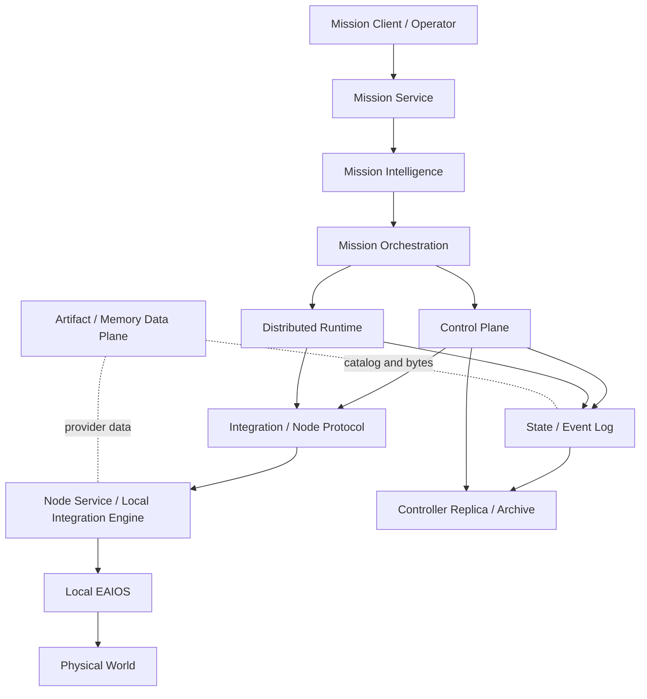

# RoboGuide 分布式具身智能操作系统分层架构审计与优化设计

**审计日期：** 2026-10-14
**审计基线：** 分支 `codex/e1-perception-rearrangement-optimization`，HEAD `af6bf3428e6ebc03afc2fdaf2572449b397cc18a0`
**审计范围：** 当前 Core、Apps、Mission、Node Service、Integration、Artifact/Memory、架构与 ADR 文档
**排除范围：** `experiments/`、实验结果、实验性能结论和真机实验结论
**工作方式：** 只读审计。本文档不改变架构契约，也不修改现有实现。

**阅读说明：** 本文是整改前的只读基线快照，章节中的“当前状态/已确认问题”描述审计时点，不能直接当作整改后的实时状态。当前工作树的实施进度以[整改实施计划](../../development/roboguide-remediation-plan-2026-10-14.md)、[整改状态复核](../../development/roboguide-remediation-status-2026-10-14.md)和[剩余整改清单](../../development/roboguide-remediation-remaining-2026-10-14.md)为准；ADR 中的 Accepted 合同不代表全部实现已完成。

## 1. 审计结论

RoboGuide 的控制内核已经形成了比较清晰的分布式执行边界：Mission Intelligence 负责语义计划，Orchestration 负责 Mission/DAG 生命周期，Control 负责匹配、承诺、绑定和恢复决策，Runtime 负责物理执行尝试和事实归约，Node Service 负责本地执行连续性，Local EAIOS 保留 Local How 和即时安全权威。这组边界是合理的，也是当前代码最有价值的部分。

当前系统仍不能完整地作为生产级分布式具身智能操作系统交付。主要原因不是缺少更多调度算法，而是以下系统闭环没有冻结或没有闭合：

1. 外部入口没有统一的身份、权限和审计模型；
2. RoboGuide 还没有跨节点的物理停止、安全状态和交接合同；
3. State、Belief、Memory 和 Spatial Authority 的最终权威仍未确定；
4. 完整 MVP、生产部署拓扑、SLO 和故障域尚未冻结；
5. Controller 高可用、节点身份生命周期和数据面一致性还没有达到生产闭环。

因此，当前最准确的定位是：**具备可靠性内核和清晰职责分层的分布式具身执行框架，正在向完整具身操作系统演进。**

## 2. 当前逻辑拓扑



逻辑组件可以共址，也可以分布部署；部署拓扑不能改变组件权威。当前真正需要补齐的是跨组件的系统合同：谁可以接收请求、谁能写入哪类状态、哪个提交点代表“已接受”、哪个证据代表“物理动作已经停止”，以及数据面和控制面失败时如何恢复。

### 2.1 权威边界

| 组件 | 应拥有的权威 | 不应拥有的权威 |
| --- | --- | --- |
| Mission Service | 请求接入、对话命令和 Mission Request 投影 | 设备控制、Node 选择、Resource Commit |
| Mission Intelligence | 指令解释、澄清、Grounding、MissionPlan 草案、Review/Repair | 实时库存、资源承诺、执行生命周期 |
| Orchestration | Mission、Task DAG、Ready、Task/Mission 终态和逻辑调度策略 | 物理资源所有权、Node 选择、Local How |
| Control | Capability Match、Proposal、Commit、Group、Binding、Recovery Decision | 高频运动控制、设备厂商调用、最终物理安全 |
| Runtime | logical slot、physical attempt、command intent、fact/relation 归约、Unknown fence、checkpoint | Match、Schedule、Commit、Replacement 选择、Task satisfaction 决策 |
| State / Event Log | source-aware evidence、projection、可重建目录和事件证据 | Global Truth、Lease、Reservation、Group 生命周期、冲突自动裁决 |
| Artifact / Memory | CAS bytes、manifest、replica 和 provider evidence | Mission/Task 生命周期、资源承诺、设备 workflow 权威 |
| Integration | Node Protocol、session、sequence、router 和 wire conversion | Control、Runtime、State、Local How 和恢复选择 |
| Node Service | 本地执行连续性、journal、endpoint 调用和本地配置 | Mission/Group 生命周期、全局调度、跨节点安全裁决 |
| Local EAIOS | 感知、导航、运动、硬件控制和即时安全 | RoboGuide 的全局 Mission 语义和资源承诺 |
| Controller Replica | 版本绑定的 checkpoint/history、复制和 archive evidence | 独立创建 Match/Bind、直接发物理命令、复制 Artifact 内容 |

这份边界基本合理。需要进一步冻结的是 State/Belief、Lease、Memory import、物理 stop 和多 Controller 之间的权威交接。

## 3. 分层审计

### 3.1 产品定义、MVP 和部署拓扑层

**当前状态。** V2 架构已经定义了 Mission、Node、Capability、Resource、Execution Group、Runtime、Relation、Integration 和 Local EAIOS 的概念边界。完整 MVP 仍处于 Draft，已经批准的是窄范围 Fake Node 恢复切片。完整 Mission、Node Topology、正常流程、故障矩阵、Observable Evidence、Metrics、Non-goals、Validation Ladder 和 Exit Criteria 尚未冻结。

**判断。** 架构方向合理，但产品边界没有冻结会使不同模块分别扩大自己的语义，最后重新形成多个隐含的控制权威。

**优化设计。** 先建立一个版本化 `DeploymentProfile`，至少固定：

- 组件是共址、同主机多进程还是跨主机；
- 每个组件的持久化目录、备份方式和故障域；
- Node、Controller、Mission、Artifact 的信任边界；
- 控制面、执行面、数据面的网络路径；
- 单 Controller 与 Replica 模式的切换条件；
- RTO、RPO、Ready、Degraded、Unknown 和 Blocked 的服务级定义。

参考：[MVP 定义](/data/workspace/code/RoboGuide/docs/mvp-definition.md:1)、[V2 架构组件表](/data/workspace/code/RoboGuide/docs/architecture/v2/README.md:83)。

### 3.2 Mission Service 和外部入口层

**当前状态。** Mission Service 能够创建 Mission Request，处理澄清、审批、重试和取消，并将请求交给 Mission Intelligence。Controller HTTP 已经有 loopback 默认、mTLS 角色映射和 mutation authorization。

**已确认问题。** Mission Service 的 `listen_host` 可以配置为非 loopback，但服务没有认证、调用者身份、租户边界或统一审计主体。它暴露了创建、查看、审批、重试和取消接口。见 [Mission Service 配置](/data/workspace/code/RoboGuide/mission/src/mission/service_config.py:65) 和 [Mission HTTP 路由](/data/workspace/code/RoboGuide/mission/src/mission/api.py:155)。

**优化设计。** Mission Service 应采用与 Controller 相同的入口安全 profile：

1. 默认只允许 loopback 或 Unix socket；
2. 非 loopback 必须配置 mTLS 或受信任的边缘身份代理；
3. 每个请求持久化 `principal_id`、tenant、authorization policy digest 和 correlation ID；
4. 查看、提交、审批、重试、取消采用不同权限；
5. 将外部用户 API 与内部 Mission command API 分开，避免一个接口同时承担产品入口和控制入口。

### 3.3 Mission Intelligence 层

**当前状态。** Canonical Capability Catalog、Grounding Snapshot、Interpreter、Planner、Reviewer、Repairer 和 MissionPlan 版本化合同形成了完整的语义准入链。MI 不读取实时库存，也不直接选择 Node，这个边界正确。

**缺口。** Shared Belief 的 provider、冲突归约、置信度融合、记忆内容访问和真正的 verifier ingress 仍未形成完整系统合同。当前 policy provenance 尚未完整进入 MissionRequest history。模型输出经过结构、Catalog、Grounding 和 Review 校验，只能证明合同合规，不能证明模型理解了真实世界。

**优化设计。** 为每个被 MI 使用的事实保存 `source_id`、`observed_at`、`received_at`、TTL、confidence、policy digest 和 evidence digest。将“模型生成的计划”“部署策略批准的计划”“Control 接受的计划”分别建模，避免一个 `MissionPlan` 字段承担三种语义。

### 3.4 Mission Orchestration 层

**当前状态。** Orchestration 拥有完整 MissionPlan、DAG readiness、TaskExecution readiness、Mission-level Group 生命周期、Task satisfaction 和显式 Mission completion。priority/aging、bounded dispatch、future scheduling 和局部 contract failure isolation 已经有清晰边界。

**缺口。** 执行期自动重写计划、自动 MI replacement、运行中物理抢占和通用多角色恢复没有实现。事件或 checkpoint 提交失败时，由于内存 Control 不支持事务回滚，应用采用整体 fail-stop。这个行为安全，但还没有转化成明确的服务恢复目标。

**优化设计。** 将应用提交拆成三层：

- domain transition：可证明局部失败时回滚；
- authority commit：Control/Runtime/State 一致提交或整体拒绝；
- outbox delivery：提交后发送，发送失败进入 durable retry/reconciliation。

同时为每类失败规定 `Retryable`、`Hold`、`ReconciliationRequired`、`Failed` 和 `OperatorActionRequired`，不要由诊断文本推断重试策略。

### 3.5 Control Plane 层

**当前状态。** Control 的 Match、Propose、Coordinate、Commit、Bind、Rebind、Release 和 Recovery Commitment 分工明确。Reservation 是唯一资源承诺权威，Allocation State 只是投影，这个设计合理。

**缺口。** State authority、Lease owner、跨 Controller ownership、lease expiry、partial release 的一致性和动态 Control topology 仍属于开放架构问题。当前 recovery commitment 的持久化、crash recovery 和 timeout/auto-Abort 也没有完全闭合。

**优化设计。** 为 Control 建立明确的 authority journal 或可重建 command log，并为每次 mutation 固化：

```text
authority_revision
command_id
causation_id
current_epoch
resource_ownership_digest
plan_digest
resulting_state_digest
```

State projection 只能带着对应的 authority revision 更新；恢复时先重建 Control authority，再刷新 State projection，不能从滞后的 Allocation View 反推 ownership。

### 3.6 Scheduler 和资源语义层

**当前状态。** 当前 Scheduler 是无状态、确定性、有界的联合选择器，消费已经过滤的 Candidate Set 和 immutable Control calendar。它不重复做 eligibility，不提交资源，也不改变 State。priority/aging 和未来窗口设计是清楚的。

**缺口。** 当前实现没有真实的 CPU/GPU/NPU memory、队列、执行时长、移动距离、交通冲突和空间占用成本模型；运行中物理抢占、分数 quota、复杂 multi-role recovery 和负载预测仍未完成。Time 和 Space 仍是 bootstrap commitment profile。

**优化设计。** 保持 Scheduler 纯函数边界，新增独立的 evidence provider：

- `ComputeLoadEvidence`：容量、队列、显存、预计完成时间；
- `SpatialCostEvidence`：位置、路线、占用区间、冲突；
- `TemporalConfidence`：估计窗口和误差界；
- `FairnessEvidence`：等待年龄、租户和优先级。

这些证据只产生可解释的 cost 和排序，不直接改变 Control ownership。未知成本只能降低排序质量，不能悄悄变成 Node 不可用。

### 3.7 Distributed Runtime 层

**当前状态。** Runtime 的 stable logical slot、physical attempt history、durable command intent、ordered fact reduction、Unknown fence、relation state 和 checkpoint 是整个系统最成熟的可靠性内核之一。Runtime completion 与 Task/Mission satisfaction 的分离也正确。

**关键缺口。** Execution relation 的 Violation/Unknown 目前主要形成 progression fence；RT-G9 尚未提供通用的版本化 pause/stop command、物理停止确认、deadline 和 completion race 处理。Command receipt 只能证明 Node journal 接受，不证明设备已经停止。

**优化设计。** 建立独立的安全执行合同：

```text
StopRequested
  -> StopCommandAccepted
  -> LocalSafeStateObserved
  -> StopConfirmed
  -> ContinuationPrepared | GroupStopped | ManualEscalation
```

每一步都要绑定 `attempt_id`、`execution_generation`、`safety_policy_digest`、deadline 和来源。没有 `StopConfirmed` 时，系统只能保持 ownership 和 Unknown/Blocked，不能自动释放资源、重放动作或交给替代 Actor。

参考：[RT-G9 待办](/data/workspace/code/RoboGuide/docs/implementation-backlog.md:111)、[Runtime 边界](/data/workspace/code/RoboGuide/docs/development/README.md:79)。

### 3.8 State、Event Log 和 Shared Belief 层

**当前状态。** State records 区分 Node/World/RoboGuide 对象和 Desired/Committed/Reported/Observed/Derived/Belief 语义，并保留 source、channel、time、TTL 和接收时间。EventLog、checkpoint、schema fence 和 replay evidence 设计较完整。

**缺口。** State 是证据联邦和投影，不是 Global Truth。Q1 State Authority 仍未解决：什么来源、什么新鲜度、什么置信度可以驱动 Control；冲突由谁归约；Belief 是否允许影响资源承诺，都还需要明确合同。当前 EventLog 也不等于完整 event-sourced authority。

**优化设计。** 定义一个显式的 `DecisionEvidencePolicy`，为每个可改变决策的 State key 声明：

- 允许的 provider 和 source class；
- freshness、TTL、confidence 下限；
- 冲突时的 deterministic reducer；
- 允许影响的决策类型；
- 缺失、冲突和过期时的 fail-closed 行为。

没有通过 policy 的 State 只能作为观察证据，不能隐式进入 Match、Commit、Rebind 或 satisfaction。

### 3.9 Memory、Spatial 和 Artifact 数据面

**当前状态。** Memory Scope、Visibility、Placement 分离得很好；manifest/catalog、provider-qualified replica identity、CAS、digest 校验和 Spatial map immutable revision 形成了可靠的数据面基础。真实 EAIOS 继续拥有语义和存储权威也合理。

**缺口。** 通用 `Controller → Node` durable selective-import command、application-accepted ACK、retry fence 和可选 ExecutionGroup 关联尚未冻结。Map fusion、active-map 选择、实时增量同步、删除/GC、内容访问控制和 provider conflict resolution 仍未完成。

**已确认的安全问题。** Artifact HTTP 默认绑定 loopback，但主程序对 `artifact_address` 没有类似 Node Protocol 或 Operator HTTP 的非 loopback 限制；路由可直接处理 artifact upload、publish、replica 和 localization evidence，代码中没有 caller authentication。见 [Artifact listener](/data/workspace/code/RoboGuide/apps/integration-server/src/main.rs:576) 和 [Artifact 路由](/data/workspace/code/RoboGuide/apps/integration-server/src/artifact_http/server.rs:61)。

**优化设计。** Artifact 数据面采用独立但统一的 security profile：

1. 默认 loopback/Unix socket；
2. 远程模式必须配置 mTLS；
3. catalog read、blob read、upload、publish、replica 和 localization write 分别授权；
4. 每次写入绑定 principal、provider、manifest digest 和 controller epoch；
5. 引入 durable import command，而不是由 discovery 或普通 Execute 隐式触发复制。

### 3.10 Integration、Node Protocol 和 Node Service 层

**当前状态。** Integration 只负责 formal Node Protocol、session、sequence、router 和 wire conversion；Node Protocol v0.4、Node Contract v0.6、Node config v0.7 分层明确。Node Service 的 journal、执行 identity、restart ambiguity fence 和 Local Integration Engine 配置验证是合理的。

**缺口。** 还缺生产级 Node identity lifecycle：动态注册、证书轮换、撤销、密钥恢复、跨域信任和硬件/物理身份 attestation。mTLS 配置能保护连接，但不能单独证明“这个 Node 仍然对应同一台物理设备”。

**优化设计。** 将 Node identity 分成三层：

- `NodeIdentity`：逻辑 Node 和协议身份；
- `LocalSystemIdentity`：本地 EAIOS 实例和配置身份；
- `PhysicalEntityIdentity`：部署注册表中的物理实体和 anti-rollback watermark。

三者分别轮换、吊销和恢复；Control 只在满足部署 registry、fresh registration 和 current epoch 后建立 ActorBinding。

### 3.11 Local EAIOS、物理世界和安全层

**当前状态。** Local EAIOS 保留 Local How、厂商 SDK、感知、导航、运动和即时安全，是正确的责任划分。RoboGuide 不把高频纠偏或硬件安全搬进远程 Controller，也不把本地动作结果伪装成官方 Mission satisfaction。

**关键缺口。** 系统还没有跨节点 hazard model、safe-state 规范、硬实时 deadline、停止证书、物理交接、载荷连续性和 coupled execution 的统一合同。软件层的 lease expiry、cancel receipt、Unknown、diagnostic 和 recovery view 都不能单独证明物理停止或安全。

**优化设计。** 由每个 Local EAIOS 实现安全动作，由 RoboGuide 统一保存安全证据和 ownership 规则。安全接口至少包括：`prepare-stop`、`stop`、`safe-state-observation`、`stop-confirmation`、`handoff-eligibility`。所有接口必须是 attempt/generation 绑定，过期命令不得影响新 attempt。

### 3.12 Controller Replication、HA 和 Archive 层

**当前状态。** 已有静态 quorum software profile、replica mTLS、exact leaf pinning、checkpoint/history、archive fence 和 recovery view。复制边界没有把 Artifact/Memory bytes 错误地混入 Controller history，这一点合理。

**缺口。** 这仍不是完整生产 HA。动态 membership、leader/lease 迁移、证书轮换、跨站点故障、snapshot/archive replay、长时间容量管理、Artifact 内容可用性和物理执行连续性都没有闭环。

**优化设计。** 将 HA 明确拆成三个独立目标：

1. **Authority continuity**：新的 Controller 是否能安全接管 Control authority；
2. **Evidence continuity**：State、Runtime、Memory catalog 和 archive 是否完整可重建；
3. **Physical continuity**：当前设备是否仍处于可证明的执行或安全状态。

只有三个目标分别通过 gate，才允许把服务状态标为 `Ready`。Replica history 成功不能单独推出 physical continuity。

### 3.13 Observability、部署和发布层

**当前状态。** 有 bounded diagnostics、事件查询、recovery view、journal 和 archive evidence。测试体系对 Rust Core 的不变量覆盖较好。

**缺口。** 没有形成完整的 Prometheus/OpenTelemetry、SLO、告警、dashboard、readiness 和生产部署模板。发布审计还记录了项目 LICENSE 和完整发布声明尚未确定，见 [发布技术准备审计](/data/workspace/code/RoboGuide/docs/development/release-preparation-audit.md:43)。

**优化设计。** 先定义最小生产指标集：

- Mission acceptance、Ready、Commit、Bind、Execute、Satisfaction 的计数和延迟；
- Unknown、Hold、ReconciliationRequired、ManualEscalation 数量；
- command accepted 到 local outcome、stop requested 到 stop confirmed 的时间；
- checkpoint age、event high-water、archive backlog、replica lag；
- Artifact upload、publish、import、localization verification 的失败率；
- 每个 Node 的 registration、liveness、capability readiness 和 route loss。

这些指标只用于观察和 SLO，不得反向成为隐含的控制 authority。

## 4. 已确认问题、测试缺口与未证明事项

### 4.1 已确认问题

- Artifact HTTP 如果配置为非 loopback，可以在没有 caller authentication 的情况下暴露读写数据面。
- Mission Service 如果配置为非 loopback，可以在没有 caller authentication、tenant 和 principal 审计的情况下暴露 Mission mutation API。
- 完整 MVP 仍是 Draft，产品拓扑、故障矩阵、指标和退出条件尚未冻结。
- State authority、Spatial authority、Control topology、Execution Group authority、Temporal assurance 和 Resource commitment semantics 仍存在开放设计问题。
- RT-G9 物理 pause/stop/ack/deadline 语义尚未完成。
- 通用 Memory selective import command、ACK、retry fence、access control、retention/GC 尚未形成完整协议。
- Controller 的失败恢复仍依赖 fail-stop；不能从当前实现推导出无损的分布式事务。
- 当前工作树离线 pytest 有两个失败，来自未提交的 execution-planning-evidence 配置与测试模板装配不一致；该问题不属于实验结论。

### 4.2 TEST GAP

以下内容目前没有足够的运行证据，不能用软件单元测试替代：

- 跨主机网络分区、Controller takeover 和真实 archive replay；
- 证书轮换、吊销、动态 membership 和真实 PKI 运维；
- Local EAIOS 物理停止、safe-state、载荷交接和多设备连续执行；
- 真机的定位、地图发布、Memory import 和 provider storage 一致性；
- 生产负载下的调度延迟、SLO、队列、GPU memory 和长时间 archive 容量；
- 设备断电、网络断开、进程恢复后物理世界与 Runtime attempt 的连续性。

### 4.3 NOT PROVEN

当前不能宣称以下性质已经成立：

- “取消已接受”意味着机器人已停止；
- checkpoint/replay 成功意味着物理动作可以安全继续；
- Node Protocol receipt 意味着 Local EAIOS 已完成执行；
- State observation 等同于全局真实状态；
- Replica history 完整意味着物理执行连续；
- MI 生成的 MissionPlan 具有真实世界语义正确性；
- 任意两个异构机器人之间都可以自动完成交接；
- 当前实现已经是生产级高可用分布式操作系统。

## 5. 优先级路线图

### P0：先关闭系统级安全和产品边界

1. 冻结 `DeploymentProfile`、MVP topology、故障域、SLO、Non-goals 和 Exit Criteria。
2. 统一 Mission、Controller、Artifact 三个入口的身份、权限、审计和非 loopback 策略。
3. 冻结 Control、Runtime、State、Memory、Artifact、Replica 的 authority matrix。
4. 设计并评审 `StopRequested → StopConfirmed` 安全执行合同。
5. 明确没有 StopConfirmed 时的 ownership、Unknown、release 和 manual escalation 规则。

### P1：补齐分布式一致性和数据面闭环

1. 为 Control 增加可重建 authority journal 或等价的 durable command log。
2. 定义 State/Belief 的 Decision Evidence Policy 和冲突归约。
3. 冻结 Memory selective import command、ACK、retry fence、provider authorization 和 Group 关联。
4. 建立 NodeIdentity、LocalSystemIdentity、PhysicalEntityIdentity 的注册、轮换和撤销流程。
5. 定义 authority continuity、evidence continuity、physical continuity 三类 HA gate。
6. 增加 readiness、metrics、SLO、告警和跨主机故障演练入口。

### P2：在闭环稳定后优化性能和表达能力

1. 为 Scheduler 接入真实 load、queue、GPU、travel、traffic 和 spatial contention evidence。
2. 增加成本模型、公平性、可解释排序和更复杂的多角色恢复。
3. 设计 map fusion、active-map、incremental memory sync、retention/GC 和内容 ACL。
4. 建立 Mission、Node Config、Node Contract、Node Protocol 的兼容矩阵和废弃策略。
5. 将事件投影、查询索引和 archive compaction 优化为可观测的独立能力。

## 6. 审计证据与边界

主要设计依据是 [V2 架构基线](/data/workspace/code/RoboGuide/docs/architecture/v2/README.md:83)、[开发模块边界](/data/workspace/code/RoboGuide/docs/development/README.md:79)、[架构待决事项](/data/workspace/code/RoboGuide/docs/implementation-backlog.md:9)、[MVP 定义](/data/workspace/code/RoboGuide/docs/mvp-definition.md:1) 以及当前实现源码。

审计时的代码质量检查记录了 Rust workspace 测试、`cargo fmt --check`、`cargo clippy -- -D warnings` 和 Mission 的 `mypy` 结果；Python 离线测试当时受未提交工作树配置影响。整改后的复核命令和结果不回写为本基线快照，统一记录在整改实施计划和交付报告中。上述检查只证明软件路径和合同测试的结果，不能证明物理安全、跨主机故障恢复、生产高可用或实验效果。

本文档是架构审计和设计建议，不替代后续 ADR。任何 P0/P1 项目进入实现前，都应先形成对应 ADR、状态迁移规则、故障矩阵和可复现的 acceptance gate。
