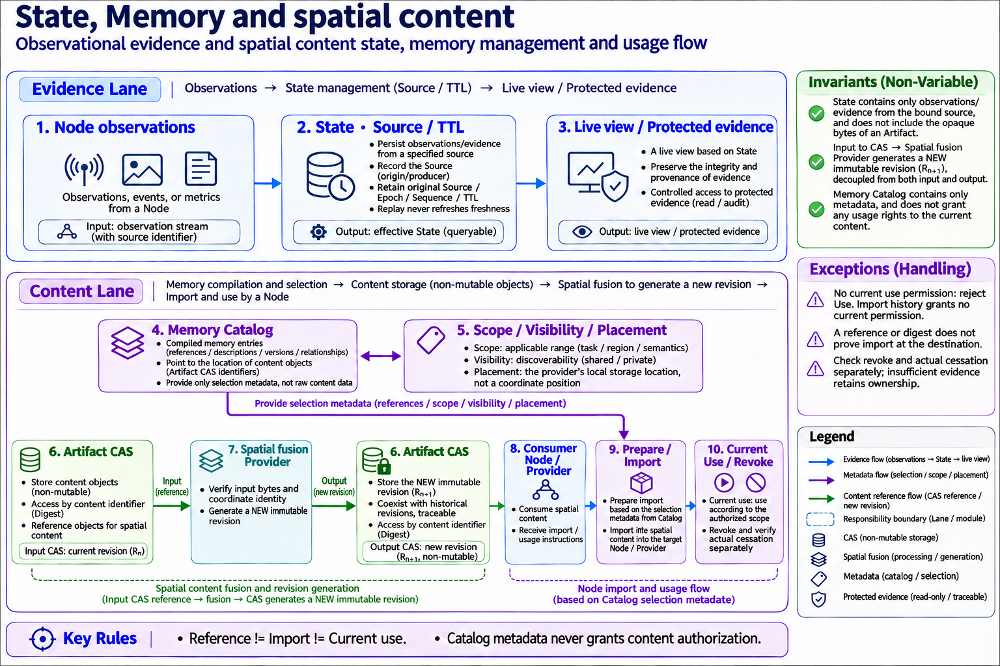

# State / Memory

Code reviewed: 2026-11-26 · `main@3c7136d6`. Figures describe implemented responsibilities and protocol boundaries; device outcomes require original acceptance evidence.

<!-- diagram:state-memory:en -->

State keeps independent facts keyed by object, semantic, source and channel, retaining source time, receive time, epoch, sequence and TTL. Reported, Observed, Derived and Belief do not automatically become global truth. Ordinary telemetry may coalesce or persist on changes/intervals; protected decision and safety evidence keeps its durable acceptance boundary.

1. Memory Catalog owns metadata and reconstructable provenance; CAS stores immutable opaque bytes.
2. Scope limits semantic consumption, Visibility controls discovery/exchange, and Placement records provider-local copies.
3. A reference/hash does not prove import; historical import grants no current-use permission.
4. Prepare/Import, current availability/use and revoke retain exact attempt, provider and original budgets.
5. Spatial fusion validates input bytes and frame identities and produces a new revision; map existence proves neither localization nor arrival.
