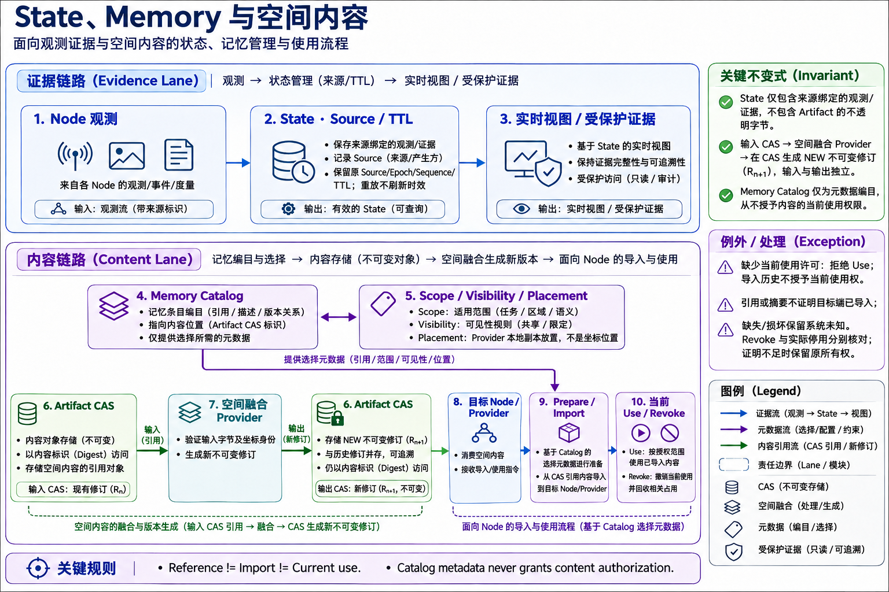

# State / Memory

代码核对：2026-11-26 · `main@3c7136d6`。图文描述代码职责与协议边界；实际设备结果须另查原验收证据。

<!-- diagram:state-memory:zh -->

State 以对象、语义、来源和通道为键保存独立事实，保留 source time、receive time、epoch、sequence 和 TTL。Reported、Observed、Derived、Belief 不会自动合成全局真值。普通遥测可合并或按变更/间隔落盘，但受保护的决策与安全依据保持原持久接纳边界。

1. Memory Catalog 管理元数据与可重建来源；CAS 保存不可变 opaque bytes。
2. Scope 限制语义消费，Visibility 限制发现/交换，Placement 记录 provider 本地副本，三者独立。
3. 引用或哈希不证明接收端已导入；导入历史不授予当前使用许可。
4. Prepare/Import、当前 availability/use、revoke 分别保留原 attempt、provider 和预算。
5. 空间融合 Provider 验证输入字节及坐标身份，产生新 revision；地图存在不证明定位或到达成功。
