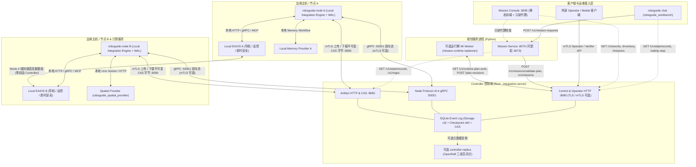
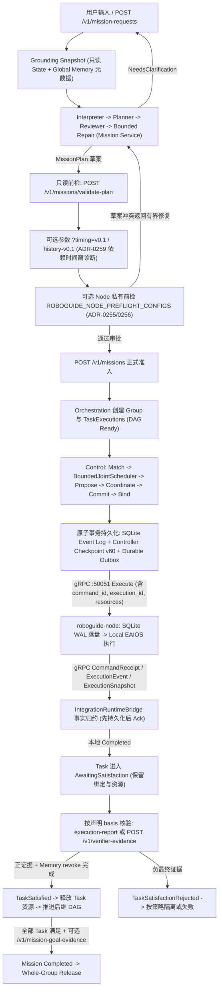
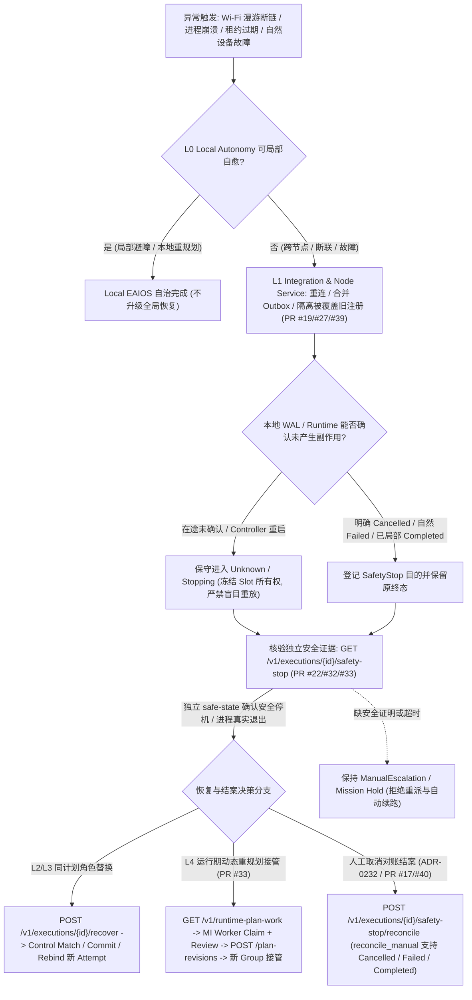

# RoboGuide 核心系统架构与五类核心数据流图解

> **System Architecture & Five Core Protocol Dataflows (Baseline: `origin/main@e4c03a55`)**
>
> 本文档依据 `e4c03a55` 主线真实源码整理，与 [V2 现行架构](README.md)、[当前代码架构图册](current-architecture.md) 保持同一语义权威。所有端口、HTTP 路由、gRPC 消息体与持久化表名均来自仓库实际实现，不引入虚构接口或隐式权威。

## 0. 默认端口、协议与代码边界总览

| 通信面 / 组件 | 默认端口与协议 | 核心职责与源码锚点 |
| --- | --- | --- |
| **Mission Service** | `127.0.0.1:8070` HTTP（现场可配置如 `:8073`） | 自然语言 Request、Grounding、`Plan / Review / Repair` 与审批提交；[`config/mission-service.toml`](../../../config/mission-service.toml) · [`mission/src/mission/`](../../../mission/src/mission/) |
| **Controller HTTP** | `127.0.0.1:8080` HTTP / mTLS | Mission 准入前检、调度与状态联邦、共享视图、安全停机核验与恢复控制；[`apps/integration-server/src/controller_http/server.rs`](../../../apps/integration-server/src/controller_http/server.rs) |
| **Artifact HTTP & CAS** | `127.0.0.1:8090` HTTP / mTLS | 不可变字节上传与 SHA-256 校验（CAS）、`/v1/maps` 与 `/v1/memories` 目录与副本凭证；[`apps/integration-server/src/artifact_http/server.rs`](../../../apps/integration-server/src/artifact_http/server.rs) |
| **Node Protocol v0.4** | `0.0.0.0:50051` gRPC 双向流（支持 mTLS） | 节点注册、心跳租约、`Execute / Cancel`、`ExecutionSnapshot`、`StateObservationBatch`、`PeerChannelReadiness` 与 `Ack`；[`contracts/node/v0.17/roboguide-node.proto`](../../../contracts/node/v0.17/roboguide-node.proto) |
| **Mission Console** | `127.0.0.1:8095` HTTP 同源只读代理 | 静态控制台与只读代理，仅转发 `/v1/events`、`/v1/inventory`、`/v1/missions` 等已有路由；[`console/serve.py`](../../../console/serve.py) |
| **Local EAIOS / Provider** | 本地 HTTP / gRPC / MCP / Unix Socket | 承载本地导航、底盘即时安全、点云/栅格建图与融合，完全独立于 RoboGuide Core；[`integrations/`](../../../integrations/) |

---

## 图 1：跨进程 / 跨主机部署与通信拓扑图

展示用户端（`roboguide chat`、只读 `Mission Console`、外部/移动端操作端）、`Mission Service`、中心 `Controller`（`integration-server` 与可选 `controller-replica`）以及边缘节点（`roboguide-node` + Local EAIOS + Spatial/Memory Provider）之间的进程与网络边界。



---

## 图 2：任务全生命周期控制流（Mission & Execution Data Flow）

从自然语言意图输入、Grounding 与规划审查，到只读前检（`validate-plan` + `?timing=v0.1` + Node 私有前检）、Control 原子承诺、SQLite 持久化、gRPC 下发执行、独立满足证据核对与资源释放的完整闭环。



---

## 图 3：高频遥测事件瘦身与空间记忆 CAS 数据流

系统将高频遥测状态与大体积空间地图字节彻底隔离在两条不同管线上：左/上分支通过节点合并、进程内租约续期与变更/间隔落盘抑制 SQLite WAL 膨胀；右/下分支通过 `:8090` CAS 内容寻址、多机占用栅格融合与受信拉取保证地图字节一致性。

```mermaid
flowchart TB
  subgraph STREAM_A["数据流 A: 高频遥测事件瘦身与投影分流 (PR #19/#20/#21)"]
    E1["Local EAIOS / Host 周期采样 (姿态 / 电量 / 相机 / 状态)"] --> OUTBOX["roboguide-node CoalescedStateOutbox (按 export_id 合并防拥塞堆积)"]
    OUTBOX -->|"gRPC Heartbeat / StateObservationBatch (最大 64 条 / 512 KiB)"| BATCH["Controller fact_batch 准入"]
    BATCH --> LIVE["更新内存态实时投影 (GET /v1/state/records 始终可读最新样本)"]
    BATCH -->|"ADR-0257 进程内 Liveness 续期"| LIVENESS{"是否首次会话或健康状态跳变?"}
    LIVENESS -->|"是"| SQL_EVENT["写入 Storage v3 controller_v3_events + Checkpoint"]
    LIVENESS -->|"否 (稳态心跳)"| MEM_ONLY1["仅推进内存态租约与时间戳 (跳过 SQL 提交)"]
    BATCH -->|"ADR-0258 ROBOGUIDE_TELEMETRY_PERSISTENCE_POLICY"| TELEM{"受保护语义 / 内容变更 / 超 max_persist_interval_ms?"}
    TELEM -->|"是 (Decision / World / SafeState 始终命中)"| SQL_DEDUP["Storage v3 正文去重持久化 + 恢复投影"]
    TELEM -->|"否 (仅时钟字段抖动)"| MEM_ONLY2["跳过冗余历史行 (保留稳态可审计间隔)"]
  end

  subgraph STREAM_B["数据流 B: 多机建图与空间记忆 CAS 融合流 (PR #18/#25)"]
    MAP_A["机器狗 A / B 本地轻量建图包"] -->|"mTLS POST /v1/artifact-uploads + /finalize"| CAS_IN["Artifact CAS :8090 (计算并绑定 SHA-256 + 字节大小)"]
    CAS_IN -->|"POST /v1/maps/{id}/revisions/{rev}"| MAP_CAT["Map Catalog 不可变元数据登记 (Scope / Visibility)"]
    MAP_CAT --> FUSE["Spatial Provider 多机占用栅格融合 (PR #25: CORRELATIVE_ICP / opencv-akaze)"]
    FUSE -->|"上传融合后新图包并发布新 Revision"| CAS_OUT["Artifact CAS :8090 融合地图不可变字节"]
    CAS_OUT -->|"目标节点拉取 GET /v1/artifacts/{sha256} + 本地 SHA-256 校验"| NODE_IMP["目标 roboguide-node 校验并导入 Local EAIOS"]
    NODE_IMP -->|"POST /v1/maps/{id}/replicas (PR #18) & /localization-evidence"| REPLICA["记录受信 (MapSelector, NodeId, Session) 副本与重定位强证据"]
  end
```



---

## 图 4：四种协作耦合模式的控制面 / 数据面分流图（ADR-0026 / ADR-0027 / PR #40）

清晰区分 `MissionPlan` 中四种 `ExecutionCouplingMode` 的协调路径。**核心边界**：Control/Runtime 仅处理状态投影、关系围栏（`relation_fences`）与双端通道就绪度确认；**Mode 4 的高频相对控制与硬件互锁完全在边缘 Local EAIOS 之间直连，Controller 侧数据面零经过**。

```mermaid
flowchart TB
  PLAN["MissionPlan CoordinationContext.coupling_mode"] --> M1["Mode 1: Independent"]
  PLAN --> M2["Mode 2: SequentialHandoff"]
  PLAN --> M3["Mode 3: ConcurrentCooperation"]
  PLAN --> M4["Mode 4: TightlyCoupledCooperation"]

  M1 -->|"标准 DAG"| D1["各 Task 独立 Match / Commit / Execute"]
  M2 -->|"TaskSatisfied + Memory Revoke 门禁"| D2["经 Artifact CAS + import / use 完成跨任务交接"]

  subgraph MODE3["Mode 3 并发协同: 运行时关系与共享视图 (PR #40)"]
    M3 --> REL["Runtime 归约 RequiresActive / SharedSpatialReference"]
    REL --> VIEW["只读共享视图: GET /v1/missions/{id}/shared-view?context_id=... (Fresh / Stale / Unknown)"]
    REL -->|"证据缺失 / 违例 / 重启"| FENCE3["触发 relation_fences 阻断目标 Task 完成"]
    FENCE3 -->|"条件满足后人工或策略对账"| REC3["POST /v1/missions/{id}/relations/{relation_id}/reconcile"]
  end

  subgraph MODE4["Mode 4 紧耦合协同: 控制面通道就绪与边缘直连数据面"]
    M4 --> OBS["Node 采样 Local EAIOS PeerChannelReadiness (gRPC :50051)"]
    OBS --> PC["Runtime 管理 PeerChannel 生命周期: Planned -> Ready -> Fenced -> Closed"]
    PC -->|"双端确认且未过期才下发 Execute"| P2P["Local EAIOS A ↔ Local EAIOS B: 端到端高频控制与断链齐刹"]
    PC -.->|"Controller 数据面流量 = 0 B (超时/断链即 Fence)" .-> P2P
  end
```

---

## 图 5：故障检测、显式 Unknown 隔离与分级恢复数据流（L0–L4 & Safety-Stop）

展示断链、节点崩溃、进程重启或自然设备故障发生后，系统如何避免“未知副作用下盲目重派”，并通过独立安全停机证据核验分支进入 Control 角色恢复（L2/L3）、同 Mission 运行期动态接管（L4 `plan_revision`）或受控人工结案（`reconcile_manual`）。



---

## 6. 关键机制源码映射表

| 图示环节 | 代码实现位置 | 关键版本 / 约束 |
| --- | --- | --- |
| **Controller HTTP 路由与权限** | [`apps/integration-server/src/controller_http/server.rs`](../../../apps/integration-server/src/controller_http/server.rs) | 含 `/validate-plan`、`?timing=`、`/shared-view`、`/relations/{id}/reconcile`、`/plan-revisions`、`/safety-stop/reconcile` |
| **Artifact CAS 与地图目录** | [`apps/integration-server/src/artifact_http/server.rs`](../../../apps/integration-server/src/artifact_http/server.rs) | `:8090` mTLS、`/v1/artifact-uploads`、`/v1/maps`、`/replicas`、`/localization-evidence` |
| **Node Outbox 与漫游重连** | [`core/node-service/src/service/mod.rs`](../../../core/node-service/src/service/mod.rs) | `CoalescedStateOutbox`、`ExecutionSnapshot`、HTTP/2 Keepalive（PR #19/#27） |
| **Liveness 与遥测落盘瘦身** | [`core/state/src/node.rs`](../../../core/state/src/node.rs) · [`core/orchestration/src/integration_bridge/telemetry_persistence.rs`](../../../core/orchestration/src/integration_bridge/telemetry_persistence.rs) | ADR-0257 稳态跳过 SQL、ADR-0258 `ROBOGUIDE_TELEMETRY_PERSISTENCE_POLICY` |
| **Storage v3 去重存储** | [`core/state/src/event_log.rs`](../../../core/state/src/event_log.rs) · [`core/state/src/archive_prepared.rs`](../../../core/state/src/archive_prepared.rs) | `controller_v3_events` 表与事务性正文引用去重（ADR-0244） |
| **多机占用栅格融合** | [`integrations/spatial-provider/roboguide_spatial_provider/shared_map_job.py`](../../../integrations/spatial-provider/roboguide_spatial_provider/shared_map_job.py) | PR #25：`correlative-icp` / `opencv-akaze` 配准与不可变融合发布 |
| **安全停机与人工取消结案** | [`apps/integration-server/src/application/safety_stop.rs`](../../../apps/integration-server/src/application/safety_stop.rs) · [`settlement.rs`](../../../apps/integration-server/src/application/safety_stop/settlement.rs) | PR #22/#32/#33/#40：`SafeStateObservation` 与 `reconcile_manual` |
| **Node 私有计划前检与时间窗** | [`core/node-service/src/preflight.rs`](../../../core/node-service/src/preflight.rs) · [`core/orchestration/src/mission/timing_preview.rs`](../../../core/orchestration/src/mission/timing_preview.rs) | ADR-0255/0256 `complete-sources/v0.1`、ADR-0259 `?timing=v0.1` |
