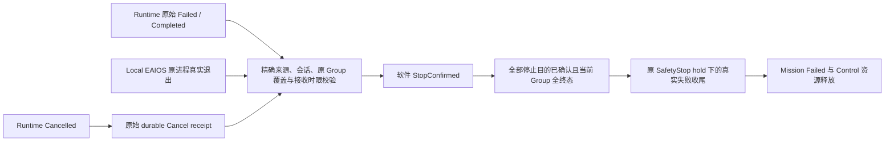

# ADR-0110：Attempt Generation 与独立软件进程停止证明

原独立分支编号为 ADR-0107；合并后的版本与迁移门禁以 [ADR-0111](0111-branch-integration-and-authority-version-fences.md) 为准。

状态：Accepted；原独立分支软件门禁通过，组合接线与验收见 ADR-0111。日期：2026-10-19。

下文 v0.8/tag 8/wrapper v32 是原独立分支的历史版本；当前统一合同为 v0.12/tag 11/
wrapper v41/journal v12，不在旧版本号下重新解释 Memory 字段。

## 问题与边界

执行记录 terminal、Cancel receipt 和独立进程停止是不同事实。原 v0.2 Habitat producer
只投影本地 terminal/cancel 标志，没有独立进程退出证据；最低置信度配置也没有真实来源。
自然 Failed/Completed 不得被改写为 Cancelled。Local EAIOS 保留 Immediate How，Control
保留 ownership；软件进程退出绝不证明物理设备停止。

## 决策

Node Contract v0.8 延续已实现的非零 execution_generation 传输，v0.6/v0.7 注册和执行语义
保持兼容。safe-state v0.3 在原 State export 上携带原始 worker 实例、PID、实际 exit code、
Group 与完整 attempt/generation 集合。ProcessWorldService 在唯一子进程 start 时冻结实例，
仅在 join 观察到该原进程真实退出后保留证明；没有证明则返回空集合。旧单线程 backend
不能声称进程退出。退出前先保存已有终态；live 世界结束后关闭一次，不影响仍在执行或
顺序复用的 endpoint，也不为 continuation 伪造退出证据。观测使用 OS 生命周期，不调用
actor.act、Gym step 或仿真 RNG。

v0.3 是确定性软件观测，不提供捏造的概率；该部署明确不要求统计 confidence。旧 v0.2
仍只支持原有 Cancelled + durable receipt + safe-state 流程。新证明没有观察到 Cancel
command 时 command_id 为 null；不能伪称收到命令。对已 Failed/Completed 的 attempt，
应用可在既定停止请求/会话/接收时限内，凭完整当前 Group 的独立进程退出证明（请求时冻结覆盖，恢复时保留）完成
TerminalProcessObserved -> StopConfirmed（若已收到 Cancel receipt，沿既有 SafeStateObserved 路径确认），不伪造 Cancel receipt，不修改 Runtime 原始终态。
Cancelled 仍要求原有 durable receipt。额外字段由显式 schema 及 wrapper v32 保护；旧
wrapper 不得携带 v0.3 确认权，历史 v31 只按原证据恢复，不获得隐含新权限。

所有 stop purpose 确认且 Group 当前 attempts 全终态后，原 SafetyStop hold 可由应用的
终态失败路径结束 Mission，保留原始失败并释放原 ownership；不触发自动继续/重跑。
其他来源的 isolation、超时、缺失和冲突证据仍由人工处理。

## 验证

覆盖旧契约、错误/重复/跨会话/跨代证明、未退出进程、部分 endpoint 完成、自然失败、
真实子进程退出、取消、重启和 checkpoint downgrade。实际 Controller/Node/软件 worker
检查 `tools/quality/check_process_stop_evidence.py` 与真实 Habitat 对照分别归档，不能用单元测试宣称设备安全或性能改善。

## 权威与关闭路径

Completed 的停止确认本身不会使 Mission 成功或解除 hold；没有真实失败时也不进入图中
失败收尾路径。其他 isolation 来源不会被此路径自动解除。未退出、部分覆盖、错误代次、
跨 session、过时、超时或不可读取证据保持原 hold/人工核对状态。
