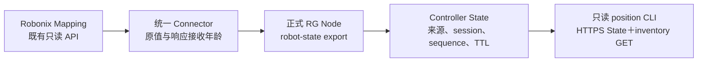

# 2026-11-06 狗2从 Controller 查询报告位置

本轮完成“只通过 RG 正式接口取得狗2报告的地图位置”的第一步，未提交机器狗任务。
查询位置不再依赖外部操作端直接访问 Robonix。代码见
[ADR-0234](../../decisions/0234-controller-reported-position-inspection.md)。

## 实际数据流水



操作端实际查询路径为 `/v1/state/records?object_class=node&object_type=robot` 和
`/v1/inventory`。工具在本地再次精确匹配 node、object、LocalSystem、channel、schema
和语义；不调用 Robonix，不提交 Mission、地图加载或动作。输出 reported 只表示
具有缓存年龄的报告位置，不能解释为定位质量、运动许可或 MI 已获得此信息。

## 网络与既有上报链路

用户提供的新局域网地址为 `192.168.2.52`。本轮从 ThinkPad 对该地址的连接得到
No route to host；经狗2既有 Tailscale 身份 `100.111.156.77` 实际登录后，接口报告
Wi-Fi 地址为 `192.168.1.61`，当前接口没有 `192.168.2.52`。

最初 RG State 中的 robot-state 已过期，inventory 为 Unreachable。RG Node 进程
仍存活，旧 TCP 长连接却仍以 `192.168.2.52:35602` 连接 Controller；发送队列已有
积压。保留日志和原状态后，仅重启 RG Node，当前连接重新建立，三次正式查询确认
Reachable 且 robot-state 未过期。没有修改系统路由、IP、Robonix 服务或 Node 配置。
这验证了本次重连恢复，不是自动网络迁移修复或长期可用性验收。

## 实际改动与部署

- 同一 Connector 的原 `/v1/state` 增加 Mapping 响应的 age_ms、availability、
  freshness_basis 与 snapshot_read_at_ns。原 received_at_ns 和原坐标不变。
- 新增 `robonix_task.position` 诊断工具，只读取 Controller；通过 mTLS、显式节点和
  地图选择，保留完整查询响应与来源证据。不修改 Controller 或 Node 二进制。
- 代码最终冻结为 `2d4dafec3a612edc696c9279e12caf3004ecc6fc`。Thor 的统一 Connector
  文件 SHA256 为 `07191a7918f21bad9d9be6723bcf6bbc21ba9de9b60a881eedfb0bba954f2aca`，
  position 模块为 `d99b8cabb583a237ddad9b5589f477bcf984aa47107eefbcff24043d63090416`。
- ThinkPad 的只读工具安装在
  `~/rg-lab/cancellation-20261105/spatial-state-20261106/source-v2/`。
  与 Thor 使用同一冻结源码；没有新增常驻服务。

## 已执行的验收

| 检查 | 实际结果 |
| --- | --- |
| 正确节点与地图 | reported，退出码 0，原数据来源明确 |
| 指定错误地图 | unavailable / map_mismatch，退出码 2，无 position |
| 短暂停止 RG Node | 原记录 stale=true、节点不可达，工具退出码 2，无 position |
| 恢复 RG Node | 新 session 上报，工具重新 reported |
| Windows 协议与位置回归 | 50 项全部通过 |
| Thor ARM 的位置工具检查 | 14 项全部通过 |
| Ruff 格式、lint、函数文档 | 通过 |
| 生产 package strict mypy | 7 个源文件通过 |

停止 Node 的测试只影响 RG 上报连接，约 12.5 秒后检查过期；通过 finally 恢复，
随后重新核对 Reachable、当前记录、ready 与资源状态。没有通过真实运动测试停止。
软件另覆盖缓存冻结时外层持续刷新、错误来源/重复来源、TTL、时钟回拨、无效坐标、
遗留无年龄记录、HTTPS GET 与有界响应，不能把这些软件反例称为物理定位验收。

首次工具现场调用由于 Controller 的现有 query parser 不解码百分号参数，带 URL
编码的 source 查询返回零记录，工具如实退出 2。该失败证据保留。工具改为服务端仅
使用固定的 node/robot 分类查询，客户端继续核对精确来源，增加相应回归后重测通过。
没有为本例改动现场 Controller 的 query parser。

## 最后保存的位置样本

```json
{
  "node_id": "lite3-dog2",
  "source": "node:lite3-dog2/robot-observer",
  "channel_id": "robot-state",
  "map_id": "1101_visual_dog2",
  "x_m": 0.38806420178965023,
  "y_m": -0.32905345223653026,
  "yaw_rad": -0.027053896712530088,
  "status": "reported",
  "localization_verified": false,
  "mi_grounding_admitted": false,
  "motion_authorized": false
}
```

这是当时的报告样本，不是持续有效的位置保证。Mapping API 没有提供原位姿测量时间、
定位质量或不可变地图 revision；map 坐标约定未单独验证为共享 frame。当前缓存年龄
只基于本机收到 Mapping HTTP 响应的时间，另计 Controller 保留时间，不伪称已测
发布端至 Controller 的传输年龄或原传感器测量年龄。

## 历史保持与未完成部分

部署前后原生 journal 都为 28 条 runs、492 项 events，完整原行与原事件摘要完全
一致；未决为零。run SHA256 为
`5f72b1c91d52b09257c0c4eae0e9eabdfab06b08bbefca608e2287cab89fb1fb`，event SHA256 为
`b9c0c528415234991b3f0d4bac696b51c2d9f6c259607c6a6c97e393ad8c7448`。
最终两项 RG 用户服务 active，Controller ready=true、Unknown=0、allocations=[]。
Node 配置 SHA256 仍为
`e15ae97df565e516367f0344458ef8eef302edf9cc3422278fc6f981a67da330`。

当前 World State 查询记录数为零。起点记忆、Scene 地点投影、MI grounding、自然语言
生成计划均未在本轮补齐，不将 reported 诊断结果伪装成这些能力。
具体缺口见[后续接线说明](../dog2-spatial-memory-mi-gaps-2026-11-06.md)。

公共证据位于工作区 `lab/rg-spatial-state-20261106/`，ThinkPad 的
`~/rg-lab/cancellation-20261105/spatial-state-20261106/` 和 Thor 的
`~/rg-lab/spatial-state-20261106/`，含原失败、查询响应、源码摘要、检查日志与保持结果。
未导出凭据或运行 SQL。
