# 狗2起点 Memory 与 MI：软件验收及现场阻塞

日期：2026-11-06。功能提交 `64082784`，实际进程整改提交 `947fb55f`。
分支 `codex/dog2-origin-memory-grounding`。

**接入代码和隔离的软件进程验证完成；未部署到狗2，未完成真机起点记录或真实模型规划。**
现场最初可读，开发期间 Thor2 变为离线。最终现场 Controller `/readyz` 为 200、
`ready=true`、`unknown_attempts=0`，资源分配为空，狗2为 `Unreachable`。
ThinkPad 的 Tailscale 查询显示 `100.111.156.77` 离线，SSH 到该地址及
`192.168.2.52` 均超时。离线原因未查明，不据此推断机器狗是否断电。

本轮未向现场提交新 Mission，未通过 Pilot、ROS 或其他途径下发运动。现场 Controller、
Node 配置、Artifact 授权及已运行服务没有改变。ThinkPad 仅接收待验源代码归档，
这不等于运行部署。旧归档和隔离验收失败证据保留。

## 正式代码通路

```mermaid
flowchart LR
  A[RG MissionPlan HTTP] --> B[匹配、资源分配、Commit/Bind]
  B --> C[Node spatial.origin.capture 工作流]
  C --> D[现有组合 Connector：只读 Mapping]
  D --> E[原 attempt 的不可变起点]
  E --> F[明确 Global 的 Memory discovery]
  F --> G[Node 会话/provider 核验及 Artifact CAS]
  G --> H[中央 Memory manifest]
  H --> I[MI：准入、原 bytes 摘要及来源核验]
  I --> J[grounding-context/v0.4]
  J --> K[Interpreter、Planner、Review]
  K --> L[AwaitingApproval，尚不提交运动]
```

新增的是只读观察并保存系统记录的操作，不调用 Pilot。运动目标仍通过既有
`task.delegate@v1` 委派 Robonix，本机执行与安全职责保持。RG 不因此要求为站立、
趴下等每个本机原语分别注册操作。

捕获任务采用一个 Context、Task、Role，`coupling_mode=independent`，占一个
`compute` 资源；不是多机协作、SequentialHandoff 或导航依赖图验收。
本机 `SUCCEEDED` 只表示记录已冻结；中央发布和 MI 读取须分别查询验证。

- [普通 Mission 示例](../../../integrations/robonix-task/deploy/origin-mission-plan.json)：
  `POST /v1/missions`，无坐标输入；仅有 `memory_id`、`expected_map_id`、显式 `scope`。
- [Node 片段](../../../integrations/robonix-task/deploy/origin-node.fragment.toml)：
  复用 observer，声明记录资源、工作流和 Memory discovery/export。
- [实验能力目录](../../../integrations/robonix-task/deploy/origin-capability-catalog.json)：
  包含记录操作与既有目标委派，供后续 MI 部署显式选择。
- [组合入口](../../../integrations/robonix-task/deploy/connector.py)：同一进程增加记录路由，
  只有显式传入 `--origin-root`、`--origin-node-id` 才启用，不新增链路进程。
- [记录实现](../../../integrations/robonix-task/robonix_task/origin.py)：独占锁、有限记录、
  fsync/不可覆盖发布、原输入冲突检查、内容/来源/scope 核对及重启恢复。

`scope=local` 不进入共享 discovery 或 MI。只有原操作明确选择 Global 的实验记录
才发布；当前没有跨请求私有起点的自动内容接入，不将它们无条件提升成 Global。

## 隔离实际进程案例

[origin_process_gate.py](../../../integrations/robonix-task/tests/origin_process_gate.py)
启动自己拥有的真实 Controller、Node 和只读位置测试服务，使用独立 SQL、临时目录、
loopback 端口，不访问现场设备、数据库或授权。

提交 `origin-process-fixture`，参数为 `fixture-origin`、`fixture-map`、`global`。
从测试源读到 `(1.25, -2.5, 0.4)`，**这是测试数据，不是狗2实测位置**。实际结果：

1. 正常 Mission 分配及 Node 工作流，最终 Mission `Completed`。
2. 中央发布 `fixture-origin/r1`，保留原 execution、Mission、Task 来源。
3. 从中央 Artifact HTTP 取得 1011 bytes，独立哈希与 manifest 一致：
   `sha256:70c68bfaa1e4bce48fcf14a51cb35cb95ced36a3d3fa446eedbad3f3b2cada5a`。
4. 生产 `HttpMissionGroundingReader` 经过正式 State/Memory/Artifact HTTP 取得同一
   内容，输出 v0.4，状态 `VerifiedReportedOrigin`，没有 grounding gap。
5. 任务完成后中央资源分配为空。

该 gate **没有调用语言模型**。另一个 Request Engine 测试用明确标注的
FakeInterpreter/FakePlanner 验证真实请求存储、同一快照传递、`AwaitingApproval`、
零 Controller 提交和持久化恢复；不能算真实模型规划。

实际 Controller SHA256 为
`7a01be0085643706da2eed7b48b2955d092c42a43fd75a735205eaf1d684a403`，
与现场 release 相同。隔离 gate Linux x86 Node SHA256 为
`7d6129d184761aa6438f6f18b8c4e6939e1c9ba55c904d68cfb953002ed0499a`，
不冒充 Thor ARM 二进制。其他源文件哈希见证据中的 `final-result.json`。

完整证据在工作区 `lab/rg-origin-memory-20261106/`，包括 `final-result.json`、
`final-mi-grounding.json`、`final-published-origin.json`、`final-submitted-plan.json`、
`final-http.jsonl`、`isolated-process-evidence.tar.gz`、原始失败及最终测试日志。
归档不含证书私钥或模型密钥。

## 修复与检查

实际二进制发现并修正三处接线错误：`map_id` 被 Node 当成地图 Artifact 指令，改为
`expected_map_id`；配置表名应为 `[artifacts]`；provider 存储路径须相对 Node state。
未触发地图加载。原 scope 与来源、内容上限、原接收年龄也增加了校验。
保留前四轮隔离失败，最终完整 gate 独立重跑通过。

| 检查 | 结果 |
| --- | --- |
| 新 origin grounding、既有 grounding/config/requests | 76 passed |
| Robonix 适配 unittest | 56 passed |
| Ruff format/lint、Python 函数文档 | 通过 |
| Linux 严格 mypy 主相关组 | 375 个文件通过 |
| 适配包严格 mypy | 8 个文件通过；外部 grpc/protobuf 使用既有缺 stub 处理 |
| 实际 Controller/Node/中央 Memory/MI reader | 通过，位置为测试数据 |
| 冻结旧版 `8da0ca8b` reader 读取 v0.4 | 拒绝 unsupported grounding context schema |
| 全量 Mission 回归 | 1 项既有失败，不能称全绿 |

全量失败为 `test_http_security.py::test_rotation_preserves_command_identity_and_revocation_is_durable`：
同 principal 换证书重复原请求返回 HTTP 404。未修改原基线也能独立复现，
见 `baseline-http-security.log`。本轮未修改安全入口绕过此问题。Windows/Linux 的
CRLF、缺路径及 mypy 查找目录问题与产品失败分开处理，不将环境失败算功能通过。

## 剩余现场验收

1. Thor2 恢复后，确认无活动原生任务、RG Unknown/占用，保存服务、配置、journal
   及源码摘要；保留原历史。用 ARM 实际 Node 校验组合配置。
2. 在同一 Connector 启用 origin profile，Node 使用原 Artifact mTLS；授权仅增加
   明确的 provider/实验 Memory ID。核实上行、注册及真实发布权限。
3. 通过普通 RG 任务取得现场新起点，核对原记录、中央 manifest/CAS、资源释放，
   验证重复、错图、过期及重启恢复，不让狗移动。
4. 部署真实 MI，选择实验目录及 `grounding_memory_content_schemas` 的 origin schema；
   对所有 `task.delegate@v1` 配置无条件 approval rule，不能仅依靠提示词。
5. 不含坐标地引用新起点，保存真实模型解释/规划及 grounding，确认 AwaitingApproval、
   零 Controller 提交、零原生运动，再报告实际结果。

仍缺 World 当前位姿/地点 schema 与实体关联、现场地图 typed revision、私有起点、
当前地图兼容性及单 Mission 运动依赖图验收。历史 reported-origin 不替代这些能力；
测量时间、地图 revision、共享物理 frame、定位质量仍未知，不自动授权导航。
