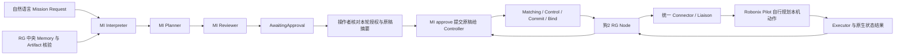

# 2026-11-09 狗2真实 MI 规划与单次站立实验

## 结论

**真实 MI 到 RG、Node、Robonix Pilot 的任务链路已运行；站立实测失败，用户确认完全没有起身。**
最终 MI Request 为 Accepted，实际 Mission/Task/attempt 为 Failed，原生 Pilot Task 为 failed。
只有一次 stand 调用，无 down、move 或导航调用；失败后未重试。Controller ready=true、
unknown_attempts=0、allocations=[]，狗2本机任务入口重新 READY。保留全部失败与修订历史。

本轮修复了 MI 本机目标中混入 RG 选机/审批职责，以及解释阶段遗漏冻结目标中的参与者
范围两处问题；同时补齐现有现场 Controller 的生命周期身份部署。未修改 Robonix。
尚未确认站立调用没有产生硬件效果的具体原因，不把 standing 字符串当作成功。

## 范围与部署

用户在本轮明确允许仅狗2进行 MI 规划或动作实验，并排除狗1。本轮不联系、修复或
重启狗1。实验目标选择一次原地站立，完成后保持站立；不授权导航、平移、调速、
自动趴下或重复姿态切换。Node、Controller、适配器及 Robonix 实现未改变，
RG 修改范围为 MI 的四个阶段提示及实验能力描述，另有现场身份 profile 配置。

MI 服务已在 ThinkPad 以 `rg-dog2-mi.service` 启动，监听 loopback 127.0.0.1:8073，
连接原 Controller 和 Artifact mTLS 入口，没有另起 Controller。使用本分支 5d124968
的实际 MI 源码、原 Python 3.13.15 运行时与 PyYAML 6.0.3。模型凭据沿用 ThinkPad
原私有环境文件；密钥没有复制到新主机或写入此记录。后续部署提示与目录修复
9f6b9c8d、07fefa00，实际生效文件与本地源码的 SHA256 均已逐项核对。

配置选择既有 local-task-delegation 能力目录，MI 只生成 task.delegate@v1，审批策略
仍要求所有这类任务进入 AwaitingApproval。使用新的持久请求数据库，原实验记录保留。
首次自然语言入口为 `POST /v1/mission-requests`，而不是助手生成最终 MissionPlan
后直接提交 Controller。实际模型调用记录确认 requested/observed_model 均为 gpt-6.1-sol。

## 真实 grounding 与模型调用

Request：request-91021139a75f438a9284fefa239901ff。
Mission：mission-612cfa3678524e69ada1ffcdfd839e43。

首次 Interpreter、Planner、Reviewer 各进行一次真实 Responses 调用，三个调用均有
原 response_id、请求/响应摘要、开始/结束时间和返回模型标识，无 provider 错误。
第一稿进入 AwaitingApproval，模型 Review approved=true。操作者审阅发现其执行目标
保留了“本阶段只生成计划，不开始执行”的阶段限制，因此没有批准该稿；使用同一
Request 的 `/messages` 正常转入实际执行阶段，没有手工改写模型生成的 MissionPlan。
第一稿、原 Review 和后续对话保留于原请求历史及 provenance。

MI 从中央 Artifact/Memory 实际读取并核验了历史记录：

| 字段 | 证据 |
| --- | --- |
| Memory | dog2-origin-field-20261106/r1 |
| Schema | roboguide.reported-origin/v0.1 |
| 状态 | VerifiedReportedOrigin |
| Scope | global / exchangeable |
| Bytes | 1302 |
| SHA256 | 4571c4a34ccda7edcff5891e94667943cc93214a7e9e6bb5665668ddb3ba164e |
| 原 Mission | dog2-record-origin-class-20261106T062858Z |
| 原 Task | record-origin |

这条 Memory 是 11月6日的历史报告位置。它不证明当前姿态、定位质量或共享 frame；
本轮原地站立不使用其坐标。MI 的 World State 查询为空，semantic_evidence 和
planning_world_evidence 均为空，不能声称 MI 已读取 node-class 的实时姿态。
执行前后的实时姿态由 Robonix 按委派目标查询。原 grounding-context/v0.4 没有 gap；
这只说明其声明的读取完成，不补齐上述未提供的 World 事实。

## 任务链路

本轮仅单 Actor、单 Task、单 Role，Context/Task coupling_mode=independent，
task.delegate@v1 / local-task-v1，使用一个 Space 单位。没有 SequentialHandoff、
双狗协作或导航 DAG。操作者会在实际审批前核对唯一可用委派候选仍为 lite3-dog2；
若候选不唯一则不提交。本轮不把 Actor 的命名当作通用物理实体绑定机制。

## 真实接入发现与保留的各轮结果

首个 Request 在三稿审阅后批准，Controller 返回 503：tenant-scoped admission requires
the lifecycle Node identity registry。MI 正确保留 Blocked/submission_ambiguous fence，
后续没有重发原 Mission。认证管理员查询原 Mission 和 admission 均为 404，attempt=[]，
同时 ready=true、Unknown=0、allocations=[]。原拒绝与草案均保留，不改写为成功。

根因是共享 Controller 已部署结构化、含租户范围的 operator authorization，而 Node
仍是静态叶证书映射。MI 正常转发 local tenant，现有准入规则要求生命周期 registry。
未删除租户 header，也未降低授权规则。先对原 Controller SQLite 的私有副本验证，
保留原 mTLS 配置并以 loopback 私有端口启动实际软件进程，没有启动任何 Node。
所有历史 Mission 已属于 local，实际迁移命令为 0。启用原证书的 lifecycle bootstrap 后，
scoped validate-plan 为 not_blocked；原 698428 条 events 的完整流式摘要前后相同：
f8d712c623ba634f7b201f372a4ba45b38e975d93d77e1a1212d8b1122c2cb9e。
第一轮副本因冷启动等待 25 秒不足而退出；第二轮将等待上限改为 180 秒后通过，保留原证据。

现场随后只更新 Controller 的同一证书 profile，registry_id=rg-field-thinkpad-20261109、
tenant=local、domain=rg-field-thinkpad，保留两台原叶摘要及实际 notBefore/notAfter。
原 41 个 Mission 及 attempts 保留，无需迁移。Controller 重启后狗2自动重连，
没有向任一 Node 或 Robonix 发出重启命令。此 bootstrap 不是硬件可信证明或自动配对验收。

| 周期 | Request / Mission 后缀 | 实际结果 |
| --- | --- | --- |
| 1 | 91021139a75f438a9284fefa239901ff / 612cfa3678524e69ada1ffcdfd839e43 | MI 三稿及模型 Review 通过，Controller 在派发前 503 拒绝，原请求保留 fence，无原生任务 |
| 2 | 8605bc39a776436bb1017ff8573ea5ba / 13705127f6cd4fd8a1e6c99b800a2d27 | MI Accepted、RG Failed；Pilot 无法证明本机 lite3_01 对应 RG 唯一候选狗2，零原生 plan、零动作 |
| 3 | 78fe513d1a314643a4a03dc237534e59 / 19046b4f9677436d87044e0680d7a02d | 修复边界后的 MI Accepted、RG Completed；Pilot 只查询状态，down、85%，因现场动作前提未获确认而未站立 |
| 4 | 0a6d8da23fa74c05a8e411b4e62aaf27 / bb7896922a4f4fdebb478c6a682cf17d | 现场事实经 MI 进入目标；首次解释遗漏 Mission 参与范围，Repairer 改目标被 fence 拒绝；补齐 Interpreter 后同 Request 新对话二稿获批，实际站立一次，原生及 RG 均 Failed，现场完全没有起身 |

周期 2 暴露 [ADR-0238](../../decisions/0238-local-eaios-delegation-objective-boundary.md)
所修正的边界错误：MI 把 RG 选机/审批前检查交给了 Pilot。更新三个 MI 提示及实验能力
描述，适配器没有删改目标，Robonix 没有修改；相关 Request/catalog 与 Planner/Review
回归共 73 项通过。新请求的本机 ExecutionIntent 只保留本机目标、动作限界与状态前提，
参与者范围仍保留于 Mission/Role 及 RG 审批前的真实候选检查。

周期 3 的原生 plan=9890-4，仅调用一次 robonix/primitive/chassis/state。原生结果
stale=false、age_ms=0、down、85%，没有 stand、down、move 或导航调用。它满足了
“条件不明确时停止并报告”的分支，因此原生 done、RG Completed；不能据此声称站立成功。
执行回执与实际期望物理效果必须分别核对。

用户随后明确确认当前平地、四足及机身起身空间、无人接触、有人观察并可接管，
允许继续本轮单次站立。该新增事实经真实 MI 请求进入局部执行目标，第四周期实际结果如下。

## 最终执行的完整关联与物理结果

最终 Request 经过真实 Interpreter/Planner/Reviewer，二稿通过原 digest/revision 审批，
由 MI 自己向 Controller 提交原生成的 MissionPlan v0.8。没有手工改写或绕开 MI 提交。
该 Request 两次对话共 7 次实际模型调用，返回模型均为 gpt-6.1-sol，无 provider 错误；
四个 Request 总共 21 次实际调用，保留原调用时间、response_id、输入/输出摘要及版本。
长时间消耗包括真实模型审阅与私有副本冷启动，不能算作机器人行走或站立执行耗时。

| 标识 | 实际值 |
| --- | --- |
| Request | request-0a6d8da23fa74c05a8e411b4e62aaf27 |
| Mission | mission-bb7896922a4f4fdebb478c6a682cf17d |
| Group | group-mission-bb7896922a4f4fdebb478c6a682cf17d |
| Task / Role | stand-once / delegate-role |
| Node / 资源 | lite3-dog2 / dog2-pilot-task-slot |
| Attempt | attempt-46:group-mission-bb7896922a4f4fdebb478c6a682cf17d-10:stand-once-13:delegate-role-1 |
| Native session | 5e3ee02b-e9a7-4388-a996-ab1f5b680bd9 |
| Native request task / turn | 885b7891-922d-4efb-b1c9-311c4a566e25 |
| Native Pilot Task | T1，属于原请求 m1 |
| 原生 plans | 9890-6、9890-7、9890-8 |

实际调用严格按原生计划记录：

1. read_capability_doc：读取本机底盘能力说明。
2. chassis/state：实时 down、82%，age_ms=3、stale=false。
3. chassis/stand：一次调用，叶回执 success=true，但 JSON 为 status=standing、posture=unknown。
4. chassis/state：实时仍为 down、82%，age_ms=3、stale=false。

Pilot 最终将原 Task 标记 failed，原因是唯一站立尝试后没有确认站立；用户现场回答
“完全没有起身”。RG 收到 Failed 并正常释放资源，未执行取消/人工对账或再次起身。
叶接口成功回包、standing 文本、原生任务结果、RG 生命周期和物理效果分别保留。
该资源释放来自正常失败终态，不是导航中的设备停止或断链恢复证明。

最终 Pilot journal 为 32 runs / 555 events。自 28/492 基线以来新增的一次只读任务、
一次身份拒绝任务、一次现场前提不明确的只读分支及一次实际单次站立任务均保留；
本轮没有清除、重放、覆盖任何旧任务。具体底盘动作无效果的原因尚未验证，
未修改本机实现或绕过 Robonix 直接发送硬件命令。

## 软件检查与接入范围

| 检查组 | 结果 |
| --- | --- |
| Request + Capability Catalog | 38 passed |
| Planner + Review | 35 passed |
| Coordination guidance + Request，含 Interpreter 后续改动 | 62 passed |
| 原实际 Controller 副本：身份 profile 冷启动及 scoped validate-plan | 通过 |
| 现场身份 profile：旧 attempts 保留、狗2重连、Unknown/allocations 清空 | 通过 |
| 真实 MI 及最终实际 Node/Pilot 任务 | 完成派发及失败回传；站立物理效果失败 |

各 Python 测试组存在重叠，不将三组数字相加称为独立测试数。未更改协议、
Rust/Python 业务实现或适配器目标透传，也没有放宽目标一致性、租户授权或审批 fence。
本次单狗 independent 任务不验证双狗协作、导航到达、共享坐标 frame、HA、
物理停止、故障自动接管或硬件可信证明。MI World grounding 仍为空，未宣称该缺口已补齐。

## 证据位置

本地：C:/workspace/DEAIOS/lab/rg-dog2-mi-posture-20261109。
ThinkPad：~/rg-lab/dog2-mi-posture-20261109。
包括源码归档摘要、非密配置、原请求与修订命令、模型生成记录、provenance 和 grounding，
cycle4-approval-result.json、cycle4-execution-result.json、cycle4-native-result.json、
cycle4-mi-record.json、cycle4-mi-provenance.json、onsite-observation.json、final-summary.json、
实际部署文件摘要与 SHA256SUMS。私有环境文件、私钥及 Controller SQL 备份只保留在
ThinkPad 原授权主机，不进入工作区公开证据或仓库。
