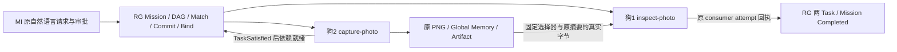

# 两台真机的 MI 照片顺序交接验收

日期：2026-11-10，Asia/Shanghai。
状态：代码检查、Linux 软件检查和本轮真实双节点无运动数据交接通过。
不是运动、视觉语义、并发协作或故障接管验收。

## 实际结果与入口

真实 MI Request：`request-5df48a68ebe14c278b69f0b118ccd2c7`。
Mission：`mission-04bca913e1624eaa92de6a9f260aef12`。
草稿 revision 1，原 digest：
`sha256:49769900d518f681af597bb17392daecca74c85956f8853b10ee372fd5047e6d`。

入口是 ThinkPad 原 MI 服务 `POST /v1/mission-requests`，实际调用
`gpt-6.1-sol` 的 Interpreter、Planner、Reviewer，进入 AwaitingApproval。
操作者核对原 revision/digest、两种唯一候选能力、两个原 Task/Role 与资源要求，
再通过原 MI `/approve` 提交。没有手写计划替代实际模型结果，没有调用 Robonix Pilot。

模式是 `sequential-handoff`。同一 Context 有两个 Actor/Role，两个 Task 通过
`depends_on=[capture-photo]` 建立真实先后。中央 inventory 当时只有狗2提供
`lite3.capture-rgb@v1`、只有狗1提供 `image.inspect@v1`；原两个 attempt 的 Node ID
分别为 `lite3-dog2` 和 `lite3-dog1`，没有依赖排序碰巧落到不同机器。

只有两次执行：

- `attempt-46:group-mission-04bca913e1624eaa92de6a9f260aef12-13:capture-photo-12:capture-role-1`
- `attempt-46:group-mission-04bca913e1624eaa92de6a9f260aef12-13:inspect-photo-12:inspect-role-1`

二者最终均 Completed。原事件从接纳到 Group 完成覆盖5.804秒，不含模型和人工审批时间；
这只是本轮样本，不是延迟 P95 或性能基准。

## 原字节与交接来源

Memory：`dog2-photo-handoff-20261110-02/r1`。
Provider：`photo-captures`，kind=artifact，Global / exchangeable，
schema=`roboguide.rgb-image/v0.1`，media type=image/png。

- 原图：640×480 PNG，498672 bytes。
- SHA-256：`18c5d871ed4bf7409883f55dbbad327d9354e3cf36868e1c8357ab024af25b48`。
- 狗2 capture ID：`86be95b6-626a-41fb-8edf-f28a888dbb13`。
- 原相机 request boundary：`1794302630934242359` ns。
- 原 ROS frame stamp：`1794302631336484000` ns，在该请求边界之后。

原 PNG 在现有拍照流程中完成中央上传/finalize。显式 photo_memory_id 使 provider
只发布这一张原图，不枚举或共享所有历史图片；manifest 保留原 Mission/Task/attempt、
原采集时间和摘要。狗1核对 Controller 当前原 producer/consumer、精确 camera State、
原 finalize 回执和中央 manifest 后，用受限身份下载原图。

狗1返回的原 consumer receipt 绑定自己的 attempt 和狗2的原 producer attempt。
中央原图、manifest、消费者回执、消费者实际缓存文件均为同一摘要和字节数；
独立 SSH 读取狗1缓存并计算摘要，与独立中央 Artifact 读取再次一致。
输入不是由操作者下载再手工上传给狗1。

原数据中的时间与 epoch/sequence 不刷新。SHA/容器检查不解码像素，回执明确
`pixel_decode_verified=false`、`visual_quality=not_evaluated`。
此处消费的是不可变已完成图像，不宣称完成回执表示相机此刻仍新鲜。

## 原事件顺序

原 SQL 的保护事件保留完整 payload_json、event ID、时间和全局序号；这些事件 body_id
均为空，不需要跳过 v3 reconstruction 校验或重写 State。事件查询限制在本轮所在的尾部。

| 序号 | 事实 |
|---|---|
| 1527352 | 狗2 capture-photo PlanCommitted |
| 1527353 | capture-photo ExecutionGroupBound |
| 1527355 | capture-photo TaskExecutionActivated |
| 1527380 | capture-photo TaskSatisfied |
| 1527382 | inspect-photo TaskExecutionReady |
| 1527386 | 狗1 inspect-photo PlanCommitted |
| 1527387 | inspect-photo ExecutionGroupBound |
| 1527389 | inspect-photo TaskExecutionActivated |
| 1527414 | 本轮 MemoryManifestPublished |
| 1527424 | inspect-photo TaskExecutionCompleted |
| 1527425 | inspect-photo TaskSatisfied |
| 1527429 | ExecutionGroupReleased |

消费者在原内容发布前有界等待，而非把 Task 的本地完成误当中央 Memory 已可读。
Scope、租户、内容发布与 Task 完成仍保留各自语义。

## 首轮失败与修复

首轮 Request `request-d2fdd7ed9de34887bb5d50874fb5a033`、Mission
`mission-1a700ccd9dee40979da2db1ec9810177` 保持 Failed。
狗2成功拍照并发布 `dog2-photo-handoff-20261110-01/r1`；狗1在读取字节前因
`consumer_task_not_active` 拒绝。当时消费者已收到 Execute，但中央 Task 激活报告
尚未到达，导致过早检查。原失败 job 和两个 attempt 未删除、未事后改写。

修复 `876720de` 仅在原3秒预算内等待**同一确切** Task/attempt 的 Ready/Accepted
推进到 Active/Running；终态、Unknown、其他身份和预算到期仍拒绝。只有两者均到达
才读图，下载后再次核对原 consumer。新增回归覆盖这一真实状态顺序。

第二轮使用新 Request、新 Mission 和新 selector，不重解释或覆盖首轮。
同一 provider 可显式配置最多16个不可变 publication，旧根及新子目录共同发现/导出，
01的原 bytes、manifest 和时间保持不变；未扩大到任意历史共享。

## 身份、部署与原记录保护

ThinkPad 使用已有 R7 Controller/R9 MI 和上一轮恢复出的数据库/Artifact副本。
原现场库未覆盖；此部署仍为实验实例，未替代未完成的24小时发布门槛。
新能力沿两台原 Connector 和 Node 单元启用，没有新增守护进程。
Robonix 未重启，底盘未收到本轮运动委派。

狗1独立生成客户端私钥，私钥留在狗1。Controller reader 为 viewer/local；Artifact
viewer 只授权本轮01/02两个 Memory ID，不使用管理员证书。Artifact reader 是独立
服务身份，不伪装 Node lifecycle leaf。实际检查：Controller GET可用，提交 Mission
返回403；未授权旧 Artifact 返回403，未发布的本轮 Memory 返回404。

配置调试中的失败保留：Artifact 只读角色误写为 reader 时启动被拒绝，改为合同原值
viewer；最初给独立 reader 绑定 Node ID 导致 leaf/lifecycle 校验拒绝。其原归属不可
更改，修改请求被409拒绝；随后保留并撤销该原 leaf，新签受限独立服务 leaf，沿正式
管理入口提交 revision5，再以 revision6增加02。未绕过原身份/不可变归属检查。
Controller 使用原CA签名、包含LAN IP的服务器证书供狗1验证hostname；本地MI仍正常。

两狗原 Pilot journal 全行摘要与本轮最初读取一致：狗1为28 runs /492 events，
狗2为36 runs /641 events；狗1当前 disabled Pilot journal 仍为0/0。
这些是没有新增本轮 Pilot 委派的证据，不代替对其他操作者或现场运动的观察。

## 重传、重启与软件检查

- 原 MI create/approve 用原正文和 Idempotency-Key 重传，返回原 Request；
  scoped provenance 仍为11条，原两个 attempt 不变，没有额外模型调用。
- 狗1原 job 重传并重启 Connector 后，完整原回执仍逐字段一致；仅1个本轮 job
  和1份 inspection receipt。Mission 已完成时，新 resolve 会拒绝，原幂等重传不会重新取图。
- 两轮实际 provider 总计6次调用，requested/observed model 均为 gpt-6.1-sol，无 provider error。
- ThinkPad Linux最终109项集成测试通过；新增/修改模块及测试通过 Ruff、格式、
  strict mypy、函数文档检查。单独保存源包及实际部署字节摘要。
- 最终 Controller ready=true、degraded=false、Unknown=0、allocations=[]。
  Controller、MI、两台 Node/Connector 保持 active。

实现提交为 `f803800a`，现场时序修复为 `876720de`。
最终源码冻结包 SHA-256：
`2da000dae7f472607b8880d077d1216af4fc476b2a5bf81ffc7cef910b19ca3b`。

## 验收限度与证据

本轮证明实际两节点、同一 Mission DAG、顺序交接与真实原字节消费。
它使用显式受限 Global Memory reader，`memory_use_authority=false`，不等同于已验收
任意 Memory 的 prepared-import/use-lease；也不证明语义视觉、地图共享、运动、
并发协作、现场失联接管或长期稳定性。MI 的 Node→World 状态接纳缺口仍单独存在。

Windows证据：`C:/workspace/DEAIOS/lab/rg-photo-handoff-20261110/`。
ThinkPad：`~/rg-lab/photo-handoff-20261110/`，两台狗各自同路径保存部署和原回执。
显式公开清单40份文件逐文件验摘要，包含原图、原计划/模型元数据、两轮任务、原事件、
发布及重传回执；不含凭据。公开包553278 bytes，SHA-256：
`acb84b6219b1115dc9c654843a532a913efde2b7d99998490c9ecf94468e112d`。
