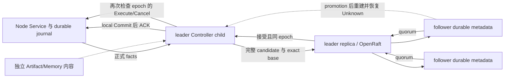

# 可选 Controller 三副本软件部署

ADR-0083 的当前实现是三个静态成员的软件 profile，默认不启动；loopback 可保持开发兼容，
任一非 loopback member 必须启用 ADR-0091 的双向 TLS。
每个 `controller-replica` 有独立 FULL-synchronous SQLite log/state machine，OpenRaft
负责共识；它仅在当前 epoch 能确认多数时拥有一个 `integration-server` child。
child 仍使用既有 Control/Runtime/Orchestration，不复制一套资源或 Task 决策。



事务先复制完整 authority checkpoint 和新增连续 event metadata，校验前一个 snapshot
digest/tail；quorum 接受后才 local SQL Commit、安装 candidate、ACK。Execute/Cancel 各自
检查原 epoch；父进程消失或 quorum 丢失时，child watchdog 关闭自己的公开 routes。
该检查是 Controller 的软件发送授权点；ADR-0085 另外让 replicated profile 将 issuing
epoch 传入 Node journal，拒绝已观察新 epoch 后的旧命令。它仍不是密码学身份、物理
停止或硬实时停止保证。
已经发送的工作保持原 Local EAIOS/Control stop-proof 规则。

切换先从 accepted history 原子重建私有 `controller.sqlite3`，然后普通 startup restore
清空 routes/leases/session anchors，保留 reservations、Actor/registry watermark、
原 receive time、Mission hold/priority/aging、stop/retry evidence，nonterminal Runtime
恢复 Unknown。Node 重新登记和 replay 状态不授权旧 Execute 重放。已经 quorum 接受但
本地 Commit/response 丢失的批次从 accepted view 收敛。

## 配置与启动

先构建 `cargo build --locked -p controller-replica -p integration-server -p roboguide-node`。
为三成员分别提供 closed JSON，以下为第一成员示例；二、三成员改变 `replica_id`、
自己的 storage directory 和三个公开地址，保留同一 members、cluster、application
schema 和 byte-bound policy。路径必须显式且 storage/binary 为绝对路径。

```json
{
  "schema": "roboguide.controller-replica-process/v0.1",
  "replica": {
    "schema": "roboguide.controller-replica/v0.1",
    "cluster_id": "local-controller",
    "replica_id": 1,
    "members": {
      "1": "127.0.0.1:32001",
      "2": "127.0.0.1:32002",
      "3": "127.0.0.1:32003"
    },
    "application_schema": "roboguide.controller-checkpoint/v26",
    "application_policy_digest": "REPLACE_WITH_POLICY_DIGEST",
    "shared_secret": null
  },
  "storage_directory": "/absolute/private/replica-1",
  "controller_binary": "/absolute/RoboGuide/target/debug/integration-server",
  "grpc_address": "127.0.0.1:32101",
  "http_address": "127.0.0.1:32201",
  "artifact_address": "127.0.0.1:32301",
  "controller_environment": {"ROBOGUIDE_CHECKPOINT_STORAGE": "full"}
}
```

`controller-replica --policy-digest /absolute/replica-1.json` 计算实际 binary SHA、明确的
Controller environment 和可选 `actor_placement_path` / `physical_entity_registry_path`
文件 bytes 的摘要；将结果写入三份同 policy 的配置后再启动
`controller-replica /absolute/replica-1.json`。child 清空继承环境，只有允许的 protocol、
batch、checkpoint-storage、admission 变量可明确提供。当前 profile 不接入可变 feasibility/
verifier 文件消费者；它们需要独立复制配置/source-history 决策。变更 binary、registry
或 policy 不支持在线更新，也不支持带旧 history 的无迁移升级；升级需要独立的可信迁移
发布 gate，不能用空 cluster 丢弃已有物理 ownership。
已有 standalone 数据库不会自动迁入 cluster；集群快照在 standalone 启动时会拒绝。

Node config v0.7 保留 `server_endpoint`，可加 `fallback_server_endpoints`（最多两个，
全部 distinct、startup validated）。Node 在 session loss 后按配置顺序旋转，保持同一
NodeId、durable command journal 和 Local EAIOS handle；旧 v0.2-v0.6 配置不能启用非空 fallback。
HTTP/Artifact 客户端使用当前 leader 的显式地址；本 slice 不提供自动 client redirect。
private `status.json` 仅供本地观察，不授予写入或资源 authority。

跨进程 replica envelope 可在三份配置中设置同一个至少 32 字节的 `shared_secret`；secret
只进入请求 digest，不写入 wire envelope。跨主机配置还必须增加：

```json
"tls": {
  "ca_cert_path": "/absolute/pki/replica-ca.crt",
  "cert_path": "/absolute/pki/replica-1.crt",
  "key_path": "/absolute/pki/replica-1.key",
  "server_name": "replica.internal",
  "peer_certificate_digests": {
    "1": "sha256:<replica-1-leaf-sha256>",
    "2": "sha256:<replica-2-leaf-sha256>",
    "3": "sha256:<replica-3-leaf-sha256>"
  }
}
```

三份配置使用同一 CA、各自证书和相同 peer DNS name。
ADR-0092 要求每个 member 的 leaf digest 互不重复；启动核验自己的 leaf，async RPC 与同步
child fence 都在发送任何 application frame 前核验 target member 的 exact leaf。CA/DNS
验证仍必须通过，不能以共同 CA 或共同 DNS 代替 member identity。该静态 policy 的改动
参与 profile identity，不支持绕过可信迁移直接接管旧集群历史。

Node Protocol 的 mTLS 环境变量见
ADR-0086，证书 digest map 必须显式绑定每个 NodeId。Operator HTTP 若绑定非 loopback，
还必须设置 `ROBOGUIDE_OPERATOR_MTLS_SERVER_CERT`、`_SERVER_KEY`、`_CLIENT_CA` 和
`_ROLE_MAP`；role map 将 `sha256:<leaf-cert>` 映射到 `viewer`、`operator` 或
`recovery-admin`。
所有 mutation 路由在持久事务前统一鉴权；header 仅可确认已认证角色，不赋权。
viewer 只能读取/只读 assessment，operator 可执行普通 Mission 操作与 execution cancel；
review/quarantine acknowledgement、execution/group recovery 和 archive 需要 recovery-admin。
隔离的无 mTLS loopback 开发环境默认 operator；如需恢复管理员，明确配置
`ROBOGUIDE_OPERATOR_LOCAL_RECOVERY_ADMIN=1`，remote/mTLS listener 使用该标志会拒绝启动。
恢复操作还必须满足原来的 generation、stop proof、current eligibility 和 ownership gates。

SIGINT 请求 supervisor 停止自己拥有的 child 和共识；异常 parent 退出由 child watchdog
保守关闭。不要共享 replica 的 storage directory；既有 writer lock 与 supervisor lease
防止第二 writer。每个 supervisor 仅管理自己的 child，不扫描或终止外部服务。

## 证据与边界

`uv run python tools/quality/check_controller_replication_processes.py --output /fresh/output`
启动隔离的实际三 replica/Controller/two Node processes 和合成 HTTP Local EAIOS。
它覆盖 minority startup、leader death、Unknown/ownership/policy/journal 保留、metadata
rejoin、old route closure、standalone downgrade 和 live majority loss，保留所有失败。
没有 MI、Provider、Habitat、真实设备或 E6。unit/integration tests 另外验证 upstream
完整 storage conformance、snapshot/reopen、错 base、stale epoch、quorum loss 和 quorum
接受后 response/SQL Commit 失败；既有 production restore 测试验证 holds/停止预算。

`--tls` 选项使用临时 CA/leaf 证书运行同一软件矩阵；用 `--member-host` 可验证非 loopback
TCP 监听（本轮使用 `192.168.1.86`）：

```bash
uv run python tools/quality/check_controller_replication_processes.py --tls --output /fresh/tls-output
uv run python tools/quality/check_controller_replication_processes.py --tls --member-host 192.168.1.86 --output /fresh/nonloopback-tls-output
```

它实际经过 rustls client/server certificate verification，并保留 SIGSTOP 造成的多数派
丢失与恢复证据；仍不是跨站点网络 SLA 或物理 continuity 证明。

2026-10-12 第一轮 debug binary hashing 导致 30s startup timeout，失败完整保留；改为
bounded streaming SHA 并启用 SHA 加速后，第二轮真实进程检查通过，两个原 local Execute
没有增加，45 rows 的 accepted metadata prefix 重新汇聚。第三轮在 quorum 恢复瞬间
复用旧 HTTP 地址遇到 connection reset，原结果完整保留。只读探针改为每次重新解析
leader 并等待新 Node 活性证据后，第四轮全部通过：44 rows metadata prefix、old route
closure、standalone downgrade、live majority loss/restore，local Execute 仍为 2。
记录位于仓库外 `adr-follow-up-audit-2026-10-12/replica-processes-{1,2,3,4}/`；
后续存储完整性修订还需在最终源码重跑进程检查，不把旧 binary 结果当作新 binary 证据。

当前基础 profile 仍是三成员静态 membership；loopback 可不启用 TLS，跨主机必须使用
ADR-0091 mTLS。系统仍不提供动态 membership、跨副本 archive 共识或物理 continuity 认证。
每个 checkpoint 至多 64MiB，新增 batch 至多 8192 events，retained event metadata 通过
ADR-0087 的 checkpoint/history anchor 压缩保持有界，snapshot/frame 至多 256MiB；单批次
本身超过界限仍 fail closed。Artifact blobs、provider-local Memory 内容不复制；目录可发现
manifest 不证明新 leader 已有相应 bytes。完整 event reducers 仍未实现，复制完整
checkpoint 加 retained tail 不是外部完整历史归档。E6 持续暂停。

最终存储修订增加 event/checkpoint digest 与 snapshot byte identity、真实 SQL rollback/
corruption 回归。此前最终源码进程检查在正常工作阶段发生早期 child fence，原结果保留在
`replica-processes-final/`。核对 OpenRaft 源码确认 quorum-read RPC TTL 等于 heartbeat：
本软件 profile 现固定 500ms heartbeat、1.5–3s election，quorum probe 外层仍最多 2s；
Node transport lease、health/readiness TTL 保持原规则。supervisor 使用四个 runtime workers。
最后 `replica-processes-final-2/` 在实际 binary
`0959093165c3324f18183f411df00988655bed208366dbe05bbb5a644791a155` 全部通过：
45 rows exact metadata prefix 汇聚，两个原 local Execute 保持不变，quorum 恢复使用
新 registration 的 Reachable 证据。676 Rust tests（另 2 个既有 ignored）、Clippy、
Rustdoc、完整 Python 检查和严格站点构建通过；这些不是 E6 或生产规模/硬实时结果。

S8–S10 实施后的新源码进程复核输出在仓库外 `/tmp/roboguide-replica-s8-s10-20261012/`，
binary SHA-256 为 `fdb5b24d577758d70469611c7078d0e95961da471e1433e36103e9c4bd0a911d`。
minority startup、old epoch route closure、leader death 后 Unknown/ownership/policy/journal、
32 行 accepted metadata rejoin、standalone downgrade、quorum loss/restore 全部通过；两个
原 Local EAIOS 调用仍为 2。该运行只使用合成 Local EAIOS 和隔离本地进程，没有模型、Habitat、
硬件或 E6。

S12 的 TLS 进程复核输出在 `/tmp/roboguide-replica-tls-nonloopback-20261013g/result.json`，binary
SHA-256 为 `73cf1c4ea3ea09200795362f427c02b0028e37f7c3d73f581a2f4e5afe07a7d0`；三副本
启动、leader death、rejoin、SIGSTOP majority loss/restore 和两个原 Local EAIOS Execute
保持不变均通过。

ADR-0092 复查修订的最终源码软件矩阵位于仓库外
`/tmp/roboguide-reliability-fix-replica-tls-final-20261013/result.json`，Controller binary SHA-256
为 `47805c1ef6213ee71f1d683874d57e05316cf9d96d728ba98a69f5ac006a32ca`。Minority startup、
旧 epoch 路由关闭、leader death 后 Unknown/ownership/policy/journal 保留、33 行 accepted
metadata rejoin、standalone downgrade、SIGSTOP majority loss/restore 均通过，两个原 Local
EAIOS Execute 保持为 2。相同 binary 的显式 group recovery 进程回归位于
`/tmp/roboguide-reliability-fix-group-processes-20261013/summary.json`：all-live 产生两个授权
replacement attempts，completed-peer 只产生一个，已完成的 peer 不重复。
全部进程由本轮夹具在独立目录/临时端口启动和清理，未启动 Provider、Habitat、硬件或 E6。
三副本在同一主机使用 `192.168.1.86` 非 loopback TCP；这不证明跨两个独立主机的网络分区。
