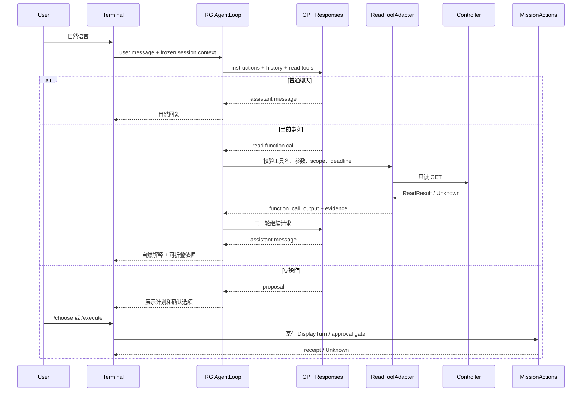

# RoboGuide Chat Agent Loop 设计 · 2026-11-13

状态：调研设计稿，尚未实现或合入 `main`。

## 结论

当前 RoboGuide 的问题不是 GPT 无法区分“你好”和“查节点”，而是宿主把模型限制在了两层强制 JSON 流水线：

```text
用户输入
  -> exact local_response / keyword matcher
  -> ResponsesRouter: Query JSON
  -> Controller read
  -> EvidenceConversation: queries/answer/citations JSON
  -> 解释文本
```

`你好` 会被本地分支改写成产品功能介绍；`谢谢`、`好的`、`你好吗` 和“我想聊聊”则没有普通聊天路径，会进入需要证据引用的查询流程。模型没有机会直接输出自然的 Assistant message。

Codex 使用的是一个持续的 Responses agent loop：模型每轮接收 instructions、历史 input 和 tools，可以直接输出 Assistant message，也可以输出 function call；宿主执行工具后把结果追加回同一轮，继续请求直到最终回答。[官方 agent loop 说明](https://openai.com/index/unrolling-the-codex-agent-loop/)

Responses API 的工具机制本身允许模型自动决定是否调用工具。[官方 tools guide](https://developers.openai.com/api/docs/guides/tools) Codex harness 负责会话上下文、工具、进度、失败、审批和中断，产品负责业务上下文、业务工具和权限边界。[Codex platform](https://developers.openai.com/blog/codex-as-a-platform) Claude Code 的 CLI 也采用持续会话、恢复和工具权限分层的方式。[Claude Code CLI reference](https://code.claude.com/docs/en/cli-usage)

因此 RG 应该改成“自然对话 Agent Loop + 宿主只读工具 + 独立写入审批”，而不是继续扩展关键词列表。

## 目标行为

| 用户输入 | 模型行为 | Controller | 用户看到的结果 |
| --- | --- | ---: | --- |
| `你好` | 直接 Assistant message | 0 | 简短自然寒暄 |
| `谢谢` / `好的` / `我想聊聊` | 直接 Assistant message | 0 | 普通聊天，不出现 E1 或功能菜单 |
| `你好，查一下节点` | 调用 `read_cluster` | 1 | 自然说明当前节点和能力 |
| `当前有没有任务在运行？` | 调用 `read_active_missions` | 1 | 数量、名称和状态边界 |
| `刚才那个任务现在怎么样？` | 使用会话引用后调用 `read_mission` | 1 | 当前事实或明确 Unknown |
| `帮我执行巡检` | 输出计划/澄清，不提交 | 0 | 等待明确确认 |
| `/execute` | 宿主显式命令 + 原有确认边界 | 可能 1 POST | 只有当前显示版本允许执行 |

模型不需要知道工具内部名称，也不输出 `active_missions`、`Query JSON` 或 `E1` 菜单。工具结果作为模型上下文和宿主证据保存；有事实查询时可以在回复末尾折叠一行“依据”，普通闲聊不附证据。

## 分层架构



### Conversation plane

新增 `AgentConversation`，拥有一个完整 turn loop。它接收当前用户文本、冻结的对象引用、会话历史和当前请求上下文。模型可以直接结束本轮，也可以请求只读工具。最终 Assistant message 是自由文本，不再用全局 `ANSWER_SCHEMA` 强制要求 `queries`、`answer` 和 `citations`。

系统指令只规定行为边界：

- 问候、感谢、确认和普通闲聊直接自然回答，不调用工具。
- 只有需要当前 Controller 事实时才调用只读工具。
- 未取得工具结果不能声称当前节点、任务或执行状态。
- 不向用户暴露工具名、内部意图标签、JSON 或查询预算。
- 计划、执行、审批和取消不由自然语言模型输出直接授权。

### Evidence plane

新增 `ReadToolAdapter`，工具首期只包含：

- `read_cluster()`
- `read_active_missions()`
- `read_mission(mission_id)`
- `search_capabilities(keyword)`
- `read_explanation(mission_id)`

每个工具都有 strict 参数 schema。宿主重新校验工具名、参数、当前 tenant、对象引用、原始 deadline 和 mTLS/origin；模型不能传 URL、HTTP method 或任意命令。

工具返回独立的 `ToolReadResult`：

```text
evidence_id
complete
scope
observed_at
display_text
components
refs_delta
```

`ReadToolAdapter` 不直接改写用户可见引用。AgentLoop 完成后，由同一个前台 writer 在 DisplayTurn 的提交边界统一应用 `refs_delta`、evidence 和 checkpoint。这样不会把未显示的模型中间结果变成下一轮的 `#1` 或 `last_mission` 权限。

### Authority plane

现有 slash command、MissionActions、DisplayTurn、SessionStore receipt、Unknown 和审批边界全部保留。自然语言只产生 proposal；`/choose`、`/request`、`/execute`、`/cancel confirm` 仍由宿主重新检查当前版本、身份、权限和 receipt。读工具不拥有写权限，模型输出不能绕过审批。

### Runtime / terminal plane

终端只展示用户有用的阶段：

```text
RG · 正在理解
RG · 正在读取当前任务
RG · 正在整理回复
```

不显示 `active_missions`、`Query`、模型 JSON 或内部工具调用名。保留当前输入框、队列、Ctrl-C 本地 mute、`/quit` drain、session resume 和 DisplayTurn。事件内部统一为：

```text
turn.started
assistant.preamble
tool.started
tool.completed
approval.requested
assistant.delta
turn.completed
turn.failed
```

## 迁移顺序

### Phase 1：读工具和自然聊天双轨

新增 AgentLoop、Responses function-call parser 和 ReadToolAdapter。普通自然语言优先走 AgentLoop；旧 `ResponsesRouter` 保留为临时 fallback，只用于兼容异常 Provider 或旧 session。移除 `你好` 的功能菜单文案，加入普通闲聊行为。

### Phase 2：完成当前事实读取

接入 cluster、active missions、mission、capability 和 explanation 工具。把现有 `ReadResult`、canonical provenance、Unknown、bounded response 和 current identity 检查映射到 ToolReadResult。删除主路径中的 exact inventory/active keyword matcher；关键词只允许做离线无 Provider fallback，不能决定正常对话。

### Phase 3：把 proposal 接回原有审批

自然语言“帮我执行巡检”只能生成 proposal。显示和确认仍由现有 `/choose`、`DisplayTurn`、MissionActions 和 receipt 完成。审批中断要能在同一 session turn 恢复，不能重新创建一个丢失上下文的请求。

### Phase 4：终端和会话验收

把 tool phase 映射为自然状态文案；增加 `--ask`、PTY、resume 和 stream-json 事件验收。普通闲聊不产生 Controller GET，读工具产生恰好一个 bounded GET，写操作在确认前产生零 POST。

### Phase 5：移除旧路由主路径

当连续 transcript、Unknown、工具错误、恢复、队列和审批验收稳定后，移除 `ResponsesRouter` 主路径、`ANSWER_SCHEMA` 查询循环和功能关键词表。保留显式 slash command 作为稳定的操作接口。

## 验收矩阵

必须以完整 transcript 验收，不再只按“意图类型”逐条断言：

1. `你好 → 谢谢 → 好的 → 我想聊聊`：0 Provider tool call、0 Controller GET、无 E1/功能菜单。
2. `你好，查节点`：1 次 `read_cluster`，自然回复节点信息。
3. `当前任务呢？`：1 次 `read_active_missions`，Completed Task 不污染 Mission 状态。
4. `查节点 → 哪些支持建图？`：第二轮使用第一轮真实 evidence，不重复无关查询。
5. Provider 超时、Controller 403、State 缺失和 Unknown：保留事实边界，不能编造成功。
6. `帮我执行巡检 → /choose plan → /request → /execute`：确认前 0 POST，确认后恰好一次原有提交。
7. `/resume`、队列、`#n`、`它`、Ctrl-C 和 `/quit`：引用冻结、没有隐式授权或重复执行。

## 不变的边界

这次设计只改变对话 orchestration 和用户体验，不改变 Controller、Mission、Node、存储、mTLS、物理 authority、原始 outcome、Unknown 语义或审批权限。AgentLoop 负责让模型自然判断是否需要工具；宿主仍然负责事实、权限、写入和最终记录。
