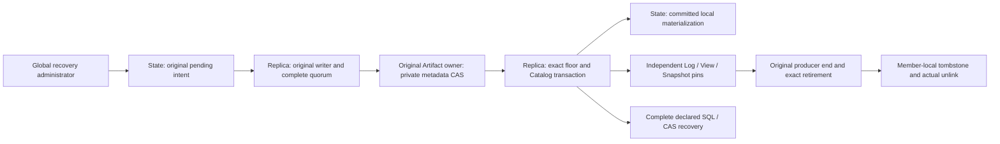

# Coordinated original-content Archive v0.1

ADR-0212 closes the explicit online Archive refusal in the replicated writer. State owns the
original operation and exact floor/Catalog/manifest transaction. Existing owned-child Unix mTLS
ingress, current actual writer epoch, qualified CAS streams, same-member complete quorum and
Log/View/Snapshot producers continue to own replication. An Archive receipt grants no Mission,
resource, Memory-use or device authority.

The opt-in process configuration is `roboguide.controller-replica-process/v0.9` with
`coordinated_archive_base` equal to its exact original owned process v0.6 or v0.7. The latter retains
its original initialization policy. Parent11 adds an explicit physical old-writer fence over the
original parent8/9/10 interpretation; it neither changes original member/Root ownership nor imports
member-local authority through Snapshot. Opening requires the actual existing Root8 and original
parent/inode leases. An active original writer prevents replacement. Application rolling upgrade
retains its original policy/executable/wait gates. This operational opt-in leaves original semantic
policy hashing unchanged; changed application bytes still require their normal upgrade authority.

All three Operator routes require global recovery-admin authority and the actual current request
witness. Tenant-scoped delegation does not grant global maintenance.

| Route | Meaning |
| --- | --- |
| `POST /v1/maintenance/coordinated-archive` | First original admission, actual metadata CAS publication and complete quorum/floor transaction |
| `GET /v1/maintenance/coordinated-archive/operations` | Bounded complete original evidence; no effect retry or renewed clock |
| `POST /v1/maintenance/coordinated-archive/abort` | Explicit rights-reducing abandonment of one unresolved original; Unknown remains beside the decision |

The first command is closed JSON with schema `roboguide.coordinated-archive-command/v0.1`, an
original `command_id`, positive checkpoint-covered `end_sequence`, and `budget_ms` between 100 and
300,000. Caller, owner, epoch and clocks are actual composition observations, never body fields.
Abandonment uses schema `roboguide.coordinated-archive-abort/v0.1` and `original_command_id`.
The existing standalone Archive v0.2 API retains its original destination/copy meaning.

Admission freezes exact predecessor metadata, original protected Catalog, complete checkpoint,
qualified current input identities and one kernel budget. The pending row first commits through the
normal complete replication port. Only then may the actual application CAS finalize the immutable
metadata package. Final acceptance validates the exact old prefix and full recovery successor;
one Raft transaction preserves checkpoint/commands/origins/unknown operations, installs protected
Catalog/manifests/timestamp floor, pins the Archive package and removes only that event prefix.
Normal incremental candidates cannot advance the floor. Future writes retain all previous Archive
packages without relabelling their source owners or retaining deleted released payloads.

Packages contain private complete control metadata. Ordinary Artifact HTTP reads, even under an
Artifact administrator, refuse them. Normal Artifact/Memory publication cannot turn a private
package into public content. Maintenance/recovery remains the independent access boundary.

A duplicate original ID is readonly, including while Unknown or abandoned. Changed original input
refuses. Interrupted publication receives no new budget; original epoch/budget loss cannot complete
it. A local persistence failure retains original uncertainty and the existing write/restart fence.
Abandonment does not erase receipts or authorize source GC; actual source leases, original workers,
remaining Root producers and tombstones retain their independent reclamation rules.

Recovery v0.30 requires the complete new journal and independently verifies actual package bytes in
the same declared source and receiving Roots. It retains all previous current Memory/reference and
HA recovery requirements. Restore starts no service and renews no clock. Controller wrapper v60,
Node Contract v0.14/config v0.15/wire v0.17/journal v15, Memory SQL v5 and event codec v33 remain.

Maintained actual software acceptance extends `check_runnable_content_processes.py` with
`--coordinated-archive --archive-sql-fault`. It checks normal Archive, exact duplicate observation, one deliberately
discarded actual reply, continued normal writes, all declared receiving Root bytes, private Artifact
read refusal, original child wait/restart and actual source-owner failover. The final-SQL fault
preserves original pending evidence through an actual source-child drain/leader transfer, readonly
cross-owner retry, independent abandonment and a separately identified new operation. The complete
cold recovery gate retains actual parent11/profile v0.30. Full original Log/Snapshot/membership and
fault compositions remain required before A1/A2/F acceptance is recorded. No process or CAS receipt
establishes devices, physical stopping, cross-host clock synchronization or long-term SLO.

| Producer | Independent authority and release | Maintained evidence |
| --- | --- | --- |
| Original Artifact upload | Original qualified owner, immutable upload/recovery/retirement record; a new writer does not relabel it | Runnable cross-owner Prepared/Completed cases |
| Catalog / typed lineage | Published original manifest/dependencies and original Catalog reference ledger; discovery never grants current use | Catalog/lineage, scoped-map and Archive recovery gates |
| Current preparation / use / active map | Original Task/attempt/provider/import/use and independent revoke/active-map authority | Complete scoped-map lifecycle and declared Memory recovery |
| Raft Log | Actual original entry/candidate and pre-effect producer; only its exact durable purge cut retires it | Historical Log and actual post-Archive producer gate |
| Accepted View | Original complete candidate/current inputs, independent of upload or Log | Actual complete quorum, cross-owner read and restart |
| Snapshot / receiving Snapshot | Actual original Snapshot/target/header and independent local issue; full byte readiness differs from publication/retirement | Purged Snapshot, learner/joint and post-Archive cold gates |
| Archive package | Original operation, manifest and qualified private package; every completed package remains a required input | Online/lost-reply/SQL/epoch/private-access and complete v0.30 recovery |
| Reader / stream / staging | Original actual scope/end/wait and retained Unknown; expiration alone grants no retirement | Native reader/stream retirement, private staging and final actual GC |

A source-end event or one released pin does not release the other producers. Recovery checks current
required content against the actual same-owner bytes and preserves released historical evidence
without demanding already deleted payloads. Historical object receipts remain history and cannot
be counted as current required inputs. When a retained Snapshot receive rejects a changed header,
parent11 may publish a new actual Snapshot under an independent journaled SnapshotBuild invocation,
with its original member/Root/producer recorded in the payload. The applied cut and application state
stay exact. This does not replace the old header, Unknown or first budget. Older profiles require an
independently newer cut and retain their original bytes; receiver-local authority is never imported.
