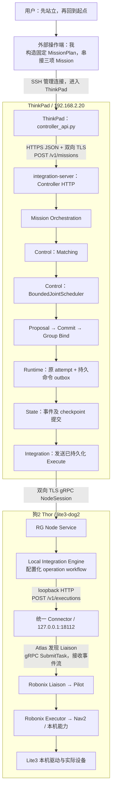
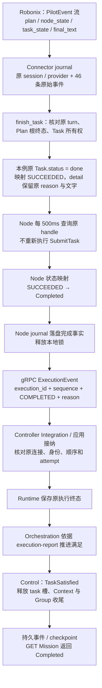

# 狗2真实任务执行流水：从 RG 入口到 Robonix 与结果回传

核对日期：2026-11-05，时间表使用 Asia/Shanghai。案例为已经执行的
`dog2-return-after-stand-20261105T093030Z`。本次说明只读取历史请求、事件、部署配置
和源码，没有重新提交任务或操作机器狗。

## 1. 先明确本轮实际走的路径

1. 我在外部把用户的话整理成固定 `MissionPlan`，通过 Controller 的结构化计划接口提交。
   本轮没有调用 RG Mission Intelligence 来理解用户的话或生成计划。
2. 站立、返程、趴下是三个独立 Mission，每项只有一个 Task、一个 Role。由我等待前一
   Mission 完成、资源释放并完成必要只读核对后，再提交下一项；没有使用一个 Mission
   内的 `depends_on` 来编排这三步。
3. Context 和 Task 的 `coupling_mode` 都是 `independent`。这是单参与者的独立执行，
   没有使用顺序交接、并发协作或紧耦合模式。
4. 单次 Mission 确实经过了 RG 的匹配、调度、Proposal、Commit、Bind、Runtime 和
   Node。Controller 原事件库提供了该返程的 17 条相关事件，不是把 SSH 命令当作 RG 执行。
5. RG 委派的操作只有 `task.delegate@v1`。站立、导航、趴下的具体本机操作由 Robonix
   决定，不为每个基础动作在 RG 新建一项全局操作。
6. 本轮任务满足依据为 `execution-report`，没有独立的到达验证器。现场确认、位置
   观察和 RG 的 Completed 分别保留；本例存在任务结束与目标达成的语义差异。

证据分类：请求 JSON、Controller 事件、Node journal、Connector journal 和现场回复是
实际留痕；模块内部的方法调用顺序由源码核对。没有追溯抓取当时的 gRPC 网络包或
完整函数调用栈。附录中的 Native Task 是用原持久化行与实际序列化函数重建，明确
不称为原始网络抓包。

## 2. 部署位置、进程和入口



图中的 Controller 内部方框是逻辑模块。本次由一个 Rust `integration-server` 进程承载，
不是每个模块一个服务。Thor 上是一个 RG Node 服务和一个统一 Connector 服务；
Connector 中组合了采图、只读状态和 Pilot 协议适配三个功能模块。本例只使用任务委派
路径与必要状态观察，不能把三个功能模块理解成三个动作适配进程。

| 位置 | 真实接口 | 本例用途 |
| --- | --- | --- |
| ThinkPad | `https://127.0.0.1:8080` | Controller HTTP；这里的 loopback 指 ThinkPad 本机 |
| ThinkPad | `https://192.168.2.20:50051` | RG Node 的 gRPC 连接目标 |
| Thor | `http://127.0.0.1:18112` | 同一 Connector 的本机 HTTP 接口 |
| Thor | `127.0.0.1:50051` | Robonix Atlas；与 ThinkPad 的 50051 是不同主机、不同服务 |
| Thor | `127.0.0.1:50081` | 本例经 Atlas 发现的 Liaison endpoint；不能把它当作永久硬编码保证 |

SSH 是外部管理和提交脚本的运行通道。真正进入 RG 的业务请求是 ThinkPad 本机发出的
HTTPS 请求；Controller 与狗2的业务执行通道是 Node Protocol，不是 SSH。

### 两种 RG 入口应分别看待

| 层次 | 代码已有入口 | 本轮是否使用 |
| --- | --- | --- |
| 上层请求入口 | Mission Service 的 `POST /v1/mission-requests`，负责请求处理与计划生成流程 | 没有使用，也没有把聊天中的我当成这个已部署服务 |
| 结构化执行入口 | Controller 的 `POST /v1/missions`，接收 `MissionPlan` | 实际使用 |
| 提交前逻辑检查 | Controller 的 `POST /v1/missions/validate-plan` | 实际使用 |
| 查询入口 | `GET /v1/missions/{id}`、`.../execution-attempts`、`/v1/resource-allocations`、`/readyz` | 实际使用 |

本轮 HTTPS 客户端使用部署好的 CA 和客户端证书。API helper 的 `exchange()` 创建
SSL context、加载证书，然后发送 JSON 并保存原始请求及响应。原 Controller 管理员
身份为证书对应的 `field-operator:33457`；凭据内容不属于本文或公共证据。

## 3. 用户的一句话怎样变成了三次提交

| 外部步骤 | 真实 Mission | 提交条件 |
| --- | --- | --- |
| 先站立 | `dog2-stand-before-return-20261105T092626Z` | 上一条超时任务已正式结案，Unknown 与占用为零 |
| 再返回起点 | `dog2-return-after-stand-20261105T093030Z` | 站立 Mission Completed，另一次只读姿态为 standing，原槽已释放 |
| 到起点后趴下 | `dog2-down-after-return-20261105T093930Z` | 返程 Mission 已结束，用户现场确认停稳，并追加趴下授权 |

每个计划中的 `depends_on` 都是 `[]`。同名 `delegate-task` 和 `capture-context` 分别
属于不同 Mission，不会把它们自动连成一张跨 Mission DAG。本轮这三步的串接责任
在外部操作端；它验证了各项任务的正式执行路径，没有验收 RG 自动生成并运行这张
三步任务图的能力。

返程时实际写入 `ExecutionIntent.objective` 的文字为：

> 狗2已经站立。请导航返回刚才去公司门口之前的出发起点：地图1101_visual_dog2中的map坐标(x=0.7672304440790438米，y=0.448885835803414米，yaw=-0.23701874981410953弧度)。使用此前低速实验的速度上限0.16米每秒，到达后原地停留并报告导航实际结果和最终位置。导航执行与本机安全由Robonix自行处理。

起点来自出发前 Robonix Scene 与 map/get_pose 的实际定位记录，由我保存后放进新请求。
这不是本轮 RG Spatial Memory 自动召回起点的证据。每个新 attempt 还创建了新的
Robonix session，没有复用站立任务的原生对话来隐式记住起点。

## 4. 计划中的对象和字段到底表示什么

完整实际计划见附录 A。决定本轮行为的字段如下。

| 字段 | 实际值 | 本例含义 |
| --- | --- | --- |
| `schema_version` | `roboguide.mission-plan/v0.7` | 输入计划格式 |
| `mission.id` | 返程 Mission ID | 本次全局任务身份 |
| `mission.actors[0].id` | `observer` | 逻辑 Actor 名称，不是狗2的网络地址或实体选择器 |
| `contexts[0].id` | `capture-context` | 模板沿用的 Context 名称；不表示本次执行了拍照 |
| Context `coupling_mode` | `independent` | 不要求跨 Role 运行时协作机制 |
| `tasks[0].id` | `delegate-task` | Mission 内唯一 Task |
| `depends_on` | `[]` | 此 Task 没有 RG DAG 前置 Task |
| `roles[0].id` | `delegate-role` | 唯一执行角色 |
| `context_role` | `observer` | 连接到该 Context 的逻辑 Actor |
| 所需 Capability contract | `task.delegate@v1` | 要求节点提供本机任务委派能力 |
| Capability 属性约束 | `task-profile == local-task-v1` | 匹配本次部署的委派范围 |
| 所需 Resource | `kind=space, units=1` | 最终选择狗2声明的独占任务槽 |
| `resource_scope` | `task` | 槽随该 Task 占用与释放，没有保留到下一 Mission |
| `execution_intent.operation` | `task / delegate / v1` | 要执行的全局操作 |
| `execution_intent.parameters` | `{"profile":"local-task-v1"}` | 当前只有 profile 是结构化参数 |
| `execution_intent.objective` | 上述返程文字 | 地图、目标坐标、限速都在这个字符串中 |
| Task `coupling_mode` | `independent` | 本 Task 的执行耦合模式 |
| `earliest_start_offset_ms` | `0` | 接纳后即可进入就绪调度 |
| `latest_start_offset_ms` | `null` | 没有另设最晚启动偏移 |
| `completion_deadline_offset_ms` | `330000` | RG 侧的完成期限偏移 |
| `satisfaction.basis` | `execution-report` | 采用执行报告作为任务满足依据 |
| `satisfaction.verifier` | `null` | 没有独立目标验证器 |

这里有几个实际限制：

- 中文“狗2”没有被 Controller 解析成 Node 绑定条件。本轮选中狗2是因为部署中只有
  它匹配该委派合同与 profile，并且当时满足就绪及资源条件。匹配后才产生了
  `MissionActorBound(observer → lite3-dog2)`。不能把本例当成双狗指定实体选择的验收。
- `space` 对应的资源 ID 是 `dog2-pilot-task-slot`，capacity 为 1。它在本例承担独占
  任务槽的作用，不是走廊、房间或地图区域的占用证明。
- 地图与坐标没有作为 RG 的结构化 Spatial requirement 输入；限速也没有作为 RG
  强制速度守卫输入。本轮由 Robonix 理解目标文字、实现限制，并返回本机证据。
- `expected_effect` 是意图描述，不是会自动计算几何误差的程序。

## 5. 任务到来之前，RG 怎样认识狗2

这部分是持续存在的注册和观察流水，不是每项任务重新安装一次。

1. Thor 上 Node Service 读取 `node.toml`，加载本地系统、连接、能力、资源及 workflow。
2. Node 主动连接 ThinkPad。gRPC 服务为 `RoboGuideNodeProtocol.NodeSession`，采用双向
   流，wire package 为 `roboguide.node.v0_4`。通过 Hello/Welcome 协商后注册节点。
3. Node 声明 `node_id=lite3-dog2`、LocalSystem `dog2-pilot`、Capability
   `task.delegate@v1`、属性 `task-profile=local-task-v1`、资源
   `dog2-pilot-task-slot`，以及该操作的 owner 与所需资源。
4. Node 通过 Connector 的 health/readiness 接口观察本机系统，再上报真实就绪证据。
   State 保存事实；Control 根据自己的准入、身份、会话和新鲜度规则决定是否可使用。
5. Heartbeat、状态导出和能力就绪继续更新，供后续调度与运行期判断使用。

Node 配置格式为 `roboguide.node-config/v0.13`；按源码对应的安全版语义合同是
`roboguide.node.v0.12`，wire protocol 是 `roboguide.node-protocol/v0.4`。
这些版本字段作用不同，不能用配置版本号替代协议协商版本号。

本次委派能力在 Node 配置中分类为 `kind=compute`，但它不是在声明导航占用一项 GPU
资源。本例实际资源要求仍是独占的 `space` 槽，不能据此宣称已经验证 GPU 算力分配。

在线、健康、能力就绪和占用是不同事实。狗在线但本机槽被原任务保留时，Pilot
readiness 可以返回 UNAVAILABLE，暂时不适合接收新任务；这不等于 Tailscale 离线。

## 6. Controller 接到计划后，内部如何推进

### 6.1 外部预检与只读 validate-plan

我先查询 `/readyz` 和 `/v1/resource-allocations`，确认上一条任务已处置。这是外部
操作端的前置核对，不代替 Controller 内部的资源检查。

随后向 `/v1/missions/validate-plan` 提交同一计划。实际响应为 HTTP 200、
`decision=not_blocked`、`scope=published-contracts`、`issues=[]`；请求摘要为
`sha256:9b2605c87fb97eba2ffdab33477ee0fa4f0edd0f999d7d0ef62d2ecb42f420d4`。

该查询不创建 Group，不预留资源，不派发动作。`not_blocked` 不代表狗已被选中或
目标物理可达。本例的 deployment/verifier/world/topology 相关摘要均为 null，
不能声称这里已经做了全局地图可达性检查。该 handler 复用发布合同检查；它不是
Mission Intelligence 的 Canonical Capability Catalog 计划生成过程。

### 6.2 正式 POST、认证、解码与接纳

`POST /v1/missions` 进入 Controller HTTP 边界，经过实际证书与角色授权，解码
MissionPlan，检查计划与 verifier 等接纳条件。随后取得原 ApplicationWriter 的
FIFO 写入 turn，在 SQL batch 中使用候选 Controller 状态处理本次变化。

外部请求的 tenant 默认是 `local`。同 Mission 身份的重复/冲突处理保留原接纳记录，
不会因为再次收到相同请求就新建另一项物理 attempt。

### 6.3 Mission Orchestration 创建运行对象

Orchestrator 接纳计划，并交由 Control 建立本次 Group 及 TaskExecution：

- `group-dog2-return-after-stand-20261105T093030Z`；
- TaskRef 为当前 Mission 与 `delegate-task` 的组合；
- 因 `depends_on=[]`，唯一 Task 可以进入 Ready。

Group 在本例只有一个参与者。Group 是绑定、资源与生命周期的组织对象，不能从
Group 这个名字推定本轮存在多机器人协作。

### 6.4 Matching 形成候选，不直接发命令

`drive_ready_tasks()` 选择就绪 Task；`prepare_task()` 调用 Control 的
`match_capabilities_for_mission()`，结合已注册节点及当前决策 State，检查能力合同、
profile、操作支持、当前可用性及相关资格限制，形成 CandidateSet。

本例匹配目标是能接收 `task.delegate@v1` 的节点，不是把“返回起点”拆成导航原语。
本机导航是否能接纳这个具体目的地，仍由 Robonix 判断。

### 6.5 Scheduler 做选择，Proposal 尚未生效

实际代码使用 `BoundedJointScheduler`，把本 Task 的需求、CandidateSet、当前资源
及时间快照送入调度。本例只有一个 Role 和一只匹配的狗，选择结果为：

```text
delegate-role
  node_id: lite3-dog2
  resource_ids: [dog2-pilot-task-slot]
```

算法具备联合调度结构，不等于本轮已经做了多参与者联合协作。随后 Control 根据选择
产生 Proposal；Proposal 只是候选承诺方案，不能触发本机动作。

### 6.6 Commit 与 Bind

`commit_for_group_with_state()` 再次核对当前资格、资源及方案，在 Control 中承诺资源。
`bind_task_execution_with_state()` 把已承诺结果绑定到 Group/Task/Role，并记录本次
Actor 的实际节点。对应真实事件依次为 `ProposalCreated`、`PlanCommitted`、
`ExecutionGroupBound`、`MissionActorBound`。

这个 Bind 是 Controller 内的执行与资源绑定。随后送到 Node 的线协议消息叫 Execute，
不是一个额外的名为 Bind 的底盘命令。

### 6.7 Runtime 分配原 attempt，先落盘后发出

Runtime 分配唯一执行身份：

```text
attempt-46:group-dog2-return-after-stand-20261105T093030Z-13:delegate-task-13:delegate-role-1
```

这里 `46`、`13`、`13` 是身份字符串长度的编码，不能读成“重试了 46 次”；末尾 `1`
对应这个逻辑 Role 槽的第一代物理 attempt。

Bridge 形成 ExecutionCommand 和持久 dispatch outbox，冻结本次 Node、Role、资源、
ExecutionIntent 和原 generation。HTTP handler 保存事件及 checkpoint，并提交 SQL
batch；提交成功后才 flush 已持久化的命令到实际 Node 连接。失败时不会把未提交的
候选状态当作已获得派发权。

本例没有 Memory 输入要求，没有 Artifact 前置准备，也没有 whole-Group execution
session 描述符：当前 `ExecutionSessionDescriptor::from_plan()` 只对计划 v0.8 生成
该描述，本例是 v0.7。不要把之后创建的 Robonix session 与这个可选 RG 描述符混淆。

### 6.8 HTTP 返回 202

真实受理响应为：

```json
{
  "group_id": "group-dog2-return-after-stand-20261105T093030Z",
  "mission_id": "dog2-return-after-stand-20261105T093030Z",
  "status": "Running"
}
```

202 表示本次 Mission 已受理进入运行流程，不表示机器狗已经到达。网络发送和本机
工作可以与客户端接收 202 交错，不应把客户端收到响应的时刻当作硬件启动时刻。

## 7. Integration 与 Node：真正跨主机的执行流水

### 7.1 Controller 沿现存 NodeSession 发送 Execute

Execute 包含当前 RG Node session、execution_id、command_id、CanonicalInvocation、
resource_ids、execution_generation 等。command_id 为 `dispatch-` 加原 execution_id。
Controller 的 Integration router 负责找到狗2当前连接并发送，不重新做能力选择。

RG Node session 是 Controller 与 Node 的连接身份；它不是 Robonix session。
本报告保留了 Node 接纳后的 invocation，没有伪造一份未抓取的原始 Execute 网络包。

### 7.2 Node 验证命令、操作和资源

Node 检查连接 session、命令身份、原 generation、Controller epoch 以及 invocation，
在自己的 operation catalog 中查找 `task.delegate@v1`，确认所绑定资源包含该操作
要求的 `dog2-pilot-task-slot`，并取得本地并发锁 `dog2-pilot-task`。

Node 把原 invocation、invocation digest、workflow digest、资源及后续 local_handle
写入自己的 `execution_authority_v7`。同一 execution_id 的相同输入恢复为原记录；
冲突输入拒绝。已越过派发边界的不确定任务不通过重发动作来试探状态。

命令持久接纳对应 CommandReceipt；实际生命周期另通过 ExecutionEvent 表达。
“命令已持久化”与“任务已经完成”是不同消息。

### 7.3 Node 将通用操作转换为固定本机 HTTP workflow

| 项目 | 实际配置 |
| --- | --- |
| operation | `task.delegate@v1` |
| owner | `dog2-pilot` |
| connection | `pilot-http` → `http://127.0.0.1:18112` |
| execute | `POST /v1/executions` |
| execute 固定字段 | `budget_ms=300000` |
| execute 绑定字段 | 原 `/attempt_id`、原 `/invocation` |
| local_handle | 从 `/steps/dispatch/handle` 提取 |
| status | `POST /v1/executions/status`，body 为原 handle |
| cancel | `POST /v1/executions/cancel`，body 为原 handle |
| status poll_interval | 500 ms |
| 每次 HTTP timeout | 2500 ms |

Node 在这里做字段映射、持久化、查询和生命周期归约，不理解中文“回到起点”，也不
生成 Nav2 Pose 或底盘控制量。附录 B 是实际发到 Connector 的完整请求对象。

## 8. Connector：协议转换、持久身份与本机入口

### 8.1 收到请求后先保存身份

统一 Connector 将 `/v1/executions` 路由给 Pilot adapter。它检查操作白名单、显式启用
状态、profile、目标长度和预算。`local-task-v1` 是部署的人工监督委派范围，不是已经
实现逐技能强制白名单的证明。

`Journal.admit()` 对原 attempt 和规范化输入做检查，在 SQL 中先创建：

| 身份 | 本例值 |
| --- | --- |
| Connector handle | `41f89d67-9d0e-49bf-ae25-6fe690c3b19d` |
| Native session_id | `08066b18-1763-4de2-af65-5fb91972867b` |
| Native 请求 task_id / turn_id | `822aa01d-cca8-48ed-a242-bbebe0e72d90` |
| Pilot 内部任务 | `T1` |

同一 attempt、相同请求返回原 handle；同一身份改变输入会冲突。`begin()` 在发出原生
请求前持久化 DISPATCHING 和发送标记。进程崩溃后，可能已发出的任务保持不确定，
不会因为没有最终回执就再发送一次硬件目标。

### 8.2 通过 Atlas 发现 Liaison

客户端向 Thor 本机 Atlas 查询 `robonix/system/liaison/submit` 的 gRPC provider，要求
明确的活动 provider；本例 provider 为 `liaison`，registration 为
`0d5e20a4-242a-433e-93b4-b273a88382c2`。接入端保存 provider 注册身份，然后建立
ConnectCapability 通道，使用发现的 endpoint 提交。

实际 RPC 路径是：

```text
/robonix.contracts.RobonixSystemLiaisonSubmit/SubmitTask
```

它是一次 server-streaming 任务调用：提交一个 Task，持续消费返回事件。没有在每次
状态轮询时再 SubmitTask。

### 8.3 Native Task 的内容

`protocol.task()` 使用已经持久化的 task/session ID 构造消息；source 为 2，
context 的 modality 为 `api`，interaction_mode 为 `task`。本机客户端 user_id 是
`local:rg-local-task`，client 标签是 `rg-pilot-lab`。这是部署的本机调用身份，不等于
将 Controller 的操作者证书原样转交给 Robonix。

Task.text 的构造公式是：

```text
原 ExecutionIntent.objective
+ "\nRG intent: "
+ 原 canonical invocation 的排序 JSON
```

因此 Robonix 同时获得任务目标和其 RG Mission/Group/Task/Role/generation/资源关联。
这里没有把站立、导航等原语写成一串由 RG 强制逐项调用的底盘命令。

## 9. Robonix 在本例内部实际做了什么

Liaison 接收原生 API Task 后交给 Pilot，Pilot 决定本机任务与 RTDL 计划，Executor
执行计划中的本机能力。下表来自原事件，不是 RG 的 Task DAG。

| Thor 原事件收到时间 | 原生 Plan | 实际能力调用 |
| --- | --- | --- |
| 17:30:53.271 | `432e-6` | 读取 nav2 能力文档、读取当前速度限制 |
| 17:31:11.854 | `432e-7` | navigation/navigate，同一原起点 |
| 17:34:01.570 | `432e-8` | navigation/navigate，再次使用同一目标 |
| 17:34:16.696 | `432e-9` | navigation/navigate，再次使用同一目标 |
| 17:34:31.310 | `432e-10` | map/get_pose，读取最终地图位姿 |
| 17:34:45.740 | 最后 FinalText | 原请求的本机流收尾 |

三次导航 call_id 为 `432e-7:0`、`432e-8:0`、`432e-9:0`；目标参数相同：
map 坐标 `(0.7672304440790438, 0.448885835803414)`，四元数约
`w=0.992986, z=-0.118232`。四元数由本机计划形成，输入 RG 的原目标仅含 yaw 文本。

这是一个 RG attempt 下同一本机任务的三次内部导航调用。不能称为 RG 重传了三次
Mission，也不能把它当成三个 RG 角色在协作。本机导航所需地图、定位、雷达和
里程计及后续驱动控制属于 Robonix 内部数据流；本轮没有逐 ROS topic 审计整个底层链路。

原生只读速度查询确认 session 上限为 20%，等效 `0.16 m/s`。本例三个导航调用均
报告 SUCCEEDED，recoveries 均为零；原始剩余距离分别为 0.184、0.253、0.254 m。

## 10. 结果怎样反向回到 RG



### 原生流结束不直接等于成功

Connector 的 `finish_task()` 核对原 session 和 provider、原 turn、所有已提交 Plan 的
根终态、TaskState 对 Plan 的完整归属，以及唯一原消息 `m1` 所属的任务。它要求取得
可归属的原任务结果，不单凭 EOF 或任一工具的成功来完成整个委派。

本例最终 `Task.status=done` 被当前规则映射为 SUCCEEDED；`failed` 映射为 FAILED。
完整 result_text、status_reason、plan_ids、原 task/session 和证据数保留于 detail。

### Node 只按声明规则归约

实际配置：PENDING/DISPATCHING → Accepted，RUNNING → Running，SUCCEEDED →
Completed，FAILED → Failed，CANCELED → Cancelled。状态字段取
`/steps/status/state`，说明字段取 `/steps/status/detail`。

Node 持久化 local_handle 后查询原 handle，把归约后的 phase 与 reason 通过
ExecutionEvent 回传。Node 的执行 sequence 与 Connector 的原生事件 sequence 是
不同层次，不要求它们数值相同。实际 Node journal 最终 status 为 completed、sequence
为 3；Connector 最终 sequence 为 50，保留 46 项事件。

### Controller 才决定 RG Task 和 Mission 的完成

Runtime 收到原 attempt 完成事实后，应用层把 outcome 交给 Orchestration。该计划
的 satisfaction basis 是 execution-report，于是调用相应满足路径，产生 TaskSatisfied，
释放 task scope 的 `dog2-pilot-task-slot`。唯一 Task 完成后，Context 和 Group 收尾，
Mission 变为 Completed。

Mission GET 展示的是全局生命周期，不是原生 46 条事件的原样回放。原始本机事件
保存在 Connector，Node journal 保留映射后的状态与完整 detail；不能由一个
Completed 字段推断所有原始传感器数据已经汇聚到 Controller。

## 11. 周期状态与传感器数据，是另外一条流水

| 流水 | 本例路径与内容 | 不应混淆的含义 |
| --- | --- | --- |
| 本机系统健康 | Node 查询 `/v1/pilot/health` | 适配模块可用，不等于导航目标已达成 |
| 委派能力就绪 | Node 查询 `/v1/pilot/readiness` | 能否接收新委派，与原任务槽占用有关 |
| 机器人状态 | Node 导出 `/v1/state` 的电量、里程计、地图/定位及部分传感器元信息 | 本轮不是原始图片、点云或视频传输 |
| 任务状态 | Node 对原 handle POST `/v1/executions/status` | 某个原任务的执行事实 |
| 停止相关证据 | `/v1/pilot/executions/safe-state` | 本部署只声明 no-effects，不声明运动设备停止能力 |

机器人状态 export 配置 interval 为 2000 ms、valid_for 为 10000 ms；统一 Connector
后台约每 3 秒 sample 一次。发送时间、主机收到时间与底层采样时间不同，应保留并
查看 source_stamp、age 和新鲜度，不能把新 heartbeat 当作新的硬件测量。

任务 effects export 配置 interval 为 500 ms、valid_for 为 1500 ms；它不授予 RG
绕过 Robonix 直接补发底盘停止的权力。

独立的站立/趴下实时核对以及现场回复，是我在操作端做的附加确认。本轮没有把这些
聊天回复提交给 RG 的独立目标验证器。部署中的采图能力和 Artifact HTTP 服务也没有
在这个返程 Task 中执行图片上传或跨节点图片处理。

## 12. 本例到底使用了哪一种协作模式

| RG 执行耦合模式 | 源码要求的基本机制 | 本例 |
| --- | --- | --- |
| Independent | Role 无跨 Role 执行协调要求 | Context 和 Task 均显式选择此模式 |
| SequentialHandoff | 分阶段的交接机制，DAG 仍拥有就绪推进权 | 未使用 |
| ConcurrentCooperation | 并发 Role 的组共享状态和关系证据 | 未使用 |
| TightlyCoupledCooperation | 上述机制加直接 peer 协调通道 | 未使用 |

另外四个字段应各自解释：`local-task-v1` 是本机委派 profile；`resource_scope=task`
是资源生命周期；`basis=execution-report` 是满足依据；`depends_on=[]` 是任务图依赖。
它们都不能代替 coupling_mode。

RG 的 DAG 顺序依赖、运行时交接机制、Robonix 内部 RTDL 计划以及外部操作端串接，
是四个不同层次。本轮使用了外部串接及本机内部计划，没有运行跨参与者的协作模式。

## 13. Controller 原事件时间线

以下为同一 Controller 数据库中的原事件。17:30:40.478 的多项事件共用同一事务
取样时间；sequence 反映逻辑顺序，不能据相同毫秒值宣称各阶段耗时为零。

| sequence | Controller 时间 | 原事件 | 本例数据/作用 |
| --- | --- | --- | --- |
| 600082 | 17:30:40.478 | ExecutionGroupCreated | 为返程 Mission 创建 Group |
| 600083 | 17:30:40.478 | TaskExecutionRegistered | 注册 delegate-task，Context 为 capture-context |
| 600084 | 17:30:40.478 | TaskExecutionReady | 无前置 Task，可以调度 |
| 600085 | 17:30:40.478 | CandidatesMatched | 完成能力候选匹配 |
| 600086 | 17:30:40.478 | TaskSchedulingSelected | delegate-role → lite3-dog2，使用 pilot task slot |
| 600087 | 17:30:40.478 | ProposalCreated | 生成方案，尚不能执行 |
| 600088 | 17:30:40.478 | PlanCommitted | Control 承诺方案与资源 |
| 600089 | 17:30:40.478 | ExecutionGroupBound | 绑定本 Task 执行 |
| 600090 | 17:30:40.478 | MissionActorBound | observer 绑定到 lite3-dog2 |
| 600091 | 17:30:40.582 | TaskExecutionActivated | 本 Task 激活 |
| 601305 | 17:34:46.097 | NodeObservation / TaskCompleted | 接收狗2原 Role 的完成观察 |
| 601306 | 17:34:46.112 | TaskExecutionCompleted | 执行完成，进入满足判断 |
| 601307 | 17:34:46.112 | TaskSatisfied | basis 为 execution-report |
| 601308 | 17:34:46.112 | TaskExecutionBindingsReleased | 释放 dog2-pilot-task-slot |
| 601309 | 17:34:46.112 | ContextBindingsReleased | Context 资源列表为空 |
| 601310 | 17:34:46.112 | ExecutionGroupCompleted | Group 执行收尾 |
| 601311 | 17:34:46.112 | ExecutionGroupReleased | Group 释放，无剩余资源 |

同一 Controller 上从创建事件到释放事件约 245.634 秒；Thor 原生任务从创建到末事件
约 245.242 秒。这是单次样本、不同计量范围。未做两主机时钟偏差校准，不将两个
主机的时间相减当作精确的网络时延或处理阶段耗时。
本机用时包含规划、三次导航、最终定位查询和报告，不是纯行走用时。外部构造计划、
处理上一条未决任务和串接三项 Mission 的时间，也不包含在这项返程的 245.634 秒内。

## 14. 这条结果流水解释了一个已发现的问题

本例实际链条是：

```text
Pilot 内部任务 T1 的 status = done
  → Connector 映射 SUCCEEDED
  → Node 映射 COMPLETED
  → Runtime 原 attempt 完成
  → execution-report 策略产生 TaskSatisfied
  → RG Mission Completed
```

但原生 status_reason 和 final_text 又表示“目标到达未获确认”“导航任务未完成”。
原 Task 的 success_criterion 已被表述为取得结果和位姿、未达目标时报告未完成，
导致 done 可以表示报告工作结束，而非原始导航目标已满足。

最终 map 位置约 `(0.674510, 0.638510)`，与请求点的平面几何误差约 0.211 m；
原生 distance_remaining 最后为 0.254 m，两种数值均保留。用户现场确认已回到原先
位置并停稳。这份现场确认没有参与前面那个自动 TaskSatisfied 的计算。

因此，本轮同时成立的是：现场返程获得确认；RG 按当前声明规则完成了任务；委派
结束与目标达成的结果合同仍有差异。不能只凭 Completed 证明后者已解决，也不能
靠匹配中文关键词篡改原生结果。更完整的原始结果见
[本轮验收](acceptance/2026-11-05-dog2-stand-then-return.md)。

## 15. 不确定、取消与三层持久化

### 三处保存的是不同责任

| 层次 | 本例持久化 | 用途 |
| --- | --- | --- |
| Controller | events、checkpoint、命令 journal/outbox | 全局 Mission、绑定、资源与原执行义务 |
| Node | execution_authority_v7 | 原 invocation/workflow digest、handle、sequence、状态与取消意图 |
| Connector | pilot.sqlite3 的 runs/events/管理员回执 | 原 native session/task/provider、发送边界和原始事件字节 |

本例 Node 的 invocation digest 为
`sha256:fa47ee0366c0c4d5a7c5833116afc0acec1810b144fa635cfbed6a5c8862f53f`，
workflow digest 为 `b0593c190a267b9d5f1c22c6f383e72e24ae0ead6ba220cff91dc5f0e6b3b681`。
Connector 请求摘要为 `8cfb8a3064d70c2c9ec97e156358be74b853defcf62cd95ffe53a37004eb62ac`。
各摘要覆盖的对象不同，不能要求它们相等。

### 三种时间约束也不同

- 330000 ms 是 RG Task 的完成期限偏移。
- 300000 ms 是本地 workflow 传给 Connector 的原任务事件流预算。
- 2500 ms 是每次 Node → Connector HTTP 调用的 timeout；500 ms 是 status 轮询间隔。

状态查询不续期原任务预算。EOF、超时或缺少可归属原生终态时，Connector/Node 保留
不确定；不能凭重发目标来恢复。取消使用原 handle，再针对原 Native session/turn
发一次 scoped abort，取消受理不直接变成物理停止证明。

RG 的原占用在缺证据时保留。之前的断电和规划超时确实走过这条异常路径，并通过
已有正式管理员流程结案；管理员决定不是物理 StopConfirmed，也不授权自动续跑。
后来站立、返程和趴下使用新授权与新身份。见
[断电与换电记录](acceptance/2026-11-05-dog2-return-after-battery.md)和
[运动停止接入缺口](robonix-motion-stop-integration-gap-2026-11-05.md)。

## 16. 本轮使用与未使用的能力边界

| 已经过的路径 | 本轮没有使用或没有验证的路径 |
| --- | --- |
| 固定 MissionPlan → Controller 正常入口 | Mission Intelligence 自动理解、生成和修订本轮三步计划 |
| 单 Task/Role 的匹配、调度、承诺及绑定 | 多参与者共同执行同一 Mission |
| 原 attempt、Node workflow、统一委派接口 | 三步放在同一 Mission 的 DAG 自动推进 |
| 原生任务流 → Node 生命周期 → TaskSatisfied | 独立、机器可验证的物理到达判定 |
| State 观察、事件与 checkpoint 持久化 | 本轮图片 Artifact 交换、Spatial Memory 自动召回起点 |
| 本机 task slot 互斥 | 走廊/区域空间互斥、GPU 算力联合分配 |
| 人工监督下的现场动作和正式异常结案 | 运动停止证据、失联自动恢复、自动换狗接替 |

## 17. 源码与复核材料入口

| 阶段 | 主要源码 |
| --- | --- |
| 自然语言请求入口，本轮未用 | [mission/api.py](../../mission/src/mission/api.py) 的 `/v1/mission-requests` |
| 本轮 HTTP 入口 | [controller_http/server.rs](../../apps/integration-server/src/controller_http/server.rs) 的 validate-plan 与 POST /v1/missions |
| 只读计划检查 | [application/plan_validation.rs](../../apps/integration-server/src/application/plan_validation.rs) |
| 选择 Ready Task、生成原 attempt | [application/dispatch.rs](../../apps/integration-server/src/application/dispatch.rs) |
| Match、Schedule、Propose、Commit、Bind 的组合 | [mission/scheduling.rs](../../core/orchestration/src/mission/scheduling.rs) |
| Matching 与资源承诺 | [matching.rs](../../core/control/src/matching.rs)、[coordination.rs](../../core/control/src/coordination.rs) |
| Group Bind | [group/mission_binding.rs](../../core/control/src/group/mission_binding.rs) |
| attempt ID、Runtime outbox | [runtime/execution/dispatch.rs](../../core/runtime/src/execution/dispatch.rs)、[integration_bridge/dispatch.rs](../../core/orchestration/src/integration_bridge/dispatch.rs) |
| Node wire 定义及应用接纳 | [Node proto](../../contracts/node/v0.17/roboguide-node.proto)、[grpc_server/pipeline.rs](../../core/integration/src/grpc_server/pipeline.rs) |
| Node 连接、Execute 与回传事件 | [node-service/service/mod.rs](../../core/node-service/src/service/mod.rs) |
| Node 本地接纳及 workflow | [engine/admission.rs](../../core/node-service/src/engine/admission.rs)、[engine/execution.rs](../../core/node-service/src/engine/execution.rs) |
| 统一 Connector 路由 | [deploy/connector.py](../../integrations/robonix-task/deploy/connector.py) |
| 本机协议适配与原生 Task 构造 | [adapter.py](../../integrations/robonix-task/robonix_task/adapter.py)、[protocol.py](../../integrations/robonix-task/robonix_task/protocol.py) |
| 原始事件与终态归约 | [journal.py](../../integrations/robonix-task/robonix_task/journal.py) 的 admit/begin/finish_task |
| 收尾及满足依据 | [application/outcomes.rs](../../apps/integration-server/src/application/outcomes.rs)、[mission/lifecycle.rs](../../core/orchestration/src/mission/lifecycle.rs) |
| 协作模式 | [execution_relation.rs](../../core/domain/src/execution_relation.rs) |

公共复核材料在工作区 `lab/rg-pipeline-review-20261105/`：Controller 原请求、受理与完成
响应、17 条事件、三项独立 Mission 的发布时间；Node 的原 invocation、实际 Connector
请求、原生计划与结果摘要，以及标明重建性质的 Native Task。各文件另有 SHA256 清单。
没有导出运行数据库或凭据。本报告是流程说明，不修改或重放上述任务。

## 附录 A：实际提交的完整 MissionPlan

这是实际计划对象；HTTP helper 会重新进行 JSON 序列化，不能把 Markdown 排版后的字节摘要当作原 HTTP body 摘要。

```json
{
  "schema_version": "roboguide.mission-plan/v0.7",
  "mission": {
    "id": "dog2-return-after-stand-20261105T093030Z",
    "objective": "狗2已经站立。请导航返回刚才去公司门口之前的出发起点：地图1101_visual_dog2中的map坐标(x=0.7672304440790438米，y=0.448885835803414米，yaw=-0.23701874981410953弧度)。使用此前低速实验的速度上限0.16米每秒，到达后原地停留并报告导航实际结果和最终位置。导航执行与本机安全由Robonix自行处理。",
    "actors": [
      {
        "id": "observer"
      }
    ]
  },
  "contexts": [
    {
      "id": "capture-context",
      "roles": [
        {
          "id": "observer",
          "actor": "observer"
        }
      ],
      "relations": [],
      "coupling_mode": "independent"
    }
  ],
  "tasks": [
    {
      "id": "delegate-task",
      "description": "Authorized return after the separately completed original standing task.",
      "depends_on": [],
      "roles": [
        {
          "id": "delegate-role",
          "context_role": "observer",
          "requirements": {
            "capabilities": [
              {
                "contract": {
                  "namespace": "task",
                  "name": "delegate",
                  "version": "v1"
                },
                "constraints": [
                  {
                    "attribute": "task-profile",
                    "operator": "equals",
                    "value": "local-task-v1"
                  }
                ]
              }
            ],
            "resources": [
              {
                "kind": "space",
                "units": 1
              }
            ]
          },
          "execution_intent": {
            "operation": {
              "namespace": "task",
              "name": "delegate",
              "version": "v1"
            },
            "objective": "狗2已经站立。请导航返回刚才去公司门口之前的出发起点：地图1101_visual_dog2中的map坐标(x=0.7672304440790438米，y=0.448885835803414米，yaw=-0.23701874981410953弧度)。使用此前低速实验的速度上限0.16米每秒，到达后原地停留并报告导航实际结果和最终位置。导航执行与本机安全由Robonix自行处理。",
            "parameters": {
              "profile": "local-task-v1"
            }
          },
          "resource_scope": "task"
        }
      ],
      "context_id": "capture-context",
      "coupling_mode": "independent",
      "timing": {
        "earliest_start_offset_ms": 0,
        "latest_start_offset_ms": null,
        "completion_deadline_offset_ms": 330000
      },
      "satisfaction": {
        "expected_effect": "Robonix reports original navigation completion and arrival near the recorded departure point with the low-speed constraint.",
        "basis": "execution-report",
        "verifier": null
      }
    }
  ]
}
```

## 附录 B：Node 实际交给 Connector 的请求对象

来自该原生 handle 的持久化 request；包括原 attempt、300000 ms 预算和完整 canonical invocation。

```json
{
  "attempt_id": "attempt-46:group-dog2-return-after-stand-20261105T093030Z-13:delegate-task-13:delegate-role-1",
  "budget_ms": 300000,
  "invocation": {
    "execution_generation": 1,
    "group_id": "group-dog2-return-after-stand-20261105T093030Z",
    "mission_id": "dog2-return-after-stand-20261105T093030Z",
    "objective": "狗2已经站立。请导航返回刚才去公司门口之前的出发起点：地图1101_visual_dog2中的map坐标(x=0.7672304440790438米，y=0.448885835803414米，yaw=-0.23701874981410953弧度)。使用此前低速实验的速度上限0.16米每秒，到达后原地停留并报告导航实际结果和最终位置。导航执行与本机安全由Robonix自行处理。",
    "operation": "task.delegate@v1",
    "parameters": {
      "profile": "local-task-v1"
    },
    "resource_ids": [
      "dog2-pilot-task-slot"
    ],
    "role_id": "delegate-role",
    "task_id": "delegate-task"
  }
}
```

## 附录 C：由原记录重建的 Native Task

此对象由原持久化 ID、创建时间和部署序列化函数重建。它是提交内容的可复核解释，不是当时的网络抓包；空 audio_data 是 protobuf 默认值。

```json
{
  "evidence_kind": "reconstructed from actual persisted row and deployed serializer; not a wire capture",
  "task": {
    "task_id": "822aa01d-cca8-48ed-a242-bbebe0e72d90",
    "session_id": "08066b18-1763-4de2-af65-5fb91972867b",
    "source": 2,
    "text": "狗2已经站立。请导航返回刚才去公司门口之前的出发起点：地图1101_visual_dog2中的map坐标(x=0.7672304440790438米，y=0.448885835803414米，yaw=-0.23701874981410953弧度)。使用此前低速实验的速度上限0.16米每秒，到达后原地停留并报告导航实际结果和最终位置。导航执行与本机安全由Robonix自行处理。\nRG intent: {\"execution_generation\": 1, \"group_id\": \"group-dog2-return-after-stand-20261105T093030Z\", \"mission_id\": \"dog2-return-after-stand-20261105T093030Z\", \"objective\": \"狗2已经站立。请导航返回刚才去公司门口之前的出发起点：地图1101_visual_dog2中的map坐标(x=0.7672304440790438米，y=0.448885835803414米，yaw=-0.23701874981410953弧度)。使用此前低速实验的速度上限0.16米每秒，到达后原地停留并报告导航实际结果和最终位置。导航执行与本机安全由Robonix自行处理。\", \"operation\": \"task.delegate@v1\", \"parameters\": {\"profile\": \"local-task-v1\"}, \"resource_ids\": [\"dog2-pilot-task-slot\"], \"role_id\": \"delegate-role\", \"task_id\": \"delegate-task\"}",
    "context_json": "{\"user_id\": \"local:rg-local-task\", \"modality\": \"api\", \"client\": \"rg-pilot-lab\", \"interaction_mode\": \"task\"}",
    "timestamp_ms": "1793871040497",
    "audio_data": ""
  }
}
```

## 附录 D：实际逻辑检查和最终查询响应

保留逻辑检查的 scope、digest 与 not_blocked 结果；本轮没有开启独立到达 verifier。

```json
{
  "decision": "not_blocked",
  "deployment_digest": null,
  "execution_lifetime": null,
  "execution_topology": null,
  "issues": [],
  "issues_truncated": false,
  "mission_id": "dog2-return-after-stand-20261105T093030Z",
  "plan_body_sha256": "sha256:9b2605c87fb97eba2ffdab33477ee0fa4f0edd0f999d7d0ef62d2ecb42f420d4",
  "schema_version": "roboguide.plan-validation/v0.2",
  "scope": "published-contracts",
  "verifier_source_digest": null,
  "world_identity": null
}
```

最终 Mission 查询响应：

```json
{
  "crash_loop_quarantined": false,
  "failure_state": null,
  "goal_completion_receipt": null,
  "goal_gate": null,
  "group_id": "group-dog2-return-after-stand-20261105T093030Z",
  "isolation": null,
  "mission_id": "dog2-return-after-stand-20261105T093030Z",
  "original_group_id": "group-dog2-return-after-stand-20261105T093030Z",
  "peer_channels": [],
  "plan_revision": 0,
  "relations": [],
  "scheduling_policy": {
    "last_service": 3212,
    "priority": 128,
    "waiting": {}
  },
  "status": "Completed",
  "tasks": [
    {
      "context_id": "capture-context",
      "status": "Completed",
      "task_id": "delegate-task"
    }
  ]
}
```
