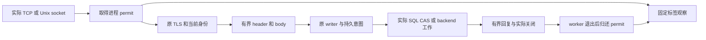

# 服务入口容量、等待边界与处置

[ADR-0213](../decisions/0213-explicit-listener-capacity.md)约束实际连接与线程，不建立
Node、资源分配或设备事实。配置按每个实际进程声明；共址、跨主机和故障域仍来自部署 profile。

| 入口 | 配置 | 默认 / 范围 | 实际持有与等待边界 |
| --- | --- | --- | --- |
| Node TCP/mTLS/HTTP2 | `ROBOGUIDE_NODE_CONNECTION_LIMIT` | 128 / 1–1024 | TLS 前取得 permit，实际连接结束才释放；首次流量和 TLS 各 5 秒、后续读取空闲 15 秒 |
| Node 每连接 stream | `ROBOGUIDE_NODE_STREAM_LIMIT` | 16 / 1–128 | HTTP2 同时 stream 与每连接并发；单 RPC 30 秒；不代替 session/sequence/lease |
| Operator | `ROBOGUIDE_OPERATOR_CONNECTION_LIMIT` | 128 / 1–1024 | TLS 前 permit；原 handshake/read/response 各 30 秒；慢 SQL 不占唯一网络 worker |
| Artifact | `ROBOGUIDE_ARTIFACT_CONNECTION_LIMIT` | 128 / 1–1024 | TLS 前 permit；handshake 5 秒；有界 header/body/chunk/response 保留原上传预算 |
| Mission HTTP | TOML `connection_limit`、`connection_timeout_seconds` | 128 / 1–1024；35 秒 / 正数至 900 | TLS 前 permit；整体 socket watchdog，实际 worker 退出才归还 |
| Memory TCP/Unix、Spatial Unix、Robonix HTTP | CLI `--connection-limit`、`--connection-timeout-seconds` | 128 / 1–1024；30 秒 / 正数至 900 | 创建线程前 permit；header 解析前 10 秒 socket timeout；整体 I/O watchdog |
| Replica Raft/content | 原 Replica transport profile | 原显式 inbound/outbound/frame/time 范围 | 原连接、frame、stream worker 与不可续期内容预算；不复用 Node quota |
| Replica 私有 metrics | 原 `metrics_address` | loopback / 16 连接 | 2 秒整体请求、4096 字节 header、受限状态文件与原 freshness |

Replica child 环境只接纳同样的显式范围，仍进入原 application policy identity；不能修改
存量配置 digest 来跳过正式升级。Robonix 只允许 literal loopback。Memory Unix 保留原
same-UID 校验，Spatial Unix 保留 0600 socket 与实际原 backend/code/config identity。

满载会关闭新 transport，没有接纳业务命令。已经持久化的工作仍保留原 ownership、预算和
Unknown；response 超时只关闭 I/O。连接关闭不能证明 Create、Commit、Execute、上传或
模型调用从未发生。客户端必须查询原 command/import/transaction ID，不能换 key 重发。

Node/Artifact/Operator 指标为 `roboguide_<listener>_connections_active`、`_limit` 和
`_rejected_total`；Mission 为 `roboguide_mission_http_connections_*`。本地 adapter
`GET /v1/transport` 只读本进程计数。观察是有界 best effort，丢样或缺失不能当作健康。

排障先冻结实际 code/config、原 incident 和连接计数，再区分连接耗尽、慢存储、缺少 quorum、
业务 Unknown 和读取权限。先修复实际阻塞和客户端行为；调整限额须核对主机容量并保留配置
修订。不得靠延长业务预算、释放 Unknown 资源、取消正在提交的事务或重建数据库来清告警。

`RoboGuideNodeCapacitySaturated`、`RoboGuideArtifactCapacitySaturated` 和
`RoboGuideMissionCapacitySaturated` 观察当前满载；`RoboGuideTransportConnectionsRejected`
保留五分钟实际 rejection 增量。满载时同入口 scrape 也可能失败，应同时处理
`ScrapeUnavailable`；独立 Operator metrics 能观察 Node/Artifact 压力。原生生成和投递见
[监控指南](observability-v0.1.md)，实际证据见[入口验收](acceptance/2026-10-26-listener-capacity.md)。

维护门禁按模块运行：`check_listener_capacity_processes.py` 运行真实入口与可选原生监控；
`check_spatial_capacity_processes.py` 要求明确 SDK interpreter/config/source；
`check_default_listener_processes.py` 从实际 TLS 输入检查默认容量和短窗口健康延迟。
验收没有设备、模型、模拟器或注册的 Node，也不发送通知给人员。
