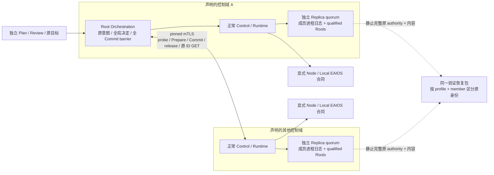

# 跨域 HA 部署与完整恢复

[ADR-0214](../decisions/0214-replicated-federation-deployment.md)把既有 v60 Federation 接到
唯一 owned Controller child。每个域保留独立 Raft、Control、原子事务和原进程日志；Root
Orchestration 仍只通过原持久 probe/Prepare/全局决定/Commit/release 与独立目标推进。

下面是职责拓扑模板；域、成员、Host、路径与 Local EAIOS 都由部署声明，产品不内置两个
域、三个副本或任何设备清单。同域 Controller 的内部职责仍按 V2 共址，跨域只交换原协议。



实际进程配置新增可选闭合字段，下面仅为参数模板，不创建控制域、Node 或设备：

```json
{
  "federation": {
    "schema": "roboguide.federation-process-inputs/v0.1",
    "domain": "declared-domain",
    "authorization": "/absolute/declared-authorization.json",
    "peers": "/absolute/declared-root-peers.json"
  }
}
```

participant-only 可省略 `peers`。声明的本域必须与原授权/peer profile 相同；实际 JSON
文件最多 1 MiB，其初始 bytes 进入共同 application policy digest。支持范围由实际 binary
声明，v60 以前的程序不获得 Federation 权威。缺省字段保持原 policy identity；继承环境
在 child 启动前清空，不能靠额外环境变量绕过显式输入。Node、Operator、Artifact mTLS
和 owned-content 原配置均须齐备，不能用一个 domain 名称代替实际身份。

原 profile 的代码、策略和来源不能靠重写 digest 更换。既有部署须通过正式代次升级或
排空后的原 source 初始化，保留所有记录、Unknown 与预算。TLS/Secrets 是显式部署输入，
其挂载位置和实际字节在恢复后再次验证；恢复数据本身不安装凭证或启动服务。

路由端点是部署组件，不拥有 quorum 或资源。一次连接只选取一个实际目标，TLS bytes
透传至真实 Controller；已有连接不迁移，不补造 HTTP 回复，不自动重发 mutation。
陈旧路由、丢失回复、分区和证书失败保留原意图，通过原事务 GET 对账。原 Root epoch
变化只能进入既有停止/撤权路径，不能继承旧 dispatch permission。

未变化的实际已提交策略走只读快路径；策略改变仍在原授权 writer 下重读并持久化，业务
mutation 保留自己的当前策略与最终 Commit 检查。出站请求持有 SQL 中原 intent/observation
的 kernel budget；写入排队和 Commit 消耗同一期限，发送前只取剩余量。到期不打开凭证或
网络连接，原失败与后续只读观察分开保留。

[ADR-0215](../decisions/0215-fair-application-writer.md)让所有原 writer 按进程内到达顺序进入，
避免持续 timer/Node producer 越过已排队请求。实际授权检查仍在取得原 writer 后及最终
Commit 前完成；panic 保持 fail closed。队列不会持久化为新权威，也不续预算。原 bounded
Replica/Federation TCP 关闭 Nagle；全部原 TLS/quorum/字节和截止检查保留。

## 数据恢复的独立维度

显式 [recovery v0.31](../../contracts/recovery/bundle-v0.31/README.md)在同一静止完整包中
支持多个独立原 Replica profile。每个 `(profile, member)` 独立，Root owner 全局唯一；
每个原 committed membership 仍必须有完整精确 Root 表。相同数字 member ID 不会合并
控制域，缺少一份原 Root 不会被另一个域的同编号替代。

应用代次与物理存储布局分别检查。当前 v60 可以保留其实际 parent8/Root4–7，不隐式
升级成 Root8；原初始化和 parent11 协调归档仍要求真实 Root8。旧恢复 profile 保持原限制。
活动全局准备、Commit/release、nonce 与实际对域 authority 在同包内对账；完整终止历史
不要求已删除的远端 owner。所有实际 writer/inode leases 先于源读取，错误在发布目的目录
前拒绝。restore 保留原预算与 Unknown，服务重启仍须当前权限、epoch 与完整内容。

## 维护入口

`check_federation_ha_processes.py` 使用两个真实独立域、各自原三 voter、真实 CPU Node 与
独立文件复算，覆盖全 Commit 前禁止执行、真实分区、原 Root transfer、成员证书实际
Stage/Retire、错误 peer leaf pin、私有 Archive 和完整双域恢复。基础设施 member ID 在
两个域中故意重复，用实际 profile/Root 证明隔离。透明 TCP 路由只转发真实字节。
`federation_ha_recovery_processes.py` 声明全部原 SQL/CAS、Node journal、文件和输入，验证
实际完整恢复，再只启动基础设施/Controller；不重启 Node 或 CPU 工作。

验收结果、原失败、实际 PID/wait、代码/配置 identity 和剩余总矩阵分别记录。整个路径
不使用设备、外部模型、模拟器或 E6；软件进程和单机网络证据不代表物理停止、跨主机
连续性或长期 SLO。总体状态以[唯一执行队列](roboguide-software-completion-plan-2026-10-15.md)为准。

该 HA 软件 profile 在首个命令前声明：两类 State export 间隔 1 秒，各自原 TTL 保持；
每次跨域请求通过显式 peer profile v0.2 声明原预算 30 秒、全局事务原预算 300 秒、最大时钟区间宽度 10 秒。它是有界的
部署输入，不能给已存在的事务、Unknown 或重启续期。原 standalone profile 仍为 3 秒 /
120 秒 / 1.5 秒。原 HA 3 秒 profile 的排队超时保留为失败，不改写为后续配置的成功；
软件延迟与长期 SLO 另按真实采样报告。原 v0.1 最高 10 秒的配置也保留其实际失败；
正常执行、换主和在线归档曾通过，后续原请求超时不改写。新配置只对新声明生效。

[ADR-0217](../decisions/0217-explicit-federation-request-budget.md)和
[peer profile v0.2](../../contracts/control/federation-peers-v0.2/README.md)要求字段
`budget_scope=intent-publication-and-peer-io`，明确 SQL publication 与 peer I/O 使用
同一份不续期预算。原 v0.1 范围仍为 100–10,000 ms，v0.2 为 100–30,000 ms；
必须显式选代次，禁止降级。真实旧 supervisor 在原存储上拒绝新配置，且不改动 SQL/CAS。
旧闭合 application/recovery decoder 也不能把该新字段作为旧权限接受。

独立目标测量在原 Runtime 完整报告 Completed 后重新读取真实文件；新证据在首次发送前
声明 10 秒有效期，受原 verifier source 的 10 秒上限约束。已过期的旧测量仍不可用于完成，
CPU 结果出现也不替代原 Runtime 报告。验收使用明确冻结的优化构建，不把 debug 与优化
构建的时延混作同一份样本。

该组合在正常全局原目标完成后，通过正式管理入口对两个域各做一次在线 private Archive，
再换主并接纳后续独立事务。cutoff、pending、实际包字节、原 floor/Catalog 与当前日志都由
原协议产生；归档不删除原命令、Unknown、预算或尚需的引用。最终再做完整 Archive/恢复。
早期未归档的真实长历史超时仍保留，不改写旧事务或以清库重跑替代维护。

[ADR-0218](../decisions/0218-federation-current-decision-time.md)区分原 HTTP receive time 与
取得 writer 后的当前决策时间。当前资格不能在排队后借用较早接收时点越过过期边界；
原 State/lease/freshness 与全部正常 Control 门禁不放松。真实命令 4xx 只触发原停止对账，
不推断无副作用或重发，原失败回包仍保留。

原 coordinator 的 barrier/backoff 无变化 turn 不再反复竞争 writer 并做空 SQL 事务。
调度 hint 只观察当前已提交原记录；真实归约、首次到期、权限/epoch 变化与实际工作仍
走原 writer/最终检查。到期 cleanup 保留 Unknown，不能用空轮询重建新预算。

[ADR-0219](../decisions/0219-original-stop-only-federation-observation.md)与
[peer profile v0.3](../../contracts/control/federation-peers-v0.3/README.md)增加原 admission
即冻结的停止只读 scope。首次停止与原 30 秒 cleanup 共用实际 kernel start；cleanup 到期
仅发 GET，不重发原 abort 或任何 mutation。原真实分区一直保持到 abort 与首个独立 GET
均失败，再恢复通信，等待对端按原期限停止/释放并核对。正常输入仍为 300 秒，另一份
故障输入在首次 admission 前明确为 120 秒；旧事务、Unknown 与 clock 不修改。
独立 GET 最多原 300 秒/十六次观察，确认不会覆写原 abort 的未知回包。
