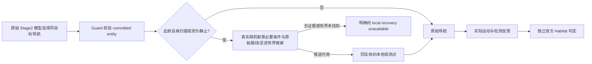

# 有界主动观测与证据封口

本扩展由 deployment-owned Habitat Local EAIOS 实现。公共 MissionPlan v0.8、Core 的
Proposal/Commit/Bind 与 Task satisfaction/release 权限保持原有边界。实现决策见
[ADR-0094](../decisions/0094-bounded-observation-and-local-contract-recovery.md)。

| 入口 | 可以执行 | 完成证据 |
|---|---|---|
| `observation.verify@v1` | 读取既有缓存，无模型/运动/额外 step | 正或负的有效读数；不证明 condition true |
| `observation.acquire@v1` | 本地有界接近指定实体与观察 | 当前原始缓存明确检测到该实体 |
| Contract recovery | 执行前要求模型重新选择 | 新返回的 action 独立通过相同 Guard |

acquire 的唯一参数是 `expected=detected(entity-ref)`。当前 profile 没有独立相机云台、
全场搜索或任意动作控制能力；预算也不证明超时目标不可能达到。新的 capability attributes
只有来源明确的 acquisition mode、visual modality、允许移动与本地 cycle 上限。
运动方式复用 Node 已有的 `base-type`（如 legged/flying），完整投影到 MI capability class；
主动观测的 `viewpoint-positioning` 则从同一注册事实约束为 ground/flight。Control 使用已有
typed capability constraints 做 Matching；逻辑 Actor 名称和文字描述均不选择物理端点。
已有固定主相机声明的部署在注册和 MI capability class 中携带真实光学标量；其他相机、
未提供的控制能力与可见性保持未知，MI 不得猜测。

当前检测能力通过注册的 `condition-format=detected(entity-ref)` 声明精确参数格式，
该字段完整进入 MI capability class。acquire 的完成条件仅为检测成立；接近实体是
本地采集手段，并不证明已到达目的地。需要同时到达和检测的 Mission 仍须保留独立的
移动意图和 satisfaction 要求，不能将任意联合目标填入这个部署的 `expected` 参数。

deployment v0.4 增加 `enable_observation_acquisition`、
`observation_acquisition_max_steps`（1–4096）与 `contract_recovery_attempts`（0–3）。
它们由声明冻结，子进程实际使用值须与 Local How v0.10 一致；acquire 还要求原始传感器、
语义相机和导航技能可用。默认 Python adapter 开关关闭。新的感知/重排 deployment
模板显式选择本轮开发配置，旧冻结运行继续使用自己的旧模板。

开启 acquisition 的当前代码输出 Local How v0.16，保留 v0.11 的闭合
`observation_control=bounded-visual-feedback/v0.1` 声明。每次真实模型动作请求包含最新的
缓存 true/false/unavailable、原 Task/attempt/world/entity、sample step 和原始剩余预算；
读取不到保持 unavailable，同 step 冲突、跨 attempt/world 或时间回退拒绝。初始已有真实
positive sample 时直接完成 acquisition，零额外模型/运动，仍不声称联合目标已成立。

该 Local EAIOS 合同将选中的 wait 映射为 `min(16, remaining_simulator_steps)` 步暂停，
然后由原始高层策略继续决策。实际工具描述预先披露此持续时间，raw call 不变；映射证据
保留原始500步 wait 与实际派发。它不改 vendor 文件、技能实现或官方总步数，不扩展
导航/操作权限，也不更新原始 acquisition deadline。它是明确的 Local How 改动，不能在
与原生 EMOS 对照中声称动作调度完全等价。普通导航、搬运、idle 与历史 v0.9/v0.10
运行保留自己的等待合同。持续可见、驻留或多目标保持仍需实际能力和官方终态证据，不能
由这个反馈 profile 推导。

v0.12 还显式声明 `fresh-acquisition-navigation-command/v0.1`：仅在 Guard 接受实际模型
选择、原始 CrabAgent 完成同目标/同 agent 的 `nav_to_obj` 映射后，清除该端点 Oracle
动作的 `prev_nav_done` 与 `skill_done` 命令标记。原始动作此前对相同已完成目标直接跳过
计算并清除完成信号；新 acquisition 会因此没有运动、也没有完成反馈。现在每次真实新调用
重新进入原始到达计算，不复用历史成功、不写入 true、不调用额外 action/Gym/sensor，不清除
已采样目标点或路径规划器。来源 action 或目标不匹配时在修改前拒绝。其他端点、非 acquisition
与历史声明不变。`fresh-navigation-command` 证据绑定 attempt、raw call、映射和前后标记。
该修复不保证视野可见；导航完成后真实检测仍可能是 false，原始 acquisition 预算仍会耗尽。

v0.13 的 `observation_view_search=bounded-base-yaw-view-search/v0.1` 提供显式本地工具
`scan_for_object(target_obj)`。它只在 acquisition 与原始底盘控制接口均加载后对模型提供，
参数必须是该 attempt 的同一实体。Guard 通过后保留原始 CrabAgent 的工具名与参数，不把
模型选择的导航或等待替换成扫描。新的独立本地技能复用原始 HRL/Wait 的入口、计数与退出
机制，通过原始 joint action vector 发出自身端点的 yaw 分量；仍由原 actor/Gym 执行唯一
一次 step。支持实际 BaseVelAction、BaseVelNonCylinderAction（含 lateral layout）及
DroneBaseVelAction，启动时检查真实实例、端点归属、action layout、角速度和控制频率。

每次扫描最多32步、命令累计转角最多90度、角速度不超过1.5rad/s，并截短到原始 acquisition
剩余预算。没有平移命令、相机节点修改、传感器创建或抓放动作；原始底盘碰撞/运动结果仍然
有效，因此零平移命令也不承诺物理位置绝对不变。持物、来源改变、错误实体或过期 attempt
均拒绝。普通 navigation、relocation 和 idle 不获得扫描权限；新技能在 attempt 结束或
初始化失败时撤销，不编辑 peer 或 vendor 文件。扫描退出仅记录 `view-scan-finished`，
不意味着检测为 true，也不建立官方或 Mission 成功。它不能保证消除遮挡或修正垂直视野，
不能宣称与原生 EMOS 动作工具集等价。

v0.14 增加 `observation_motion_feedback=observed-own-scan-rotation/v0.1`。每个真实scan调用
在派发前冻结自身原始quaternion，只在自身scan skill的既有成功Gym step后读当前quaternion。
下一次模型输入、tool receipt和终止归档保留同一call ID/sequence的rotation-observed、
no-rotation-observed或unavailable。完全缺失基线或部分读取失败不能证明静止；q与-q不表示
不同朝向。内存只保留起点、最新值和标量计数，不在每步写盘或序列化JSON。

原始计时技能仍返回原始结果；扫描计时结束不证明已经转动，更不证明检测或benchmark成功。
读取失败不影响原动作或异常；运动阻塞的原因保持unavailable，不能由零转角猜测碰撞。
没有自动重试、改写动作、替换目标、改变footprint/碰撞容差/NavMesh或增加物理控制权限。
不同Local How控制器的几何可行性不一致需要独立的部署合同审查，不能靠放宽检查掩盖。

v0.15 增加 `observation_viewpoint_recovery=bounded-observation-viewpoint/v0.1`。
只有上一扫描真实观测为未转动、当前检测为false且模型重新选择同一entity的`nav_to_obj`，
才执行有界观测点搜索。模型没有选导航时不自主移动；错误目标仍由Guard在原始映射前拒绝。
既有raw tool、canonical operation与entity不变，变化的是本地导航到该实体所选的arrival point。

候选位于当前点周围0.4/0.7/1.0米的固定8方向；投影偏移超过0.2米、位移不足0.25米、
重复旧点、路线缺失或超过1.5米均不能使用。最多24个候选，每个候选用原始非圆柱底盘
footprint/容差/mesh回放完整32步scan；footprint最多16点。已有goal-region导航的距离
envelope保留。路径查询失败不使用原生的直线兜底。整个attempt最多两次搜索，不续期
原始acquisition预算。Python每个候选前后检查1秒期限，不能中断单次native查询或约束其
内部内存分配；不宣称硬实时执行上限。

当前实现需要实际加载的BaseVelNonCylinderAction及非空足迹、同一机器人与原始mesh；
其他接口缺少这项几何契约时保持原始导航，不启用或宣称这项恢复能力。
perception-readiness逐端点记录loaded_geometry_supported，物理可行性仍未证明；已启用
接口若在派发时丢失必要几何，则明确local recovery unavailable，不臆测平台运动安全。
局部位置只覆盖当前导航调用，实体位置、episode或mesh改变后拒绝旧选择；任务退出与
下一次导航清除自身hooks，原始缓存、peer与其他operation保持各自执行路径。
记录`observation-viewpoint-selection`、原scan call、当前nav call/sequence、候选位置、
route、预算与失败原因。搜索失败属于local-observation-recovery，未派发、不重试Provider。

v0.16 使用 `bounded-observation-viewpoint/v0.2`。原生多agent构造会给camera mount
和sensor UUID都加agent前缀，解析必须按原映射绑定自身端点。`observation_optics.py`
只把唯一base-mounted pinhole主相机作为固定几何模型；jaw等机械臂相机仍可被原detector
使用，但不会被冒称为固定或可由本操作控制。Node注册和MI capability class中的标量是：

| 属性 | 意义 |
|---|---|
| `camera-model` | `fixed-primary-pinhole/v0.1`，不保证可见性 |
| `camera-height-above-base-m` | 光心相对运动基点的高度，不是世界绝对高度 |
| `camera-forward-offset-m` | 平台前向的光心偏移 |
| `camera-forward-elevation-degrees` | 光轴相对平台前向平面的仰角；负值朝下 |
| `camera-horizontal-fov-degrees` / `camera-vertical-fov-degrees` | 真实pinhole视场 |
| `camera-pan-tilt-supported` | 当前观测工作流是否能独立控制相机，当前为false |

运行前 `observation-optics-declaration.json` 冻结Node文件摘要和完整可选标量。v0.16
缺失该artifact不能降级为旧schema。reset后核对实际原相机矩阵、mount和FOV，误报能力
会使READY失败；缺失声明仍明确unavailable。相同事实随既有typed attributes注册给Control，
并从deployment profile交给MI；MI不读取live Node Inventory。

生产候选来自0.15米间隔、1.2米半宽的固定局部网格（288个请求，硬上限512）。
原投影偏移、至少0.25米且至多1米位移、去重、至多1.5米真实路线、两次恢复和原始
采集预算保持。原始相机矩阵对目标的实际包围球作视锥半平面必要条件检查；遮挡和
像素数未知。每次最多64次route和32个完整scan候选，耗尽独立预算时记录真实进度并
拒绝派发。一秒Python期限不能中断单个native调用。选择后外参、实体或mesh漂移会
使旧hook失效，清理仍只恢复自己的覆盖，不改变原cache、其他端点或vendor源码。

该几何检查不保证实际到达误差、无遮挡或严格像素阈值。若靠近和取景的可行区域不同，
不能由检测动作暗中承诺保持其他Task效果，也不能把两个独立存在性谓词强绑同一Physical
Entity。实际MI计划须保留所有任务条件，最终按原联合verifier检查当前状态，历史正读数
和stage-goal锁存都不能代替终态。当前实现没有本地跨端点改派或自动改写MissionPlan。

本功能是RoboGuide受控臂的Local How扩展，不能称作原生EMOS等价执行。静态候选检查不
证明动态碰撞安全、到达误差下的可旋转性、目标持续可见性或官方成功；真实轨迹与detector
继续决定实际结果。旧v0.14/v0.13归档保持原始字段和行为版本，不能补字段重写历史。

物理诊断开关还启用 `perception-diagnostics.jsonl`，以16步采样周期读取同一次既有 Gym
缓存。每条记录保留精确 entity/attempt/world、各 detector 的自身结果、原始整数语义图像
中目标像素数、原传感器的严格 `count > pixel_threshold` 比较、相机矩阵几何及当前缓存的
跨 agent 并集。相机锥内只表示几何推导，遮挡未知；缓存并集也不冒充官方谓词执行结果。
单 agent false 与官方 any-agent 条件必须区分，历史正样本不锁存为当前 truth。

诊断不调用 sensor/render/predicate/Gym/actor/RNG；不序列化完整图像。每条最多4个 detector、
每个最多8个相机、总计4,194,304像素比较；最多4096条记录，32条有界批写，报告丢样与开销。
读取与写盘失败不影响执行，终态补采失败也必须 flush 已有批次，并保留原执行异常。
关闭物理诊断时不读取图像或相机矩阵。该证据用于定位缓存/像素/视角差异，不能代替
正式 verifier。实际检测保持原始缓存语义，官方 `is_detected` 仍由 Habitat 独立计算。

planning world v0.4 的 `entity_geometry` 是最多 64 条 reset position，字段为
`entity_id`、`frame_id`、三项 integer `position_mm` 和 `up_axis=y`；未知位置进入 `gaps`。
它只是一个已观测快照，不能当作 route、future goal 或检测真值。

live `GET /v1/executions/closure` 返回 Mission、session digest、producer phase 和实际
publication flags。`closed` 表示发布尝试已经结束，只有 `evidence_flushed=true` 且无归档
错误时才能声称必要终态证据已封口。实际执行失败仍可拥有完整的失败归档。
Runner 最多观察 30 秒 / 64 页小状态响应，将每次读取保存在
`evidence-closure-archive.json`；失败归属 `HARNESS_ARCHIVAL`，不覆盖 `run-failure.json`。
legacy adapter 的 closure 为 unavailable；只有 live 的已接受 Request 启用该附加 barrier。

### 失败后 session 的自然封口

`independent-live/v0.1` 不提供失败后的 session continuation。某个真实本地执行返回
`FAILED` 后，已经活动的 peer 继续原执行路径，或响应既有显式取消；adapter 不替 Control
取消、重新调度或释放资源。当这些活动执行全部结束，而 session 仍有从未下发的 slot 时，
runtime 使用 `termination_reason=local_failure_drained` 结束本次世界执行，不再等待不可能由
本地补发的后继。正常成功后的 Control 顺序派发、全 slot 完成及 assignment wait budget
保持原有路径。此规则依据实际失败事实和活动执行集合，不读取或推导 DAG 调度决策。

slot ledger 的 `completed` 仅表示本地已终止，不等于成功或 Task satisfaction；新的
`roboguide.live-session-progress/v0.1` 分别记录 declared/dispatched/terminal 数量、真实
failed slots、active slots 和 undispatched slots。它随 live summary、session state 和
closure 发布。summary 来自子进程已收到的派发；closure/session state 来自父进程已接收的
派发。因此在终态与派发并发到达的情况下，两边的 dispatched 数量可以不同，不能据数量
相等推断完整性。父进程已接收但未得到子进程终态的派发，在 store 中保留真实失败及错误，
另列于 `unreported_dispatches`，不会伪造位置、物理执行结果或 verifier 的 attempt coverage。
这些记录在最终 state 发布前结束本地 handle，不能继续标为 active。

封口仍读取同一真实世界的原始官方 metric；不会由局部失败推导 `pddl_success=false`，
也不会把 `episode_terminated` 改成 true。官方 metric 缺失仍为 unavailable，summary 或
verifier 写入失败仍使 `evidence_flushed=false`。物理失败、归档失败和正式 admission
保持独立；历史失败归档不回写。

feasibility v0.6 的 `finality_profile` 固定三个中立字段：
`verifier_publication=after-all-session-slots`、`endpoint_capacity=1`、
`resource_release=after-task-satisfaction`。Controller 在资源保留的 final slots 上进行
有界候选匹配，并在创建 Group 前拒绝无法闭合的容量冲突；这不授予任何预留或释放权限。
这里的全 slot barrier 约束正常完成路径；失败封口结束的是已失败、不可继续的 session，
不把未下发 slot 标成完成，也不授予正常 Task satisfaction 或额外资源复用。

感知与重排的 live deployment 还在每次 reset 后、Mission Service 启动前发布
`roboguide.execution-planning-evidence/v0.2`。该 artifact 将同一份 semantic evidence 的
`run/episode/scene/dataset` identity、Habitat 官方 terminal verifier source，以及
endpoint 数量、capacity-one、resource release、verifier publication 和明确的
`execution_topology` 支持绑定到一个 digest。旧 v0.1 保持可读，不获得其未发布的能力。
Planner、Reviewer 和 Repairer 看到的是这份不可变的 deployment declaration；它不是 live
Node inventory，也不选择 Actor 或 Physical Entity。MI 检查同一 Task 的同时 Role 需求和
终态 verifier 在所有 session slots 结束前持有的容量；independent Tasks 只有在 Control
实际释放后才能复用 endpoint。Planner/regenerate/Repairer 的新草案还通过 Controller
`/v1/missions/validate-plan` 复用提交时的发布合同校验，保留原始草案与多条结构化错误，
进入原有有界恢复。HTTP 失败、缺失接口和来源不匹配保持系统失败；前检不能授予提交、
调度、资源或物理可达性保证。需同步部署包含该接口的 Controller，不能回退为跳过前检。
逐 Task 可及时发布的独立 verifier 不受全局终态 source 的生命周期限制。
只读回复 v0.2 回显同一拓扑声明；模式、能力与资源生命周期的具体错误保持各自 code/path。
当任务需要条件为 true，snapshot verify 的负读数不能代替主动 acquisition；局部 acquisition
先后成功也不能被锁存为联合终态成功。诊断复用原缓存，不额外调用官方谓词或 render。
详见 [ADR-0109](../decisions/0109-published-plan-validation-and-bounded-draft-recovery.md)。缺失、篡改或跨 reset
的 artifact 会让 live Mission Service 在请求前 fail closed；offline prepare 可以只验证配置
模板，不宣称已经拥有本次 reset 的 verifier evidence。

真实验证必须同时保留 frozen input、精确源码/model/部署 identity、MI 请求与草案、
Control assignments、实际动作和反馈、initial/reset/terminal diagnostics、官方结果和
closure/provenance/admission。应分别汇报 true、false、unavailable，不能将本地 acquisition
完成当作联合官方成功，也不能把小规模诊断当成 E1 成绩。
