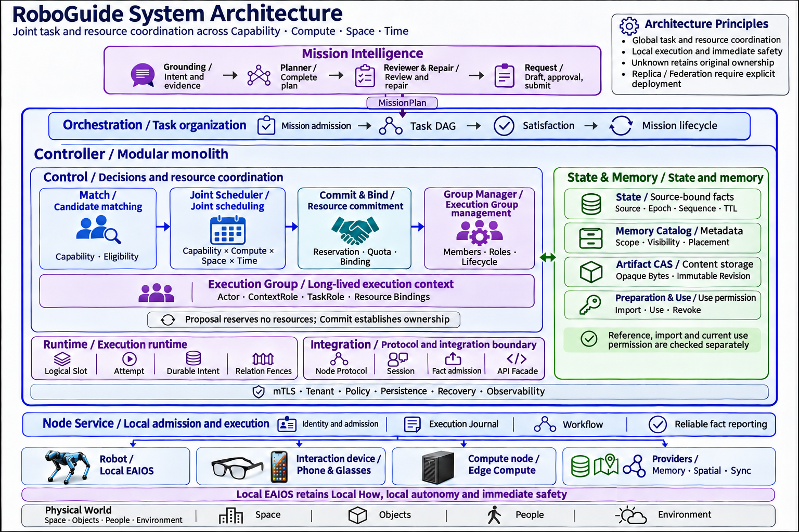

# Coordinate heterogeneous systems around a Mission

RoboGuide is a distributed operating-system framework for heterogeneous embodied agents. It turns objectives into plans, selects participants, commits resources and manages execution, evidence and recovery while preserving local autonomy and immediate safety.

[Understand the architecture](../architecture/v2/architecture-tour.md){ .md-button .md-button--primary }
[Run your first example](quickstart.md){ .md-button }

## From an objective to a verified result

<!-- diagram:overview:en -->

**Mission Intelligence** produces plans; **Orchestration** advances Tasks and evaluates satisfaction; **Control** owns bindings and resource commitments; **Runtime** manages execution attempts. Node Service connects authorized operations to Local EAIOS. State and Memory supply attributed observations and content.

## Choose a reading path

| Your goal | Start here |
| --- | --- |
| Understand architecture and rationale | [Architecture tour](../architecture/v2/architecture-tour.md) → [System dataflows](../architecture/v2/system-dataflows.md) → [Concepts](../architecture/v2/concepts.md) → [Execution lifecycle](../architecture/v2/execution-lifecycle.md) |
| Run locally | [Getting started](quickstart.md) → [Development and integration](../guides/integration/README.md) |
| Find code entrypoints | [Module map](../guides/development/modules/domain-ports.md) → [Implementation status](../reference/implementation-status.md) |
| Deploy and troubleshoot | [Operations](../operations/README.md) → [Versions and references](../reference/contracts-and-build.en.md) |
| Read decisions and evidence | [ADR topics](../reference/decision-guide.md) → [Original archives](../archive/README.md) |

## Three distinctions that shape the system

**Proposal and commitment.** A Scheduler selection owns no resources. Control Commit creates the obligation.

**Completion, satisfaction and release.** Local Completed, evidence of the requested effect and releasing ownership have separate gates.

**Logical participants and execution identities.** Actor, Role and Task are plan objects. Deployment and Control bind Nodes and PhysicalEntities.

## What exists today

Software paths include complete-plan admission, DAG scheduling, four execution coupling modes (ADR-0026/0027), execution attempts, source-aware State, telemetry slimming with Storage v3, multi-robot spatial occupancy fusion, runtime revision, logical quota, recovery tools, the `roboguide chat` workbench, and the `console/` mission UI. [Implementation status](../reference/implementation-status.md) separates validation coverage from remaining work. Process/file checks do not establish device safety or overall completion.

[Reference](../reference/contracts-and-build.en.md) contains contract versions and build provenance so historical snapshots remain identifiable.
