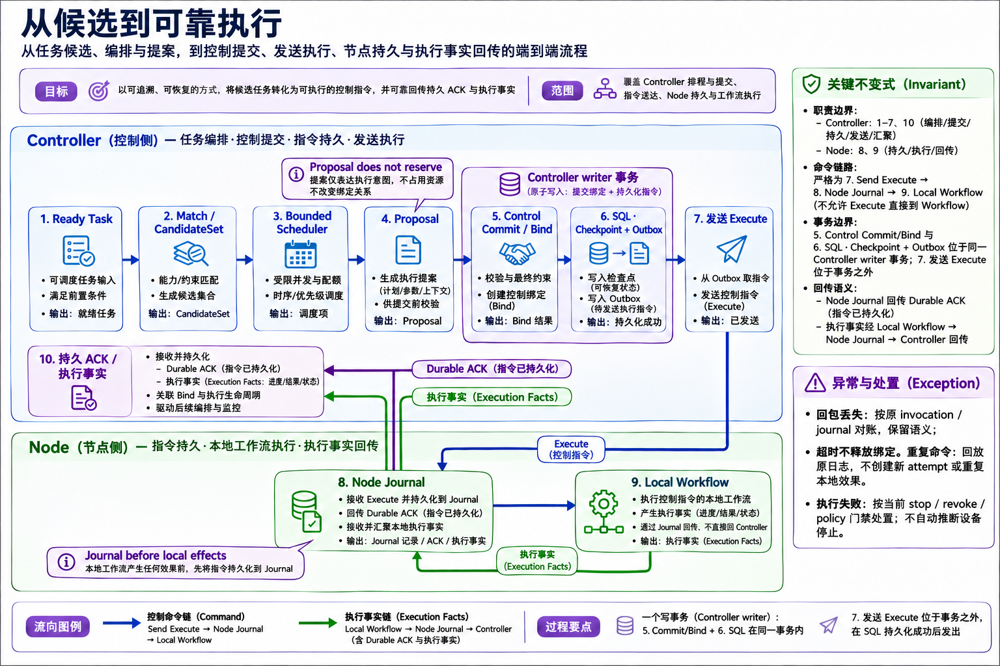

# Integration 与 Node Service

Integration 负责正式 gRPC/session/route；Node Service 编译配置、保留 journal 并调用通用 driver 连接 Local EAIOS。

## 职责与关键对象

GrpcIntegrationService、Node router、NodeServiceConfig、LocalIntegrationEngine、ExecutionJournal。

## 主流程

先 observation readiness 再 Register；Registered/Ack 等应用 durable acceptance。Execute 先 journal 再 Local How，重复命令保留原 identity/budget。

## 代码入口

- [主入口](https://github.com/Farewell-CK/RoboGuide/blob/main/core/integration/src/lib.rs)：`core/integration/src/lib.rs`。
- [协作入口](https://github.com/Farewell-CK/RoboGuide/blob/main/core/node-service/src/lib.rs)：`core/node-service/src/lib.rs`。

## 实现状态

当前实际调用链与剩余工作统一记录在[实现状态](../../../reference/implementation-status.md)，版本由[参考页](../../../reference/contracts-and-build.md)生成。本模块的存在不代表完整阶段或设备验收完成。

## 验证与排查

先检查原 identity/plan/attempt、当前 policy 与期限，再查上下游事务和 receipt。拒绝、超时、重放与重启必须保留原证据。测试使用显式软件配置，不把 FakeNode 或协议 fixture 当作设备。

## 相关边界

[架构与权威](../../../architecture/v2/architecture-tour.md) · [概念](../../../architecture/v2/concepts.md) · [生命周期](../../../architecture/v2/execution-lifecycle.md) · [接入指南](../../integration/README.md) · [State 与 Memory](../../../architecture/v2/state-memory.md)

## 调用链详解

### 接纳、ACK 与本地 journal

<!-- diagram:dispatch:zh -->

wire v0.4、语义 Node Contract 和 config schema 是不同版本轴。基础握手示例明确协商 v0.6；Memory/安全 profile 显式采用新合同，不根据 metadata 猜权限。

Node journal 使用原 sibling/inode leases，克隆保留 lease；schema fence 拒绝旧 writer。Local EAIOS 的协议 driver 是通用实现，厂商语义在部署 workflow 内维护。

原命令 receipt、terminal、stop proof 和 provider revoke 通过不同证据路径返回，不能把 gRPC 送达等同于业务完成。

在弱网与漫游韧性方面，Node Service 启用 HTTP/2 keepalive 探活与 `CoalescedStateOutbox` 按 `export_id` 合并（PR #19/#27），并在被新注册覆盖时仅将拒绝限定于原会话（PR #39），防止高并发重连产生假性拒绝。设置 `ROBOGUIDE_NODE_PREFLIGHT_CONFIGS` 与 `ROBOGUIDE_NODE_PREFLIGHT_PROFILE=complete-sources/v0.1`（ADR-0255/0256）可离线或经 `/v1/missions/validate-plan` 预检 Node workflow Pointer 与外部描述符完整性。
