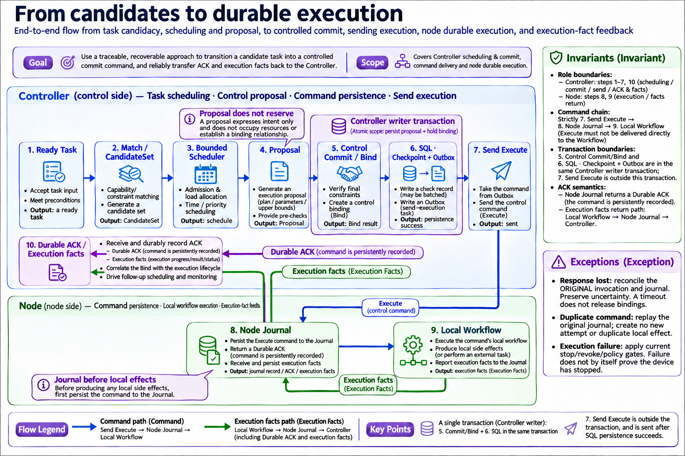

# Mission Orchestration

Owns accepted plans, DAG readiness, Task satisfaction, Mission lifecycle, holds and logical dispatch policy.

## Responsibilities and key objects

MissionOrchestrator, MissionExecution and IntegrationRuntimeBridge; the bridge is not a second execution authority.

## Main flow

Submit creates the Group/all Tasks → advance Ready → call Control/Runtime → await satisfaction after local completion → release gates → DAG. Revisions preserve original goals and facts.

Due reservations receive the first dispatch opportunities. Among Ready Tasks at the same effective priority without a due reservation, the earliest completion deadline goes first. Each deadline is measured from its Mission's acceptance, and Tasks with no deadline follow those with a deadline. Waiting age and per-Mission rounds still apply.

## Code entrypoints

- [Primary entry](https://github.com/Farewell-CK/RoboGuide/blob/main/core/orchestration/src/lib.rs): `core/orchestration/src/lib.rs`.
- [Collaborating entry](https://github.com/Farewell-CK/RoboGuide/blob/main/core/orchestration/src/mission/lifecycle.rs): `core/orchestration/src/mission/lifecycle.rs`.

## Implementation status

[Status](../../../reference/implementation-status.md) records actual paths and remaining work; [Reference](../../../reference/contracts-and-build.en.md) generates versions. A module's existence does not establish full stage or device acceptance.

## Validation and diagnosis

Inspect original identity/plan/attempt, current policy and deadlines before upstream/downstream transactions and receipts. Rejection, timeout, replay and restart preserve original evidence. Explicit software configurations, FakeNodes and protocol fixtures are not devices.

## Related boundaries

[Architecture and authority](../../../architecture/v2/architecture-tour.md) · [Concepts](../../../architecture/v2/concepts.md) · [Lifecycle](../../../architecture/v2/execution-lifecycle.md) · [Integration](../../integration/README.md) · [State and Memory](../../../architecture/v2/state-memory.md)

## Detailed flow reference

### Admission, satisfaction and versioned revision

<!-- diagram:dispatch:en -->

`mission/checkpoint.rs` retains the accepted plan/time anchor; `mission/lifecycle.rs` separates completion and satisfaction; `mission/revision.rs` preserves original goals/version history. `integration_bridge/` composes transport facts with existing Runtime rather than another execution map.

Shortages retain durable deferrals without blocking other Missions. Cancellation, hold, recovery and revision retain their own gates. Terminal evidence alone is not sufficient for every stop or content-revocation requirement.

For admission and exception settlement, `POST /v1/missions/validate-plan` accepts `?timing=v0.1` and `?timing=history-v0.1` (ADR-0259 / PR #30) to diagnose DAG dependency-window conflicts; confirmed natural device-failure `SafeStateObservation` evidence unlocks in-Mission `plan_revision` takeover (PR #33); and [`reconcile_manual`](https://github.com/Farewell-CK/RoboGuide/blob/main/apps/integration-server/src/application/safety_stop/settlement.rs) (ADR-0232 / PR #17/#40) settles `Cancelled`, `Failed`, and `Completed` attempts without fabricating physical stop proof.
