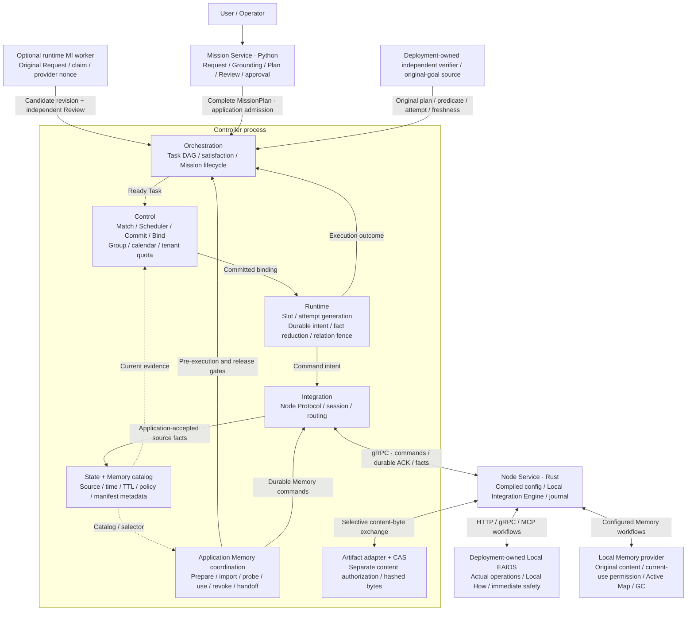
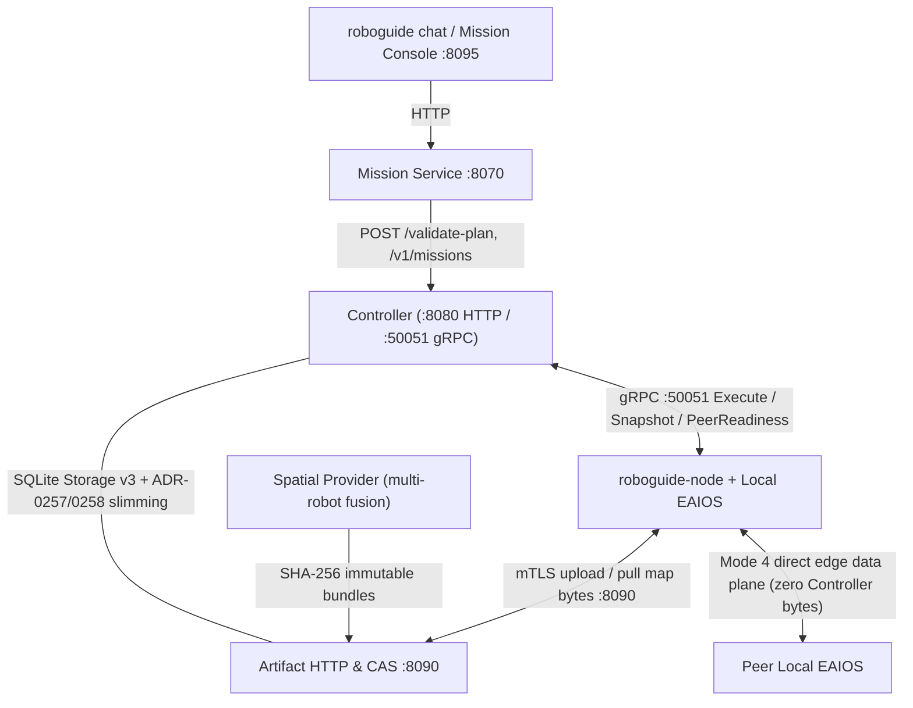

# Architecture tour

Keep three views separate: logical responsibilities, code modules and deployed processes.
The [V2 current architecture](docs/architecture/v2/index.md) integrates the reviewed mainline implementation;
the [handbook](docs/architecture/v2/architecture-handbook.md) provides a reading path.

## Purpose

RoboGuide coordinates Capability, Compute, Space and Time around a long-lived Mission. Global coordination handles objectives, resources and collaboration constraints; Local EAIOS retains Local How and final safety.

## Layers and authority

| Layer | Decision authority | Read more |
| --- | --- | --- |
| MI | Interpretation, clarification, planning, Review and approval | [Mission Intelligence](modules/mission.md) |
| Orchestration | Complete-plan acceptance, DAG, satisfaction and Mission completion | [Orchestration](modules/orchestration.md) |
| Control | Eligibility, resource commitment, binding, Groups and recovery decisions | [Control](modules/control.md) |
| Runtime | Current attempts, durable intents, fact reduction and relation fences | [Runtime](modules/runtime.md) |
| Integration / Node | Formal transport, Node journal and local workflows | [Nodes and protocol](modules/integration-node-service.md) |

State, Memory, identity and persistence span these responsibilities; they are not a final serial processing stage.

## Current code architecture

Reviewed against mainline code on 2026-10-22. Controller modules share application transactions;
State, Memory and verification support the execution chain horizontally.

<!-- architecture-overview:start -->

<!-- architecture-overview:end -->

The [complete Mermaid architecture atlas](docs/architecture/v2/current-architecture.en.md) contains
execution/durability, process/storage and Habitat/Eval views, plus a code evidence table and downloadable sources.
Zero Nodes is valid. A Node is not a Host; Replica metadata consensus, content recovery and physical continuity
remain separate. The old V2 PNG is a historical conceptual snapshot.

## Invariants

- Proposals create no reservations; Commit rechecks current evidence.
- Control manages Groups; Runtime carries execution context. Releasing a Task does not destroy its Group.
- Local Completed does not automatically mean TaskSatisfied. Unknown retains ambiguity and ownership.
- State preserves source, receive time and TTL without silently merging independent sources.
- Memory Scope, Visibility and Placement are independent. A CAS reference does not establish receiver import.
- Recovery preserves original facts, budgets and permission. Local EAIOS and independent evidence constrain device safety.

## Three-plane flows and four coupling modes

At runtime, RoboGuide separates the **Control Plane (HTTP :8080 / gRPC :50051)**, the **State and Spatial CAS Plane (:8090 / Storage v3)**, and the **Mode 4 Direct Peer Data Plane**. Five detailed protocol diagrams are documented in [System architecture and core dataflows](docs/architecture/v2/system-dataflows.md) (in Chinese with bilingual terminology).

| Coupling mode (ADR-0026 / ADR-0027) | Control-plane gating | Data plane and immediate safety |
| --- | --- | --- |
| `Independent` | Standard Task DAG, `Match -> Commit -> Bind` | Each Node runs independently |
| `SequentialHandoff` | Predecessor `TaskSatisfied` + Memory/Artifact release gates | Handoff via `:8090` CAS and explicit `import / use` |
| `ConcurrentCooperation` | `RequiresActive` / `SharedSpatialReference`, `GET /v1/missions/{id}/shared-view`, `relation_fences`, `/reconcile` | Shared state freshness classified by receive-time TTL; local safety stays in Local EAIOS |
| `TightlyCoupledCooperation` | Runtime manages only two-ended `PeerChannel` (`Planned -> Ready -> Fenced -> Closed`) | High-frequency control and disconnect braking run peer-to-peer at edge with zero bytes through Controller |

## Continue reading

[Concepts](concepts.md) explains identities; [Lifecycle](lifecycle.md) follows normal and failure paths; [State and Memory](state-memory.md) covers evidence and content; [Status](status.md) records implementation limits.
