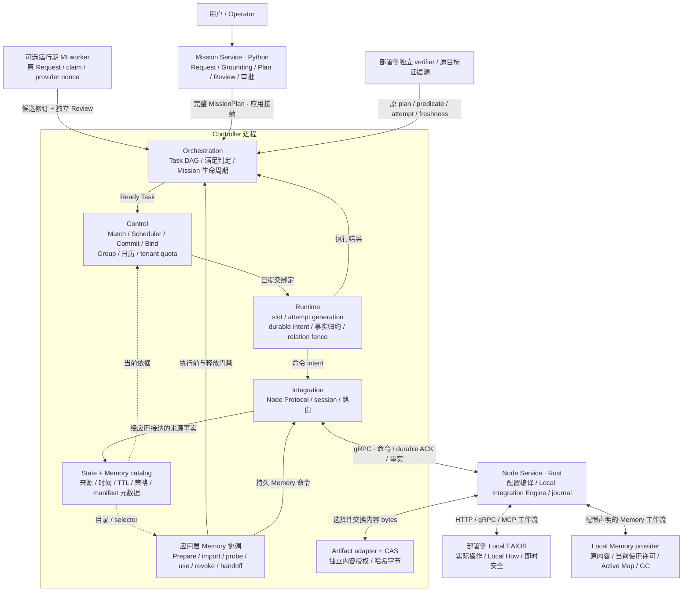

# 架构导览

先区分三种视图：逻辑架构解释谁负责，代码模块说明实现位置，部署拓扑说明哪些进程实际运行。完整说明见[V2 架构手册](docs/architecture/v2/architecture-handbook.md)。

## 系统定位

RoboGuide 联合协调 Capability、Compute、Space、Time，以 Mission 为长期目标组织异构系统。全局协调处理目标、资源和协作约束，Local EAIOS 保留 Local How 与最终安全。

## 分层与权威

| 层 | 决定什么 | 深入阅读 |
| --- | --- | --- |
| MI | 解释、澄清、规划、Review、审批 | [Mission Intelligence](modules/mission.md) |
| Orchestration | 接纳完整计划、DAG、satisfaction、Mission completion | [编排](modules/orchestration.md) |
| Control | eligibility、资源承诺、绑定、Group、恢复决定 | [Control](modules/control.md) |
| Runtime | 当前 attempt、durable intent、事实归约、relation fence | [Runtime](modules/runtime.md) |
| Integration / Node | 正式传输、节点 journal、本地工作流接入 | [节点与协议](modules/integration-node-service.md) |

State、Memory、身份和持久化横跨这些职责；它们不是一条串行流水线的最后一步。

## 当前代码架构

按 2026-10-22 主线代码核对。Controller 内部职责共用应用事务；State、Memory 与验证横向支撑执行。

<!-- architecture-overview:start -->

<!-- architecture-overview:end -->

[完整 Mermaid 架构图册](docs/architecture/v2/current-architecture.md)包含执行与持久化顺序、进程/存储部署、
Habitat/Eval 接入图、代码依据表和可下载源码。零 Node 有效；Node 不等于 Host。
Replica 元数据共识、内容恢复和物理连续性分别有自己的合同与证据。旧 V2 PNG 保留为历史概念快照。

## 不变量

- Proposal 不产生 reservation，Commit 必须重验当前依据。
- Group 由 Control 管理，运行上下文由 Runtime 承载；Task 释放不等于销毁 Group。
- 本地 Completed 不自动成为 TaskSatisfied；Unknown 保留歧义与 ownership。
- State 保留来源、receive time 与 TTL，不隐式覆盖独立来源。
- Memory Scope、Visibility、Placement 独立；CAS 引用不证明接收端已导入。
- 恢复保留原事实、预算与权限；设备安全仍由 Local EAIOS 及独立证据约束。

## 下一步

[核心概念](concepts.md)解释对象关系；[执行生命周期](lifecycle.md)串起正常与异常路径；[State 与 Memory](state-memory.md)说明数据和证据；[实现状态](status.md)列出实际边界。
