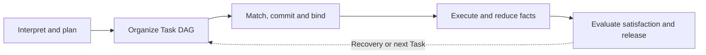

# Coordinate heterogeneous systems around a Mission

RoboGuide is a distributed operating-system framework for heterogeneous embodied agents. It turns objectives into plans, selects participants, commits resources and manages execution, evidence and recovery while preserving local autonomy and immediate safety.

[Understand the architecture](architecture-tour.md){ .md-button .md-button--primary }
[Run your first example](getting-started.md){ .md-button }

## From an objective to a verified result

**Mission Intelligence** produces plans; **Orchestration** advances Tasks and evaluates satisfaction; **Control** owns bindings and resource commitments; **Runtime** manages execution attempts. Node Service connects authorized operations to Local EAIOS. State and Memory supply attributed observations and content.

## Choose a reading path

| Your goal | Start here |
| --- | --- |
| Understand architecture and rationale | [Architecture tour](architecture-tour.md) → [Concepts](concepts.md) → [Execution lifecycle](lifecycle.md) |
| Run locally | [Getting started](getting-started.md) → [Development and integration](integration-guide.md) |
| Find code entrypoints | [Module map](modules/domain-ports.md) → [Implementation status](status.md) |
| Deploy and troubleshoot | [Operations](operations.md) → [Versions and references](reference.md) |
| Read decisions and evidence | [ADR topics](decisions.md) → [Original archives](archives.md) |

## Three distinctions that shape the system

**Proposal and commitment.** A Scheduler selection owns no resources. Control Commit creates the obligation.

**Completion, satisfaction and release.** Local Completed, evidence of the requested effect and releasing ownership have separate gates.

**Logical participants and execution identities.** Actor, Role and Task are plan objects. Deployment and Control bind Nodes and PhysicalEntities.

## What exists today

Software paths include complete-plan admission, DAG scheduling, execution attempts, source-aware State, Memory preparation/use, runtime revision, logical quota and recovery tools. [Implementation status](status.md) separates validation coverage from remaining work. Process/file checks do not establish device safety or overall completion.

[Reference](reference.md) contains contract versions and build provenance so historical snapshots remain identifiable.
