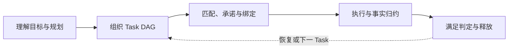

# 让异构系统协作完成一项 Mission

RoboGuide 是面向异构具身智能体的分布式操作系统框架。它把目标转成计划，选择参与者并承诺资源，持续管理执行、证据和恢复；每个节点保留本地自治与即时安全。

[理解系统架构](architecture-tour.md){ .md-button .md-button--primary }
[运行第一个示例](getting-started.md){ .md-button }

## 从目标到经过验证的结果

**Mission Intelligence** 形成计划；**Orchestration** 推进任务并判定满足；**Control** 决定绑定与资源承诺；**Runtime** 管理执行尝试。Node Service 把已授权操作接入 Local EAIOS，State 和 Memory 提供有来源的状态与内容。

## 按你的目标开始

| 你想做什么 | 阅读路径 |
| --- | --- |
| 理解架构与设计理由 | [架构导览](architecture-tour.md) → [概念与术语](concepts.md) → [完整执行链](lifecycle.md) |
| 在本地运行 | [快速开始](getting-started.md) → [开发与接入](integration-guide.md) |
| 找到代码入口 | [模块地图](modules/domain-ports.md) → [实现状态](status.md) |
| 部署和排查故障 | [部署与运维](operations.md) → [状态与版本](reference.md) |
| 查阅设计与证据 | [ADR 主题索引](decisions.md) → [原始文档档案](archives.md) |

## 三个必须区分的事实

**提案与承诺。** Scheduler 的选择不占有资源，只有 Control Commit 形成义务。

**执行完成、任务满足与释放。** 本地 Completed、符合目标的证据、释放 ownership 分别有门禁。

**逻辑参与者与执行实体。** Actor、Role 与 Task 是计划对象；Node 和 PhysicalEntity 由部署与 Control 绑定。

## 当前能做到哪里

当前已有完整计划接纳、DAG 调度、执行尝试、来源 State、Memory 准备与使用、运行期修订、逻辑 quota 和恢复工具等软件路径。每项验证范围与剩余工作见[实现状态](status.md)；软件进程和文件验收不构成设备安全或总体完成证据。

版本与构建来源集中在[参考页](reference.md)，避免把历史快照当成当前能力。
