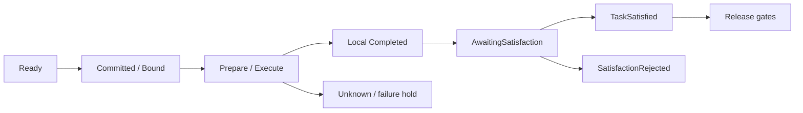

# Execution lifecycle: plan to release

Use “produce a file, then independently verify it” as a conceptual example. [Getting started](getting-started.md) identifies actual test configurations; this narrative is not deployment evidence.

## Normal path

1. **Interpret and plan**: MI freezes grounding, plans and Reviews; policy determines approval.
2. **Accept**: Read-only preflight creates no resources. Formal acceptance creates the Group, all TaskExecutions and initial Ready set.
3. **Schedule**: `Match → Schedule → Propose → Commit → Bind`, with current State, tenant, resource and quota checks.
4. **Prepare**: Explicit Memory inputs require original context, Prepare, import/query, availability/use and the Group pending barrier.
5. **Dispatch**: Persist the durable intent before outbox send. The Node journals admission before execution.
6. **Reduce**: ACK follows durable application acceptance. Runtime reduces the exact attempt.
7. **Satisfy**: Use the accepted execution-report or independent-verifier basis; a final negative verdict enters SatisfactionRejected.
8. **Release**: Control releases ownership only after applicable revoke/stop gates. Advance the DAG and complete the Mission after all closing conditions.

This reading diagram relates states; it does not merge Runtime, Task and Mission enums into one state machine.

## Failure and recovery

Unknown retains ambiguity about effects and preserves ownership. Application persists original stop/revoke intents, receives original receipts/terminals and independent evidence, then Control authorizes recovery. New bindings still require Match, Proposal, Commit and Rebind.

Cancel receipt, Cancelled, actual software-process exit and device safe-state are separate facts. Timeout and restart cannot turn uncertainty into success or renew budgets.

## Runtime plan revision

An explicit revision freezes the original Mission goal/source, complete stop/revoke, MI work claim/nonce and independent Review. Candidates pass original-goal and policy gates, create a new Group and use normal scheduling. Completed facts and attempt history survive; the source Execute outbox remains permanently fenced.

The software file composition covers nonempty scoped v0.9 Memory. See [status](status.md) for complex topologies and other content types.

## Troubleshooting order

Inspect the accepted plan and original command ID, exact attempt/session, receipts, State receive time/TTL, verifier, Memory context/provider, then application transaction/persistence errors. A log line containing `completed` is insufficient to establish Mission success.
