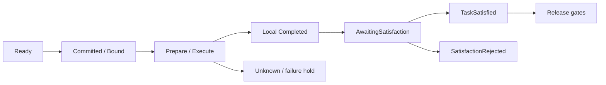

# 从计划到释放：执行生命周期

以“生成文件 → 独立验证文件”为概念示例。可运行的测试配置见[快速开始](getting-started.md)，不把示意任务当成真实部署结果。

## 正常路径

1. **解释与计划**：MI 冻结 grounding，规划并 Review；风险审批按 policy 决定。
2. **接纳**：只读 preflight 不创建资源；正式接纳创建 Group、全部 TaskExecution 和初始 Ready 集合。
3. **调度**：`Match → Schedule → Propose → Commit → Bind`，当前 State、tenant、资源、quota 在权威边界重验。
4. **准备**：显式 Memory 输入需原 context、Prepare、import/query、availability/use，满足 Group pending barrier。
5. **派发**：应用事务提交 durable intent 后 outbox 发送；Node journal 先接纳再执行。
6. **归约**：回执和事实经应用持久接受后 ACK，Runtime 归约 exact attempt。
7. **满足**：按 accepted basis 使用 execution-report 或独立 verifier；final negative 进入 SatisfactionRejected。
8. **释放**：适用的 revoke 与停止门禁通过后由 Control 释放，推进 DAG；所有收尾条件成立才结束 Mission。

这是阅读用的状态关系示意，不是把 Runtime、Task 和 Mission 的 enum 合成一个状态机。

## 故障与恢复

Unknown 保留“是否已发生副作用”的歧义与 ownership。应用记录原 stop/revoke 意图、接收原 receipt/terminal 和独立证据，再由 Control 明确恢复；新绑定仍需 Match、Proposal、Commit、Rebind。

取消回执、Cancelled、软件进程实际退出、设备 safe-state 各自独立。超时和重启不能把待确认状态改成成功，也不能更新原预算。

## 运行期计划修订

原任务不可继续时，显式修订路径冻结原 Mission goal、source、stop/revoke、MI work claim/nonce 和独立 Review。新计划通过原目标与政策门禁，创建新 Group 并正常调度。旧 Group 的完成事实和 attempt 历史保留，原 Execute outbox 永久 fence。

软件文件组合已覆盖非空 scoped Memory v0.9；复杂拓扑与其他内容类型见[实现状态](status.md)。

## 排查顺序

先看 accepted plan 与原 command ID，再查 exact attempt/session、原 receipt、State 的 receive time/TTL、verifier 和 Memory context/provider，最后看应用事务/持久化错误。不要仅凭日志中的 `completed` 判断 Mission 成功。
