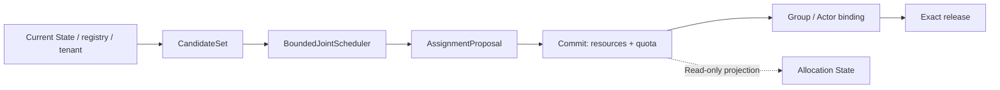

# Control Plane

The sole resource commitment, binding, Group and recovery decision authority, consuming current State, identity, tenant and policy.

## Responsibilities and key objects

CandidateSet, BoundedJointScheduler, AssignmentProposal, CommittedPlan, ActorBinding and QuotaLedger.

## Main flow

Match filters eligibility → bounded Scheduler selection → Proposal validation → atomic Commit/quota → Bind. Release follows exact Task/Context/Group/recovery scope.

## Code entrypoints

- [Primary entry](https://github.com/Farewell-CK/RoboGuide/blob/main/core/control/src/lib.rs): `core/control/src/lib.rs`.
- [Collaborating entry](https://github.com/Farewell-CK/RoboGuide/blob/main/core/control/src/coordination.rs): `core/control/src/coordination.rs`.

## Implementation status

[Status](../status.md) records actual paths and remaining work; [Reference](../reference.md) generates versions. A module's existence does not establish full stage or device acceptance.

## Validation and diagnosis

Inspect original identity/plan/attempt, current policy and deadlines before upstream/downstream transactions and receipts. Rejection, timeout, replay and restart preserve original evidence. Explicit software configurations, FakeNodes and protocol fixtures are not devices.

## Related boundaries

[Architecture and authority](../architecture-tour.md) · [Concepts](../concepts.md) · [Lifecycle](../lifecycle.md) · [Integration](../integration-guide.md) · [State and Memory](../state-memory.md)

## Detailed flow reference

### Proposal, commitment and release

Commit writes resource reservations, original Role-demand quota and evidence only after all checks. Over-limit rejection leaves no partial claim. The usage view includes configured and unlimited categories; absent limits/remaining are null.

Due future intervals recheck Match/Commit/Bind. Overrun retains open occupancy rather than preempting Local How. Only exact-generation, strictly future, unactivated/unbound/uncommitted intervals support the current preemption path; running preemption remains separate.

Recovery proposals own no resources. Original Group/Role pending recovery Commit is consumed by Rebind or explicitly released by Abort. Ordinary Actor recovery cannot authorize cross-entity takeover.

### Costs from current sources

Explicit decision-policy registry v0.2 connects original tenant, Node session, State source, schema, TTL and metric units to normal and recovery scheduling. Unknown, stale, conflicting or absent required metrics have no numeric cost; available GPU capacity follows the explicit preference. Original observations and policy enter durable audit. `/v1/missions/{id}/scheduling-costs` is a read-only Mission-authorized view. The local reference provider measures actual host load and leaves other metrics null. Costs order candidate exploration without granting resources or bypassing eligibility.
