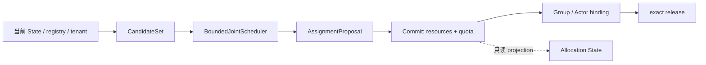

# Control Plane

唯一资源承诺、binding、Group 与恢复决定权威；消费当前 State、身份、tenant 和 policy。

## 职责与关键对象

CandidateSet、BoundedJointScheduler、AssignmentProposal、CommittedPlan、ActorBinding、QuotaLedger。

## 主流程

Match 过滤 eligibility → Scheduler 有界选择 → Proposal 校验 → Commit 原子承诺与 quota → Bind。Task/Context/Group/recovery 按 exact scope release。

## 代码入口

- [主入口](https://github.com/Farewell-CK/RoboGuide/blob/main/core/control/src/lib.rs)：`core/control/src/lib.rs`。
- [协作入口](https://github.com/Farewell-CK/RoboGuide/blob/main/core/control/src/coordination.rs)：`core/control/src/coordination.rs`。

## 实现状态

当前实际调用链与剩余工作统一记录在[实现状态](../status.md)，版本由[参考页](../reference.md)生成。本模块的存在不代表完整阶段或设备验收完成。

## 验证与排查

先检查原 identity/plan/attempt、当前 policy 与期限，再查上下游事务和 receipt。拒绝、超时、重放与重启必须保留原证据。测试使用显式软件配置，不把 FakeNode 或协议 fixture 当作设备。

## 相关边界

[架构与权威](../architecture-tour.md) · [概念](../concepts.md) · [生命周期](../lifecycle.md) · [接入指南](../integration-guide.md) · [State 与 Memory](../state-memory.md)

## 调用链详解

### 提案、承诺与释放

Commit 在全部检查通过后才同时写 resource reservation、原 Role demand quota 和 evidence；超限拒绝不能留下部分 claim。usage view 同时报告已设限与未设限类别，缺限额或 remaining 为 null。

未来 interval 是日历权威，到期仍重验 Match/Commit/Bind。运行超出预计结束时保留开放占用，不抢占 Local How。只支持精确代次的严格未来、尚未激活/绑定/承诺区间抢占；运行中抢占另有缺口。

恢复 proposal 不占资源；pending recovery Commit 由原 Group/Role 保有，Rebind 消费或显式 Abort 释放。普通 Actor recovery 不获得跨实体 takeover 权限。
