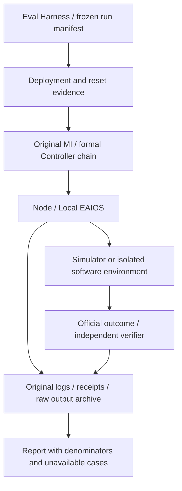

# Eval Harness and deployment integrations

Organizes experiments, frozen inputs and result archives outside the execution core. Habitat/Coherent/Memory/Spatial integrations implement local backends without creating global authority.

## Responsibilities and key objects

Run manifests, frozen code/model identity, original requests/Node evidence, official metrics and unavailable classifications.

## Main flow

Freeze admitted configuration → reset/deployment evidence → formal MI/Controller chain → archive original facts → reduce official metrics separately from diagnostics. New runs use fresh directories.

## Code entrypoints

- [Primary entry](https://github.com/Farewell-CK/RoboGuide/tree/main/evaluation/src/roboguide_eval): `evaluation/src/roboguide_eval`.
- [Collaborating entry](https://github.com/Farewell-CK/RoboGuide/blob/main/integrations/habitat-local-eaios/README.md): `integrations/habitat-local-eaios/README.md`.

## Implementation status

[Status](../status.md) records actual paths and remaining work; [Reference](../reference.md) generates versions. A module's existence does not establish full stage or device acceptance.

## Validation and diagnosis

Inspect original identity/plan/attempt, current policy and deadlines before upstream/downstream transactions and receipts. Rejection, timeout, replay and restart preserve original evidence. Explicit software configurations, FakeNodes and protocol fixtures are not devices.

## Related boundaries

[Architecture and authority](../architecture-tour.md) · [Concepts](../concepts.md) · [Lifecycle](../lifecycle.md) · [Integration](../integration-guide.md) · [State and Memory](../state-memory.md)

## Detailed flow reference

### Experiment boundaries

E1 Habitat official PDDL metrics, local completion, Task satisfaction and diagnostic counterfactuals remain separate. Differences in inputs, Local How, model or initialization prevent attribution of overall score changes to a single architecture mechanism.

Offline prepare, protocol fixtures and process/file conformance are not formal live-model experiments. Existing E6 or historical directories do not mean a new experiment has started.

The early console observes existing APIs. Demo/replay data are not real events, and the UI gains no Controller, State or Memory authority.
