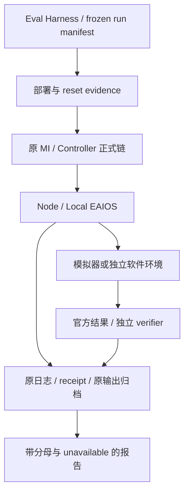

# Eval Harness 与部署集成

在核心执行系统外编排实验、冻结输入、归档过程与结果。Habitat/Coherent/Memory/Spatial 等 integration 提供本地后端，不创造全局权威。

## 职责与关键对象

运行 manifest、代码/模型身份、原请求与 Node evidence、官方 metric、unavailable 分类。

## 主流程

准入冻结配置 → reset/部署 evidence → MI/Controller 正式链 → 归档原事实 → 官方 metric 与诊断分别归约。新运行使用新目录，不覆盖旧证据。

## 代码入口

- [主入口](https://github.com/Farewell-CK/RoboGuide/tree/main/evaluation/src/roboguide_eval)：`evaluation/src/roboguide_eval`。
- [协作入口](https://github.com/Farewell-CK/RoboGuide/blob/main/integrations/habitat-local-eaios/README.md)：`integrations/habitat-local-eaios/README.md`。

## 实现状态

当前实际调用链与剩余工作统一记录在[实现状态](../status.md)，版本由[参考页](../reference.md)生成。本模块的存在不代表完整阶段或设备验收完成。

## 验证与排查

先检查原 identity/plan/attempt、当前 policy 与期限，再查上下游事务和 receipt。拒绝、超时、重放与重启必须保留原证据。测试使用显式软件配置，不把 FakeNode 或协议 fixture 当作设备。

## 相关边界

[架构与权威](../architecture-tour.md) · [概念](../concepts.md) · [生命周期](../lifecycle.md) · [接入指南](../integration-guide.md) · [State 与 Memory](../state-memory.md)

## 调用链详解

### 实验边界

E1 的 Habitat 官方 PDDL metric、内部 local completion、Task satisfaction 和诊断反事实分别归档。系统间输入、Local How、模型和初始化不同时，不把总体成绩差异归因到某一个架构机制。

离线 prepare、协议 fixture 和 process/file conformance 不是正式模型实验。E6 或历史实验目录的存在不说明已经开始新实验。

console 是早期观察界面，原始 demo/replay 不构成真实事件；它只消费现有 API，不成为新的 Controller、State 或 Memory 权威。
